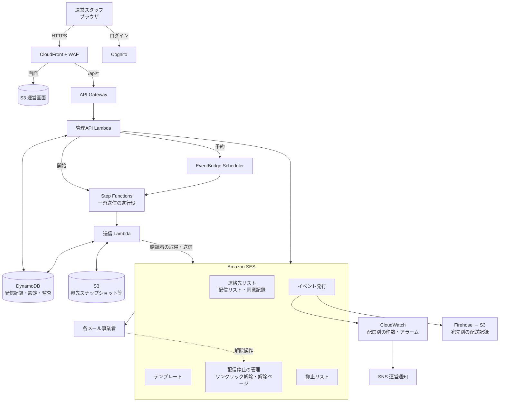
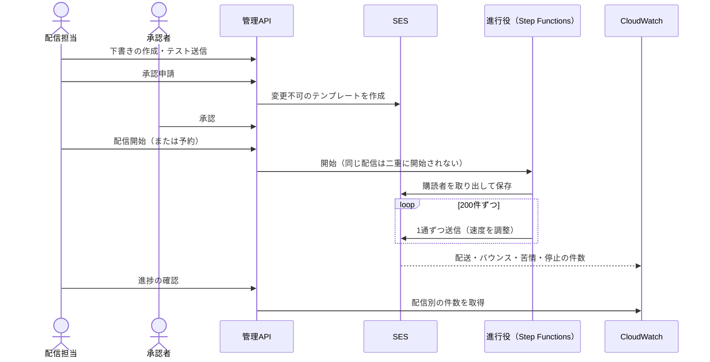

# HT2 ファンクラブメール配信システム 基本設計書

| 項目 | 内容 |
|---|---|
| 文書ID | HT2-BD-001 |
| 版 | 2.2 |
| 改訂日 | 2026-11-03 |
| 文書状態 | 実装前レビュー版。未決定事項を含み、本番利用承認を意味しない |
| 関連文書 | [詳細設計書](詳細設計書.md) |

| 版 | 内容 |
|---|---|
| 1.0 / 1.1 | Gmail宛て限定・マルチテナントSaaSとしての初版と技術制約の明文化 |
| 2.0 | SES中心の構成へ全面改訂（宛先ドメインの制限撤廃、1 AWSアカウント＝1配信組織） |
| 2.1 | 構成を整理。経緯を本文から外し、詳細設計書の付録に集約。宛先別の配送記録を標準機能にした。バックアップを日次に、配信リストの管理をCloudFormationに統一。到達性の要件（受信事業者ごとの要件、差出人ドメインのDNS、送信量の段階的な増加、開始前の検査、本番開始の条件）を8章に追加 |
| 2.2 | 認証・解除・送信前検査・拒否理由・監視・試験条件を具体化し、事業者の要件とプロジェクトの運用値を区別 |

## 1. 概要

### 1.1 目的

ファンクラブ等の会員組織（以下「配信組織」）が、自ら管理する送信元ドメインから、配信に同意した会員へ会報・お知らせを一斉配信できるシステム「HT2」を作る。

運営スタッフは**1つの配信画面**で配信リスト・件名・本文を設定し、テスト送信・承認・配信開始・進捗の確認まで行える。

### 1.2 対象範囲

| 含む | 含まない（将来または対象外） |
|---|---|
| 運営スタッフのログインと役割 | 会員自身による登録フォーム（将来） |
| 会員アドレスの登録・CSV取込・配信停止・削除 | HTMLメール、差し込み、添付（将来） |
| 配信の作成・プレビュー・テスト送信・承認 | 開封・クリック計測 |
| 即時配信・予約配信・一時停止・再開・中止 | 複数の配信組織を1つの環境に同居させること |
| 配信結果と宛先別の配送記録 | Amazonアカウント等の外部IDでのログイン |
| 評判の監視と自動停止、連絡先のバックアップ | 配送成功の保証 |

宛先のメール事業者は限定しない（Gmail、Yahoo!メール、Outlook.com、携帯キャリアメール、プロバイダメール等）。

### 1.3 基本方針

1. **メールに関わる機能はAmazon SESで完結させる。** 宛先の保管、配信リスト、同意の記録、配信停止、バウンス・苦情の抑止、本文テンプレート、送信、結果の集計はSESの機能を使う。
2. **自作はSESにない機能だけにする。** 一斉送信の進行役と、承認を含む運営画面だけを作る。
3. **1 AWSアカウント＝1配信組織とする。** 複数のファンクラブは、同じ構成をアカウントごとに展開する。
4. **二重送信を避けることを優先する。** 送信結果が分からない宛先は自動で再送せず、運営者が判断する。
5. **AWSのサービスと自作コード以外に依存しない。**

## 2. 前提と制約

### 2.1 システム境界

| 分類 | 条件 |
|---|---|
| 提供形態 | 1つのAWSアカウントに1つの配信組織。複数組織は AWS Organizations と CloudFormation StackSets で同じ構成を展開 |
| 利用者 | 配信組織の運営スタッフ。アカウントはAWSの管理者がCognitoで作成する |
| 送信元 | 配信組織が管理する独自ドメイン1つ。配下に複数のFromアドレスを置ける |
| 宛先 | ドメインの制限なし。SESの連絡先リストに登録され、配信リストを購読している会員 |
| 配信リスト | 最大20（SESのトピック） |
| 配信内容 | UTF-8のテキストメール |
| 規模 | 宛先10万件まで |
| リージョン | 東京（`ap-northeast-1`）。CloudFront用の証明書とWAFだけ `us-east-1` |

> SESが送信を受け付けたことと、受信側サーバーへの配送成功は別のものとして扱う。受信トレイへの到達は保証も検知もできない。

### 2.2 技術制約

| ID | 制約 |
|---|---|
| TC-01 | インフラはCloudFormationとAWS CLIで定義・展開する。CDK・Terraform等は使わない |
| TC-02 | サーバー処理はLambda（Node.js 24）。Node.js標準モジュールとLambda同梱のAWS SDKだけを使い、外部パッケージを入れない |
| TC-03 | 運営画面は素のHTML・CSS・JavaScript。フレームワーク・ビルドツール・外部スクリプトを使わない。ログイン処理（PKCE）も自作する |
| TC-04 | 自作する部品：ルーター、入力検証、CSVの読み書き、ID生成、DynamoDBの値変換、ログとメトリクスの出力 |
| TC-05 | テストはNode.js標準のテストランナー |
| TC-06 | 秘密情報はSecrets ManagerとSSM、監視はCloudWatchとSNSを使う |

### 2.3 SESの制約と設計への影響

| SESの制約 | 設計への影響 |
|---|---|
| 連絡先リストは1アカウントに1つ | 1アカウント1配信組織とする |
| トピック（配信リスト）は1リストに20まで | 配信リストは20まで |
| リスト全員へ一斉送信する機能がない | 購読者を取り出して1通ずつ送る進行役を自作する |
| 一括送信APIは配信停止の管理に対応しない | 1通ずつ送る。速度はSESの送信上限の範囲で調整する |
| 送信以外のAPIは毎秒1件まで | 宛先の一覧や取込前の照合に時間がかかる。呼び出しを間引き、制限時は待って再試行する |
| CSV取込は既存の購読状態を上書きする | 取込は新規の宛先だけにする。既存の宛先は画面から1件ずつ変更する |
| 配信停止の管理を付けて未登録の宛先へ送ると、自動で連絡先が作られる | 送信先は必ず連絡先リストから取り出す。テスト送信先も登録済みに限る |
| Gmailは苦情をSESに通知しない | Google Postmaster Toolsで迷惑メール率を監視し、購読設定変更の急増を通知する |

## 3. システム構成

### 3.1 構成図



### 3.2 SESと自作の分担

| 機能 | 担当 | 使う機能 |
|---|---|---|
| 送信元ドメインの認証 | SES | ドメイン認証、Easy DKIM、カスタムMAIL FROM |
| 会員アドレスの保管・配信リスト・同意の記録 | SES | 連絡先リスト、トピック、連絡先の属性データ |
| CSV一括登録 | SES＋自作 | SESのインポートジョブ。自作は形式チェックと変換 |
| 配信停止 | SES | ワンクリック解除のヘッダー、解除ページ、停止済みの宛先への送信の自動停止 |
| バウンス・苦情の抑止 | SES | アカウント抑止リスト |
| 本文 | SES | テンプレート（承認時に変更不可の版を作る） |
| 送信 | SES | 1通ずつの送信（配信停止の管理付き） |
| 配信別の件数 | SES＋CloudWatch | イベント発行 → 配信IDごとのメトリクス |
| 宛先別の配送記録 | SES＋Firehose | イベント発行 → S3（Athenaで検索） |
| 受信側への配送（SMTP接続、送信IP・PTR・EHLO、一時拒否の再試行） | SES | 共有IP。相手の一時的な拒否はSESが再試行する。アプリは同じメールを送り直さない |
| 一斉送信の進行 | 自作 | Step Functions＋送信Lambda |
| 送信量の管理（速度・1日の上限・開始前の検査） | 自作 | 8.4節、8.6節 |
| DNS認証の維持、同意の取得、受信事業者の状況確認 | 配信組織 | 8章の運用作業 |
| 予約配信 | AWS | EventBridge Scheduler |
| 運営画面・承認・監査 | 自作 | CloudFront、S3、Cognito、API Gateway、Lambda、DynamoDB |
| 運営スタッフのアカウント | AWS | Cognitoのコンソール |

## 4. 利用者と役割

| 役割 | できること |
|---|---|
| 管理者 | 組織設定（差出人、法定表示、承認の要否、送信速度、テスト送信先）、停止した会員の購読再開、完全削除、システムが止めた配信の再開、監査ログの閲覧、その他すべて |
| 配信担当 | 宛先の登録・取込・配信停止、配信の作成・テスト送信・申請・開始・予約・停止 |
| 承認者 | 配信の承認・差戻し・停止 |
| 閲覧者 | 配信履歴と結果の閲覧（宛先アドレスは一部を伏せて表示） |

- アカウントの作成・役割の変更・無効化は、AWSの管理者がCognitoのコンソールで行う。運営画面に利用者管理の機能は持たない。
- 全員に認証アプリによる二要素認証を必須とする。
- 承認は既定で必須とし、申請者と承認者は別人に限る。スタッフが1人の組織は、管理者が承認を不要に設定できる（監査ログに残る）。
- 役割はAPIが毎回Cognitoに確認する。無効化した利用者は最長60秒で操作できなくなる。

## 5. 機能

### 5.1 機能一覧

| ID | 機能 | 主要な受入条件 |
|---|---|---|
| F-01 | ログインと役割 | 二要素認証が必須。無効化した利用者は60秒以内に操作できない |
| F-02 | 組織設定 | 法定表示が未設定なら配信を申請できない |
| F-03 | 送信元 | SESで認証済みのドメイン配下のアドレスだけを差出人にできる |
| F-04 | 宛先の登録・CSV取込 | 同意の日時と取得経路が必須。配信停止した会員を取込で復活させない |
| F-05 | 配信停止 | ワンクリック解除と解除ページが動き、停止後は送られない |
| F-06 | 作成・プレビュー・テスト送信 | 1画面で行える。テスト送信は登録済みのテスト送信先だけ |
| F-07 | 承認と内容の固定 | 承認後は件名・本文・フッターを変えられない |
| F-08 | 一斉送信と速度の制御 | SESの上限を超えない。同時に送る配信は1つ |
| F-09 | 一時停止・再開・中止 | 操作から数秒で未送信分が止まる |
| F-10 | 予約配信 | 指定日時に始まり、予約を取り消せる |
| F-11 | 結果の表示 | 送信受付と配送を区別する。失敗・結果不明を一覧できる |
| F-12 | 結果不明の扱い | 自動で再送しない。運営者が判断する |
| F-13 | 宛先別の配送記録 | 任意の宛先の配送・バウンス・停止の記録を検索できる |
| F-14 | 評判による自動停止 | バウンス率・苦情率のアラームで送信中の配信が止まる |
| F-15 | 監査 | 設定・宛先・承認・開始・停止の操作者と時刻が残る |
| F-16 | バックアップ | 連絡先を毎日S3に保存し、復元できる |
| F-17 | 到達性の開始前検査と1日の上限 | 即時開始・予約起動・再開時に認証・送信枠・抑止・監視・受信確認の記録を検査する。組織の日次上限で待機した配信は翌日以降に再検査して続ける |
| F-18 | 段階的な増量と復旧 | 初回・休止明け・増量時は承認した上限で始め、拒否・遅延の原因を解消してから増量・再開する |

### 5.2 初期設定の流れ

1. 配信組織用のAWSアカウントを用意し、CloudFormationで本システムを展開する。配信リストもこのとき定義する。
2. 送信元ドメインのDNSに、SESが示す認証レコード（DKIM、MAIL FROM、DMARC）を登録する。
3. SESの本番利用を申請する（配信目的、同意の取得方法、配信停止の方法を記載）。
4. Cognitoで運営スタッフのアカウントを作り、役割を割り当てる。
5. 運営画面で組織設定を登録し、主要なメール事業者のテスト用アドレスで受信を確認する。
6. 会員アドレスをCSVで取り込む。

### 5.3 配信の流れ



- 宛先は送信を始めた時点の購読者とする。承認後に配信停止した会員には送らない。
- 一時停止・中止は未送信分に対する操作で、SESが受け付けた分は取り消せない。

### 5.4 配信停止・バウンス・苦情

- 会員はメール画面の「登録解除」（ワンクリック）か、本文の配信停止URLから手続きする。SESが連絡先リストを更新し、以後の送信を止める。解除ページでは配信リストごとの停止と全停止を選べる。
- ハードバウンスと苦情の宛先は、SESの抑止リストに自動で登録され、以後送られない。
- バウンス率・苦情率がしきい値を超えると、送信中の配信を自動で一時停止し、運営者に通知する。

## 6. 画面

### 6.1 配信画面（1ページ）

```text
┌──────────────────────────── HT2 ────────────────────────────┐
│ ○○ファンクラブ／ログイン中: 山田    [宛先] [配信履歴] [設定]       │
├───────────────────────────────────────────────────────────────────┤
│ 差出人      ○○ファンクラブ <info@fc.example.jp>   返信先 support@… │
│ 配信リスト  [会報 ▼]          購読者 約1,234件（前日時点）         │
│ 件名        [____________________________________________]       │
│ 本文        [                                            ]       │
│             [             テキスト本文                 ]       │
│ フッター    （自動）発行者・所在地・問合せ先・配信停止URL          │
│ 配信日時    (●) 承認後すぐ  ( ) 予約 [2026-12-01 19:00]           │
│ [プレビュー] [テスト送信] [下書き保存] [承認申請 / 配信開始]       │
├───────────────────────────────────────────────────────────────────┤
│ 配信状況    送信済○／失敗○／不明○ ・ 配送○／バウンス○／苦情○／停止○ │
│             [一時停止] [再開] [中止]                              │
└───────────────────────────────────────────────────────────────────┘
```

### 6.2 その他の画面

| 画面 | 主要な要素 |
|---|---|
| 宛先 | 配信リストごとの一覧、アドレスでの検索、個別登録、配信停止、CSV取込と結果、抑止状態の表示 |
| 配信履歴 | 配信ごとの状態・件数・結果、失敗と結果不明の一覧 |
| 設定 | 差出人・返信先、法定表示、承認の要否、送信速度の上限、テスト送信先 |

### 6.3 運営画面で扱わない作業

| 作業 | 行う場所 |
|---|---|
| 配信リストの追加・名称変更 | CloudFormationのパラメータ（変更前にレビュー） |
| 運営スタッフのアカウント管理 | Cognitoのコンソール |
| 抑止リストからの削除 | SESのコンソール（理由を運営記録に残す） |
| 宛先別の配送記録の検索 | Athenaのコンソール |
| 送信元ドメインの認証、本番利用の申請 | SESのコンソール |

## 7. 非機能要件

以下は提案値であり、SESの本番利用後の実際の上限と試験結果で確定する。

| 区分 | 要件 |
|---|---|
| 性能 | 1配信あたり最大10万件。既定の送信速度は毎秒10通（SES上限の80%以下）で、1万件を約17分で送る |
| 同時実行 | 送信中の配信は1つ。後から始めた配信は待ってから開始する |
| 停止の反映 | 一時停止・中止から5秒以内に送信が止まる（目安） |
| 可用性 | 運営画面は月99.5%（案）。配送成功率は保証しない |
| 復旧 | 連絡先は毎日のバックアップと配送記録から復元する。配信記録はDynamoDBの時点復元（PITR）で戻す |
| セキュリティ | HTTPS、最小権限、二要素認証、監査ログ。宛先アドレスはアプリのデータベースに保存しない |
| 個人情報 | ログに宛先アドレスを出さない。宛先アドレスを含むファイルは暗号化し、期限で削除する |
| 監視 | SESの評判、配信の失敗・結果不明・要確認、処理の失敗を通知する |
| データ保持 | 配信記録1年、宛先スナップショット30日、取込ファイル1年（同意の証跡）、宛先別の配送記録180日、監査ログ1年（案） |

### 7.1 概算費用（月1万通程度、参考）

| 項目 | 月額の目安（USD） |
|---|---:|
| SES（0.10／1,000通） | 約1 |
| CloudWatch（配信別メトリクス・アラーム） | 1〜3 |
| Firehose・S3・Athena（配送記録） | 1未満 |
| Step Functions・Lambda・API Gateway・DynamoDB・CloudFront | 1〜2 |
| Cognito | 0〜数ドル（利用ティアによる） |
| AWS WAF | 約8〜12（使わない場合は0） |

## 8. 到達性とコンプライアンス

### 8.1 基本原則

認証不備や同意・解除の漏れなど、送信側で防げる拒否原因を減らす。受信事業者の独自判定、受信者の設定、転送先での改変まで制御できないため、拒否されないことや受信トレイ到達は保証しない。

初期構成はSES共有IPを使う。SMTP接続、IPの正逆引き・EHLO、宛先MX選択とSMTP再試行はSESの責任範囲とし、LambdaやCloudFrontにメール用PTRを設定しない。専用IPは継続的な送信量と費用から別途判断する。独自MTAや転送用のSRS・ARCは追加しない。[SESの共有・専用IP](https://docs.aws.amazon.com/ses/latest/dg/dedicated-ip.html)

- 送信件数がどれだけ少なくても、大量送信者向けの要件（認証、購読メールのワンクリック解除、低い苦情率）をすべての配信に適用する。
- 「SESが受け付けた」「受信側サーバーが受け取った」「受信トレイに届いた」は別のものとして扱う。最後の1つは検知できない。
- 受信側での拒否を避けるために、送信元のIPやドメインを替える、抑止を自動で解除する、といった回避策は取らない。

### 8.2 受信事業者の要件

| 事業者 | 主な要件（公開資料による） | 本設計での対応 |
|---|---|---|
| Gmail | 1日約5,000通以上の送信者は、SPFとDKIMの両方、DMARC、差出人との整合、購読・販促メールのワンクリック解除（RFC 8058）、本文の解除リンク、2日以内の解除反映。迷惑メール率は0.3%未満が必須で、0.1%未満が目標 | すべて満たす。迷惑メール率はPostmaster Toolsで確認する |
| Yahoo（米Yahoo Inc.・AOL） | 大量送信者はSPFとDKIMの両方、DMARC、差出人との整合、解除ヘッダーと本文のリンク、2日以内の解除反映。迷惑メール率0.3%未満 | すべて満たす |
| Yahoo!メール（日本） | SPF・DKIM・DMARCで認証する。米Yahoo Inc.の基準をそのまま当てはめない | 認証を満たす |
| Outlook.com（個人向け） | 同じ差出人ドメインから5,000通以上となる大量送信者は、SPFとDKIMの両方の合格、DMARC、差出人との整合。満たさないと拒否される | すべて満たす |
| iCloud | 明示的な購読、すぐ効く解除、SPF・DKIM・DMARC。苦情の通知の仕組みはない | すべて満たす。苦情0件を「苦情なし」とみなさない |
| docomo | DMARCの成功（失敗すると警告表示）、DKIMの併用、**差出人（Header From）のドメインにもSPF**、差出人ドメインのA・MXを推奨（双方ない場合は不達のおそれ）、毎正時の集中送信を避ける、宛先不明の多い名簿を使わない | 差出人ドメインにもSPFを置く（8.3節）。送信順を混ぜ、予約は00分を避けるよう促す |
| au・SoftBank | 地域・ドメインが偏らない送信、送信の時間分散、古い宛先の整理、宛先不明の多い送信の回避 | 送信順を混ぜる。ハードバウンス・通知された苦情をSESが抑止する |

適用範囲と出典は次のとおり。Gmailは個人の `gmail.com` / `googlemail.com` 宛てが対象で、24時間に約5,000通を同一primary domain配下で合算し、一度大量送信者と判定されると継続する。Google Workspace全体に同じ条件が適用されるとはしない。DMARCは最低 `p=none` と、FromとSPFまたはDKIMの少なくとも一方の整合が必要。迷惑メール率0.1%未満は推奨目標、0.3%未満は最低線として区別する。[Googleガイドライン](https://support.google.com/mail/answer/81126?hl=en)、[FAQ](https://support.google.com/mail/answer/14229414?hl=en)

Yahoo Incは大量送信者の具体的通数を公開していない。Outlook.comは同一Fromドメインの5,000通以上を対象とするが、現行サポート本文だけでは厳密な時間窓を確定できないため、HT2は数量によらず適合させる。Microsoft 365全法人環境や、Microsoft固有のRFC 8058義務・苦情率の数値へ一般化しない。[Yahoo要件](https://senders.yahooinc.com/best-practices/)、[Yahoo FAQ](https://senders.yahooinc.com/faqs/)、[Microsoft](https://support.microsoft.com/en-gb/outlook/fix-ndr-error-550-5-7-515-in-outlook-com)

docomoのFrom側SPFは事業者固有の互換対策であり、標準SPFの評価対象はMAIL FROMである。A/MXは双方の設定が推奨され、双方ない場合の不達に注意する。Yahoo! JAPANは公式案内でDMARCレポート送信に未対応としており、Yahoo Incの数値を転用しない。[docomo](https://www.docomo.ne.jp/service/docomo_mail/smtp_notice/)、[Yahoo! JAPAN](https://mail.yahoo.co.jp/antispam/dmarc.html)

事業者の要件は変わることがあるため、本番開始前、拒否増加時と年1回、参考資料で確かめ直す。Yahoo Incの本文は今回の直接取得が429だったため、公式検索インデックスで確認した内容を本番前に再確認する。

### 8.3 送信元ドメインの認証（DNS）

- **DKIM**：SESのEasy DKIM（2048bit）。DNSに登録する値は、SESが示した名前と値をそのまま使う。
- **SPF**：MAIL FROM（`bounce.` のサブドメイン）にSESを許可するSPFを置く。docomoのために、**差出人ドメインそのものにもSPFを置く**。既にSPFがあれば `include:amazonses.com` を加える形でまとめ、同じ名前にSPFを2つ作らない。
- **差出人ドメインのA・MX**：実際に使っているWebサイトやメール受信サービスの値にする。到達性のためだけに架空のレコードを作らない。Fromと返信先は、実際に受信できるアドレスにする。
- **DMARC**：Fromと整合するSPFまたはDKIMの少なくとも一方の成功が必要。本設計は両方の整合・成功を確認する。現行仕様はRFC 9989（2026年5月）。最初は `p=none` で集計レポートを受け取り、会報以外の正規の送信経路（業務メール等）も含めて合格を確かめてから、`quarantine`、`reject` へ段階的に強める。集計レポートの受信先は、配信組織が実際に読むアドレスにする。
- **TLS**：受信側との通信はTLSを必須にする。TLSを使えない受信側には届かないが、暗号化なしで送り直すことはしない。

SPFは再帰的なinclude等を含むDNS参照上限を確認し、既存の正規送信経路を残す。MAIL FROMのMX不備では `REJECT_MESSAGE` により送信を拒否する。From側の通常受信用MXとbounce専用のSES feedback MXを混ぜない。DMARCは正規送信経路を棚卸ししてから強制し、旧 `pct` による割合指定を確実な段階導入策にしない。TLS必須をMTA-STS・DANEの検証保証と同一視しない。[SPF](https://www.rfc-editor.org/rfc/rfc7208.html)、[SES MAIL FROM](https://docs.aws.amazon.com/ses/latest/dg/mail-from.html)、[RFC 9989](https://www.rfc-editor.org/rfc/rfc9989.html)、[RFC 9990](https://www.rfc-editor.org/rfc/rfc9990.html)

### 8.4 配信量・名簿・内容

- **送信量の段階的な増加**：1日の送信上限を設け、少ない量から始める。受信側の遅延・拒否・苦情の状況を見て、AWSの管理者が上限を引き上げる。組織の日次上限による待機は翌日以降に再検査して続けられるが、SESの枠はローリング24時間であり日付変更では回復しない。認証・評判・監視異常の停止は管理者が原因を確認して再開する。
- **送信の時間分散**：毎秒の送信速度を一定に保つ。宛先は配信ごとに順序を混ぜ、同じ事業者への集中を緩和する（連続送信がなくなる保証ではない）。予約配信は毎正時（00分）を避けるよう画面で促す。
- **名簿**：同意の日時と取得経路がある宛先だけに送る。購入した名簿や、長く使っていない名簿は使わない。停止・苦情の宛先を取込や復元で戻さない。
- **内容**：差出人名や件名で別の送り手を装わない。短縮URLや、組織と関係のないリンクは使わない。

会報は全通にSESの `ListManagementOptions` と本文解除URLを適用する。Fromと整合するDKIM署名が、SESの作る `List-Unsubscribe` と `List-Unsubscribe-Post` の両方を署名対象に含むことを実受信で確認する。RFC 8058のHTTPS POSTはログインや追加確認なしで行い（本文URLからの購読設定ページは別経路）、SES反映後の未送信分から止める。48時間等の期限を待ち時間にせず、受け付け済みのメールは取り消せないことを区別する。[SES購読管理](https://docs.aws.amazon.com/ses/latest/dg/sending-email-subscription-management.html)、[RFC 8058](https://www.rfc-editor.org/rfc/rfc8058.html)

### 8.5 苦情・拒否・遅延の監視

- **SESの数値**：アカウントのバウンス率・苦情率と、配信ごとのバウンス・配送遅延の割合を監視し、しきい値を超えたら自動で一時停止する。
- **Google Postmaster Tools**：送信元ドメインを登録する。最初の配信と増量中は配信日ごと、安定した後は週1回確認し、確認した日時・迷惑メール率・認証の状態を運営記録に残す。データが出ない日を「問題なし」とみなさない。
- **苦情の通知**：Gmail・iCloudは苦情をSESに通知しない。他の事業者も通知する範囲は限られる。通知が0件でも苦情がないとは限らない。
- **受信側の拒否**：認証や送信元の評判を理由とする拒否が増えたら、配信を止めて原因を直し、少量で確かめてから再開する。

SESの評判率、配信別の失敗割合、受信事業者の迷惑メール率は分母と観測範囲が異なり、合算しない。`Subscription` は購読設定変更であり全件が解除ではない。`Reject` はSES内のウイルス検出等で、受信側のSMTP拒否は `Bounce`・`DeliveryDelay` の理由から調べる。SMTP一時拒否への再試行はSESに任せ、遅延・イベント未着を理由にアプリから再送しない。受付不明も自動再送しない。[SESイベント仕様](https://docs.aws.amazon.com/ses/latest/dg/event-publishing-retrieving-sns-contents.html)

Firehose→S3→Athenaは監査と調査に使い、購読停止・宛先抑止の正本はSES、配信ジョブの一時停止はアプリが管理する。監視資源の故障と、無送信・少量による欠測を区別し、欠測を安全の証拠にしない。共有IPのSNDS等はIP管理者の認可が必要なため一律には必須とせず、障害時はAWSへ診断情報を添えて調査を依頼する。Google Postmaster Toolsも低量時に欠測があり、通常は即時更新されない。[Googleの指標](https://support.google.com/mail/answer/14668346?hl=en)

### 8.6 本番開始の条件

1. SESの本番利用が承認されている。
2. 送信元ドメインのDKIM・MAIL FROM・SPF（差出人ドメインを含む）・DMARCがそろっている。
3. 主要事業者（Gmail、Yahoo、Yahoo!メール、Outlook.com、iCloud、docomo、au、SoftBank、プロバイダ1社）のテスト用アドレスで、認証の合格、ワンクリック解除、表示を確かめ、その結果を「受信確認の記録」として登録している。記録がなければ配信を開始できない。解除は原文ヘッダーとHTTPS POSTで試験し、受信画面に解除ボタンが表示されるかは合否にしない。
4. Postmaster Toolsに送信元ドメインを登録している。
5. 1日の送信上限が、増量計画の最初の値に設定されている。
6. イベント保存、抑止、監視故障・評判異常での停止と復旧の試験が合格している（詳細設計書16.3〜16.5節）。実機試験の証跡と担当者を記録し、未合格のまま一般会員への本番配信を始めない。SESシミュレーターだけで実受信試験を代替しない。

### 8.7 特定電子メール法

本文の末尾に、送信者の名称・所在地・問合せ先・配信停止の方法を必ず表示する。同意の日時と取得経路を宛先ごとに記録する。運営開始前に法務確認を行う。

## 9. リスクと対策

| リスク | 対策 |
|---|---|
| 二重送信 | 進行役は各手順を1回だけ実行し、送信を含む手順を自動でやり直さない。同じ配信は二重に開始されない。送信は1つの処理が順に行う。結果不明は再送しない |
| 配信停止後の送信 | SESが送信時に停止を強制する。取込で停止済みの宛先を復活させない |
| 承認後の内容の改ざん | 承認対象のテンプレートを、権限設定で変更・削除できなくする |
| 意図しない大量送信 | 承認、テスト送信、同時送信1つ、送信速度の上限、評判による自動停止、全体の停止スイッチ |
| 連絡先リストの消失 | 削除を権限設定で禁止し、毎日バックアップする |
| SESの評判の低下 | 同意の記録、抑止リスト、評判アラーム、Postmaster Tools |
| 運営アカウントの乗っ取り | 自己登録なし、二要素認証、役割を毎回確認 |
| 宛先アドレスの漏えい | アプリのデータベースに保存しない。URL・ログに出さない。閲覧者には一部を伏せて表示 |
| 開発・検証環境からの誤送信 | 環境ごとにAWSアカウントを分け、許可した宛先とSESの試験用アドレスにしか送らない |
| 受信事業者による遅延・拒否 | 8章の認証、段階的な増量、時間分散、遅延・バウンスによる自動停止。回避策（IP・ドメインの変更）は取らない |

## 10. 実装段階

| 段階 | 範囲 | 完了条件 |
|---|---|---|
| Phase 0 | AWSアカウント、ドメイン認証、SES本番利用、SESの仕様の実機確認 | 主要受信先の認証・TLS・解除・表示を技術検証し、実装時の合格条件を確定する |
| Phase 1 | 展開、設定、宛先の登録と取込、配信の作成・承認・送信・停止、結果表示 | 少数の配信で、配信停止・二重送信の防止・停止の試験に合格 |
| Phase 2 | 予約配信、自動停止、配送記録の検索、バックアップと復元、複数アカウントへの展開 | 1万件の負荷試験、復元・異常停止・復旧試験に合格。一般会員への本番移行には8.6節の全条件を満たす |
| Phase 3 | HTMLメール、差し込み、会員の登録フォーム | 必要性とリスクを再評価してから着手 |

## 11. 未決定事項

| ID | 論点 | 現時点の決定案 |
|---|---|---|
| D-01 | 複数のファンクラブの扱い | 1アカウント1組織で確定。StackSetsで展開 |
| D-02 | 外部IDでのログイン | 対象外。必要になったら別途設計 |
| D-03 | 承認の既定 | 必須。スタッフ1人の組織だけ管理者が無効化できる |
| D-04 | 送信速度の上限 | 既定は毎秒10通。SESの実上限の80%以下 |
| D-05 | Gmailのドット違い・「+」付きのアドレス | 同じ受信箱に届く表記を1つにまとめて登録・送信する。入力された表記は記録に残す |
| D-06 | 表示事項・同意の記録・削除請求への対応 | 法務確認待ち |
| D-07 | WAFの利用 | 既定で利用。費用を優先する組織は外せる |
| D-08 | 1日の送信上限の初期値と増量の進め方 | 案：最初は1日1,000通。遅延・拒否・苦情に問題がなければ、配信ごとに2倍までを目安に引き上げる。受信事業者が公表した値ではなく、本プロジェクトの運用値 |

SESの仕様のうち実機で確かめる事項は、詳細設計書の18.2節にまとめる。

## 12. 参考資料

確認日：2026-11-03。

1. [SES list management](https://docs.aws.amazon.com/ses/latest/dg/sending-email-list-management.html)
2. [SES subscription management](https://docs.aws.amazon.com/ses/latest/dg/sending-email-subscription-management.html)
3. [SES service quotas](https://docs.aws.amazon.com/ses/latest/dg/quotas.html)
4. [SES API v2 SendBulkEmail](https://docs.aws.amazon.com/ses/latest/APIReference-V2/API_SendBulkEmail.html)
5. [SES tenant-level suppression（Gmailの苦情について）](https://docs.aws.amazon.com/ses/latest/dg/sending-email-suppression-list-tenant-level.html)
6. [Step Functions workflow types](https://docs.aws.amazon.com/step-functions/latest/dg/choosing-workflow-type.html)
7. [Gmail Email sender guidelines](https://support.google.com/mail/answer/81126?hl=en)、[同 FAQ](https://support.google.com/mail/answer/14229414?hl=en)
8. [Yahoo sender requirements](https://senders.yahooinc.com/best-practices/)
9. [Yahoo!メール DMARC](https://mail.yahoo.co.jp/antispam/dmarc.html)
10. [Microsoft 550 5.7.515（Outlook.com）](https://support.microsoft.com/en-gb/outlook/fix-ndr-error-550-5-7-515-in-outlook-com)
11. [Apple iCloud postmaster](https://support.apple.com/en-us/102322)
12. [ドコモメール 送信時の注意事項](https://www.docomo.ne.jp/service/docomo_mail/smtp_notice/)
13. [au メール送信時のお願い](https://www.au.com/mobile/service/attention/request/)
14. [SoftBank 送受信時の注意](https://www.softbank.jp/mobile/support/mail/antispam/howto/wrestle/)
15. [RFC 8058 One-Click Unsubscribe](https://www.rfc-editor.org/rfc/rfc8058.html)
16. [RFC 9989 DMARC](https://www.rfc-editor.org/rfc/rfc9989.html)

事業者の公開条件の根拠は8章の各一次資料と上記リンクに示した。数値未公開の条件と本システム独自の運用値を区別し、本番前に最新の公式案内を確認する。

---

**本書は構築前の設計案であり、実装済み・デプロイ済み・メール送信試験済みを示すものではない。**
