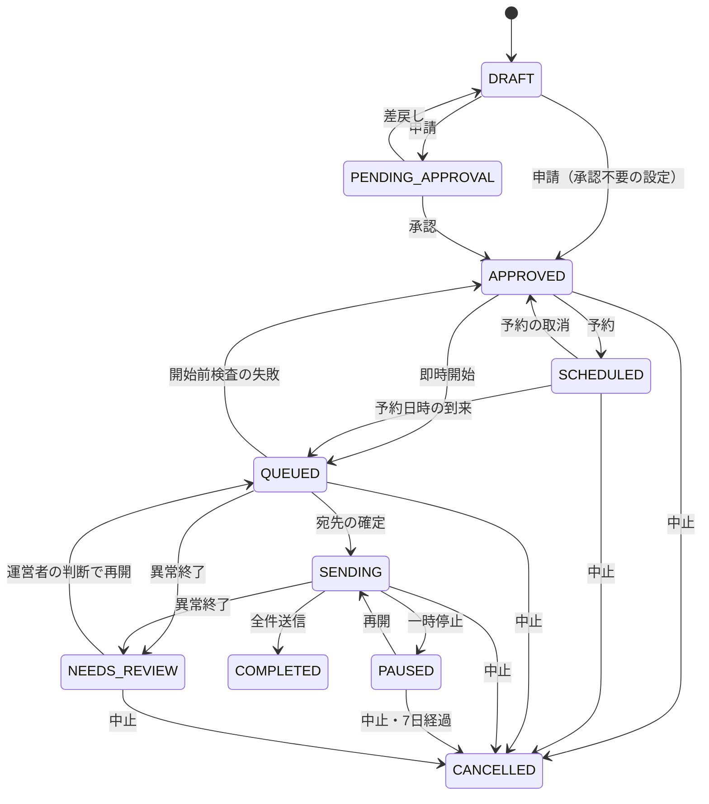
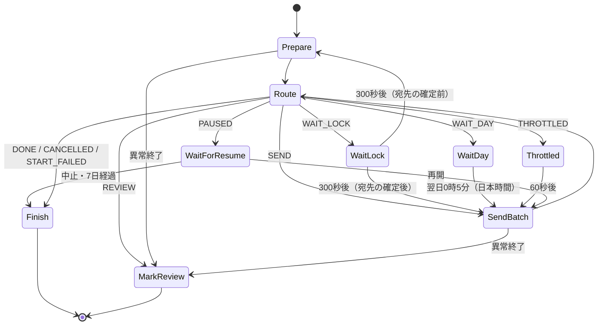

# Postline ファンクラブメール配信システム 詳細設計書

| 項目 | 内容 |
|---|---|
| 文書ID | PL-DD-001 |
| 版 | 2.2 |
| 改訂日 | 2026-11-03 |
| 文書状態 | 実装前レビュー版。パラメータに暫定値を含む |
| 上位文書 | [基本設計書](基本設計書.md) |

| 版 | 内容 |
|---|---|
| 1.0 / 1.1 | Gmail宛て限定・マルチテナント構成の実装仕様 |
| 2.0 | SES中心の構成へ全面改訂 |
| 2.1 | 章立てを処理の流れに沿って整理。旧版との差分とレビュー対応を付録に集約。宛先別の配送記録を標準機能に変更。到達性の要件を反映（差出人ドメインのSPFとA・MX、開始・再開前の検査、1日の送信上限、送信順の分散、送信速度の計算の修正、送信結果の分類の見直し、配送遅延とイベント欠測の監視、試験の追加と訂正） |
| 2.2 | 到達性の検査項目・監視と欠測の扱い・送信枠の予約・拒否理由別対応・本番受入試験を具体化し、一次資料の根拠を追記 |

## 1. 概要

### 1.1 目的と範囲

本書は、基本設計書 v2.2 に基づく実装仕様である。実装者が本書だけで、第三者ライブラリを使わずに構築・試験できることを目標とする。範囲は基本設計書1.2節の「含む」欄のとおり。

### 1.2 用語

| 用語 | 意味 |
|---|---|
| 配信組織 | 1つのAWSアカウントでメールを配信するファンクラブ等 |
| 連絡先リスト | SESのContact List。アカウントに1つ。名称は `postline` |
| トピック | 連絡先リスト内の配信リスト（会報、イベント告知など）。最大20 |
| 連絡先 | 連絡先リストに登録した会員アドレス。トピックごとの購読状態と属性データを持つ |
| 購読状態 | トピックごとの `OPT_IN`（購読）/ `OPT_OUT`（停止）と、全停止フラグ `UnsubscribeAll` |
| 抑止リスト | SESのアカウント抑止リスト。ハードバウンス・苦情の宛先 |
| 配信 | 1つのトピックへ1つの内容を送る単位。ID はULID |
| 固定テンプレート | 承認申請時に作るSESテンプレート `pl-c-{配信ID}-{版}`。以後変更しない |
| 宛先スナップショット | 送信開始時にSESから取り出した購読者の一覧。S3に200件ずつ保存する |
| バッチ | スナップショットの1ファイル（200件） |
| 送信受付 | SESが送信要求を受け付け、MessageIdを返したこと。配送成功ではない |
| 結果不明 | 送信要求の成否が分からない状態。自動で再送しない |
| 要確認 | 処理の異常終了などで、運営者の判断を待つ配信の状態 |
| 送信ロック | 同時に送信する配信を1つに限るためのDynamoDB項目 |

### 1.3 実装上の前提

| 領域 | 方針 |
|---|---|
| ランタイム | Lambda `nodejs24.x`、`arm64`、ESモジュール。`package.json` に依存パッケージを書かない |
| AWS SDK | Lambda同梱の `@aws-sdk/client-*`（sesv2、dynamodb、s3、sfn、scheduler、cloudwatch、cognito-identity-provider、ssm、secrets-manager、lambda）だけを使う |
| SESクライアント | SDKの自動再試行を使わない（`maxAttempts: 1`）。送信以外のAPIは自作の待ち合わせで間引く（3.8節） |
| 画面 | 素のHTML・CSS・JavaScript。PKCEはWeb Crypto APIで実装 |
| テスト | `node --test`。SDKクライアントは差し替えてモックにする |

## 2. 全体構成

### 2.1 構成要素

| 構成要素 | 責務 | 詳細 |
|---|---|---|
| SES | 宛先の保管、配信リスト、配信停止、抑止、テンプレート、送信、イベント発行 | 3章 |
| 管理API Lambda（`ApiFunction`） | 役割の確認、組織設定、宛先の操作、取込の受付、配信の作成・申請・承認・開始・停止、結果の取得 | 10章 |
| 送信Lambda（`WorkerFunction`） | 宛先スナップショット、バッチ送信、CSV取込、日次処理 | 5.4節、7章、13.4節 |
| Step Functions（`BroadcastStateMachine`） | 一斉送信の進行。一時停止・再開・中止の待ち合わせ | 7.2節 |
| EventBridge Scheduler | 予約配信の開始、日次処理の起動 | 7.1節、13.4節 |
| DynamoDB（1テーブル） | 配信記録、組織設定、取込記録、送信ロック、監査ログ、完全削除の記録 | 4.3節 |
| S3 | 運営画面、取込ファイル、宛先スナップショット、失敗・不明の記録、バックアップ、配送記録 | 4.4節 |
| CloudWatch・Firehose・Athena | 配信別の件数、宛先別の配送記録、アラーム | 8章、13章 |
| CloudFront・WAF・API Gateway・Cognito | 運営画面の配信、APIの公開、ログイン | 9章、11章、12章 |

### 2.2 処理の流れ

**宛先の登録**

1. 個別登録は管理APIがSESに連絡先を作る（5.1節）。
2. CSV取込は管理APIがファイルを受け取り、送信Lambdaが検証・照合してSESのインポート形式に変換し、SESのインポートジョブで登録する（5.4節）。

**配信**

1. 配信担当が下書きを作り、テスト送信で確認する（6.3節、6.6節）。
2. 申請時に、件名・本文・フッターを固定テンプレートとしてSESに作る（6.4節）。
3. 承認者が承認する（6.5節）。
4. 配信担当が開始または予約する。Step Functionsの実行を、配信IDを名前にして開始する（7.1節）。
5. 送信Lambdaが送信ロックを取り、トピックの購読者をSESから取り出してS3に保存する（7.3節）。
6. 送信Lambdaが200件ずつ、速度を調整しながら1通ずつ送る。組織の日次上限に達したら翌日以降に再検査して続ける。SES枠・認証・監視異常では自動再開しない（7.4節）。
7. SESのイベントが、CloudWatchの配信別メトリクスとS3の配送記録に記録される（8章）。

**配信停止・バウンス**

1. 会員の解除操作はSESが処理し、連絡先リストの購読状態を変える（5.7節）。
2. ハードバウンス・苦情はSESが抑止リストに登録する。以後の送信はSESが止める。

## 3. SESの設定

### 3.1 送信元ドメインとDNS

CloudFormationでドメインのIdentityを作り、出力された値を配信組織のDNSに登録する。

| 種別 | 名前 | 値 | 目的 |
|---|---|---|---|
| CNAME ×3 | `{selector}._domainkey.{domain}` | SESが返す値（参照先のゾーンは `DkimAttributes.SigningHostedZone`） | Easy DKIM（2048bit）。ドメイン認証を兼ねる。値を固定の文字列から組み立てず、SESの出力をそのまま使う |
| MX | `bounce.{domain}` | `10 feedback-smtp.ap-northeast-1.amazonses.com`（1つだけ） | カスタムMAIL FROM。通常のメール受信には使わない |
| TXT | `bounce.{domain}` | `v=spf1 include:amazonses.com ~all` | SPF。MAIL FROMで評価され、DMARCの整合に使われる |
| TXT | `{domain}` | 既存のSPFに `include:amazonses.com` を加える。SPFがなければ `v=spf1 include:amazonses.com ~all` | docomoが差出人ドメインのSPFを確認するため。同じ名前にSPFを2つ作らない。DNS参照の回数（10回まで）を超えない |
| A / MX | `{domain}` | 配信組織が実際に使っているWebサイト・メール受信サービスの値 | docomoは差出人ドメインにAもMXもないと届かない場合がある。架空の値は入れない |
| TXT | `_dmarc.{domain}` | `v=DMARC1; p=none; rua=mailto:dmarc@{domain}; adkim=s; aspf=r` から始める | DMARC（RFC 9989）。集計レポートで正規の送信経路をすべて確かめてから `quarantine`、`reject` へ進める。旧 `pct` による割合指定を確実な段階導入策にしない（現行RFC 9989では削除。旧実装との共存を考慮） |

- 送信元ドメインは配信組織につき1つ。Fromのドメイン部分は `SENDER_DOMAIN` と完全一致に限る（任意の子ドメインは許可しない）。Fromと返信先は、実際に受信できるアドレスにする。
- MAIL FROMのMXが見つからない場合は送信を拒否する設定（`BehaviorOnMxFailure: REJECT_MESSAGE`）にする。
- DMARCの集計レポートの受信先は、配信組織が実際に読むメールボックスにする。レポートにはIPなどが含まれるため、読める人を限る。
- `GetEmailIdentity` が成功を返しても、SPFの重複や整合の失敗は分からない。実際に受信したメールで確かめる（T-30）。
- 組織設定の保存時と、配信の開始・再開の前に、送信可能、DKIMの署名が有効で成功、MAIL FROMが成功であることを確かめる（7.1節）。DNSのSPF・DMARCは日次処理で確かめる（13.4節）。

Fromが `fc.example.jp`、DKIMの `d=` が `fc.example.jp`、MAIL FROMが `bounce.fc.example.jp` の場合、DKIMはstrict整合、SPFはrelaxed整合で成立する。`aspf=s` にするとこのMAIL FROMではSPF経由の整合が成立しない。両方のpassと整合をプロジェクトの合格条件とするが、DMARC自体の条件は整合した少なくとも一方のpassである。`MailFromDomainStatus=SUCCESS` はMX確認の成功であり、SPF・DMARC全体の合格を意味しない。[SES DMARC](https://docs.aws.amazon.com/ses/latest/dg/send-email-authentication-dmarc.html)

SPFはinclude/redirectの再帰を含めてDNS参照を評価し、上限10を超える設定を採用しない。既存SPFの正規送信元やall方針を無断で消さない。日次の存在・重複検査だけでは完全なSPF評価を代替できないため、変更時は正規送信経路の棚卸し、DNS参照数、権威DNSと通常の再帰リゾルバへの伝播、実受信を確認する。docomo向けのHeader From側SPFは標準SPFの定義とは分ける。[RFC 7208](https://www.rfc-editor.org/rfc/rfc7208.html)、[docomo](https://www.docomo.ne.jp/service/docomo_mail/smtp_notice/)

Easy DKIMの秘密鍵・公開鍵のローテーションはSESに任せ、3つのCNAMEを維持する。独自の事前署名やBYODKIMへ変更しない。DMARC集計用メールボックスはSES送信Identityだけでは作られない。外部ドメインの `rua` は必要な受信側DNS承認を確認し、集計ファイルは信頼しない入力として容量・展開率を制限して解析する。[Easy DKIM](https://docs.aws.amazon.com/ses/latest/dg/send-email-authentication-dkim-easy.html)、[RFC 9990](https://www.rfc-editor.org/rfc/rfc9990.html)

### 3.2 アカウント設定

`scripts/bootstrap-ses.sh` で次を行う。

| 設定 | 方法 | 値 |
|---|---|---|
| 抑止リスト | `PutAccountSuppressionAttributes` | 対象 `BOUNCE`、`COMPLAINT` |
| 本番利用の申請 | `PutAccountDetails` またはコンソール | 配信目的、同意の取得方法、配信停止の方法、想定通数 |
| 送信上限の記録 | `GetAccount` | `MaxSendRate`、`Max24HourSend` を記録し、送信速度の上限を決める |

### 3.3 Configuration Set `postline-{env}`

| 項目 | 値 | 理由 |
|---|---|---|
| TLS | `REQUIRE` | 受信側との通信を暗号化する。TLSを使えない受信側には届かないが、暗号化なしに切り替えて送り直さない |
| 配送の最長時間 | 指定しない | SESの既定に任せる。配送遅延の期限が切れても、アプリから送り直さない |
| 評判メトリクス | 有効 | バウンス率・苦情率の監視 |
| 抑止設定 | 指定しない | アカウント抑止リストをそのまま使う。Configuration Setの抑止設定はアカウント設定より優先されるため |
| 開封・クリック計測 | 指定しない | リンクの書換えを避け、会員のプライバシーを守る |
| イベント発行先1 | CloudWatch。対象 `SEND, REJECT, BOUNCE, COMPLAINT, DELIVERY, DELIVERY_DELAY, SUBSCRIPTION, RENDERING_FAILURE`。次元 `campaign`（メッセージタグから取得、既定値 `none`） | 配信別の件数（8.1節） |
| イベント発行先2 | Data Firehose（本番必須）。対象は同上 | 宛先別の配送記録（8.3節） |

`REQUIRE` はTLS接続を条件とするが、MTA-STS・DANEによる宛先認証まで保証する設定とは扱わない。送信元DNSに受信用MTA-STS/TLS-RPTを置くだけで外向きSES配送が改善すると仮定しない。これらを必須にする場合は別途SESの対応範囲を確認する。[SESのTLS](https://docs.aws.amazon.com/ses/latest/dg/security-protocols.html)、[MTA-STS](https://www.rfc-editor.org/rfc/rfc8461.html)、[DANE](https://www.rfc-editor.org/rfc/rfc7672.html)

### 3.4 連絡先リストとトピック

```yaml
ContactList:
  Type: AWS::SES::ContactList
  DeletionPolicy: Retain
  UpdateReplacePolicy: Retain
  Properties:
    ContactListName: postline
    Description: ○○ファンクラブ会員
    Topics:
      - TopicName: kaiho
        DisplayName: 会報
        Description: 毎月の会報をお届けします
        DefaultSubscriptionStatus: OPT_OUT
      - TopicName: event
        DisplayName: イベント・チケット情報
        Description: イベントやチケット先行受付のお知らせ
        DefaultSubscriptionStatus: OPT_OUT
```

- トピックの既定の購読状態はすべて `OPT_OUT` とし、明示的に同意したトピックにだけ送る。
- トピック名は英小文字・数字・`_` で20文字以内。表示名と説明はSESの解除ページに表示される。
- トピックの追加・変更はCloudFormationのパラメータで行い、SESのコンソールでは変えない（定義のずれを防ぐため）。**一覧から外したトピックは削除され、その購読状態も失われる**ので、変更セットのレビューで必ず確認する。
- 連絡先リストの削除は権限設定で拒否し、スタックを削除しても残す。

### 3.5 連絡先の属性データ

SESの連絡先の `AttributesData`（JSON文字列）に次を保存する。全体で1KB以内に抑える。

```json
{
  "v": 1,
  "name": "山田 太郎",
  "consent": { "at": "2026-10-01T09:00:00+09:00", "source": "FC入会フォーム", "version": "2026-04" },
  "reconsent": { "at": "2027-01-10T12:00:00+09:00", "source": "本人からのメール", "by": "sub-of-admin" },
  "origin": "import:01JC…",
  "orig": "Taro.Yamada+fc@googlemail.com"
}
```

| 項目 | 必須 | 規則 |
|---|---|---|
| `name` | × | 0〜50文字。制御文字不可 |
| `consent.at` | ○ | ISO 8601。未来の日時は不可 |
| `consent.source` | ○ | 1〜100文字 |
| `consent.version` | × | 0〜30文字 |
| `reconsent` | × | 購読再開（5.5節）の最新1件 |
| `origin` | ○ | `import:{取込ID}` または `manual:{操作者のsub}` |
| `orig` | × | 正規化前の表記。Gmailで表記が変わった場合だけ（4.2節） |

### 3.6 テンプレート

| 項目 | 規則 |
|---|---|
| 名称 | `pl-c-{配信ID}-{版}`。版は差戻し後の再申請で増える |
| 内容 | `Subject`（件名）と `Text`（本文＋フッター）。`Html` は使わない |
| 作成 | 承認申請のとき（6.4節） |
| 変更・削除 | 管理APIの権限では拒否する。日次処理だけが、保持期間を過ぎた終了済み配信のテンプレートを削除できる |
| 構文 | SESのテンプレートは `{{…}}` を差し込みとして解釈する。件名・本文・設定値に `{{` と `}}` を含む入力は拒否する。システムが入れるのはフッターの `{{amazonSESUnsubscribeUrl}}` だけ |
| 上限 | 1件500KB、リージョンあたり20,000件 |

### 3.7 送信要求

```json
{
  "FromEmailAddress": "=?UTF-8?B?44CH44CH44OV44Kh44Oz44Kv44Op44OW?= <info@fc.example.jp>",
  "Destination": { "ToAddresses": ["member@example.ne.jp"] },
  "ReplyToAddresses": ["support@fc.example.jp"],
  "Content": { "Template": { "TemplateName": "pl-c-01JC7Q…-1", "TemplateData": "{}" } },
  "ListManagementOptions": { "ContactListName": "postline", "TopicName": "kaiho" },
  "ConfigurationSetName": "postline-prod",
  "EmailTags": [ { "Name": "campaign", "Value": "01JC7Q…" } ]
}
```

| パラメータ | 規則 |
|---|---|
| `FromEmailAddress` | 申請時に固定した差出人。表示名に日本語を含む場合はRFC 2047のBエンコード（自作） |
| `Destination.ToAddresses` | 1件だけ。配信停止のヘッダーとURLは宛先が1件のときだけ付く |
| `ListManagementOptions` | 必ず指定する。SESが `List-Unsubscribe`・`List-Unsubscribe-Post` を付け、停止済みの宛先への送信を止める |
| `EmailTags` | `campaign` に配信ID。テスト送信は `test` |
| 独自ヘッダー | 付けない（SESが付けるヘッダーと衝突させないため） |

`ListManagementOptions` を付けて連絡先リストにない宛先へ送ると、SESが連絡先を自動で作る。そのため送信先は必ず連絡先リストから取り出したアドレスに限る。テスト送信先も登録済みの連絡先に限る（6.6節）。一括送信API（`SendBulkEmail`）は `ListManagementOptions` に対応しないため使わない。

### 3.8 API呼び出し制限への対応

SESは `SendEmail` と `SendBulkEmail` 以外のAPIを毎秒1件に制限している。この制限が操作ごとかアカウント全体で共有かは確認できていないため、共有として扱う（U-02）。

- `common/sesv2.js` は送信以外の呼び出しを、DynamoDBの `RATE / SES_CONTROL` による条件付き更新で1.1秒以上離す。最新の `next_allowed_at_ms` を強い整合性で読み、期限経過かつ読んだ版が一致するときだけ次の時刻へ更新して実行する。競合時は再読取して待つ。Lambda間で枠を共有し、プロセス内だけの間引きにしない。失敗・再試行も同じ枠を通す。
- `TooManyRequestsException` を受けたら、1・2・4・8・16秒と待って再試行する。送信以外のAPIは、制限で拒否された要求が実行されていないので、再試行しても安全である。それでも失敗したら `503 SES_BUSY` を返す。
- 画面の一覧表示は1ページ50件とし、連続した呼び出しを避ける。
- 宛先スナップショットの作成中は画面の操作が遅くなることがあるため、画面に「送信準備中」と表示する。
- `SendEmail` の速度は7.4節で調整する。

### 3.9 Sandboxと本番

1. Sandboxでは認証済みのアドレスにしか送れない。開発環境はこの状態で結合試験を行う。
2. 本番利用が承認されたら `GetAccount` の送信上限を記録し、送信速度の上限を `MaxSendRate × 0.8` 以下にする。
3. 初回・休止明け・増量時は1つのトピックの少数会員から始め、バウンス・遅延・苦情・購読設定変更を観察する。日次上限の引上げは管理者の記録を必要とする。

### 3.10 到達性検査の値と有効期限

7.1節で次を検査する。値は東京リージョン・当該AWSアカウントのものに限り、CloudFormationの作成成功や別リージョンの検証結果を流用しない。

| 対象 | 合格条件 | 失敗理由 |
|---|---|---|
| `GetAccount` | 本番は `ProductionAccessEnabled=true`、`SendingEnabled=true`、`EnforcementStatus=HEALTHY`。`SuppressionAttributes.SuppressedReasons` にBOUNCEとCOMPLAINTがある | `SES_PAUSED` / `SUPPRESSION_MISCONFIGURED` |
| `GetEmailIdentity` | `VerifiedForSendingStatus=true`、`DkimAttributes.SigningEnabled=true`、`Status=SUCCESS`、`CurrentSigningKeyLength=RSA_2048_BIT` | `AUTH_CHECK_FAILED` |
| MAIL FROM | 設定値が `bounce.{SENDER_DOMAIN}`、`MailFromDomainStatus=SUCCESS`、`BehaviorOnMxFailure=REJECT_MESSAGE` | `AUTH_CHECK_FAILED` |
| `GetConfigurationSet` | `SendingOptions.SendingEnabled=true`、`DeliveryOptions.TlsPolicy=REQUIRE`、評判メトリクス有効、アカウント抑止を無効化する上書きがない | `CONFIGURATION_INVALID` |
| `GetConfigurationSetEventDestinations` | CloudWatch・Firehoseの両方がEnabledで、3.3節の全イベント、正しい次元・ストリームが指定済み | `EVENT_DESTINATION_DISABLED` |
| DNS検査 | `AUTH_STATUS.checked_at` が26時間以内、結果PASS、対象ドメイン・設定版が一致。SPF・DMARCの欠落・重複なし | `AUTH_CHECK_FAILED` |
| 本番受入記録 | 16.5節の必須試験が合格し、`status=PASS` で現在の送信設定・DNSハッシュと一致する `delivery_check` が有効 | `DELIVERY_CHECK_REQUIRED` |
| 送信枠・監視 | 7.4、7.8節の枠と監視条件を満たす。取得失敗やリソース不在を正常扱いしない | `QUOTA_INSUFFICIENT` / `MONITORING_UNAVAILABLE` |

SES APIの状態は最大60秒キャッシュし、開始・予約起動・再開・翌日待機からの継続で再評価する。送信中は60秒ごとにアカウントと認証状態、設定セットを更新して確認する。設定変更時はキャッシュを無効にする。全検査は宛先単位には行わず3.8節の共通間引きを使う。26時間・60秒は本システムの設計値であり、DNSやSESの反映時間の保証ではない。[GetAccount](https://docs.aws.amazon.com/ses/latest/APIReference-V2/API_GetAccount.html)、[DkimAttributes](https://docs.aws.amazon.com/ses/latest/APIReference-V2/API_DkimAttributes.html)、[MailFromAttributes](https://docs.aws.amazon.com/ses/latest/APIReference-V2/API_MailFromAttributes.html)

## 4. データ

### 4.1 保持場所

| データ | 保持場所 | 備考 |
|---|---|---|
| 宛先アドレス、トピック別の購読状態、全停止フラグ | SES 連絡先リスト | 正本 |
| 同意の記録、名前 | SES 連絡先の属性データ | 3.5節 |
| ハードバウンス・苦情の宛先 | SES 抑止リスト | 自動登録 |
| 承認済みの本文 | SES 固定テンプレート | 変更不可 |
| 配信記録、組織設定、取込記録、送信ロック、監査ログ、完全削除の記録 | DynamoDB | 宛先アドレスは保存しない |
| 取込ファイル、宛先スナップショット、失敗・不明の記録、バックアップ | S3 `DataBucket` | 期限付き |
| 配信別の件数 | CloudWatch メトリクス | 15か月 |
| 宛先別の配送記録 | S3 `EventLogBucket` | 180日 |

### 4.2 メールアドレスの検証と正規化

| 手順 | 規則 |
|---|---|
| 前処理 | 前後の空白を除き、全体を小文字にする（SESの連絡先は大文字と小文字を区別して保存されるため） |
| 文字 | ASCIIだけ。`@` は1つ。ローカル部64文字以下、全体254文字以下 |
| ローカル部 | RFC 5322のatext文字とドット。先頭・末尾のドットと連続したドットは `NONSTANDARD_ADDRESS` として拒否する（古い携帯アドレスに多い。SESが受け付けない可能性があるため。U-07） |
| ドメイン | 各ラベル63文字以下、全体253文字以下、英数字とハイフン。国際化ドメインはPunycode表記だけ受け付ける。最上位のラベルが数字だけのものは拒否 |
| Gmailの正規化 | ドメインが `gmail.com` か `googlemail.com` なら、ローカル部のドットと `+` 以降を除き、ドメインを `gmail.com` にした値を連絡先のアドレス（送信先）とする。入力された表記は属性データの `orig` に残す |

Gmailはドットを無視し、`+` 以降と `googlemail.com` も同じ受信箱に届く。正規化することで、同じ受信箱が複数の連絡先になり、毎回何通も届いたり、1つを停止しても他に送り続けたりすることを防ぐ。`+` を使った受信側の振り分けは効かなくなるが、配送には影響しない。Google Workspace 等の独自ドメインは正規化しない。

### 4.3 DynamoDB テーブル `postline-{env}`

キーは `PK`（文字列）と `SK`（文字列）。索引（GSI）は持たない。TTL属性は `expires_at`（Unix秒）。

| PK | SK | 内容 | TTL |
|---|---|---|---|
| `SETTINGS` | `ORG` | 組織設定 | — |
| `SETTINGS` | `TOPIC_COUNTS` | トピック別の購読者数（日次処理が更新） | — |
| `CAMPAIGN` | `{配信ID}` | 配信記録 | — |
| `IMPORT` | `{取込ID}` | 取込記録 | 1年 |
| `IDEMP` | `{sub}#{Idempotency-Key}` | 取込要求の二重送信防止 | 24時間 |
| `LOCK` | `SEND` | 送信ロック | — |
| `LOCK` | `CONTACT_CREATE` | 新規登録とインポートの排他。所有者・ジョブID・状態を保持 | — |
| `DAILY` | `{YYYY-MM-DD}`（日本時間） | `reserved_attempts`：送信試行の予約数。テスト・再試行を含む保守的な日次制限 | 7日 |
| `RATE` | `SES_CONTROL` | 送信以外のSES APIの `next_allowed_at_ms` と `version` | — |
| `SETTINGS` | `AUTH_STATUS` | 日次の認証検査の結果（13.4節） | — |
| `AUDIT#{YYYYMM}` | `{ISO8601}#{ULID}` | 監査ログと連絡先の変更記録 | 1年 |
| `ERASED` | `{HMAC-SHA256(erase-hmac, 正規化したアドレス)}` | 完全削除した宛先（再登録の防止） | — |

#### 組織設定 `SETTINGS / ORG`

| 項目 | 型 | 規則 |
|---|---|---|
| `from_local` | S | Fromのローカル部。ドメインは環境変数 `SENDER_DOMAIN` に固定 |
| `from_name` | S | 1〜64文字。改行と `<>"` は不可 |
| `reply_to` | S | 任意。4.2節で検証 |
| `legal.sender_name` | S | 送信者の名称（必須） |
| `legal.address` | S | 所在地（必須） |
| `legal.contact` | S | 苦情・問合せの連絡先（メールアドレス・URL・電話番号のいずれか、必須） |
| `approval_required` | BOOL | 既定 true |
| `test_recipients` | L(S) | 最大5件。連絡先リストに登録済みであること |
| `max_rate_per_sec` | N | 1以上。既定10 |
| `delivery_check` | M | 本番受入記録 `{status, passed_at, by, note, evidence_key, cases, config_hash, dns_config_hash}`（API-26）。90日以内で現設定と一致すること。API-02では変更不可（16.5節） |
| `version` / `updated_at` / `updated_by` | | 楽観ロックと監査 |

`legal`・`from_name`・`reply_to` には `{{`・`}}`・制御文字を含めない。

#### 配信記録 `CAMPAIGN / {配信ID}`

| 項目 | 型 | 意味 |
|---|---|---|
| `campaign_id` | S | ULID |
| `status` | S | 6.1節の状態 |
| `topic` / `topic_display` | S | 送信先のトピック |
| `subject` / `body_text` | S | 下書きの件名・本文 |
| `rev` | N | 申請の版。差戻しの後の申請で増える |
| `template_name` / `content_sha256` | S | 固定テンプレートの名前と、件名＋本文＋フッターのSHA-256 |
| `from` / `reply_to` / `footer_text` | S | 申請時に固定した差出人・返信先・フッター |
| `created_by` / `submitted_by` / `approved_by` / `started_by` | S | Cognitoの `sub`。自動承認は `AUTO` |
| `created_at` / `submitted_at` / `approved_at` / `started_at` / `completed_at` | S | UTCのISO 8601 |
| `start_mode` / `scheduled_at` / `schedule_name` | S | `NOW` か `SCHEDULED`、予約日時、スケジュール名 |
| `start_error` | S | 開始前検査に失敗した理由 |
| `execution_arn` | S | 現在のStep Functionsの実行 |
| `rate_per_sec` | N | 送信開始時に決めた速度 |
| `recipients_total` / `chunks_total` | N | スナップショットの件数とファイル数 |
| `progress` | M | `{chunk, index}`。次に送る位置。20通ごとに更新 |
| `counts` | M | `{accepted, failed, unknown, excluded_allowlist}` |
| `next_attempt_at` | S | 日次上限による待機の再開予定（UTC）。待機も開始から7日を超えたら中止し、30日保持のスナップショットを使い続けない |
| `pause_reason` | S | `USER` / `OPERATOR_SWITCH` / `REPUTATION_ALARM` / `CAMPAIGN_BOUNCE` / `CAMPAIGN_DELAY` / `EVENTS_MISSING` / `EVENT_LOG_STALE` / `MONITORING_UNAVAILABLE` / `CONTENT_ERROR` / `AUTH_CHECK` / `SES_PAUSED` / `SES_UNSTABLE` / `QUOTA` |
| `task_token` | S | 一時停止中の再開待ちトークン |
| `review` | M | `{chunk, index_from, index_to, reason}`。要確認の範囲 |
| `reject_reason` / `cancel_reason` | S | |
| `version` / `updated_at` | N / S | 楽観ロック |

#### 送信ロック `LOCK / SEND`

| 項目 | 意味 |
|---|---|
| `owner` | 送信中の配信ID、または `test:{request_id}`。テストも同じ排他を使う |
| `expires_at_ms` | 期限（Unixミリ秒）。バッチごとに延長する |
| `next_send_at_ms` | 最後の実送信開始＋必要間隔。バッチ切替・テスト送信・ロック解放後も保持する |

`AUTH_STATUS` は `{checked_at, domain, config_hash, dns_config_hash, status: PASS/FAIL/UNKNOWN, checks, reason_codes}` を保持する。DNS応答を取得できない場合はUNKNOWNとし、前のPASSの時刻を更新しない。

### 4.4 S3

`DataBucket`（公開ブロック、SSE-S3、TLS必須）：

| プレフィックス | 内容 | 失効 |
|---|---|---|
| `imports/staging/{取込ID}.csv` | 画面から受け取った元のCSV | 7日 |
| `imports/ready/{取込ID}.csv` | SESのインポート形式に変換したCSV（同意の記録を含む） | 1年 |
| `imports/report/{取込ID}.json` | 取込結果（行番号と理由だけ） | 1年 |
| `recipients/{配信ID}/{chunk:05}.jsonl` | 宛先スナップショット。1行 `{"e":"アドレス"}` | 30日 |
| `results/{配信ID}/{chunk:05}-{開始位置:03}.jsonl` | 失敗・不明の宛先。1行 `{"e","r":"FAILED"か"UNKNOWN","c":"コード","t":"時刻"}` | 180日 |
| `backups/contacts/{YYYY-MM-DD}.jsonl.gz` | 連絡先のバックアップ | 1年 |
| `delivery-checks/{検査ID}/` | 管理者が保管する本番受入の証跡。通常画面には原文を返さない | 180日 |

`EventLogBucket`（公開ブロック、SSE-S3、閲覧は管理者ロールだけ）：`ses-events/yyyy/MM/dd/` にFirehoseがGZIPで書く。180日で失効。

### 4.5 保持期間

| データ | 期間と方法 |
|---|---|
| 配信記録 | 終了から1年で件名・本文を消し、件数だけ残す（日次処理） |
| 固定テンプレート | 終了から1年で削除（日次処理） |
| 監査ログ | 1年（TTL） |
| 連絡先 | 在籍中は保持。退会・削除請求は5.6節 |
| 抑止リスト | 削除しない |
| S3のファイル | 4.4節（ライフサイクル） |
| Step Functionsの実行履歴 | 終了から90日（サービスの仕様） |

## 5. 宛先管理

### 5.1 操作とSES APIの対応

| 操作 | API | SESの呼び出し |
|---|---|---|
| 一覧 | API-04 | `ListContacts`（50件ずつ） |
| 1件の表示 | API-05 | `GetContact`、`GetSuppressedDestination`（見つからなければ抑止なし） |
| 新規登録 | API-06 | `CreateContact` |
| 名前の変更・トピックの停止・追加購読 | API-07 | `GetContact` → `UpdateContact`（全項目を指定） |
| 配信停止（トピック別・全停止） | API-08 | `GetContact` → `UpdateContact` |
| 購読の再開 | API-09 | `GetContact` → `UpdateContact` |
| 完全削除 | API-10 | `DeleteContact` |

`UpdateContact` は部分更新で他の値を消さないよう、`GetContact` で得た値に変更を加えて全項目を渡す。

### 5.2 購読状態の変更規則

| 変更 | 許可する役割 | 条件 |
|---|---|---|
| 新規登録で `OPT_IN` | 管理者、配信担当 | 同意の日時・取得経路が必須 |
| 未設定のトピックを `OPT_IN`（追加購読） | 管理者、配信担当 | そのトピックへの同意の記録が必須 |
| `OPT_IN` → `OPT_OUT`、全停止 | 管理者、配信担当 | 理由を監査ログに残す |
| `OPT_OUT` → `OPT_IN`、全停止の解除 | 管理者だけ（API-09） | 新しい同意の証跡が必須 |
| CSV取込 | 管理者、配信担当 | 新規の連絡先だけを登録する。既存の連絡先は変えない（5.4節） |

SESのAPIはどの購読状態でも上書きできてしまう。停止した会員を誤って復活させない規則は、アプリ側で守る。

### 5.3 CSV形式（利用者が用意するファイル）

UTF-8（BOM付きも可）、改行は `\n` か `\r\n`、カンマ区切り、引用符は `"`。1ファイル2MiB以下、データ行20,000行以下。

| 列 | 必須 | 規則 |
|---|---|---|
| `email` | ○ | 4.2節 |
| `name` | × | 0〜50文字 |
| `consent_at` | ○ | ISO 8601。未来の日時は不可 |
| `consent_source` | ○ | 1〜100文字 |
| `consent_version` | × | 0〜30文字 |
| `topics` | ○ | 購読するトピック名をセミコロンで区切って1つ以上（例 `kaiho;event`） |

知らない列があればファイル全体をエラーにする。

### 5.4 CSV取込処理

管理API（API-11）がファイルを `imports/staging/` に保存し、送信Lambdaを非同期で呼ぶ。送信Lambda（`mode: import`）は次を行う。

1. 取込記録を `RECEIVED → VALIDATING` にし、ファイルを読む。
2. CSVを解析し、ヘッダーを検査する。
3. 行ごとに検証する。アドレス（4.2節）、`consent_at`、`consent_source`、`topics`（`GetContactList` のトピックに存在すること）、`name`。
4. 正規化したアドレスでファイル内の重複を探し、2件目以降を `DUPLICATE_IN_FILE` とする。
5. 完全削除の記録と照合する（HMACを `BatchGetItem` で100件ずつ）。一致した行は `ERASED_SKIPPED`。
6. 既存の連絡先を `ListContacts`（絞り込みなし、1,000件ずつ）ですべて取得し、一致した行は `EXISTING_SKIPPED` とする。**これにより、取込で停止済みの宛先が購読状態に戻ることはない。**
7. 開発・検証環境では、許可リストにない行を `NOT_ALLOWED_IN_ENV` とする。
8. 残った行をSESのインポート形式にして `imports/ready/{取込ID}.csv` に書く。すべてのトピックの列を出し、指定されたトピックを `OPT_IN`、それ以外を `OPT_OUT` にする。

   ```text
   emailAddress,unsubscribeAll,attributesData,topicPreferences.kaiho,topicPreferences.event
   member@example.ne.jp,false,"{""v"":1,""name"":""山田 太郎"",""consent"":{…},""origin"":""import:01JC…""}",OPT_IN,OPT_OUT
   ```

9. `CreateImportJob`（取込先 `ContactListDestination`、連絡先リスト `postline`、動作 `PUT`、取込元 `s3://…/imports/ready/{取込ID}.csv`、形式 `CSV`）を呼び、ジョブIDを記録して `IMPORTING` にする。SESがこのファイルを読めるよう、バケットポリシーで `ses.amazonaws.com` に `imports/ready/*` の読取を許可する（条件 `aws:SourceAccount`）。
10. 行番号と理由だけの結果を `imports/report/{取込ID}.json` に保存する。
11. 画面が結果を開いたとき（API-12）、`IMPORTING` なら `GetImportJob` で状態・処理件数・失敗件数を取り、完了していれば `DONE`（失敗なら `FAILED`）にして監査ログに残し、取込の排他ロックを解放する。日次処理も未完了ジョブを照合し、画面を開かなくても完了確認できるようにする。

手順6からインポート完了まで新規登録が割り込むと、その後の解除を取込で上書きする危険がある。取込中は新規登録（API-06）と別の取込を `409 CONTACT_IMPORT_IN_PROGRESS` で拒否する。`LOCK / CONTACT_CREATE` を取込の照合開始からSESジョブの完了確認まで保持し、個別新規登録も同じロックを使う。失敗・完了不明時は管理者がジョブ状態を確認するまで解放しない。既存宛先の解除は妨げず、取込対象から除外する。取込中にコンソール等で連絡先を新規作成しない。

### 5.5 購読の再開

停止した会員が改めて配信を希望した場合だけ、管理者がAPI-09で購読を戻す。新しい同意の日時と取得経路（本人からの申込メール、入会フォームの再送信など）を、属性データの `reconsent` と監査ログに残す。

### 5.6 退会と完全削除

| 依頼 | 処理 | 残るもの |
|---|---|---|
| 配信停止・退会 | API-08（`scope: ALL`）で全停止にし、属性データから名前を消す | アドレスと停止状態（再送の防止のため） |
| 個人情報の削除請求 | API-10：`DeleteContact`、`ERASED` にHMACを登録、監査ログに `ERASE` を残す | HMAC（アドレスには戻せない）。抑止リストの記録はSESのコンソールで別途削除できる |

S3のファイル（取込ファイル、スナップショット、失敗の記録、バックアップ、配送記録）に残るアドレスは、それぞれの保持期間が過ぎると消える。すぐに消す必要があるかは法務確認とする（DD-06）。

### 5.7 SESによる配信停止・抑止・苦情の処理

**配信停止**：`ListManagementOptions` を付けた送信では、SESが次を行う。

| 動作 | 内容 |
|---|---|
| ヘッダーの付与 | `List-Unsubscribe` と `List-Unsubscribe-Post`（RFC 8058のワンクリック解除） |
| 解除URLの差し込み | 本文の `{{amazonSESUnsubscribeUrl}}` を解除ページのURLに置き換える |
| ワンクリック解除 | メールソフトの「登録解除」で、そのメールのトピックを `OPT_OUT` にする |
| 解除ページ | トピックごとの購読の変更と全停止を選べる |
| 停止の強制 | 停止済みの連絡先への送信は配送せず、バウンスのイベントを出す |
| イベント | 解除や購読設定の変更は `SUBSCRIPTION` イベントになる。変更の前後（`oldTopicPreferences`・`newTopicPreferences`）は配送記録で確かめられる |

本システムは独自の解除ページや解除APIを持たない。

**抑止**：ハードバウンスと苦情の宛先は、SESが抑止リストに自動で登録する。抑止中の宛先への送信は配送されないが、送信数には数えられる。宛先画面に抑止の状態（理由と日時）を表示する。抑止の解除は、会員から受信できるようになったと連絡があった場合などに限り、AWSの管理者がSESのコンソールで行い、運営記録に理由を残す。

**苦情**：

| 事業者 | SESへの苦情の通知 | 対応 |
|---|---|---|
| Gmail | なし | Google Postmaster Toolsで迷惑メール率を確かめる（13.6節）。購読設定の変更率の通知（7.8節）で補う |
| iCloud | なし（苦情を通知する仕組みがない） | 苦情0件を「苦情なし」とみなさない |
| その他の事業者 | 苦情の通知の仕組みに対応する事業者から、通知される範囲だけ | SESが自動で抑止リストに登録し、評判メトリクスに反映する。通知が0件でも苦情がないとは限らない |

## 6. 配信の作成と承認

### 6.1 配信の状態



| 状態 | 意味 |
|---|---|
| `DRAFT` | 下書き。編集できる |
| `PENDING_APPROVAL` | 承認待ち。内容は固定済み |
| `APPROVED` | 承認済み。開始または予約ができる |
| `SCHEDULED` | 予約済み |
| `QUEUED` | 開始の処理中、または他の配信の終了待ち |
| `SENDING` | 送信中 |
| `PAUSED` | 一時停止中（理由は `pause_reason`） |
| `NEEDS_REVIEW` | 要確認（7.7節） |
| `COMPLETED` / `CANCELLED` | 終了 |

### 6.2 遷移規則

| 遷移 | 操作者 | 条件と処理 |
|---|---|---|
| 作成 → `DRAFT` | 管理者、配信担当 | トピックが存在する |
| `DRAFT` の編集 | 管理者、配信担当 | `version` が一致。入力規則（6.3節） |
| `DRAFT` → `PENDING_APPROVAL` | 管理者、配信担当 | 6.4節 |
| `DRAFT` → `APPROVED` | 同上 | 承認不要の設定のとき。`approved_by = AUTO` を監査ログに残す |
| `PENDING_APPROVAL` → `APPROVED` | 管理者、承認者 | 6.5節 |
| `PENDING_APPROVAL` → `DRAFT` | 管理者、承認者 | 差戻しの理由が必須。固定テンプレートは残し、次の申請で新しい版を作る |
| `APPROVED` → `QUEUED` / `SCHEDULED` | 管理者、配信担当 | 7.1節 |
| `SCHEDULED` → `APPROVED` | 管理者、配信担当 | 7.1節（予約の取消） |
| `QUEUED` → `APPROVED` | 進行役 | 開始前検査の失敗。理由を `start_error` に残し、もう一度開始できる |
| `QUEUED` → `SENDING` | 進行役 | 7.3節 |
| `SENDING` ↔ `PAUSED` | 管理者・配信担当・承認者、または送信Lambda | 7.6節、7.8節 |
| `SENDING` → `COMPLETED` | 進行役 | 全バッチの送信が終わった |
| → `NEEDS_REVIEW` → `QUEUED` | 進行役 → 管理者 | 7.7節 |
| → `CANCELLED` | 管理者、配信担当、承認者 | 7.6節 |

すべての遷移は、DynamoDBの `UpdateItem` に `ConditionExpression: #status IN (:from…) AND version = :v` を付けて行い、成功したら `version` を1増やす。条件に合わなければ `409 STATE_CONFLICT` を返す。

### 6.3 下書きと入力規則

| 項目 | 規則 |
|---|---|
| トピック | 連絡先リストに存在するもの |
| 件名 | 1〜200文字。改行・制御文字・`{{`・`}}` は不可 |
| 本文 | UTF-8で50KiB以下。`{{`・`}}` は不可。改行は `\n` にそろえる |
| プレビュー | 下書きは画面内で件名・本文・フッターをつないで表示する。申請後は `TestRenderEmailTemplate` の結果のテキスト部分を表示する |
| 注意の表示 | 本文に短縮URLらしいリンクがあれば、使わないよう注意を出す（保存は妨げない）。差出人名・件名で別の送り手を装わないことを申請画面に明記する |

### 6.4 申請（固定テンプレートの作成）

1. 状態が `DRAFT` で、組織設定の差出人と法定表示がそろっていることを確かめる。
2. `rev` を1増やし、フッター（6.7節）を作って `Text = 本文 + フッター` とする。
3. `CreateEmailTemplate`（名前 `pl-c-{配信ID}-{rev}`、`Subject`、`Text`）を呼ぶ。既に同じ名前があれば（再試行のとき）、`GetEmailTemplate` で内容が一致することを確かめる。
4. `content_sha256 = SHA-256(件名 + "\n\n" + Text)` を計算し、差出人・返信先・フッターを固定して保存する。状態を `PENDING_APPROVAL`（承認不要なら `APPROVED`）にする。

### 6.5 承認規則

- 承認不要の設定でなければ、承認者は管理者か承認者の役割を持ち、申請者とは別の人（`sub` が異なる）でなければならない。
- 承認画面には固定テンプレートの描画結果とハッシュの先頭12文字を表示する。承認の要求にはハッシュ全体を含め、保存値と違えば `409 HASH_MISMATCH` とする。
- 承認不要の設定に変えられるのは管理者だけで、変更は監査ログに残る。

### 6.6 テスト送信

1. 宛先は組織設定のテスト送信先（最大5件）だけ。要求で宛先を指定することはできない。
2. 各宛先が連絡先リストにあり、配信のトピックを購読していることを `GetContact` で確かめる。未登録なら `422 TEST_RECIPIENT_NOT_REGISTERED`。配信停止の管理を付けて未登録の宛先へ送るとSESが連絡先を作ってしまうため、この確認は省かない。
3. 下書きは `Content.Simple`（件名と、本文＋フッター）で、申請後は固定テンプレートで送る。`ListManagementOptions` は本番と同じにし、`EmailTags` の `campaign` は `test` とする。
4. 開発・検証環境では許可リストも確かめる。監査ログに `TEST_SEND` を残す。

テスト送信のメールで、件名・本文・フッターの表示、解除リンク、`List-Unsubscribe` ヘッダーを本番と同じ形で確認できる。テスト送信も1日の送信件数（`DAILY`）に数える。

テスト送信も `LOCK / SEND` を取得し、通常配信中は `409 SENDING_IN_PROGRESS` とする。テスト同士も排他にし、通常配信と同じ秒間枠・日次予約・結果不明時の非再送を使う。管理APIの残り実行時間が15秒未満なら次の宛先を開始しない。未試行と受付済み・不明を分けて返し、不明分を次のテスト要求で自動再送しない。

初回の受信確認記録を作るためのAPI-16では `delivery_check` の未登録だけを許容する。対象は登録済みテスト宛先の最大5件で、認証、TLS、抑止、許可リスト、送信枠は省略しない。監視の無履歴の扱いは7.8節に従う。これを本番会員配信の検査回避経路にしない。

### 6.7 フッター（法定表示）

申請時に `footer.js` が組織設定とトピックから作り、本文の後ろに付ける。利用者は編集できない。

```text

----
このメールは{legal.sender_name}の「{topic_display}」にご登録いただいた方にお送りしています。
配信停止・配信設定の変更は、次のURLから手続きできます（このメール上部の「登録解除」からも停止できます）。
{{amazonSESUnsubscribeUrl}}

発行：{legal.sender_name}
所在地：{legal.address}
お問い合わせ：{legal.contact}
```

- `{{amazonSESUnsubscribeUrl}}` はちょうど1回だけ入れる。
- SESの解除ページが英語だけで表示されても手続きできるよう、フッターに日本語で案内を書く（U-01）。

### 6.8 メール仕様

| 項目 | 仕様 |
|---|---|
| 文字コード | UTF-8。テストの `Content.Simple` はSubjectとBody.Textの `Charset=UTF-8` を指定する |
| From | `"{from_name}" <{from_local}@{送信元ドメイン}>`。日本語はRFC 2047のBエンコード。1つのエンコード語は75文字以下にし、UTF-8の文字の途中で区切らない |
| 宛先 | ローカル部はASCIIだけ（SESは国際化アドレスに対応しない）。国際化ドメインはPunycode |
| Date・Message-ID・MIME | SESが付ける。受信した原文で確かめる（T-41） |
| To | 1件。表示名なし |
| Reply-To | 組織設定の値（任意） |
| 件名 | 1〜200文字 |
| 本文 | テキストだけ。本文＋フッター |
| 追加ヘッダー | SESが付ける `List-Unsubscribe` と `List-Unsubscribe-Post` だけ |
| 使わないもの | HTML、添付、開封・クリック計測、独自ヘッダー |

## 7. 送信処理

### 7.1 開始と予約

開始の要求（API-19）は `{"mode":"NOW"}` か `{"mode":"SCHEDULED","at":"2026-12-01T19:00:00+09:00"}`。

**開始前検査**（要求時と、進行役の準備時の両方で行う）：

| 検査 | 失敗したとき |
|---|---|
| 状態が `APPROVED`（準備時は `QUEUED`） | `409 STATE_CONFLICT` |
| 全体の停止スイッチ（SSMの `sending_enabled`）がオン | `503 SENDING_DISABLED` |
| `GetAccount` で送信が有効で、SESによる制限がない | `503 SES_PAUSED` |
| SESの直近24時間の残り枠が、次に投入する日次上限内の通数以上 | `422 QUOTA_INSUFFICIENT`（予約設定時は警告、実際の起動時には必須）。全会員分を一度に必要とはしない |
| 評判アラームが `ALARM` でない | `503 REPUTATION_ALARM` |
| `GetEmailIdentity` で送信可能、DKIMの署名が有効で成功（2048bit）、MAIL FROMが成功。日次の認証検査（`SETTINGS / AUTH_STATUS`）が直近で正常 | `503 AUTH_CHECK_FAILED` |
| Configuration Setのイベント発行先が2つとも有効（`GetConfigurationSetEventDestinations`） | `503 EVENT_DESTINATION_DISABLED` |
| 配送記録の鮮度のアラーム（13.3節）が `ALARM` でない | `503 EVENT_LOG_STALE` |
| 本番では、本番利用が承認済み（`ProductionAccessEnabled`）で、受信確認の記録（`delivery_check`）がある | `422 DELIVERY_CHECK_REQUIRED` |

- この検査は、開始・予約の開始・再開・要確認からの再開のたびに行い、結果を監査ログに残す。確かめられなかった項目は失敗として扱う。
- SESのAPIは毎秒1件の制限があるため、検査の結果は最大60秒キャッシュする。予約の設定時の検査結果だけで実際の起動を許可しない。
- 組織の日次上限はSES枠とは別の運用制限。上限に達したら翌日以降に3.10節を再検査して続ける（7.4節）。SES枠はローリング24時間であり、JST/UTCの日付変更だけでは回復しない。

**即時開始**：状態を `QUEUED` にし、`StartExecution`（名前は配信ID、入力 `{"campaign_id":"…"}`）を呼ぶ。同じ名前の実行が既にあれば成功として扱う。

**予約**：予約日時は5分後から90日後まで。`CreateSchedule` を次の内容で呼び、状態を `SCHEDULED` にする。

| 項目 | 値 |
|---|---|
| 名前 | `pl-{配信ID}`（スケジュールグループ `postline-{env}`） |
| 日時 | `at(2026-12-01T19:00:00)`、タイムゾーン `Asia/Tokyo`、時間の幅なし |
| 実行後 | 自動で削除 |
| 対象 | `arn:aws:scheduler:::aws-sdk:sfn:startExecution`。入力に状態マシンのARN、名前（配信ID）、入力を指定 |

予約日時に別の配信が送信中なら、終了を待ってから始まる。00分（毎正時）の予約は受信側で混み合うため、画面で注意を出し、既定値を05分にする。

**予約の取消**：先に `DeleteSchedule` を呼び、成功したら状態を `APPROVED` に戻す。スケジュールが見つからず、状態が `QUEUED` 以降なら、もう始まっているので `409 ALREADY_STARTED` を返す。

### 7.2 ステートマシン `BroadcastStateMachine`（Standard）



| 状態 | 種類 | 内容 |
|---|---|---|
| `Prepare` | Lambdaの呼び出し | `{"mode":"prepare","campaign_id","execution_arn":"$$.Execution.Id","resume"}`。7.3節 |
| `SendBatch` | Lambdaの呼び出し | `{"mode":"send","campaign_id","execution_arn"}`。7.4節 |
| `Route` | 分岐 | 戻り値の `action` で分ける。`WAIT_LOCK` の後の行き先は戻り値の `phase`（`prepare` か `send`）で決める |
| `WaitLock` / `Throttled` | 待機 | 300秒／60秒 |
| `WaitDay` | 待機 | 戻り値の `wait_seconds` だけ待つ（`SecondsPath`）。1日の送信上限に達したとき |
| `WaitForResume` | `dynamodb:updateItem.waitForTaskToken` | 配信記録に `task_token = $$.Task.Token` を、条件 `#status = PAUSED` で保存して待つ。最大7日 |
| `Finish` / `MarkReview` | Lambdaの呼び出し | `{"mode":"finish","outcome",…}`。ロックの解放と最終状態の記録 |

**再試行の規則**

- Lambdaの呼び出しで自動再試行するのは `Lambda.TooManyRequestsException`（呼び出しが拒否され、関数が動いていない）だけ。間隔5秒、最大5回、倍率2。
- 関数の異常終了・タイムアウト・`Lambda.ServiceException` などは再試行せず、`MarkReview` へ進む。**送信を含む処理を自動でやり直さない。**
- `WaitForResume` で、再開や中止が先に行われて条件付きの保存が失敗した場合（`DynamoDB.ConditionalCheckFailedException`）は `SendBatch` へ進む。7日が過ぎたら（`States.Timeout`）、または中止の通知（エラー名 `Cancelled`）を受けたら `Finish` へ進む。

Standardのワークフローは各状態を1回だけ実行する。実行名を配信IDにするので、同じ配信を二重に開始しても実行は1つになる。1バッチあたりの実行履歴は約7件で、10万件（500バッチ）でも上限の25,000件に収まる。

### 7.3 宛先スナップショット（`mode: prepare`）

1. 配信記録を読む。`CANCELLED` なら `CANCELLED` を返す。`SCHEDULED` なら `QUEUED` にする。`QUEUED` 以外なら `REVIEW`（理由 `UNEXPECTED_STATUS`）を返す。`execution_arn` に自分の実行を記録する。
2. 送信ロックを取る。

   ```text
   UpdateItem LOCK/SEND
     SET owner = :id, expires_at_ms = :now + lock_ttl
     条件: attribute_not_exists(owner) OR owner = :id OR expires_at_ms < :now
   ```

   取れなければ `{action:"WAIT_LOCK", phase:"prepare"}` を返す（画面は「他の配信の終了待ち」と表示）。
3. 開始前検査（7.1節）をやり直す。失敗したらロックを解放し、状態を `APPROVED` に戻して理由を `start_error` に残し、`START_FAILED` を返す。
4. 要確認からの再開（`resume = true`）なら、既存のスナップショットを使って手順8へ進む。
5. `ListContacts`（絞り込み：トピックが `OPT_IN`、既定値を使う、1ページ1,000件）を最後のページまで呼ぶ。呼び出しの間隔は3.8節に従う。
6. 全停止の連絡先、同じアドレスの重複、開発・検証環境で許可リストにない宛先を除く（最後のものは件数を `excluded_allowlist` に記録）。抑止リストの宛先はSESが送信時に止めるので、ここでは照会しない。
7. 宛先の並び順を混ぜる。配信IDのHMACを種にした乱数で、フィッシャー–イェーツの方法により並べ替える。事業者別に固まった順序を緩和するためであり、連続送信が必ずなくなる保証ではない。ファイルに書いた後は順序が変わらないので、再開しても位置はずれない。そのうえで200件ずつ `recipients/{配信ID}/{chunk:05}.jsonl` に書く。件数が上限（既定10万件）を超えたら手順3と同じく開始を失敗させる（理由 `TOO_MANY_RECIPIENTS`）。0件なら `DONE` を返す。
8. 送信速度を、組織設定の上限、SSMの上限、`MaxSendRate × 0.8` のうち最も小さい値に決める。
9. 配信記録を `SENDING` にし、件数・ファイル数・進捗（再開時は既存の値）・速度・開始日時を記録して `SEND` を返す。

宛先は送信開始時点の購読者である。スナップショットの後に停止した会員には、SESが送信時に送るのを止める。

### 7.4 バッチ送信（`mode: send`）

```text
send(campaign_id, execution_arn):
  c = 配信記録を読む
  if c.execution_arn != execution_arn            → CANCELLED を返す（古い実行）
  if c.status == PAUSED                          → PAUSED を返す
  if c.status == CANCELLED                       → CANCELLED を返す
  if c.status != SENDING                         → REVIEW("UNEXPECTED_STATUS")
  if c.progress.chunk >= c.chunks_total          → DONE を返す
  if 全体の停止スイッチがオフ                     → pause("OPERATOR_SWITCH")
  if 評判アラームのどれかが ALARM                 → pause("REPUTATION_ALARM")、SNSで通知
  if chunk が5の倍数で、配信の割合がしきい値を超え → pause(理由)、SNSで通知（7.8節）
  if 3.10節の認証・設定・監視検査が不合格          → pause(該当理由)、SNSで通知
  送信ロックを取る・延ばす（7.3節 手順2の条件）。失敗 → {WAIT_LOCK, phase:"send"}

  lines = recipients/{id}/{chunk}.jsonl を読む
  i = c.progress.index;  start = i
  limiter = {interval: 1000 / c.rate_per_sec, next: max(now(), lock.next_send_at_ms)}
  pending = {accepted:0, failed:0, unknown:0};  results = [];  unknownRun = 0

  while i < lines.length:
    if 残りの実行時間 < 15秒: flush(chunk, i); save(results); return SEND
    r = trySend(lines[i], limiter)                 # limiterはnextとintervalを保持。各試行の直前に日次予約と速度待機（下表、7.5節）
    case r:
      ACCEPTED     → pending.accepted++; unknownRun = 0
      FAILED       → pending.failed++;  results に記録
      UNKNOWN      → pending.unknown++; results に記録; unknownRun++
                     if unknownRun >= 5: flush(chunk, i+1); save(results); pause("SES_UNSTABLE")
      PAUSE(reason) → s = flush(chunk, i); save(results)  # iは未試行。直前の受付済み件数を失わない
                      if s が PAUSED か CANCELLED: ロックを解放; return s
                      else: pause(reason)
      WAIT_DAY     → flush(chunk, i); save(results); ロックを解放; return {WAIT_DAY, wait_seconds, next_attempt_at}
      THROTTLED    → flush(chunk, i); save(results); return THROTTLED     # i はまだ送っていない
      QUOTA        → flush(chunk, i); save(results); pause("QUOTA")
      SES_PAUSED   → flush(chunk, i); save(results); pause("SES_PAUSED")
      CONFIG_ERROR → flush(chunk, i); save(results); return REVIEW(コード)  # i はまだ送っていない
    i++
    if (i - start) % 20 == 0:
      s = flush(chunk, i)                          # 最新の状態が返る
      if s が PAUSED か CANCELLED: save(results); ロックを解放; return s

  save(results); flush(chunk + 1, 0); return SEND
```

| 処理 | 内容 |
|---|---|
| `flush(chunk, index)` | 配信記録を `SET progress = :p ADD counts.accepted :a, counts.failed :f, counts.unknown :u` で更新する。条件は `execution_arn = :me` だけで、**状態は条件にしない**（停止された後でも、送った件数を必ず記録するため）。更新後の `status` を返し、`pending` を0に戻す。`DAILY` は送信直前に予約済みなのでここでは加算しない。ロックの `next_send_at_ms` も所有者条件付きで保存する |
| `save(results)` | 失敗・不明があれば `results/{id}/{chunk:05}-{start:03}.jsonl` に書く |
| `pause(理由)` | `SENDING → PAUSED` を条件付きで更新し、ロックを解放して `PAUSED` を返す |
| 速度 | 実際に送り始めた時刻に間隔を足して次の予定とする。SESの応答が遅れた後でも、遅れを取り戻すための連続送信をしない。バッチの切替えや再開の直後も同じ |
| 一時停止の反映 | 20通ごとに状態を確かめるので、最大20通（毎秒10通なら約2秒）で止まる |

#### 7.4.1 送信枠と実送信間隔

`trySend` の初回と各再試行で、次を必ず実行する。通常配信・テスト送信を共通処理にする。

1. ロックの所有者・期限・実行ARNを確認する。各SendEmailの直前（再試行と速度待機の後も含む）に状態・停止スイッチを確認し、前回の監視確認から60秒以上なら3.10節・7.8節を更新する。継続不可ならAPIを呼ばず `PAUSE(reason)` を返す。呼出元は必ず未保存の受付済み件数と結果をflush/saveし、返された最新状態がPAUSEDまたはCANCELLEDならその状態を保持してロックを解放し、そのまま返す。まだSENDINGの場合だけpause(reason)を行い、未試行のindexを進めない。pauseの条件付き更新時に停止・中止と競合した場合も最新状態を読み直して保持する。実行中APIの応答待ちは最大10秒で、確認期限を過ぎたまま次のAPIを始めない。`daily_send_cap` とSESの残枠を再評価する。SES枠は `GetAccount.SendQuota.Max24HourSend - SentLast24Hours` を基にし、前回取得後の受付済み・受付不明件数を保守的に差し引く。枠やレートの取得値は最大60秒で更新し、減少した上限を直ちに適用する。
2. 速度待機を終えてからJSTの日付を求め直し、`DAILY/{日付}` の `reserved_attempts < daily_send_cap` を条件に1増やす。初回は `attribute_not_exists` を許容する。予約に失敗したら送信せず翌日0時5分までの `WAIT_DAY` を返す。予約後のクラッシュ・拒否・不明でも減算しない。これは実際の配達通数ではなく安全側の試行枠であり、再試行も枠を使う。予約の直後にも日付を確認し、変わっていれば新日付で再予約する（旧予約は戻さない）。TTLでの削除時刻を日付判定に使わない。DynamoDBの取得・更新失敗は枠不足と混同せず送信を止める。
3. 速度待機には `effectiveRate=min(組織上限, SSM上限, 最新MaxSendRate×0.8)` と `sleep(max(0,next-now()))` を使う。手順2の予約完了後、実際の送信開始時刻で `next=now()+1000/effectiveRate` としてからAPIを呼ぶ。待機関数が予定より遅れて戻っても、過去の予定に追いつくバーストを作らない。
4. バッチ切替・ロック解放時は `next_send_at_ms` を同じ所有者条件で保存する。次の所有者もこの値から待つ。テスト送信が別のLambdaでも同時に送信しない。運営者が同じアカウント・リージョンから別ツールで配信する運用は避ける。

確実に拒否されたAPI再試行とSES内のSMTP再試行を区別する。SESは1宛先のSendEmail受付後にSMTP配送と再試行を行うため、アプリの投入レートが相手側の同時接続数を直接表すわけではない。[SES送信枠](https://docs.aws.amazon.com/ses/latest/dg/manage-sending-quotas.html)

`WAIT_DAY` では状態・再開予定・進捗を保存し、ロックを解放する。翌日の継続は最初に3.10節と7.8節を再検査し、失敗なら `PAUSED` として管理者判断を待つ。待機中の中止は次の起動時に送信前に確認する。開始から7日を超えた配信は中止し、自動で古い会報を送り続けない。

### 7.5 送信結果の分類（`trySend`）

SESクライアントは自動再試行なし、要求のタイムアウトは10秒。

| 分類 | 判定 | 処理 |
|---|---|---|
| `ACCEPTED` | MessageIdを受け取った | 件数に加える |
| 速度超過 | `TooManyRequestsException` で、SESの24時間の上限を示すメッセージではない | 1・2・4秒（それぞれ最大20%のゆらぎを加える）待って同じ宛先に送り直す。拒否された要求は送られていないので安全。再試行3回とも拒否されたら `THROTTLED`。各回も7.4.1節の枠を通す |
| `WAIT_DAY` | 7.4.1節の手順2で、組織の1日の上限（`daily_send_cap`）の予約に失敗した | 送らずに翌日0時5分まで待つ。SESの24時間の上限とは別 |
| `QUOTA` | SESの24時間の上限（`Daily message quota exceeded` 等）を示すメッセージ | 一時停止。直近24時間の合計なので日付が変わっても戻らない。`GetAccount` で残りを確かめてから管理者が再開する |
| `SES_PAUSED` | `SendingPausedException`、`AccountSuspendedException` | 一時停止し、SNSで通知 |
| `FAILED` | 宛先が原因の `BadRequestException`（アドレスの形式など） | 記録して次へ。同じコードが5回続いたら設定の誤りとみなし `CONFIG_ERROR` |
| `CONFIG_ERROR` | `AccessDeniedException`、分類不能の確実なHTTP 4xx、`MessageRejected`（要求が拒否されたが、この応答だけで宛先不存在とは判定できない。共通設定・内容の不備を疑い1件目で止める）、`MailFromDomainNotVerifiedException`、`NotFoundException`（テンプレート・連絡先リスト・Configuration Set） | 要確認 |
| `UNKNOWN` | HTTPステータスがない（タイムアウト・切断）、HTTP 500・502・503・504 | **送り直さない。** 記録して次へ。5回続いたら一時停止（`SES_UNSTABLE`） |

### 7.6 一時停止・再開・中止

| 操作 | APIの処理 | 進行役の動き |
|---|---|---|
| 一時停止 | `SENDING → PAUSED`（理由 `USER`） | 送信Lambdaが20通以内に気づき、ロックを解放して `PAUSED` を返す → `WaitForResume` |
| 再開 | USER停止以外は管理者に限定。`PAUSED → SENDING`。古い値にトークンがあれば `SendTaskSuccess` | `SendBatch` へ。トークンが保存される前に再開された場合は、`WaitForResume` の条件付き保存が失敗して `SendBatch` へ進む |
| 中止（送信中） | `SENDING → CANCELLED` | 次の `flush` で気づいて `Finish` |
| 中止（停止中） | `PAUSED → CANCELLED`。トークンがあれば `SendTaskFailure`（エラー名 `Cancelled`） | `Finish` |
| 中止（予約中） | `DeleteSchedule` → `SCHEDULED → CANCELLED` | 実行は作られない |
| 中止（開始待ち） | `QUEUED → CANCELLED` | `Prepare` か `SendBatch` が気づいて `Finish` |

- 評判・認証・監視・配送異常による停止は管理者だけが再開できる。アラームの復旧に加え、原因・是正内容・少量再確認の証跡を監査に残し、3.10節と7.8節を満たすこと。単に時刻が進んだことだけで自動再開しない。
- 再開したとき、他の配信が送信ロックを持っていれば、その配信の終了を待つ。
- 再開の前に7.1節の開始前検査を行い、満たさなければ再開を拒否する。
- 一時停止から7日たつと自動で中止する。

### 7.7 要確認と再開

送信Lambdaが異常終了すると、`MarkReview` が次を記録し、SNSで通知する。

```text
review = { chunk: progress.chunk,
           index_from: progress.index,
           index_to: min(progress.index + 20, バッチの件数) - 1,
           reason: エラー名 }
```

最後に記録した進捗から異常終了までに送った宛先（最大20件）は、送ったかどうか分からない。管理者はAPI-22で次のどれかを選ぶ。

| 判断 | 処理 | 影響 |
|---|---|---|
| `SKIP` | 範囲の次（`index_to + 1`）から再開 | 範囲内でまだ送っていなかった宛先に届かない可能性（最大20件） |
| `RESEND` | 範囲の先頭（`index_from`）から再開 | 範囲内の宛先に二重に届く可能性（最大20件） |
| `CANCEL` | 中止 | 残りは送らない |

- 判断の前に、宛先別の配送記録（8.3節）で範囲内の宛先に `Send` イベントがあるかを確かめる。あればSES受付済みと判断できる。イベントが見つからないことは未受付の証拠にはならず、ログの遅延・欠落を確認する。画面には範囲内の宛先と、確認用のAthenaのクエリを表示する。
- 再開では状態を `NEEDS_REVIEW → QUEUED` にし、実行名 `{配信ID}-r{n}`、入力 `{"campaign_id","resume":true}` で新しい実行を始める。
- 宛先スナップショットを作っている途中（ファイル数が未記録）で異常終了した場合は、まだ1通も送っていない。この場合の判断は「最初からやり直す」（`resume:false` で新しい実行）か `CANCEL` だけ。

### 7.8 自動停止

| 監視 | 判定 | 動作 |
|---|---|---|
| アカウントのバウンス率 | アラーム `postline-{env}-ses-bounce-rate`（`Reputation.BounceRate` が0.03以上、案） | 各バッチの開始時に `DescribeAlarms` で確かめ、`ALARM` なら一時停止 |
| アカウントの苦情率 | アラーム `postline-{env}-ses-complaint-rate`（`Reputation.ComplaintRate` が0.0008以上、案） | 同上 |
| 配信のバウンス率 | `GetMetricData`（次元 `campaign`）で `Bounce ÷ (Bounce + Delivery)`。母数が200以上で5%超 | 5バッチごとに確かめ、一時停止 |
| 配信の配送遅延率 | `DeliveryDelay ÷ Send`。母数が200以上で、10%超なら一時停止、5%超なら通知 | 5バッチごとに確かめる（`CAMPAIGN_DELAY`）。受信側が受け入れを絞っている兆候 |
| イベントの欠測 | 直近の実送信からの観測猶予を設け、受付200件以上の対象に15分を超えてSend証跡も配送・バウンス・配送遅延もない | 一時停止（`EVENTS_MISSING`）。欠測を「問題なし」とみなさない |
| 配信の購読設定の変更率 | `Subscription ÷ Delivery`。母数が500以上で2%超 | SNSで通知するだけ。`Subscription` は解除以外の変更も含むので「解除率」とは呼ばない。解除の実数は配送記録で数える（8.3節） |

GmailとiCloudは苦情をSESに通知しないので、苦情率は実態より低く出る。購読設定の変更率の通知とPostmaster Toolsの確認でこれを補う。SESの評判の数値と、本システムが計算する配信ごとの割合は別の指標であり、混ぜて扱わない。しきい値は運用の実績で見直す。

**SESの応答と受信側の結果の境界**：`SendEmail` の応答は、受信側のSMTPの結果ではない。受信側の一時的な拒否（4xx）はSESが再試行し、その経過は配送遅延のイベントとして届く。アプリは、配送遅延やイベントが届かないことを理由に送り直さない。

アラームは各バッチ開始時と送信中最大60秒ごとに確認する。`ALARM` を認識した後は新しいSendEmailを開始せず、進捗を保存して停止する。受信事業者からSES・CloudWatchへの反映には別の遅延があるため、相手で異常が発生してから60秒以内に止まる保証ではない。上表の割合は配信開始以降の累計を使う。イベントが重複しうるため、配送遅延等の割合は厳密な会員割合ではなく運用上の検知指標とし、Athenaで原本を確認する。

| 監視の状態 | 動作 |
|---|---|
| API取得失敗、想定したアラーム不在、設定先無効 | `MONITORING_UNAVAILABLE` / `EVENT_DESTINATION_DISABLED` で開始・継続を停止 |
| 無送信・低量により率のデータがない | 正常率ゼロには置き換えない。リソースと認証が正常なら登録済みテスト先への少量試験だけ許容する。配信継続の判断はSend証跡・イベント経路・受入記録に基づく |
| 初回・長期無送信後で `INSUFFICIENT_DATA` | 率だけを理由に永久に開始不能にしない。少量試験でイベント経路を検証し、管理者が観測不足と承認上限を記録して初段階へ進む。既存ALARMの回避には使わない |
| 実送信後15分超、受付200件以上に対するSend証跡もない | `EVENTS_MISSING`。無送信時の欠測とは区別する |
| `Firehose` の配送失敗・鮮度900秒超 | `EVENT_LOG_STALE`。即時の購読停止・抑止はSESに任せ、監査経路の復旧を待つ |
| `RenderingFailure` / SES `Reject` | `CONTENT_ERROR` で停止し、テンプレート・内容を調査。相手SMTPの拒否とは区別 |

短い配信は15分の観測前に完了するため、開始前検査と日次処理でも直近7日の終了配信の受付件数・Send証跡を照合する。対象通数と観測猶予を満たしても未観測なら `EVENTS_MISSING` とし、次の一般配信を拒否する。この経路は即時監視を保証せず、配信後の監査として運用者に通知する。

配信記録の `pause_reason` は、認証・抑止設定・TLS等の設定不備を `AUTH_CHECK`、監視API取得不能・アラーム不在・イベント発行先無効を `MONITORING_UNAVAILABLE` にまとめ、個別の検査コードは監査に残す。Firehose異常は `EVENT_LOG_STALE`、受付証跡の欠測は `EVENTS_MISSING` とする。

0.03・0.0008等の停止値、60秒・15分・900秒、最低母数はプロジェクトの暫定運用値であり、受信事業者やAWSが保証する安全値ではない。SES評判率とGoogleのuser-reported spam rateは対象と分母が異なるため、一つの率へまとめない。Googleの0.1%未満という推奨目標や0.3%未満の最低線は基本設計8.2節に従う。[SESメトリクス](https://docs.aws.amazon.com/ses/latest/dg/event-publishing-retrieving-cloudwatch.html)

### 7.9 二重送信対策と限界

| 対策 | 効果 |
|---|---|
| Standardワークフロー。送信を含む状態は再試行しない | 進行役が同じバッチをやり直すことがない |
| 実行名とスケジュール名に配信IDを使う | 開始の連打や予約との重なりで実行が増えない |
| 送信ロック | 同時に送る配信は1つ。送信速度の上限も守れる |
| `execution_arn` の照合 | 古い実行が送信を続けない |
| 1つのLambdaが順に送る | 同じ宛先へ同時に送ることがない |
| SDKの自動再試行なし。結果不明は送り直さない | 受け付けられたかもしれない要求を繰り返さない |
| 20通ごとの進捗の記録 | 異常終了時に分からなくなる範囲を最大20件に抑える |

**二重送信を完全になくすことは保証しない。** Lambdaが異常終了した場合の最大20件に加え、APIタイムアウト等で受付不明になった宛先についても「送り漏れ」と「二重送信」のどちらを取るかを運営者が選ぶ。

## 8. 結果の表示と記録

### 8.1 配信別の結果

SESのイベントがCloudWatchに、名前空間 `AWS/SES`、次元 `campaign` のメトリクスとして記録される。管理API（API-23）は `GetMetricData` で、送信開始から現在までの合計（`Sum`）を取り、60秒キャッシュする。粒度は15日以内なら1時間、それ以降は1日。メトリクスは数分遅れて反映される。

| 画面の表示 | メトリクス | 注意 |
|---|---|---|
| SES受付 | `Send` | 抑止中・停止済みの宛先への送信も含む |
| 配送 | `Delivery` | 受信側サーバーが受け取った |
| バウンス | `Bounce` | ハードバウンスと、SESが再試行をやめたソフトバウンス。抑止リストによるもの（`OnAccountSuppressionList`）や停止済みの宛先によるものも含む。抑止リストによるものはSESの評判の数値に入らない。内訳は配送記録で見る |
| 苦情 | `Complaint` | Gmailの分は含まれない |
| 配送遅延 | `DeliveryDelay` | 一時的な遅れ |
| 購読設定の変更 | `Subscription` | ワンクリック解除と解除ページでの変更。解除以外の変更も含む |
| SES内部の拒否 | `Reject` | ウイルスの検出など。受信側による拒否はバウンスと配送遅延に出る |
| テンプレートの失敗 | `RenderingFailure` | 固定テンプレートの不備。1件でも出たら配信を止めて調べる |

送信Lambdaが数えた件数（`accepted`・`failed`・`unknown`）も並べて表示する。メトリクスの名前は公式文書で確かめた。名前空間 `AWS/SES` での表示は実機で確かめる（U-08）。

### 8.2 失敗・不明の一覧

API-24が `results/{配信ID}/` のファイルを読み、宛先・分類・コード・時刻を返す。閲覧者にはアドレスの一部を伏せて返す。

### 8.3 宛先別の配送記録

- SESのイベントをData Firehoseで `EventLogBucket` に保存する（`ses-events/yyyy/MM/dd/`、GZIP、180日）。
- Glueのテーブル `postline_events.ses_events`（JSON、日付のパーティション射影）とAthenaのワークグループをCloudFormationで定義する。
- 使い道は、会員からの問い合わせ（「届かない」「停止したのに届く」）の調査、要確認の範囲の確認（7.7節）、連絡先を復元するときの配信停止の再適用（13.5節）。
- 運営画面からは使わない。AWSのコンソールで、管理者のロールだけが検索する。

```sql
SELECT eventtype, mail.timestamp, bounce.bouncetype, bounce.bouncesubtype
FROM postline_events.ses_events
WHERE dt BETWEEN '2026/12/01' AND '2026/12/08'
  AND element_at(mail.tags, 'campaign')[1] = '01JC7Q…'
  AND contains(mail.destination, 'member@example.ne.jp')
ORDER BY mail.timestamp;
```

- 生イベントを改変せず保存し、分析では `mail.messageId`・イベント種別・対象受信者・`feedbackId` を基本に重複を除く。feedbackIdがない種別ではイベント自身の時刻と正規化ペイロードのハッシュを使う。`mail.timestamp` は送信時刻なので別の購読変更を同じものとして消さない。到着順を発生順と仮定しない。
- 解除は `oldTopicPreferences` と `newTopicPreferences` の差分で `OPT_IN→OPT_OUT`、または全停止の `false→true` を抽出し、受信者・トピック・変更イベントで重複を除く。既にOPT_OUTの維持やOPT_INへの変更を解除数にしない。全停止のイベント表現は実機のスキーマで確認する。生のSubscription/Deliveryを解除率とは呼ばない。
- バウンスの種類（`bounceType`・`bounceSubType`）、SMTPの応答（`diagnosticCode` は省かれることがある）、配送遅延の種類と期限（`delayType`・`expirationTime`）も記録に含まれる。
- 宛先のドメインから事業者を推し量る集計は目安にとどめる（独自ドメインの事業者は分からない）。

### 8.4 配送イベントの分類と調査

| イベント・理由 | 解釈と対応 |
|---|---|
| `Send` / APIのMessageId | SES受付。受信側の受領・受信トレイ到達とは別 |
| `DeliveryDelay` | 配送継続中。`delayType`、各受信者のstatus/diagnosticCode、`expirationTime`を確認。アプリで再投入しない |
| `Delivery` | 相手サーバー受領。後日のComplaintは別の事実として残し、Deliveryの記録を消さない |
| `Bounce` / `NoEmail`・5.1.1 | 宛先不存在の根拠を確認し、SES抑止を維持。名簿の取得元を見直す |
| 5.7.x・認証・ポリシー・IP評判の拒否 | ドメイン認証、内容、同意、IP評判を調査。会員全員の永久無効アドレスとは扱わない |
| `MailboxFull` 等の容量超過 | 宛先不存在と区別。最終Bounceでも独自に永久削除・抑止追加しない。SESが持つ抑止は尊重する |
| `OnAccountSuppressionList`・購読停止 | 自分の抑止・停止による未配送。相手からの新たな拒否と分ける |
| `Reject` / `RenderingFailure` | SES内部判定・テンプレートの失敗。アプリ受付成功から配送成功を推定しない |
| 診断コード欠落・未知の値 | 原本を保持してUNKNOWN_REASONとする。文字列の部分一致だけで抑止を解除・全名簿を無効化しない |

SMTPの4xx/5xxは受信側の配送応答であり、SendEmailのHTTP 429/5xxと同じ再試行規則を適用しない。SDKの自動再試行は無効とし、受付不明を再送する判断には二重送信の可能性を示す。[SES配送障害](https://docs.aws.amazon.com/ses/latest/dg/troubleshoot-delivery.html)、[SendEmail](https://docs.aws.amazon.com/ses/latest/APIReference-V2/API_SendEmail.html)

保存・検索対象は `mail.messageId`、campaignタグ、イベント時刻、宛先、bounceType/SubType、feedbackId、status/diagnosticCode、delivery.smtpResponse、deliveryDelayの種類と期限、購読変更前後。受信事業者区分は既知の公開ドメインに限り、独自ドメインは不明区分にする。診断文、原文、解除URLにも個人情報・トークンが含まれるため、通常ログへ転記せずアクセス制限したS3で扱う。[SESイベントスキーマ](https://docs.aws.amazon.com/ses/latest/dg/event-publishing-retrieving-sns-contents.html)

## 9. 画面

### 9.1 画面一覧

単一の `index.html` で、ハッシュ（`#/send` など）により表示を切り替える。

| 画面 | 経路 | 使える役割 |
|---|---|---|
| 配信 | `#/send`、`#/send/{配信ID}` | 全員（操作は役割による） |
| 宛先 | `#/contacts` | 管理者、配信担当、承認者、閲覧者（伏せ字表示） |
| 配信履歴 | `#/history` | 全員 |
| 設定 | `#/settings` | 管理者（他の役割は閲覧のみ） |
| ログイン後の戻り先 | `callback.html` | — |

### 9.2 配信画面の項目

| ID | 項目 | 形式 | 必須 | 内容 |
|---|---|---|---|---|
| UI-01 | 差出人・返信先 | 表示 | — | 組織設定の値。変更は設定画面で行う |
| UI-02 | 配信リスト | 選択 | ○ | トピックの表示名と購読者数の目安（前日時点） |
| UI-03 | 件名 | 1行入力 | ○ | 6.3節 |
| UI-04 | 本文 | 複数行入力 | ○ | 6.3節 |
| UI-05 | フッター | 表示 | — | 6.7節の固定文。編集不可 |
| UI-06 | プレビュー | ダイアログ | — | 6.3節 |
| UI-07 | テスト送信 | ボタン | — | 6.6節 |
| UI-08 | 配信日時 | 選択＋日時 | ○ | 承認後すぐ、または予約（5分後〜90日後、日本時間）。00分を選ぶと注意を出す。既定値は05分 |
| UI-09 | 申請・承認・開始 | ボタン | ○ | 状態と役割に応じて1つだけ押せる。押せない理由も表示 |
| UI-10 | 進捗 | 表示 | — | 送信済み／総数、失敗、不明、配送、配送遅延、バウンス、苦情、購読設定の変更。1日の上限で翌日待ちなら再開予定の時刻。10秒ごとに更新 |
| UI-11 | 一時停止・再開・中止 | ボタン | — | 状態に応じて押せる。中止は確認ダイアログを出す |

- 開始ボタンは画面で二度押しを防ぐ。サーバー側でも実行名により二重開始を防ぐ。
- 承認では固定テンプレートの描画結果とハッシュの先頭12文字を表示する（6.5節）。
- 送信受付（SESが受け付けた）と配送（受信側が受け取った）は別の数字で表示する。

### 9.3 宛先画面

| 機能 | 内容 |
|---|---|
| 一覧 | トピックと購読状態で絞り込み、50件ずつ表示（「次へ」で続き）。閲覧者には `a***z@example.com` の形で表示 |
| 検索 | アドレスの完全一致で1件を表示。部分一致はSESが対応しないので提供しない |
| 個別登録 | アドレス、名前、同意の日時・取得経路・版、購読するトピック |
| 購読の変更 | トピックの追加購読（同意の記録が必要）、トピック別の停止、全停止 |
| 購読の再開 | 管理者だけ。新しい同意の証跡を入力 |
| CSV取込 | ファイルを選んで送る → 結果（件数と、行番号ごとの理由） |
| 完全削除 | 管理者だけ。理由を入力して確認 |
| 抑止状態 | 1件表示のときに、抑止の有無・理由・日時を表示 |

### 9.4 配信履歴・設定画面

- **配信履歴**：状態・トピック・件名・日時・件数の一覧（新しい順）。詳細では10秒ごとに件数を更新し、失敗・不明の一覧（8.2節）を表示する。
- **設定**：4.3節の組織設定を編集する（管理者だけ）。差出人の保存時に3.1節の確認を、テスト送信先の保存時に連絡先リストへの登録を確かめる。

### 9.5 フロントエンドの実装

**ログイン（PKCE、`js/auth.js`）**

```text
login():
  verifier  = base64url(32バイトの乱数)
  challenge = base64url(SHA-256(verifier))
  state     = base64url(16バイトの乱数)
  sessionStorage に verifier・state・戻り先を保存
  {authDomain}/oauth2/authorize?response_type=code&client_id&redirect_uri
      &scope=openid+email+profile&state&code_challenge&code_challenge_method=S256 へ移動

callback.html:
  state を照合し、違えば中止
  POST {authDomain}/oauth2/token
       grant_type=authorization_code&client_id&code&redirect_uri&code_verifier
  verifier と state を消し、トークンを sessionStorage "pl_session" に保存
  history.replaceState でクエリを消し、index.html の戻り先へ

refresh():
  有効期限の60秒前に grant_type=refresh_token でトークンを更新
  新しいリフレッシュトークンが返れば置き換える

logout():
  POST {authDomain}/oauth2/revoke（リフレッシュトークンを失効）
  sessionStorage を消し、{authDomain}/logout?client_id&logout_uri へ移動
```

- APIには**アクセストークン**を付ける（`Authorization: Bearer`）。
- トークンはタブごとの `sessionStorage` に置き、`localStorage` は使わない。
- `401` を受けたら一度だけ更新を試み、だめなら再ログインする。

**描画とAPIの呼び出し**

- `dom.js` の `clone(templateId)`、`setText(el, selector, text)`、`on(el, selector, event, fn)` で描く。`innerHTML` は使わない。
- `api.js` はJSONで送る（CSV取込だけ `text/csv; charset=utf-8`）。応答の `error_code` を日本語の文言に変えて表示し、問い合わせ用に `request_id` も表示する。

## 10. API

### 10.1 共通ルール

- 接頭辞は `/api/v1`（本章では `/v1` と書く）。HTTPSだけ。`Authorization: Bearer {アクセストークン}`。
- 応答はJSONで、`Cache-Control: no-store` を付ける。エラーは `{ "error_code", "message", "request_id", "field_errors": [{ "field", "code" }] }`。
- **宛先アドレスはURLのパスにもクエリにも入れない。** 宛先を指定する操作は `POST` の本文で渡す。
- 変更を伴う操作はすべて監査ログに残す（操作者、操作、対象、結果、`request_id`）。宛先アドレスは `addr8`（13.1節）で記録する。
- ページングは `?limit=50&cursor=…`。`cursor` はSESの `NextToken` かDynamoDBの `LastEvaluatedKey` をBase64URLにした値。
- 二重実行の防止：開始は実行名、予約はスケジュール名、取込は `Idempotency-Key` ヘッダー、連絡先の作成は既存かどうかの確認で防ぐ。

### 10.2 一覧

| ID | メソッド | パス | 役割 | 内容 |
|---|---|---|---|---|
| API-01 | GET | `/v1/me` | 全員 | 名前、役割、組織名 |
| API-02 | GET / PUT | `/v1/settings` | GETは全員、PUTは管理者 | 組織設定。PUTは `version` が必須 |
| API-03 | GET | `/v1/topics` | 全員 | トピックと購読者数の目安 |
| API-04 | GET | `/v1/contacts?topic=&status=` | 管理者、配信担当、承認者、閲覧者 | 一覧。閲覧者には伏せ字 |
| API-05 | POST | `/v1/contacts/get` | 同上 | 本文 `{email}` で1件を表示 |
| API-06 | POST | `/v1/contacts` | 管理者、配信担当 | 新規登録 |
| API-07 | POST | `/v1/contacts/update` | 管理者、配信担当 | 名前の変更、トピックの停止、追加購読。停止中のトピックの再開は拒否 |
| API-08 | POST | `/v1/contacts/unsubscribe` | 管理者、配信担当 | 本文 `{email, scope: "ALL" かトピック名}` |
| API-09 | POST | `/v1/contacts/reconsent` | 管理者 | 購読の再開。新しい同意の証跡が必須 |
| API-10 | POST | `/v1/contacts/erase` | 管理者 | 完全削除 |
| API-11 | POST | `/v1/imports` | 管理者、配信担当 | CSVを受け取り、非同期で取り込む |
| API-12 | GET | `/v1/imports`、`/v1/imports/{importId}` | 管理者、配信担当 | 取込の一覧と結果 |
| API-13 | GET / POST | `/v1/campaigns` | GETは全員、POSTは管理者・配信担当 | 配信の一覧と下書きの作成 |
| API-14 | GET / PATCH | `/v1/campaigns/{id}` | GETは全員、PATCHは管理者・配信担当 | 詳細と下書きの更新（`version` が必須） |
| API-15 | POST | `/v1/campaigns/{id}/preview` | 管理者、配信担当、承認者 | 申請後のプレビュー |
| API-16 | POST | `/v1/campaigns/{id}/test-send` | 管理者、配信担当 | 6.6節 |
| API-17 | POST | `/v1/campaigns/{id}/submit` | 管理者、配信担当 | 6.4節 |
| API-18 | POST | `/v1/campaigns/{id}/approve`、`/reject` | 管理者、承認者 | 6.5節 |
| API-19 | POST | `/v1/campaigns/{id}/start` | 管理者、配信担当 | 7.1節 |
| API-20 | POST | `/v1/campaigns/{id}/unschedule` | 管理者、配信担当 | 予約の取消 |
| API-21 | POST | `/v1/campaigns/{id}/pause`、`/resume`、`/cancel` | 管理者、配信担当、承認者（`USER` 以外の理由で止まった配信の再開は管理者だけ） | 7.6節 |
| API-22 | POST | `/v1/campaigns/{id}/review` | 管理者 | 7.7節 |
| API-23 | GET | `/v1/campaigns/{id}/stats` | 全員 | 8.1節 |
| API-24 | GET | `/v1/campaigns/{id}/failures` | 全員（閲覧者には伏せ字） | 8.2節 |
| API-25 | GET | `/v1/audit?month=YYYYMM` | 管理者 | 監査ログ |
| API-26 | POST | `/v1/settings/delivery-check` | 管理者 | 本番受入記録（16.5節）。本文 `{passed, note, evidence_key, cases, config_hash, dns_config_hash}`。`passed:false` は記録をFAILにし、手動検査で見つかった認証不備でも一般配信を止める。16.5節の必須試験と設定一致を検証し、日時と操作者を `delivery_check` に保存。API-02ではこの項目を更新できない |

### 10.3 主な入出力

**API-02 組織設定の更新**

```json
{
  "version": 3,
  "from_local": "info", "from_name": "○○ファンクラブ", "reply_to": "support@fc.example.jp",
  "legal": { "sender_name": "○○ファンクラブ事務局", "address": "東京都…", "contact": "support@fc.example.jp" },
  "approval_required": true,
  "test_recipients": ["staff1@example.com", "staff2@example.ne.jp"],
  "max_rate_per_sec": 10
}
```

確かめること：差出人の形式と送信元ドメインの状態（3.1節）、法定表示の3項目が空でないこと、テスト送信先が連絡先リストにあること（`GetContact`、最大5回）、送信速度が1以上であること。承認を不要にした場合は、監査ログに `APPROVAL_DISABLED` を残す。

**API-06 宛先の新規登録**

```json
{ "email": "member@example.ne.jp", "name": "山田 太郎",
  "consent": { "at": "2026-10-01T09:00:00+09:00", "source": "FC入会フォーム", "version": "2026-04" },
  "topics": ["kaiho", "event"] }
```

1. 4.2節で検証・正規化する。開発・検証環境では許可リストも確かめる。
2. 完全削除の記録に一致すれば `409 ERASED_ADDRESS`。
3. `CreateContact`（指定したトピックを `OPT_IN`、全停止なし、属性データは3.5節）。既にあれば `409 CONTACT_EXISTS` とし、購読状態は変えない。Gmailの別の表記もここで「既にある」と判定される。
4. 監査ログに `CONTACT_CREATE`（属性データを含む）を残す。

応答は `201 { "email_masked", "topics": {…} }`。

**API-07 宛先の更新**

本文は `{ "email", "name"?, "topics": { "kaiho": "OPT_OUT", "event": "OPT_IN" } }`。

- 現在 `OPT_OUT` のトピックを `OPT_IN` にする変更や、全停止中の連絡先への `OPT_IN` を含むときは、`409 RECONSENT_REQUIRED` を返す。
- 未設定のトピックを `OPT_IN` にする（追加購読）ときは、要求に `consent` を必須とし、属性データを更新する。

**API-09 購読の再開**

本文は `{ "email", "topics": ["kaiho"], "reconsent": { "at", "source" }, "note" }`。全停止を解除し、指定したトピックを `OPT_IN` にする。属性データの `reconsent` を更新し、監査ログに `RECONSENT` を残す。

**API-11 CSV取込の受付**

- 要求：`Content-Type: text/csv; charset=utf-8`、本文はCSV（2MiB以下）、`Idempotency-Key` が必須。
- 処理：サイズとヘッダー行を確かめ、取込記録を `RECEIVED` で作り、ファイルを `imports/staging/{取込ID}.csv` に置き、送信Lambdaを非同期で呼ぶ（`{mode:"import", import_id}`）。応答は `202 { "import_id", "status": "RECEIVED" }`。
- 同じ `Idempotency-Key` で再送されたら、同じ `import_id` を返す。

### 10.4 エラー

| HTTP | `error_code` | 意味 |
|---|---|---|
| 400 | `INVALID_REQUEST` | 形式の誤り（`field_errors` 付き） |
| 401 | `UNAUTHENTICATED` | 再ログインが必要 |
| 403 | `FORBIDDEN` / `FORBIDDEN_ORIGIN` / `USER_DISABLED` / `NO_ROLE` | 権限がない |
| 404 | `NOT_FOUND` | 対象がない |
| 409 | `STATE_CONFLICT` / `VERSION_CONFLICT` / `HASH_MISMATCH` / `CONTACT_EXISTS` / `ERASED_ADDRESS` / `RECONSENT_REQUIRED` / `ALREADY_STARTED` / `SENDING_IN_PROGRESS` / `CONTACT_IMPORT_IN_PROGRESS` | 状態の競合、業務上の不整合 |
| 413 | `PAYLOAD_TOO_LARGE` | CSV・本文が大きすぎる |
| 422 | `SETTINGS_INCOMPLETE` / `INVALID_ADDRESS` / `NONSTANDARD_ADDRESS` / `QUOTA_INSUFFICIENT` / `TEST_RECIPIENT_NOT_REGISTERED` / `RECIPIENT_NOT_ALLOWED_IN_ENV` / `DELIVERY_CHECK_REQUIRED` | 入力は正しいが条件を満たさない |
| 503 | `SES_BUSY` / `SES_PAUSED` / `SENDING_DISABLED` / `REPUTATION_ALARM` / `AUTH_CHECK_FAILED` / `EVENT_DESTINATION_DISABLED` / `EVENT_LOG_STALE` / `MONITORING_UNAVAILABLE` / `SUPPRESSION_MISCONFIGURED` / `CONFIGURATION_INVALID` | 一時的に実行できない |
| 500 | `INTERNAL` | `request_id` で調査する |

### 10.5 処理の順序

オリジンの検証（12.3節）→ トークンの確認（11.2節）→ ルートの照合 → 役割の確認（11.3節）→ 入力の検証 → 処理 → 監査ログ → 応答。

## 11. 認証・認可

### 11.1 Cognitoの設定

| 項目 | 値 |
|---|---|
| ユーザープール | `postline-{env}`。メールアドレスでサインイン（大文字小文字を区別しない）。自己登録なし（`AdminCreateUserOnly`）。本番は削除保護 |
| 属性 | `email`（必須・検証済み）、`name`。email の変更は検証が済むまで反映しない（`AttributesRequireVerificationBeforeUpdate: [email]`） |
| パスワード | 12文字以上、英大文字・小文字・数字・記号を含む。仮パスワードは7日 |
| 二要素認証 | 必須。認証アプリ（TOTP）だけ |
| アカウントの復旧 | メールだけ |
| アプリクライアント `WebClient` | シークレットなし。OAuthフローは認可コードだけ。スコープ `openid email profile`。SDKからの直接ログインは無効（`ExplicitAuthFlows` はリフレッシュだけ）。IDプロバイダーはCognitoだけ。書き込める属性は `name` だけ。コールバック `https://app.{domain}/callback.html`、ログアウト後 `https://app.{domain}/`。アクセストークン・IDトークン15分、リフレッシュトークン8時間（ローテーションあり）、トークンの失効を有効、ユーザーの存在を示すエラーを返さない |
| グループ | `admin`（管理者）、`sender`（配信担当）、`approver`（承認者）、`viewer`（閲覧者） |
| ログイン画面 | Managed Login（Essentialsティア）。Liteティアなら従来のホストUI |

### 11.2 トークンの確認

- API Gatewayが署名・期限・発行者・`client_id` を検証する。
- 管理APIは `token_use` が `access` であることと `client_id` を確かめ、`sub` を取り出す。

### 11.3 役割の確認

```text
resolveUser(sub):
  60秒のキャッシュにあればそれを返す
  u = AdminGetUser(sub)
  if 無効化されている、または確認済みでない → 403 USER_DISABLED
  groups = AdminListGroupsForUser(sub)
  roles = groups のうち admin / sender / approver / viewer
  if roles が空 → 403 NO_ROLE
  return { sub, name, roles }
```

- トークンに含まれるグループ情報は使わない。グループの変更や無効化は最長60秒で反映される。
- 複数のグループに属する場合は、権限を足し合わせる。

### 11.4 操作権限

| 操作 | 管理者 | 配信担当 | 承認者 | 閲覧者 |
|---|---|---|---|---|
| 組織設定の変更 | ○ | × | × | × |
| 宛先の一覧・検索 | ○ | ○ | ○ | 伏せ字で可 |
| 宛先の登録・CSV取込・配信停止 | ○ | ○ | × | × |
| 購読の再開・完全削除 | ○ | × | × | × |
| 下書きの作成・編集・テスト送信・申請 | ○ | ○ | × | × |
| 承認・差戻し | ○ | × | ○ | × |
| 開始・予約・予約の取消 | ○ | ○ | × | × |
| 一時停止・中止 | ○ | ○ | ○ | × |
| 再開（利用者が止めた配信。理由 `USER`） | ○ | ○ | ○ | × |
| 再開（システムが止めた配信） | ○ | × | × | × |
| 要確認の判断 | ○ | × | × | × |
| 履歴・結果の閲覧 | ○ | ○ | ○ | ○ |
| 監査ログの閲覧 | ○ | × | × | × |

### 11.5 利用者の管理（Cognitoのコンソールで行う）

| 作業 | 手順 |
|---|---|
| 追加 | ユーザーを作り（仮パスワードをメールで送る）、グループに入れる。初回ログインでパスワードの変更と認証アプリの登録を行う |
| 役割の変更 | グループの追加・削除。60秒以内に反映 |
| 無効化 | ユーザーを無効化し、「すべてのセッションからサインアウト」を実行する。管理APIは60秒以内に拒否するようになる |
| 削除 | 無効化から30日後に削除する。監査ログの `sub` と人の対応は運営記録に残す |

Cognitoのコンソールを使うAWSの管理者は、IAM Identity Center と二要素認証でログインする。

## 12. AWSリソースとIAM

### 12.1 スタックとリソース

メインスタック `postline-main-{env}`（東京）と、エッジスタック `postline-edge-{env}`（`us-east-1`：運営画面の証明書と、使う場合はWAF）で構成する。`{env}` は `dev` / `stg` / `prod` で、**環境ごとにAWSアカウントを分ける**（12.8節）。

| 論理名 | 種類 | 主な設定 |
|---|---|---|
| `WebBucket` | S3 | 公開ブロック、SSE-S3、バージョニング。CloudFrontのOACからだけ読める |
| `DataBucket` | S3 | 4.4節。SESのインポート用に `imports/ready/*` の読取を許可 |
| `EventLogBucket` | S3 | 4.4節 |
| `Distribution` | CloudFront | 12.3節 |
| `WebAcl` | WAF（CloudFront用） | 12.3節。既定で使う |
| `UserPool` ほか | Cognito | 11.1節 |
| `HttpApi` | API Gateway HTTP API | 12.4節 |
| `ApiFunction` / `WorkerFunction` | Lambda | 12.5節 |
| `BroadcastStateMachine` | Step Functions（Standard） | 7.2節。ログは `ERROR` 以上で、実行データを含めない |
| `Table` | DynamoDB | 4.3節。オンデマンド、PITR、本番は削除保護 |
| `EmailIdentity` | SES | 3.1節。既定のConfiguration Setに `postline-{env}` |
| `ConfigurationSet` と発行先2つ | SES | 3.3節 |
| `ContactList` | SES | 3.4節。スタックを消しても残す |
| `EventStream` | Data Firehose | 出力先 `EventLogBucket`、GZIP、5MBか300秒ごと |
| `EventsDatabase` / `EventsTable` / `AthenaWorkGroup` | Glue / Athena | 8.3節 |
| `ScheduleGroup` / `DailySchedule` | EventBridge Scheduler | 予約配信の入れ物と、毎日3時（日本時間）の日次処理 |
| `ConfigParameter` / シークレット2つ | SSM / Secrets Manager | 12.7節 |
| `AlertTopic` | SNS | 運営者のメールに通知 |
| アラーム | CloudWatch | 13.3節 |
| `AppRecord` | Route 53 | `app.{domain}` → `Distribution` |

- LambdaはVPCの外で動かし、NAT Gatewayは作らない。
- ブラウザにAWSの認証情報を持たせない。SESの操作はすべて管理APIを通す。
- 宛先アドレスはDynamoDBに保存しない。保存先はSESと、期限付きのS3ファイルだけ。

### 12.2 ドメインとURL

| 用途 | 例 | 備考 |
|---|---|---|
| 運営画面とAPI | `app.postline.example` | `/api/v1/...` がAPI、それ以外が画面 |
| ログイン | `postline-{env}.auth.ap-northeast-1.amazoncognito.com` か独自ドメイン | Cognito |
| 差出人 | `info@fc.example.jp` | 配信組織のドメイン |
| MAIL FROM | `bounce.fc.example.jp` | SPFの整合 |
| 配信停止 | SESが発行するURL | 本システムは解除ページを持たない |

`example` を含む値は仮の値である。

### 12.3 CloudFrontとWAF

**振り分け**：既定は `WebBucket`（OAC、キャッシュ有効）。`/api/*` は `HttpApi`（キャッシュ無効、Host以外のヘッダーとクエリを転送、全メソッド、オリジンヘッダー `x-origin-verify` を付与）。TLS 1.2以上。

**APIへの直接アクセスの防止**

1. CloudFrontがオリジンヘッダー `x-origin-verify` に秘密の値を付ける。
2. 管理APIはこの値を `crypto.timingSafeEqual` で比べ、違えば `403 FORBIDDEN_ORIGIN` を返す。値は5分キャッシュし、新旧2つの値を受け付ける（入れ替えのため）。
3. トークンの検証はAPI Gatewayが先に行うので、直接呼ばれても未認証の要求はLambdaまで届かない。

**WAF**：`AWSManagedRulesCommonRuleSet`、`KnownBadInputsRuleSet`、`AmazonIpReputationList`、`/api/` へのレート制限（IPごとに5分で1,000件）。本文の検査上限は64KBとし、超えた場合は検査せず通す（CSV取込のため）。

**セキュリティヘッダー**

| ヘッダー | 値 |
|---|---|
| `Strict-Transport-Security` | `max-age=63072000; includeSubDomains; preload` |
| `Content-Security-Policy` | `default-src 'self'; script-src 'self'; style-src 'self'; img-src 'self' data:; connect-src 'self' https://{auth-domain}; form-action 'self' https://{auth-domain}; frame-ancestors 'none'; base-uri 'none'; object-src 'none'` |
| `X-Content-Type-Options` | `nosniff` |
| `X-Frame-Options` | `DENY` |
| `Referrer-Policy` | `no-referrer` |
| `Permissions-Policy` | `camera=(), microphone=(), geolocation=()` |

インラインのスクリプトとスタイルは使わない。

### 12.4 API Gateway

| 項目 | 値 |
|---|---|
| API | `postline-{env}`。ペイロード形式2.0。CORSなし（同じオリジン） |
| オーソライザー | JWT。発行者 `https://cognito-idp.ap-northeast-1.amazonaws.com/{UserPoolId}`、対象 `{WebClientId}` |
| ルート | `ANY /api/{proxy+}` → `ApiFunction`（認証必須）。既定ルート（`$default`）は作らない |
| アクセスログ | `requestId, ip, requestTime, httpMethod, routeKey, status, responseLength, integrationLatency, authorizer.claims.sub`。パス・クエリ・本文・ヘッダーは記録しない |
| 流量制限 | バースト50、毎秒20 |

### 12.5 Lambda

| 項目 | `ApiFunction` | `WorkerFunction` |
|---|---|---|
| 役割 | 管理API | 送信準備、バッチ送信、終了処理、CSV取込、日次処理 |
| 呼び出し元 | API Gateway | Step Functions、管理API（非同期）、EventBridge Scheduler |
| メモリ / タイムアウト | 256MB / 29秒 | 512MB / 900秒 |
| 同時実行 | 既定 | 予約3 |
| ハンドラー | `src/api/handler.handler` | `src/worker/handler.handler`（`mode` で処理を分ける） |

共通：`nodejs24.x`、`arm64`、ログはJSON、パッケージは1つのzip。環境変数は `ENV`、`TABLE_NAME`、`DATA_BUCKET`、`CONTACT_LIST`、`CONFIG_SET`、`STATE_MACHINE_ARN`、`SCHEDULE_GROUP`、`SCHEDULER_ROLE_ARN`、`WORKER_FUNCTION_ARN`、`USER_POOL_ID`、`CONFIG_PARAM`、`ORIGIN_SECRET_ARN`、`ERASE_SECRET_ARN`、`SENDER_DOMAIN`、`LOG_LEVEL`。

### 12.6 IAM

共通：自分のロググループへの書き込み、設定値（SSM）の読み取り、必要なシークレットの読み取り。

| ロール | 許可 | 明示的な拒否 |
|---|---|---|
| `ApiFunction` | DynamoDB `GetItem, PutItem, UpdateItem, Query, TransactWriteItems`。SES `GetAccount, GetEmailIdentity, GetConfigurationSet, GetConfigurationSetEventDestinations, GetContactList, ListContacts, GetContact, CreateContact, UpdateContact, DeleteContact, GetSuppressedDestination, GetImportJob, CreateEmailTemplate, GetEmailTemplate, TestRenderEmailTemplate, SendEmail`。Step Functions `StartExecution, DescribeExecution, SendTaskSuccess, SendTaskFailure`。Scheduler `CreateSchedule, DeleteSchedule, GetSchedule` と `iam:PassRole`（`SchedulerRole`）。Cognito `AdminGetUser, AdminListGroupsForUser`。S3 `PutObject`（`imports/staging/*`）、`GetObject`（`results/*`、`delivery-checks/*`。後者は証跡のHeadObject/GetObjectに必要な読取だけ）。Lambda `InvokeFunction`（`WorkerFunction`）。CloudWatch `GetMetricData, DescribeAlarms` | 下の共通拒否 |
| `WorkerFunction` | DynamoDB `GetItem, PutItem, UpdateItem, Query, BatchGetItem`。SES `GetAccount, GetEmailIdentity, GetConfigurationSet, GetConfigurationSetEventDestinations, GetContactList, ListContacts, SendEmail, CreateImportJob, GetImportJob, DeleteEmailTemplate`（`template/pl-c-*`、日次処理だけ）。S3 `GetObject, PutObject`（`imports/*`、`recipients/*`、`results/*`、`backups/*`）。CloudWatch `DescribeAlarms, GetMetricData`。SNS `Publish` | 下の共通拒否（`DeleteEmailTemplate` を除く） |
| `BroadcastStateMachine` | Lambda `InvokeFunction`（`WorkerFunction`）、DynamoDB `UpdateItem` | — |
| `SchedulerRole` | `states:StartExecution`、`lambda:InvokeFunction`（`WorkerFunction`） | — |
| `FirehoseRole` | S3 `PutObject`（`EventLogBucket`） | — |
| SESのFirehose用ロール | `firehose:PutRecordBatch`（`EventStream`） | — |

**共通拒否**（アプリに誤りや侵害があっても、取り返しのつかない操作をさせないため）：

- 固定テンプレート（`template/pl-c-*`）の `UpdateEmailTemplate`・`DeleteEmailTemplate`
- `DeleteContactList`、`UpdateContactList`、`DeleteEmailIdentity`、`DeleteSuppressedDestination`、`PutAccount*`
- 先頭のキーが `AUDIT#` の項目への `UpdateItem`・`DeleteItem`（条件キー `dynamodb:LeadingKeys`）

SES→Firehose→S3はAWSサービスのIAM認証を使い、公開HTTP webhookは追加しない。SESが引き受けるFirehose用ロールは自アカウントの設定セットから対象ストリームへの書込に限定し、FirehoseのS3書込と人・管理APIの証跡読取を分ける。[SESのFirehose設定](https://docs.aws.amazon.com/ses/latest/dg/event-publishing-add-event-destination-firehose.html)

SESの `SendEmail` は、リソースを送信元ドメイン、`configuration-set/postline-{env}`、`contact-list/postline`、`template/pl-c-*` に限る。

### 12.7 設定値と秘密情報

| 名前 | 種類 | 内容 |
|---|---|---|
| `/postline/{env}/config` | SSM（JSON） | `{"sending_enabled":true,"max_rate_per_sec":10,"ses_rate_safety_factor":0.8,"batch_size":200,"progress_every":20,"max_recipients_per_campaign":100000,"lock_ttl_seconds":7200,"pause_timeout_days":7,"reputation_alarms":["postline-prod-ses-bounce-rate","postline-prod-ses-complaint-rate"],"campaign_bounce_pause_ratio":0.05,"campaign_min_sample":200,"campaign_delay_pause_ratio":0.10,"daily_send_cap":1000,"delivery_check_required":true,"nonprod_allowlist":[]}` |
| `/postline/{env}/origin-verify` | Secrets Manager | `{"current":"…","previous":"…"}` |
| `/postline/{env}/erase-hmac` | Secrets Manager | `{"key":"<32バイトのbase64>"}`。完全削除の記録と、ログ用の `addr8` に使う。入れ替えない |

設定値は30秒、シークレットは5分、プロセス内にキャッシュする。追加設定は `health_check_seconds=60`、`auth_status_max_age_hours=26`、`delivery_check_max_age_days=90`、`max_pending_days=7`、`event_log_stale_seconds=900` とする（暫定値）。`daily_send_cap` の引上げはAWSの管理者が行い、理由を運営記録に残す（基本設計書 D-08）。`delivery_check_required` は本番だけ true にする。

### 12.8 環境の分離

| 環境 | AWSアカウント | SES | 送れる宛先 |
|---|---|---|---|
| `dev` | 開発用 | Sandbox | 認証済みのテスト用アドレスだけ |
| `stg` | 受入試験用 | 本番利用（負荷試験のため） | 許可リストの運営用テストアドレスと、SESの試験用アドレス（`success+{n}@simulator.amazonses.com` など） |
| `prod` | 本番用 | 本番利用 | 会員 |

- 開発・検証環境では、宛先の登録時、宛先スナップショットの作成時、テスト送信時の3か所で許可リストを確かめる。本番のデータを誤って取り込んでも送らないためである。
- 本番のバックアップを開発・検証環境に戻さない。

## 13. 監視・運用

### 13.1 ログ

1行のJSONで出す。必須の項目は `ts`、`level`、`fn`、`req_id`、`msg`。必要に応じて `campaign_id`、`import_id`、`actor_sub`、`addr8`、`err` を加える。

出さないもの：宛先アドレス、件名、本文、トークン、`Authorization`、CSVの中身、SESの応答に含まれるアドレス。`log.js` は既知のキー（`email`、`to`、`subject`、`body`、`token`、`authorization`）を自動で伏せる。`addr8` は `erase-hmac` の鍵で計算したHMACの先頭8文字で、調査のときに同じアドレスを突き合わせるためだけに使う。

ステートマシンのログには実行データを含めない。状態の入出力には配信IDと件数しか入れない。

### 13.2 アプリのメトリクス（名前空間 `Postline/{env}`、EMF形式）

| メトリクス | 出すところ |
|---|---|
| `Accepted`、`Failed`、`Unknown`、`Throttled` | 送信Lambda |
| `Paused`（次元 `Reason`）、`NeedsReview`、`StartFailed` | 送信Lambda |
| `PrepareRecipients`、`PrepareSeconds` | 送信Lambda |
| `SesBusy`（送信以外のAPIの制限超過） | 両方のLambda |
| `ImportRows`、`ImportSkipped`、`ImportRejected` | 送信Lambda（取込） |
| `ApiError4xx`、`ApiError5xx`、`ApiLatencyMs`（次元 `Route`） | 管理API |

### 13.3 アラーム（`AlertTopic` に通知）

| 名前 | 条件（案） | 対応 |
|---|---|---|
| `postline-{env}-ses-bounce-rate` | `AWS/SES` の `Reputation.BounceRate` が0.03以上 | 送信は自動で一時停止する。リストの質を確かめる |
| `postline-{env}-ses-complaint-rate` | `Reputation.ComplaintRate` が0.0008以上 | 同上 |
| `needs-review` | `NeedsReview` が1以上（5分） | 7.7節の判断 |
| `unknown-results` | `Unknown` が1以上（5分） | 8.3節で確かめる |
| `paused-by-system` | 理由が `USER` 以外の `Paused` が1以上 | 理由に応じて対応 |
| `sfn-failed` | Step Functionsの失敗またはタイムアウトが1以上 | ロックと状態を確かめる |
| `lambda-errors` | 各関数の `Errors` が1以上（5分） | ログを確かめる |
| `ses-busy` | `SesBusy` が10以上（5分） | 画面の操作と送信準備の重なりを確かめる |
| `firehose-delivery` | `DeliveryToS3.Success` が1未満 | 配送記録の欠落を確かめる |
| `firehose-freshness` | `DeliveryToS3.DataFreshness` が900秒超 | 配送記録の遅れ。開始前検査で新しい配信を止める（7.1節） |
| `rendering-or-reject` | `AWS/SES` の `RenderingFailure` か `Reject` が1以上 | テンプレートと内容を調べる |
| `api-5xx` | API Gatewayの5xxが1%超（5分） | 障害を調べる |

しきい値は、SESの審査の目安（バウンス率5%、苦情率0.1%）より低く置く。実績で見直す。データがない期間を「正常」とみなさないよう、無送信時間にも欠測するFirehoseのメトリクスは `TreatMissingData: missing` とし、データなしだけでは異常にしない。実送信がある場合の欠測は7.8節で別に判定する。評判アラームも `missing` とし、初回・休止後の扱いを7.8節に統一する。

監視の評価期間は、評判率がPeriod=300秒・Statistic=Maximum・1/1点、Firehoseの失敗・鮮度がPeriod=300秒・Maximum（SuccessはMinimum）・1/1点を初期値とする。メトリクスの更新間隔をPhase 0で確認し、欠測を0補完しない。監視APIの権限不備・アラーム不在は欠測とは別の故障として扱う。RenderingFailure/RejectはSumを評価し、検出時は7.8節の停止対象とする。

### 13.4 日次処理（`mode: daily`、毎日3時・日本時間）

| 処理 | 内容 |
|---|---|
| 連絡先のバックアップ | 13.5節 |
| 購読者数 | バックアップと同じ結果から、トピック別の購読者数を数えて `SETTINGS / TOPIC_COUNTS` に保存 |
| 送信元の状態 | `GetEmailIdentity` でDKIM（署名の有効・成功・鍵長）とMAIL FROMの状態を、`node:dns` で差出人ドメインとMAIL FROMのSPF、DMARCのレコードの有無と重複を確かめる。観測したDKIM CNAME・From/MAIL FROMのSPF・MAIL FROM MX・DMARCの値を正規化して `dns_config_hash` を求め、結果を `SETTINGS / AUTH_STATUS` に保存する。受入記録のハッシュと変われば記録を失効させ、構造不備・取得不能もSNSで通知する。異常の間は新しい配信を開始できない（7.1節） |
| アカウントの状態 | `GetAccount` の送信可否・制限・上限をメトリクスに出し、異常ならSNSで通知 |
| 期限切れの処理 | 終了から1年たった配信の件名・本文を消し、固定テンプレートを削除 |
| ロックの点検 | 期限切れのロックを通知。取込ジョブの完了を照合してCONTACT_CREATEのロックを解放 |
| 終了配信の証跡 | 7.8節のとおり、短時間で終了した配信のSend欠測も確認し、以後の一般配信を止める |

### 13.5 バックアップと復元

**バックアップ**：日次処理で `ListContacts`（絞り込みなし）の全件を `backups/contacts/{日付}.jsonl.gz` に保存する（アドレス、トピック別の購読状態、全停止、更新日時）。`ListContacts` では属性データが取れないため、属性データは取込ファイル（`imports/ready/`）と監査ログの変更記録で補う。

**復元**（`scripts/restore-contacts.sh`）：

1. 最新のバックアップから、購読状態と全停止を復元するファイルを作る。
2. 取込ファイルと監査ログ（`CONTACT_CREATE`、`CONTACT_UPDATE`、`RECONSENT`、`ERASE`）から属性データを組み立てて合わせる。完全削除した宛先は除く。
3. **バックアップ以降の停止を必ず反映する。** 重複排除したSubscriptionイベントの変更前後からトピック停止と全停止を抽出する。後続のOPT_INイベントだけでは新しい同意の証拠とせず、API-09の再同意記録と対応する場合に限り再開を反映する。順序不明・記録欠落は停止側に倒す。既存SESの最新停止状態と抑止を優先し、抑止リストは復元処理で解除しない。復元中は送信・新規登録・取込を停止し、完了直前までの解除差分を再確認する。
4. SESのインポートジョブで登録し、完了を待つ。完了までは送信を無効のまま維持する。
5. インポート中にも解除が起きうるため、復元開始から完了までの解除差分を再取得し、トピック停止・全停止を再適用する。イベント遅延を考慮して再確認し、欠落・遅延が解消しない間は送信を再開しない。既に停止中の値をOPT_INへ戻す更新を行わない。
6. 件数と無作為抽出した状態、抑止・停止維持を確かめ、管理者が記録して送信を再開する。

### 13.6 運用手順

| 事象 | 手順 |
|---|---|
| 全体の緊急停止 | SSMの `sending_enabled` をオフにする。送信中の配信は最大60秒ごとの状態確認で一時停止する（SES受付済み分は取消不可）。さらに急ぐときは、SESのコンソールでConfiguration Setの送信を止める |
| 要確認 | 8.3節で範囲内の宛先の `Send` イベントを確かめ、`SKIP` か `RESEND` を選ぶ |
| SESによる送信の停止 | SESのコンソールとAWS Supportのケースで理由を確かめ、是正してから再開する |
| SESの24時間の上限に達した（`QUOTA`） | 直近24時間の合計なので、日付が変わっても戻らない。`GetAccount` で残りが戻ってから管理者が再開する。いつも足りないなら上限の引上げを申請する |
| 「停止したのに届く」 | 宛先画面で購読状態を、8.3節でそのメールのトピックと時刻を確かめる（停止の前に送信が始まっていた可能性） |
| 「届かない」 | 抑止の状態と8.3節の配送記録を確かめる。携帯キャリアなら受信設定を案内する |
| 連絡先の復元 | 13.5節 |
| 利用者の退職 | 11.5節 |
| オリジン検証値の入れ替え | 旧い値を `previous` に残して `current` を更新 → CloudFrontのヘッダーを更新 → 24時間後に `previous` を消す |
| 到達性の確認 | Postmaster Toolsは、最初の配信と増量中は配信日ごと、安定した後は週1回確かめる。確認した日時、対象日（UTC）、迷惑メール率、認証の状態、データの有無を運営記録に残す。DMARCの集計も週1回確かめる |
| 受信側の拒否が増えた | 配送記録でバウンスの内容を確かめる。宛先不明（5.1.1など）はSES抑止を維持し、名簿の取得元を確認する。認証・ポリシー・評判による拒否（5.7.xなど）は配信を止め、DNS・内容・名簿を直し、少量で確かめてから再開する。容量超過は独自に永久抑止せず、SESの抑止があれば尊重する。根拠の乏しい1件の文言で名簿全体を止めない |
| 送信IPがブロックリストに載った | 送信時刻・MessageId・相手のドメイン・SMTPの診断を添えて、AWS Supportに調査を依頼する。IPやドメインを替えて回避しない |
| 送信量の引上げ | 直近の配信の配送遅延率・バウンス率・Postmaster Toolsの値を確かめ、問題がなければAWSの管理者がSSMの `daily_send_cap` を引き上げる（基本設計書 D-08） |

## 14. セキュリティ

| 脅威 | 対策 | 該当節 |
|---|---|---|
| 運営アカウントの乗っ取り | 自己登録なし、二要素認証、SDKからの直接ログインを無効、email の変更は検証が必要、役割を毎回Cognitoで確かめる | 11.1、11.3 |
| 権限の昇格 | 利用者管理の権限をアプリに与えない。役割はCognitoのコンソールでだけ変える | 11.5、12.6 |
| 承認後の本文の改ざん | 固定テンプレートの変更・削除を権限設定で拒否。承認時にハッシュを照合 | 3.6、6.5、12.6 |
| 意図しない大量送信 | 承認（申請者と別人）、テスト送信、同時送信1つ、速度の上限、自動停止、全体の停止スイッチ | 6.5、7.8 |
| 二重送信 | 7.9節 | 7.9 |
| 配信停止後の送信 | SESが送信時に強制。取込は新規だけ。購読の再開は管理者だけ | 5.2、5.4 |
| 宛先アドレスの漏えい | アプリのデータベースに保存しない。URL・ログに出さない。閲覧者には伏せ字。S3は期限付き・暗号化・公開ブロック | 4、10.1、13.1 |
| 連絡先リストの消失 | 削除を権限設定で拒否、スタックを消しても残す、日次バックアップ | 3.4、12.6、13.5 |
| テンプレート構文の悪用 | 件名・本文・設定値の `{{`・`}}` を拒否 | 3.6、6.3 |
| ヘッダーの注入 | 差出人名・件名の改行を拒否。独自ヘッダーを付けない | 4.3、6.3、6.8 |
| 画面のXSS | `innerHTML` を使わない。CSPで外部とインラインのスクリプトを禁止 | 9.5、12.3 |
| APIへの直接アクセス | トークンの検証、オリジン検証ヘッダー、既定ルートなし、流量制限 | 12.3、12.4 |
| 開発・検証環境からの誤送信 | アカウントの分離、3か所での許可リストの確認 | 12.8 |
| 受信事業者による遅延・拒否 | 認証のそろった送信元、開始・再開前の検査、1日の上限、送信順の分散、遅延・バウンス・欠測による自動停止 | 3.1、7.1、7.4、7.8 |
| SESアカウントの停止 | 同意の記録、抑止リスト、評判アラーム、Postmaster Tools | 5.7、7.8 |

## 15. 実装と構築

### 15.1 ソースコードの構成

```text
postline/
├─ package.json                 # "type":"module"。依存パッケージは書かない
├─ infra/
│  ├─ template.yaml             # メインスタック
│  ├─ edge.yaml                 # 証明書とWAF（us-east-1）
│  ├─ broadcast.asl.json        # ステートマシンの定義（7.2節）
│  └─ params/{dev,stg,prod}.json
├─ scripts/
│  ├─ package.sh  deploy.sh  deploy-web.sh  bootstrap-ses.sh  smoke.sh
│  └─ restore-contacts.sh       # 13.5節
├─ src/
│  ├─ common/
│  │  ├─ ddb.js        # 値の変換、条件式、ページング
│  │  ├─ ids.js        # ULID
│  │  ├─ email.js      # アドレスの検証・正規化、RFC 2047
│  │  ├─ csv.js        # CSVの読み書き
│  │  ├─ sesv2.js      # SESクライアント（自動再試行なし）、送信以外の呼び出しの間引きと再試行
│  │  ├─ footer.js     # フッターの生成
│  │  ├─ http.js  router.js  validate.js  authz.js  audit.js
│  │  └─ config.js  secrets.js  log.js  metrics.js  time.js
│  ├─ api/
│  │  ├─ handler.js
│  │  └─ routes/{me,settings,topics,contacts,imports,campaigns,audit}.js
│  └─ worker/
│     ├─ handler.js
│     └─ modes/{prepare,send,finish,import,daily}.js
├─ web/
│  ├─ index.html  callback.html  app.css  config.json
│  └─ js/{app,auth,api,dom}.js  js/views/{send,contacts,history,settings}.js
└─ test/{unit,contract}/*.test.js  test/fixtures/
```

### 15.2 実装規約

| 規約 | 内容 |
|---|---|
| モジュール | ESモジュール。読み込むのは `node:` の標準モジュールと `@aws-sdk/client-*` だけ |
| 依存の注入 | 各ハンドラーは `createHandler(deps)` を公開する。`deps` にSDKクライアント・時計・待機関数・設定を入れ、テストで差し替える |
| エラー | `AppError(code, status, message, fieldErrors?)`。想定外は `500 INTERNAL` にし、スタックはログにだけ出す |
| 入力の検証 | ルートごとにスキーマを決める。知らない項目は拒否する |
| DynamoDB | 更新には必ず条件式を付ける。配信記録は `version` で楽観ロック |
| 画面 | `innerHTML` を使わない。`textContent` と `template` 要素で描く |

### 15.3 ビルドとデプロイ

```bash
node --test test/
scripts/package.sh                                   # src/ と package.json を build/backend.zip に固める
aws cloudformation package --template-file infra/template.yaml \
  --s3-bucket postline-artifacts-prod --output-template-file build/template.out.yaml
aws cloudformation deploy --template-file build/template.out.yaml \
  --stack-name postline-main-prod --parameter-overrides file://infra/params/prod.json \
  --capabilities CAPABILITY_NAMED_IAM --no-execute-changeset
# 変更セットをレビューしてから実行する（トピックの削除が入っていないか必ず確かめる）
scripts/deploy-web.sh prod
scripts/smoke.sh prod
```

複数の配信組織に展開するときは、AWS Organizations の各アカウントへCloudFormation StackSetsで同じテンプレートを配る。SESのドメイン認証と本番利用の申請はアカウントごとに必要である。

### 15.4 初期構築の手順

1. AWS Organizations で環境ごと（必要なら配信組織ごと）のアカウントを作り、CloudTrailを有効にする。
2. 運営画面のドメインを用意し、エッジスタック（証明書とWAF）を展開する。
3. SSMの設定（`sending_enabled` はオフで始める）とシークレットを作る。
4. メインスタックを展開する（パラメータ：送信元ドメイン、トピックの定義、運営画面のドメイン）。
5. 出力されたDNSレコードと、差出人ドメインのSPF・A・MX（3.1節）を登録し、SESの認証が終わるのを待つ。
6. `scripts/bootstrap-ses.sh` で抑止リストを設定し、SESの本番利用を申請する。
7. Cognitoのコンソールで運営スタッフを作り、グループに入れる。
8. `scripts/deploy-web.sh` で画面を置き、`scripts/smoke.sh` で疎通を確かめる。
9. 運営画面で組織設定を登録する。スタッフのアドレスを連絡先に登録し、テスト送信先にする。
10. `sending_enabled` をオンにし、T-30〜T-32を登録済みテスト先で行う。16.5節の全必須試験がそろってから本番受入記録を登録する（API-26）。送信元ドメインを Google Postmaster Tools に登録する。`daily_send_cap` を増量計画の最初の値にする。
11. 会員のCSVを取り込む。
12. 最初の配信は1つのトピックで行い、1週間、バウンス・遅延・苦情と購読設定変更を確かめる。

## 16. 試験

### 16.1 ユニットテスト

| 対象 | 主なケース |
|---|---|
| `email.js` | 大文字小文字、Gmailの正規化（ドット・`+`・`googlemail.com`）、独自ドメインは正規化しない、連続ドット・先頭末尾のドットの拒否、長さの境界、Punycode |
| `csv.js` | BOM、CRLF、引用符の中の改行・カンマ・二重引用符、列数の不一致、知らない列、20,001行、SES形式への書き出し（属性データのJSONのエスケープ） |
| `footer.js` | 法定表示の差し込み、`{{` を含む設定値の拒否、解除URLがちょうど1つ |
| `validate.js` | 件名の改行・`{{`、本文50KiB、差出人名の禁止文字 |
| RFC 2047 | 日本語の表示名。1つのエンコード語が75文字以下で、UTF-8の文字の途中で区切らない |
| 並べ替え | 同じ配信IDなら同じ順序、別の配信IDなら別の順序になり、全件がそろっている |
| `router.js` / `authz.js` | 役割ごとの権限表（11.4節）、無効化した利用者 |
| 状態の遷移 | 6.2節のすべての遷移と、許されない遷移 |
| 送信速度 | 偽の時計で、応答が遅れた後やバッチの切替え・再開の後も、送り始める間隔が指定以上であること |
| `trySend` | 7.5節のすべての分類（例外名、HTTPステータス、日次上限のメッセージ） |
| `send` の制御 | 20通ごとの記録、停止の検知、時間切れのときの中断位置、結果不明の連続 |
| ULID・値の変換 | 長さと単調増加、往復の変換 |

### 16.2 契約試験（SDKをモックにする）

| ID | 試験 | 期待する結果 |
|---|---|---|
| T-01 | 閲覧者が宛先の登録や配信の開始を呼ぶ | 403 |
| T-02 | Cognitoで無効化した利用者 | 60秒以内に 403 `USER_DISABLED` |
| T-03 | オリジン検証ヘッダーのない呼び出し | 403 `FORBIDDEN_ORIGIN` |
| T-04 | 法定表示が未設定のまま申請 | 422 `SETTINGS_INCOMPLETE` |
| T-05 | 申請者自身が承認 | 403 |
| T-06 | 違うハッシュで承認 | 409 `HASH_MISMATCH` |
| T-07 | 開始の連打、予約と即時開始の重なり | 実行は1つ |
| T-08 | 送信中に一時停止 | 停止の後に送るのは20通以内 |
| T-09 | 再開待ちのトークンが保存される前に再開 | 送信が続く |
| T-10 | 停止中に中止 | `Finish` に進み、ロックが解放される |
| T-11 | バッチの途中でLambdaが異常終了 | `NEEDS_REVIEW`、範囲は20件以内。`SKIP`・`RESEND` が正しい位置から再開する |
| T-12 | 送信が速度超過で拒否される | 同じ宛先に送り直し（最大3回）、その後60秒待って続ける。二重送信なし |
| T-13 | 送信がタイムアウト | 送り直さない。5回続くと一時停止 |
| T-14 | SESの24時間の上限に達した | 一時停止（`QUOTA`）。日付が変わっても自動では続かない |
| T-15 | 評判アラームが `ALARM` | 一時停止。`OK` に戻るまで再開できない |
| T-16 | 停止済みの既存連絡先を含むCSV | `EXISTING_SKIPPED`。購読状態は変わらない |
| T-17 | 完全削除したアドレスを含むCSV・個別登録 | `ERASED_SKIPPED` / 409 |
| T-18 | Gmailの別の表記を含むCSV | 1件として登録される |
| T-19 | 更新APIで `OPT_OUT` を `OPT_IN` にする | 409 `RECONSENT_REQUIRED` |
| T-20 | 未登録のテスト送信先 | 422。連絡先は作られない |
| T-21 | 開発・検証環境で許可リストにない宛先 | 登録・スナップショット・テスト送信のどれでも除かれる |
| T-22 | 送信中に別の配信を開始 | 終了を待ってから始まる |
| T-23 | 件名に `{{` | 400 |
| T-24 | 権限設定 | 固定テンプレートの変更・削除、連絡先リストの削除、抑止の解除、監査ログの更新が拒否される（stgの実機で確認） |
| T-25 | 送信元の認証、イベント発行先、本番利用、受信確認の記録のいずれかが欠けた状態で開始・再開する | 503 / 422。理由が画面と監査ログに出る |
| T-26 | 組織の日次上限に達する配信 | 翌日0時5分以降に再検査して続く。SES残枠不足や認証・監視異常では続かない。テスト・再試行も試行枠を予約する |
| T-27 | `MessageRejected` が返る | 1件目で要確認になり、次の宛先へ進まない |
| T-28 | 配送遅延率・イベントの欠測がしきい値を超える（メトリクスをモック） | 一時停止し、通知される |

### 16.3 実環境の試験

| ID | 試験 | 期待する結果 |
|---|---|---|
| T-30 | Gmail、Yahoo（米）、Yahoo!メール、Outlook.com、iCloud、docomo、au、SoftBank、プロバイダのメール1社で、通常の受信設定のまま受信 | 受信した原文の `Authentication-Results` で、SPF（`smtp.mailfrom`）・DKIM（`header.d` が差出人ドメイン。`amazonses.com` の署名だけでは不合格）・DMARCが合格する。TLSで受信している。`List-Unsubscribe` と `List-Unsubscribe-Post` が、差出人ドメインのDKIM署名の対象に含まれる（U-04）。文字化けがなく、返信が届く |
| T-31 | RFC 8058のワンクリック解除 | 原文のHTTPS URLへ `List-Unsubscribe=One-Click` をPOSTし、ログイン・追加確認なしでOPT_OUTになる。反映後の未送信分をSESが止める。UIの解除ボタン表示の有無を合否にしない |
| T-32 | フッターの解除URL | SESの解除ページでトピック別の停止と全停止ができる。表示言語を記録する（U-01） |
| T-33 | stgでシミュレーター1万件に送る | 試験用の組織日次上限を1万以上に設定し、毎秒10通がSES枠内なら約17分を目安に完了。設定した上限・実測時間・件数を記録する。実在する無効アドレスには送らない |
| T-34 | SESの試験用アドレス（配送・バウンス・苦情・`suppressionlist@`） | 対応するイベントが配送記録と配信別の件数に出る。試験用アドレスは抑止リストに入らず、評判の数値も変わらない（それを期待しない） |
| T-35 | 予約配信 | 指定の時刻に始まり、予約の取消が効く |
| T-36 | 復元の訓練 | 試験用アカウントで、バックアップから連絡先リストを戻し、停止状態と属性データが戻る |
| T-37 | 古い携帯形式のアドレス | SESが受け付けるかを記録し、4.2節の規則を確定する（U-07） |
| T-38 | 宛先別の配送記録 | Athenaで、特定の宛先の `Send`・`Delivery`・`Subscription` が検索できる |
| T-39 | stgで、自分が管理するアドレスをAWSの管理者が抑止リストに登録してから送る | SESは受け付けるが配送されず、`OnAccountSuppressionList` のバウンスが記録される |
| T-40 | 評判アラームを `SetAlarmState` で `ALARM` にする | 送信中の配信が一時停止する（試験用アドレスでは評判の数値が上がらないため、この方法で試す） |
| T-41 | 長い日本語の差出人名・件名、長い行を含む本文 | 受信した原文で、エンコード・行の長さ・Date・Message-ID・MIMEが正しく、文字化けしない |
| T-42 | 本番の最初の少量配信 | 1日の上限の範囲で送られる。配送遅延・拒否がないことを確かめてから上限を引き上げる手順（13.6節）を実施できる |

シミュレーターは日次枠・評判率・抑止自動追加の試験の代替にならない。毎秒の送信レートは適用される。T-39の抑止登録とT-40のアラーム状態操作はstgの管理者ロールだけで行い、アプリには抑止削除権限を与えない。[SESシミュレーター](https://docs.aws.amazon.com/ses/latest/dg/send-an-email-from-console.html)

### 16.4 到達性と障害時の追加試験

| ID | ケース | 合格条件 |
|---|---|---|
| T-43 | DKIM無効・CNAME欠落、MAIL FROM MX不備、SPF重複・参照超過、DMARC不整合（stg） | SES状態異常・DNS欠落/重複は自動拒否。参照超過や整合不備は変更時のDNS/実受信検査で不合格としてAPI-26をFAILにし開始拒否。DNS値変更でも受入記録を失効させる。修復後に再受信確認 |
| T-44 | テスト送信競合、日次予約後クラッシュ、深夜越え、SESローリング枠不足 | 排他と予約上限を守り、不明枠は戻さない。JST日付変更でSES枠を回復扱いしない |
| T-45 | 応答遅延・待機の超過・バッチ切替・429再試行・再開、進捗保存前の監視停止 | 全実送信の開始間隔と試行前の監視期限を守る。停止前に受付済み件数を保存し、再開で重複しない。5xx/タイムアウトは再送しない |
| T-46 | Send→Delay→Delivery、最終Bounce、Delivery→Complaint、診断欠落 | 受付と配送を区別し、遅延・欠落による再投入なし。8.4節の分類になる |
| T-47 | Subscriptionの重複、OPT_IN維持・OPT_OUT維持・全停止、順不同、復元 | 解除を差分で数え、同意証拠なしの再購読や抑止解除を行わない |
| T-48 | 無送信時の欠測、監視API失敗、アラーム不在、実送信後の欠測 | 初回試験は可能だが故障を正常扱いしない。検出後の新規投入を停止 |
| T-49 | Firehose配送失敗・鮮度超過、イベント送信先無効 | `EVENT_LOG_STALE` 等で停止・通知。復旧と証跡確認後に管理者だけが再開 |
| T-50 | TLS不成立、受信原文のFrom/SPF/DKIM整合、解除ヘッダー署名 | TLSを弱めず、相手非対応と宛先不存在を区別。From整合署名で両解除ヘッダーを検証 |
| T-51 | 受入記録の期限切れ・設定変更・証跡欠落、取込と新規登録の競合 | 一般配信を開始不可。API-02で合格を偽装できず、取込で停止を戻さない |

### 16.5 本番移行の判定と証跡

技術確認のPhase 0と、実装後の本番移行を分ける。一般会員への初回配信にはT-25〜T-28、T-30〜T-32、T-34、T-36、T-38〜T-41、T-43〜T-51を合格させ、想定規模でT-33も行う。T-42は移行後の承認上限内の少量運用確認とする。AWS/DNSの実値や今回の受信結果は未検証であり、本書の追記を試験合格とは扱わない。

証跡は管理者が `DataBucket/delivery-checks/{検査ID}/` に保管し、公開せず180日で削除する。記録するのは検査ID、対象アカウント・リージョン・From・MAIL FROM・DKIM、設定・観測DNSのハッシュ、実施者と時刻、試験ID別の結果、主要受信先の原文とTLS・認証・解除・返信の結果。解除トークンや宛先のある原文は通常ログへ出さない。API-26は必須IDの結果、指定バケット内で存在する証跡キー、サーバーが求める現設定・観測DNSのハッシュを検査し、操作者と時刻をサーバーで付ける。単なる `passed:true` だけでは合格扱いにしない。

受入記録は90日を超えたら更新する。送信元、MAIL FROM、DKIM・SPF・DMARC、設定セット、MIME・テンプレート・解除ヘッダーを生成するコードや設定の変更時は期限内でも失効させ、影響する試験を再実施する。配信ごとの会報本文・件名の編集や固定テンプレート作成はこの設定ハッシュに含めず、通常のテスト送信と承認で確認する。DNSの外部変更は観測レコードのハッシュ比較と運営の変更記録で把握するが、外部include先の内部変更まで完全に検知する保証はない。DMARC集計・実受信による点検も継続する。API-16の登録済みテスト先への少量試験は記録作成のため許容するが、一般会員への配信は失効中に始めない。

## 17. 基本設計とのトレーサビリティ

| 基本設計の機能 | 本書の該当節 | 試験 |
|---|---|---|
| F-01 ログインと役割 | 11 | T-01、T-02 |
| F-02 組織設定 | 4.3、6.7、10.3 | T-04 |
| F-03 送信元 | 3.1、10.3 | T-30 |
| F-04 宛先の登録・CSV取込 | 4.2、5 | T-16〜T-18 |
| F-05 配信停止 | 5.2、5.7 | T-19、T-31、T-32 |
| F-06 作成・プレビュー・テスト送信 | 6.3、6.6、9.2 | T-20 |
| F-07 承認と内容の固定 | 3.6、6.4、6.5 | T-05、T-06、T-24 |
| F-08 一斉送信と速度の制御 | 7.2〜7.5 | T-12、T-22、T-33 |
| F-09 一時停止・再開・中止 | 7.6 | T-08〜T-10 |
| F-10 予約配信 | 7.1 | T-35 |
| F-11 結果の表示 | 8.1、8.2 | T-33 |
| F-12 結果不明の扱い | 7.5、7.7 | T-11、T-13 |
| F-13 宛先別の配送記録 | 8.3 | T-38 |
| F-14 評判による自動停止 | 7.8、13.3 | T-15 |
| F-15 監査 | 4.3、10.1 | T-24 |
| F-16 バックアップ | 13.4、13.5 | T-36 |
| F-17 到達性の開始前検査と1日の上限 | 3.1、3.10、7.1、7.4、13.4、16.5 | T-25、T-26、T-43〜T-45、T-48〜T-51 |
| F-18 段階的な増量と復旧 | 7.4、7.6、7.8、13.6 | T-40、T-42、T-48、T-49 |

## 18. 決定事項と未確認事項

### 18.1 決定事項

| ID | 内容 | 状態 |
|---|---|---|
| DD-01 | 1 AWSアカウント＝1配信組織 | 決定 |
| DD-02 | 配信停止・抑止・宛先の保管はSESに任せ、独自に作らない | 決定 |
| DD-03 | 送信は配信停止の管理を付けた1通ずつの送信で、1つのLambdaが順に行う | 決定 |
| DD-04 | CSV取込は新規の連絡先だけ | 決定 |
| DD-05 | 宛先別の配送記録を標準で有効にする（復元と要確認の判断に使うため） | 決定 |
| DD-06 | 表示事項・同意の記録・削除請求の扱い（S3に残るアドレスをすぐ消す必要があるかを含む） | 法務確認待ち |
| DD-07 | 送信速度の既定値、1日の上限の初期値、各しきい値 | 仮の値。本番利用の開始後に確定 |
| DD-08 | 差出人ドメインにもSPFを置き（docomo向け）、送信順を混ぜ、1日の上限で段階的に増やす | 決定 |

### 18.2 実機で確かめる事項（Phase 0）

| ID | 確かめること | 方法 | 結果による変更 |
|---|---|---|---|
| U-01 | SESの解除ページの表示言語 | T-32 | 英語だけなら、フッターの日本語の案内で補う（今の設計のまま） |
| U-02 | 送信以外のAPIの毎秒1件の制限が、操作ごとか共有か | 並行して呼ぶ試験 | 操作ごとなら、3.8節の間引きを操作ごとに緩める |
| U-03 | `ListContacts` の1ページの最大件数 | 実機 | 1,000件より少なければ `PageSize` を合わせる |
| U-04 | SESが付ける解除ヘッダーがDKIM署名の対象か | T-30 | 対象でなければGmail・Yahooの要件を満たさないため、AWSに問い合わせ、本番化を保留する |
| U-05 | 停止済みの宛先への送信で出るバウンスが評判に影響するか | stgで計測 | 影響するなら、送信の直前に購読状態を照会することを検討する |
| U-06 | 連絡先の属性データの上限 | 実機 | 3.5節の項目を減らす |
| U-07 | 古い携帯形式のアドレスをSESが受け付けるか | T-37 | 受け付けるなら `NONSTANDARD_ADDRESS` を警告に変える |
| U-08 | 配信別メトリクスの名前空間 `AWS/SES` での表示（名前は公式文書で確認済み） | 実機 | 表示がずれれば8.1節を合わせる |
| U-09 | SDKからの直接ログインを無効にしてManaged Loginが動くか | 実機 | 動かなければ必要な最小のフローを足し、email の書換えは属性の書込権限と検証必須で防ぐ |
| U-10 | トピックの表示名に日本語が使えるか | 実機 | 使えなければ英語の表示名と説明で補う |

## 19. 参考資料

確認日：2026-11-03。

1. [SES list management](https://docs.aws.amazon.com/ses/latest/dg/sending-email-list-management.html)
2. [SES subscription management](https://docs.aws.amazon.com/ses/latest/dg/sending-email-subscription-management.html)
3. [SES service quotas](https://docs.aws.amazon.com/ses/latest/dg/quotas.html)
4. [SES API v2 SendEmail](https://docs.aws.amazon.com/ses/latest/APIReference-V2/API_SendEmail.html)
5. [SES API v2 SendBulkEmail](https://docs.aws.amazon.com/ses/latest/APIReference-V2/API_SendBulkEmail.html)
6. [SES API v2 ListContacts](https://docs.aws.amazon.com/ses/latest/APIReference-V2/API_ListContacts.html)
7. [SES API v2 CreateImportJob](https://docs.aws.amazon.com/ses/latest/APIReference-V2/API_CreateImportJob.html)
8. [SES CloudWatch event destination](https://docs.aws.amazon.com/ses/latest/dg/event-publishing-add-event-destination-cloudwatch.html)
9. [SES tenant-level suppression（Gmailの苦情について）](https://docs.aws.amazon.com/ses/latest/dg/sending-email-suppression-list-tenant-level.html)
10. [SES Easy DKIM](https://docs.aws.amazon.com/ses/latest/dg/send-email-authentication-dkim-easy.html)
11. [Step Functions workflow types](https://docs.aws.amazon.com/step-functions/latest/dg/choosing-workflow-type.html)
12. [Cognito UserPoolClient（CloudFormation）](https://docs.aws.amazon.com/AWSCloudFormation/latest/TemplateReference/aws-resource-cognito-userpoolclient.html)
13. [Cognito token revocation](https://docs.aws.amazon.com/cognito/latest/developerguide/token-revocation.html)
14. [Gmail Email sender guidelines](https://support.google.com/mail/answer/81126?hl=en)
15. [RFC 8058 One-Click Unsubscribe](https://www.rfc-editor.org/rfc/rfc8058.html)
16. [RFC 7636 PKCE](https://www.rfc-editor.org/rfc/rfc7636.html)
17. [RFC 9989 DMARC](https://www.rfc-editor.org/rfc/rfc9989.html)
18. [ドコモメール 送信時の注意事項](https://www.docomo.ne.jp/service/docomo_mail/smtp_notice/)
19. [SES mailbox simulator](https://docs.aws.amazon.com/ses/latest/dg/send-an-email-from-console.html)
20. [SES CloudWatch metrics](https://docs.aws.amazon.com/ses/latest/dg/event-publishing-retrieving-cloudwatch.html)
21. [SES DkimAttributes](https://docs.aws.amazon.com/ses/latest/APIReference-V2/API_DkimAttributes.html)
22. [SES custom MAIL FROM](https://docs.aws.amazon.com/ses/latest/dg/mail-from.html)

受信事業者ごとの要件は基本設計書の8.2節と参考資料を参照する。認証・イベント・送信枠の根拠は各節の一次資料に示す。暫定値と実機での確認事項はAWSや受信事業者の保証ではない。

## 付録A 旧版（v1.1）からの主な変更

| v1.1の構成 | 現行 | 理由 |
|---|---|---|
| マルチテナントのSaaS（SES Tenant） | 1アカウント1配信組織 | SESの連絡先リストがアカウントに1つのため。アカウントで分ける方が分離も強い |
| Gmail宛てだけ | 宛先ドメインの制限なし | 要件の変更 |
| 独自の購読テーブル・解除トークン・公開の解除API | SESの配信停止の管理 | SESがヘッダーの付与、解除ページ、停止の強制まで行う |
| 独自の抑止管理とSESイベントの取込Lambda | SESの抑止リスト、CloudWatchのメトリクス、Firehoseの配送記録 | 状態の取りこぼしと競合の経路をなくす |
| SQSの送信キュー、ディスパッチ、DynamoDBによる送信枠の予約 | Step Functionsと、1つの送信Lambdaによる順次の送信 | 送る処理を1本にし、二重実行と速度超過の経路をなくす |
| 宛先アドレスのKMSによる項目暗号化 | SESに保管 | アプリのデータベースに宛先を持たない |
| DynamoDBの16テーブル | 1テーブル | 持つのは配信記録と設定だけ |
| 招待機能、Login with Amazon | 対象外（利用者はCognitoのコンソールで作る） | 乗っ取りの経路をなくし、簡単にする |

## 付録B v1.1のレビュー指摘への対応

| v1.1の指摘 | 現行での扱い |
|---|---|
| SESが受け付けた記録が状態の競合で失われる | 解消。宛先ごとの状態をアプリで持たず、1つのLambdaが順に送る |
| スナップショットの重複実行で二重送信 | 解消。Standardワークフローは各状態を1回だけ実行し、送信を含む状態を再試行しない |
| イベント取込の更新が再処理されない | 該当なし。イベントの取込をやめ、抑止と停止はSESが行う |
| 招待の乗っ取り | 該当なし。招待と外部IDをやめ、SDKからの直接ログインを無効にし、email の変更に検証を必須にした |
| Gmailの苦情がSESに届かない | 継続課題。Postmaster Toolsと購読設定変更の急増通知で補う（5.7節、7.8節） |
| 特定電子メール法の表示が足りない | 解消。法定表示を必須の組織設定にし、フッターに固定した（6.7節）。細目は法務確認 |
| CreateTenant のパラメータの誤り、抑止の範囲 | 該当なし。Tenantを使わず、Configuration Setに抑止の設定を置かない |
| KMSキーの条件と復号の範囲 | 該当なし。項目の暗号化をやめ、宛先はSESに置く |
| IAMの表と処理の食い違い | 12.6節を処理の仕様から作り直し、権限の試験を加えた（T-24） |
| 再投入回数の数え方 | 該当なし。ディスパッチをやめた |
| テナントの状態イベントの読み違い | 該当なし。アカウントの状態は `GetAccount` と送信時の例外で判断する |
| 運営権限をすぐに取り消せない | 解消。役割を毎回Cognitoで確かめる（最長60秒） |
| 管理APIへの権限の集中、監査ログの改ざん | 縮小。利用者管理を外し、監査ログの更新・削除を権限設定で拒否した |
| 宛先アドレスが平文で残る | 縮小。DLQとイベント明細をやめた。残るS3ファイルは期限付き・暗号化・閲覧者限定 |
| Gmailのドット違い | 解消。正規化して1件にする（4.2節） |
| 開発・検証環境の誤送信の防止 | 解消。アカウントの分離、3か所での許可リストの確認、負荷試験はSESの試験用アドレス |
| 二者承認の回避 | 縮小。承認者のアカウントを作れるのはAWSの管理者だけ。残るのは組織内の共謀だけ |
| 送信直前の内容の確認が働かない | 解消。送信は固定テンプレートの名前で行い、テンプレートは権限設定で変更できない |
| 解除経路のレート制限・WAF・解除トークン・解除ページのエスケープ | 該当なし。解除はSESが処理する |
| 認証なしの既定ルート | 解消。既定ルートを作らない |
| ドメインの先取り | 該当なし。送信元ドメインはアカウントに1つで、構築時に決める |

---

**注意：この詳細設計書は実装・結合試験の前の設計案である。AWS上のリソースの作成、SESの本番利用の承認、配信の試験、法令への適合の確認は行っていない。**
