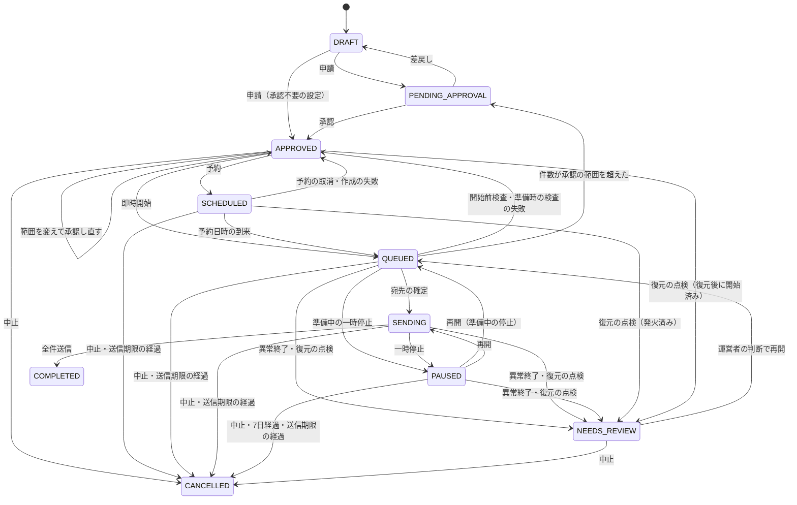
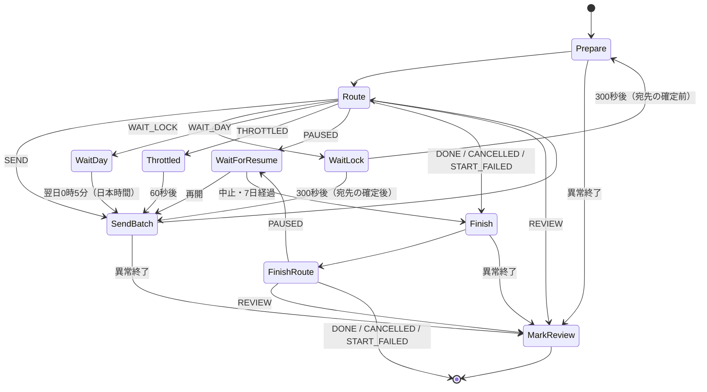

# HT2 ファンクラブメール配信システム 詳細設計書

| 項目 | 内容 |
|---|---|
| 文書ID | HT2-DD-001 |
| 版 | 2.3 |
| 改訂日 | 2026-11-03 |
| 文書状態 | 実装第1〜第8段階の判断を反映したレビュー版。v2.3の変更（V-01〜V-19）は次の実装段階で実装する。パラメータに暫定値を含む |
| 上位文書 | [基本設計書](基本設計書.md) |

| 版 | 内容 |
|---|---|
| 1.0 / 1.1 | Gmail宛て限定・マルチテナント構成の実装仕様 |
| 2.0 | SES中心の構成へ全面改訂 |
| 2.1 | 章立てを処理の流れに沿って整理。旧版との差分とレビュー対応を付録に集約。宛先別の配送記録を標準機能に変更。到達性の要件を反映（差出人ドメインのSPFとA・MX、開始・再開前の検査、1日の送信上限、送信順の分散、送信速度の計算の修正、送信結果の分類の見直し、配送遅延とイベント欠測の監視、試験の追加と訂正） |
| 2.2 | 到達性の検査項目・監視と欠測の扱い・送信枠の予約・拒否理由別対応・本番受入試験を具体化し、一次資料の根拠を追記 |
| 2.3 | 実装メモ第1〜第8段階の判断を各節へ取り込み、本書を正本に戻した。変更仕様 V-01〜V-19 を反映した（付録A.2） |

## 1. 概要

### 1.1 目的と範囲

本書は、基本設計書 v2.3 に基づく実装仕様である。実装者が本書だけで、第三者ライブラリを使わずに構築・試験できることを目標とする。範囲は基本設計書1.2節の「含む」欄のとおり。

v2.3 では、実装メモ第1〜第8段階の「節番号・判断・理由」を該当節へ取り込んだ。以後は本書が正本であり、実装メモは判断の経緯の記録とする。v2.3 の変更項目（変更仕様の V-01〜V-19）と反映先は付録A.2に示す。変更仕様に書かれていない点を決めた箇所には「（v2.3で決定）」と書き、安全側（送らない・止める・再送しない）を選んだ。

### 1.2 用語

| 用語 | 意味 |
|---|---|
| 配信組織 | 1つのAWSアカウントでメールを配信するファンクラブ等 |
| 連絡先リスト | SESのContact List。アカウントに1つ。名称は `ht2` |
| トピック | 連絡先リスト内の配信リスト（会報、イベント告知など）。最大20 |
| 連絡先 | 連絡先リストに登録した会員アドレス。トピックごとの購読状態を持つ。名前と同意の正本は `CONTACT_META` |
| `addr_id` | 正規化したアドレスの HMAC-SHA256（16進64文字）。宛先の内部識別子（4.7節）。先頭8文字の `addr8` は画面とログの表示だけに使う |
| `CONTACT_META` | 宛先ごとの名前・同意・アプリ側の停止・完全削除の印を持つDynamoDBの項目。キーは `addr_id`。アドレスは持たない |
| アプリ側の停止 | `CONTACT_META` の `blocked_all`（全停止）と `blocked_topics`（トピック別）。送信時はSESの停止と合わせて判定する |
| 購読状態 | トピックごとの `OPT_IN`（購読）/ `OPT_OUT`（停止）と、全停止フラグ `UnsubscribeAll` |
| 抑止リスト | SESのアカウント抑止リスト。ハードバウンス・苦情の宛先 |
| 配信 | 1つのトピックへ1つの内容を送る単位。ID はULID |
| 固定テンプレート | 承認申請時に作るSESテンプレート `ht2-c-{配信ID}-{版}`。以後変更しない |
| 宛先スナップショット | 送信開始時にSESから取り出し、`CONTACT_META` で絞り込んだ購読者の一覧。S3に200件ずつ保存する |
| バッチ | スナップショットの1ファイル（200件） |
| 送信受付 | SESが送信要求を受け付け、MessageIdを返したこと。配送成功ではない |
| 結果不明 | 送信要求の成否が分からない状態。自動で再送しない |
| 要確認 | 処理の異常終了などで、運営者の判断を待つ配信の状態 |
| 送信ロック | 同時に送信する配信を1つに限るためのDynamoDB項目 |
| 全体の停止スイッチ | SSMの設定 `sending_enabled`。オフにすると5秒以内に新しい送信要求を始めない（7.11節） |
| 承認の範囲 | 承認者が確定した最大件数・送信期限・最も早い開始時刻（`approval_scope`。6.9節） |
| 送信期限 | `deadline_at`。過ぎたら残りを送らずに中止する（7.10節） |
| 結果不明の調査 | 結果不明の宛先がある配信に作る調査の記録（`unknown_review`。8.6節） |
| 配送記録の索引 | EventBridge経由で `ADDR#{addr_id}` に書く宛先別の配送記録。調べものの入口で、完全な記録はFirehoseの生の配送記録（8.5節） |
| 監査の保管庫 | 監査項目の変更を写すObject Lock付きのS3バケット `AuditArchiveBucket`（4.6節） |
| 受入検査 | 本番受入記録を作るための検査 `ACCEPTANCE / {検査ID}`（16.6節） |
| AWS管理者 | AWSアカウントを管理する人。運営画面の役割ではない。デプロイ、DNS・SESの申請、上限の引上げ、復元、鍵の管理などを行う |

### 1.3 実装上の前提

| 領域 | 方針 |
|---|---|
| ランタイム | Lambda `nodejs24.x`、`arm64`、ESモジュール。`package.json` に依存パッケージを書かない。実行環境の版はデプロイしたときだけ変わる（15.5節） |
| AWS SDK | Lambda同梱の `@aws-sdk/client-*` 12種（sesv2、dynamodb、s3、sfn、scheduler、cloudwatch、cognito-identity-provider、sns、ssm、secrets-manager、lambda、kms）だけを使う。SDKを読み込むのは `src/common/aws.js` だけで、動的 `import()` で遅延読込する。他のモジュールは薄いアダプター（例 `deps.ses.sendEmail(input)`）を受け取る |
| SDKクライアント | すべて自動再試行なし（`maxAttempts: 1`）。送信処理を起動するLambdaの `Invoke` や状態の変更も、結果不明のままSDKが再実行しないようにする。SESは要求の開始から10秒で中断する（AbortSignalとHTTPのタイムアウト）。送信以外のSESの制限応答だけを `sesv2.js` が明示的に再試行する（3.8節） |
| DynamoDB | 更新・追加・削除は条件式がなければアダプターが拒否する |
| 画面 | 素のHTML・CSS・JavaScript。PKCEはWeb Crypto APIで実装 |
| テスト | `node --test test/`。`test/index.js` が単体・契約試験の `.test.js` を再帰的に読み込む（この環境では `node --test` がディレクトリを自動で探索しないため）。SDKは偽のアダプターに差し替える |

## 2. 全体構成

### 2.1 構成要素

| 構成要素 | 責務 | 詳細 |
|---|---|---|
| SES | 宛先アドレスの保管、配信リスト、配信停止、抑止、テンプレート、送信、イベント発行 | 3章 |
| 管理API Lambda（`ApiFunction`） | 役割の確認、組織設定、宛先の操作、取込の受付と確認、配信の作成・申請・承認・開始・停止、結果の取得、スタッフ管理、受入確認、送信の準備状況 | 10章 |
| 送信Lambda（`WorkerFunction`） | 宛先スナップショット、バッチ送信、終了処理、CSV取込と一括更新、日次処理、認証の再確認、SDKの点検、属性の移行、鍵の入れ替え、抑止リストからの削除、DynamoDBの復元の書戻しと点検 | 5.4節、7章、12.5節、13.4節、13.7節 |
| 監査を写すLambda（`AuditFunction`） | 監査項目の変更を監査の保管庫に写し、書換えを検知する | 4.6節 |
| 配送記録の索引のLambda（`EventsFunction`） | SESのイベントから宛先別の配送記録の索引を書く | 8.5節 |
| Step Functions（`BroadcastStateMachine`） | 一斉送信の進行。一時停止・再開・中止の待ち合わせ | 7.2節 |
| EventBridge Scheduler | 予約配信の開始、日次処理の起動 | 7.1節、13.4節 |
| EventBridge（既定のイベントバス） | SESのイベントを `EventsFunction` に渡す | 8.5節 |
| DynamoDB（1テーブル） | 配信記録、組織設定、取込記録、受入検査、送信ロック、監査ログ、宛先の記録（`CONTACT_META`）、完全削除の記録、配送記録の索引。ストリームで監査の変更を流す | 4.3節 |
| S3 | 運営画面、取込ファイル、宛先スナップショット、失敗・不明の記録、バックアップ、受入の証跡、復元の報告、配送記録、監査の保管庫 | 4.4節、4.6節 |
| KMS（`EraseMacKey`） | 完全削除の照合値を作るHMAC鍵 | 4.7節 |
| CloudWatch・Firehose・Athena | 配信別の件数、宛先別の配送記録、アラーム | 8章、13章 |
| CloudFront・WAF・API Gateway・Cognito | 運営画面の配信、APIの公開、ログイン | 9章、11章、12章 |

### 2.2 処理の流れ

**宛先の登録**

1. 個別登録は、管理APIが `CONTACT_META` を登録中として作り、SESに連絡先を作ってから有効にする（5.1節）。
2. CSV取込は、管理APIがファイルを受け取り、送信Lambdaが検証・照合して確認用の結果を作る。管理者か配信担当が確認すると、新規はSESのインポートジョブ（JSON Lines）で登録し、既存の宛先の更新は `CONTACT_META` に反映する（5.4節、5.8節）。

**配信**

1. 配信担当が下書きを作り、テスト送信で確認する（6.3節、6.6節）。
2. 申請時に、件名・本文・フッターを固定テンプレートとしてSESに作る。申請者は範囲（最大件数・送信期限）を提案する（6.4節、6.9節）。
3. 承認者が内容と範囲を確定して承認する（6.5節、6.9節）。
4. 配信担当が承認の範囲の中で開始または予約する。Step Functionsの実行を、開始試行ごとの名前（初回は配信ID）で開始する（7.1節）。
5. 送信Lambdaが送信ロックを取り、トピックの購読者をSESから取り出し、`CONTACT_META` の停止と完全削除を除いてS3に保存する。件数が承認の範囲を超えるとき、または期限までに送り終えられないときは1通も送らない（7.3節、7.10節）。
6. 送信Lambdaが200件ずつ、速度を調整しながら1通ずつ送る。各送信の直前に、配信の状態と宛先の停止を確かめる。組織の日次上限に達したら翌日以降に再検査して続ける。SES枠・認証・監視異常では自動再開しない（7.4節）。
7. SESのイベントが、CloudWatchの配信別メトリクス、S3の配送記録、DynamoDBの配送記録の索引に記録される（8章）。
8. 終了時に結果不明の宛先があれば、結果不明の調査を作り、管理者の判断を待つ（8.6節）。

**配信停止・バウンス**

1. 会員の解除操作はSESが処理し、連絡先リストの購読状態を変える（5.7節）。運営者が行う停止は `CONTACT_META` のアプリ側の停止として記録する（5.1節）。
2. ハードバウンス・苦情はSESが抑止リストに登録する。以後の送信はSESが止める。

**監査**

1. 変更を伴う操作は、DynamoDBに監査項目として書く（4.3節）。
2. DynamoDB Streamsが監査項目の追加・変更を `AuditFunction` に渡し、Object Lock付きの保管庫に写す。既存の項目の書換えは検知して通知する（4.6節）。

## 3. SESの設定

### 3.1 送信元ドメインとDNS

CloudFormationでドメインのIdentityを作り、出力された値を配信組織のDNSに登録する。

| 種別 | 名前 | 値 | 目的 |
|---|---|---|---|
| CNAME ×3 | `{selector}._domainkey.{domain}` | SESが返す値（参照先のゾーンは `DkimAttributes.SigningHostedZone`） | Easy DKIM（2048bit）。ドメイン認証を兼ねる。値を固定の文字列から組み立てず、SESの出力をそのまま使う |
| MX | `bounce.{domain}` | `10 feedback-smtp.ap-northeast-1.amazonses.com`（1つだけ） | カスタムMAIL FROM。通常のメール受信には使わない |
| TXT | `bounce.{domain}` | `v=spf1 include:amazonses.com ~all` | SPF。MAIL FROMで評価され、DMARCの整合に使われる |
| TXT | `{domain}` | 既存のSPFに `include:amazonses.com` を加える。SPFがなければ `v=spf1 include:amazonses.com ~all` | docomoが差出人ドメインのSPFを確認するため。同じ名前にSPFを2つ作らない。DNS参照の回数（10回まで）を超えない |
| A / MX | `{domain}` | 配信組織が実際に使っているWebサイト・メール受信サービスの値 | docomoは差出人ドメインにAもMXもないと届かない場合がある。架空の値は入れない |
| TXT | `_dmarc.{domain}` | `v=DMARC1; p=none; rua=mailto:dmarc@{domain}; adkim=s; aspf=r` から始める | DMARC（RFC 9989）。集計レポートで正規の送信経路をすべて確かめてから `quarantine`、`reject` へ進める。旧 `pct` による割合指定を確実な段階導入策にしない（現行RFC 9989では削除。旧実装との共存を考慮） |

- 送信元ドメインは配信組織につき1つ。Fromアドレスは環境ごとに組織設定の1つだけ（表示名は設定で変えられる）。Fromのドメイン部分は `SENDER_DOMAIN` と完全一致に限る（任意の子ドメインは許可しない）。Fromと返信先は、実際に受信できるアドレスにする。
- MAIL FROMのMXが見つからない場合は送信を拒否する設定（`BehaviorOnMxFailure: REJECT_MESSAGE`）にする。
- DMARCの集計レポートの受信先は、配信組織が実際に読むメールボックスにする。レポートにはIPなどが含まれるため、読める人を限る。
- `GetEmailIdentity` が成功を返しても、SPFの重複や整合の失敗は分からない。実際に受信したメールで確かめる（T-30）。
- 組織設定の保存時と、配信の開始・再開の前に、送信可能、DKIMの署名が有効で成功、MAIL FROMが成功であることを確かめる（7.1節）。DNSのSPF・DMARCは日次処理で確かめる（13.4節）。組織設定を保存したときは、日次と同じ認証・DNSの確認（`auth-check`）を非同期で起動する（10.3節）。

Fromが `fc.example.jp`、DKIMの `d=` が `fc.example.jp`、MAIL FROMが `bounce.fc.example.jp` の場合、DKIMはstrict整合、SPFはrelaxed整合で成立する。`aspf=s` にするとこのMAIL FROMではSPF経由の整合が成立しない。両方のpassと整合をプロジェクトの合格条件とするが、DMARC自体の条件は整合した少なくとも一方のpassである。`MailFromDomainStatus=SUCCESS` はMX確認の成功であり、SPF・DMARC全体の合格を意味しない。[SES DMARC](https://docs.aws.amazon.com/ses/latest/dg/send-email-authentication-dmarc.html)

SPFはinclude/redirectの再帰を含めてDNS参照を評価し、上限10を超える設定を採用しない。既存SPFの正規送信元やall方針を無断で消さない。日次の存在・重複・機構ごとの検査（13.4節）だけでは完全なSPF評価を代替できないため、変更時は正規送信経路の棚卸し、DNS参照数、権威DNSと通常の再帰リゾルバへの伝播、実受信を確認する。docomo向けのHeader From側SPFは標準SPFの定義とは分ける。[RFC 7208](https://www.rfc-editor.org/rfc/rfc7208.html)、[docomo](https://www.docomo.ne.jp/service/docomo_mail/smtp_notice/)

Easy DKIMの秘密鍵・公開鍵のローテーションはSESに任せ、3つのCNAMEを維持する。独自の事前署名やBYODKIMへ変更しない。DMARC集計用メールボックスはSES送信Identityだけでは作られない。外部ドメインの `rua` は必要な受信側DNS承認を確認し、集計ファイルは信頼しない入力として容量・展開率を制限して解析する。[Easy DKIM](https://docs.aws.amazon.com/ses/latest/dg/send-email-authentication-dkim-easy.html)、[RFC 9990](https://www.rfc-editor.org/rfc/rfc9990.html)

### 3.2 アカウント設定

`scripts/bootstrap-ses.sh` で次を行う。

| 設定 | 方法 | 値 |
|---|---|---|
| 抑止リスト | `PutAccountSuppressionAttributes` | 対象 `BOUNCE`、`COMPLAINT` |
| 本番利用の申請 | `PutAccountDetails` またはコンソール | 配信目的、同意の取得方法、配信停止の方法、想定通数 |
| 送信上限の記録 | `GetAccount` | `MaxSendRate`、`Max24HourSend` を記録し、送信速度の上限を決める |

### 3.3 Configuration Set `ht2-{env}`

| 項目 | 値 | 理由 |
|---|---|---|
| TLS | `REQUIRE` | 受信側との通信を暗号化する。TLSを使えない受信側には届かないが、暗号化なしに切り替えて送り直さない |
| 配送の最長時間 | 指定しない | SESの既定に任せる。配送遅延の期限が切れても、アプリから送り直さない |
| 評判メトリクス | 有効 | バウンス率・苦情率の監視 |
| 抑止設定 | 指定しない | アカウント抑止リストをそのまま使う。Configuration Setの抑止設定はアカウント設定より優先されるため |
| 開封・クリック計測 | 指定しない | リンクの書換えを避け、会員のプライバシーを守る |
| イベント発行先1 | CloudWatch。対象 `SEND, REJECT, BOUNCE, COMPLAINT, DELIVERY, DELIVERY_DELAY, SUBSCRIPTION, RENDERING_FAILURE`。次元 `campaign`（メッセージタグから取得、既定値 `none`） | 配信別の件数（8.1節） |
| イベント発行先2 | Data Firehose（本番必須）。対象は同上 | 宛先別の配送記録（8.3節） |
| イベント発行先3 | EventBridge（既定のイベントバス）。対象は同上 | 宛先別の配送記録の索引（8.5節） |

- 3つの発行先の対象イベントは同じにする。イベントの種類はCloudFormationの表記（大文字とアンダースコア）で書く。
- 送信時のメールタグは `campaign`（配信ID）と `rid`（`addr_id`）の2つ（3.7節）。

`REQUIRE` はTLS接続を条件とするが、MTA-STS・DANEによる宛先認証まで保証する設定とは扱わない。送信元DNSに受信用MTA-STS/TLS-RPTを置くだけで外向きSES配送が改善すると仮定しない。これらを必須にする場合は別途SESの対応範囲を確認する。[SESのTLS](https://docs.aws.amazon.com/ses/latest/dg/security-protocols.html)、[MTA-STS](https://www.rfc-editor.org/rfc/rfc8461.html)、[DANE](https://www.rfc-editor.org/rfc/rfc7672.html)

### 3.4 連絡先リストとトピック

```yaml
ContactList:
  Type: AWS::SES::ContactList
  DeletionPolicy: RetainExceptOnCreate
  UpdateReplacePolicy: Retain
  Properties:
    ContactListName: ht2
    Description: !Sub 'HT2 ${Env}'
    Topics:
      - TopicName: !Ref Topic1Name          # 例 kaiho（会報）。必須
        DisplayName: !Ref Topic1Display
        Description: !Ref Topic1Description
        DefaultSubscriptionStatus: OPT_OUT
      - !If
        - HasTopic2                         # Topic2Name が空なら作らない
        - TopicName: !Ref Topic2Name        # 例 event（イベント・チケット情報）
          DisplayName: !Ref Topic2Display
          Description: !Ref Topic2Description
          DefaultSubscriptionStatus: OPT_OUT
        - !Ref 'AWS::NoValue'
```

- トピックの既定の購読状態はすべて `OPT_OUT` とし、明示的に同意したトピックにだけ送る。
- 初期のテンプレートでは、トピックを2つまでパラメータで定義する（`Topic1*` は必須、`Topic2*` は任意）。
- トピック名は英小文字・数字・`_` で20文字以内。表示名は128文字、説明は500文字まで。表示名と説明はSESの解除ページに表示される（日本語の表示はU-10）。
- トピックの追加・変更はCloudFormationのパラメータで行い、SESのコンソールでは変えない（定義のずれを防ぐため）。**一覧から外したトピックは削除され、その購読状態も失われる。** `Retain` はトピック単体の購読状態を守らない。`deploy.sh` は変更セットに、連絡先リストの削除・置換、トピックの削除、`Topics`・条件の宣言の変更があれば、作成時も実行時も止める（15.3節）。
- 配信リストの追加・名前の変更は運営画面では扱わず、AWS管理者に依頼する（変更セットのレビューが必要なため）。
- 連絡先リストの削除は権限設定で拒否し、スタックを消しても残す（`RetainExceptOnCreate` は初回の作成に失敗したときだけ消える）。

### 3.5 連絡先の属性データ

宛先の名前・同意・アプリ側の停止の正本は、DynamoDBの `CONTACT_META / {addr_id}`（4.3節）である。SESの連絡先の `AttributesData`（JSON文字列）には、作成時の最小限だけを書く。以後の名前の変更や停止では、SESの属性を書き換えない（5.1節）。

属性の形は次のとおり。`CONTACT_META.attributes` とSESの作成時の `AttributesData` は同じ形で、違いは表の「書く場所」のとおり。

```json
{
  "v": 1,
  "name": "山田 太郎",
  "consent": { "at": "2026-10-01T09:00:00+09:00", "source": "FC入会フォーム", "version": "2026-04" },
  "reconsent": { "at": "2027-01-10T12:00:00+09:00", "source": "本人からのメール", "by": "sub-of-admin" },
  "origin": "import:01JC…",
  "orig": "Taro.Yamada+fc@googlemail.com"
}
```

| 項目 | 必須 | 規則 | 書く場所 |
|---|---|---|---|
| `name` | × | 0〜50文字（Unicodeのコードポイントで数える）。制御文字不可 | 両方 |
| `consent.at` | ○ | ISO 8601。未来の日時は不可 | 両方 |
| `consent.source` | ○ | 1〜100文字。メールアドレスの形を含めば `422 CONSENT_SOURCE_HAS_ADDRESS` | 両方 |
| `consent.version` | × | 0〜30文字 | 両方 |
| `reconsent` | × | 購読再開（5.5節）の最新1件。`source` の規則は `consent.source` と同じ | `CONTACT_META` だけ |
| `origin` | ○ | `import:{取込ID}` または `manual:{操作者のsub}` | 両方 |
| `orig` | × | 正規化前の表記。Gmailで表記が変わった場合だけ（4.2節） | SESの作成時だけ。`CONTACT_META`・監査・ログには書かない |

- 全体で1KiB以内に抑える（`orig`・`origin` を含めて数える）。
- 閲覧者には属性を返さない（9.3節）。
- 送信してよいのは、SESで購読中（トピックが `OPT_IN` で全停止なし）であり、かつ `CONTACT_META` が `ACTIVE`・`erased` でない・アプリ側の停止がない宛先だけである（7.3節、7.4.1節）。

### 3.6 テンプレート

| 項目 | 規則 |
|---|---|
| 名称 | `ht2-c-{配信ID}-{版}`。版は差戻し後の再申請で増える |
| 内容 | `Subject`（件名）と `Text`（本文＋フッター）。`Html` は使わない |
| 作成 | 承認申請のとき（6.4節） |
| 変更・削除 | 管理APIの権限では拒否する。日次処理だけが、保持期間を過ぎた終了済み配信のテンプレートを削除できる |
| 構文 | SESのテンプレートは `{{…}}` を差し込みとして解釈する。件名・本文・設定値に `{{` と `}}` を含む入力は拒否する。システムが入れるのはフッターの `{{amazonSESUnsubscribeUrl}}` だけ |
| プレビュー | `TestRenderEmailTemplate` に限り、`amazonSESUnsubscribeUrl` にダミーのURLを渡す。実送信と固定テンプレートの差し込みはそのまま。プレビューAPIが解除URLを作るとは仮定しない |
| 上限 | 1件500KB、リージョンあたり20,000件 |

### 3.7 送信要求

```json
{
  "FromEmailAddress": "=?UTF-8?B?44CH44CH44OV44Kh44Oz44Kv44Op44OW?= <info@fc.example.jp>",
  "Destination": { "ToAddresses": ["member@example.ne.jp"] },
  "ReplyToAddresses": ["support@fc.example.jp"],
  "Content": { "Template": { "TemplateName": "ht2-c-01JC7Q…-1", "TemplateData": "{}" } },
  "ListManagementOptions": { "ContactListName": "ht2", "TopicName": "kaiho" },
  "ConfigurationSetName": "ht2-prod",
  "EmailTags": [ { "Name": "campaign", "Value": "01JC7Q…" }, { "Name": "rid", "Value": "3f9a…（addr_id、64文字）" } ]
}
```

| パラメータ | 規則 |
|---|---|
| `FromEmailAddress` | 申請時に固定した差出人。表示名に日本語を含む場合はRFC 2047のBエンコード（自作。6.8節） |
| `Destination.ToAddresses` | 1件だけ。配信停止のヘッダーとURLは宛先が1件のときだけ付く |
| `ListManagementOptions` | 必ず指定する。SESが `List-Unsubscribe`・`List-Unsubscribe-Post` を付け、停止済みの宛先への送信を止める |
| `EmailTags` | `campaign` に配信ID（テスト送信は `test`）、`rid` に宛先の `addr_id`（テスト送信も付ける）。SESのタグの値は英数字・`_`・`-` で256文字以内 |
| 独自ヘッダー | 付けない（SESが付けるヘッダーと衝突させないため） |

`ListManagementOptions` を付けて連絡先リストにない宛先へ送ると、SESが連絡先を自動で作る。そのため送信先は必ず連絡先リストから取り出したアドレスに限る。テスト送信先も登録済みの連絡先に限る（6.6節）。一括送信API（`SendBulkEmail`）は `ListManagementOptions` に対応しないため使わない。

### 3.8 API呼び出し制限への対応

SESは `SendEmail` と `SendBulkEmail` 以外のAPIを毎秒1件に制限している。この制限が操作ごとかアカウント全体で共有かは確認できていないため、共有として扱う（U-02）。

- `common/sesv2.js` は送信以外の呼び出しを、DynamoDBの `RATE / SES_CONTROL` による条件付き更新で1.1秒以上離す。最新の `next_allowed_at_ms` を強い整合性で読む。項目がなければ `attribute_not_exists(PK)` で作り、あれば期限経過かつ読んだ版と時刻が一致するときだけ次の時刻へ更新して実行する。競合時は再読取して待つ。Lambda間で枠を共有し、プロセス内だけの間引きにしない。失敗した呼び出しも枠を使い、各再試行も同じ枠を通す。
- `TooManyRequestsException`、またはHTTP 400の `ThrottlingException` を受けたら、1・2・4・8・16秒と待って再試行する。送信以外のAPIは、制限で拒否された要求が実行されていないので、再試行しても安全である。それでも失敗したら `503 SES_BUSY` を返す。`SendEmail` はこの仕組みを通さず、ここでは再試行しない（7.5節）。
- 画面の一覧表示は1ページ50件とし、連続した呼び出しを避ける。
- 宛先スナップショットの作成中は画面の操作が遅くなることがあるため、画面に「送信準備中」と表示する。
- `SendEmail` の速度は7.4節で調整する。

### 3.9 Sandboxと本番

1. Sandboxでは認証済みのアドレスにしか送れない。開発環境はこの状態で結合試験を行う。
2. 本番利用が承認されたら `GetAccount` の送信上限を記録し、送信速度の上限を `MaxSendRate × 0.8` 以下にする。
3. 初回・休止明け・増量時は1つのトピックの少数会員から始め、バウンス・遅延・苦情・購読設定変更を観察する。日次上限の引上げは管理者の記録を必要とする。

### 3.10 到達性検査の値と有効期限

7.1節で次を検査する。値は東京リージョン・当該AWSアカウントのものに限り、CloudFormationの作成成功や別リージョンの検証結果を流用しない。

| 対象 | 合格条件 | 失敗理由 |
|---|---|---|
| `GetAccount` | 本番は `ProductionAccessEnabled=true`、`SendingEnabled=true`、`EnforcementStatus=HEALTHY`。`SuppressionAttributes.SuppressedReasons` にBOUNCEとCOMPLAINTがある | `SES_PAUSED` / `SUPPRESSION_MISCONFIGURED` |
| `GetEmailIdentity` | `VerifiedForSendingStatus=true`、`DkimAttributes.SigningEnabled=true`、`Status=SUCCESS`、`CurrentSigningKeyLength=RSA_2048_BIT` | `AUTH_CHECK_FAILED` |
| MAIL FROM | 設定値が `bounce.{SENDER_DOMAIN}`、`MailFromDomainStatus=SUCCESS`、`BehaviorOnMxFailure=REJECT_MESSAGE` | `AUTH_CHECK_FAILED` |
| `GetConfigurationSet` | `SendingOptions.SendingEnabled=true`、`DeliveryOptions.TlsPolicy=REQUIRE`、評判メトリクス有効。抑止設定（`SuppressionOptions`）はなし、または `SuppressedReasons` なしを許し、理由を明示する場合はBOUNCEとCOMPLAINTの両方を必須にする（アカウント抑止を無効化する上書きを許さない） | `CONFIGURATION_INVALID` |
| `GetConfigurationSetEventDestinations` | CloudWatch・Firehose・EventBridgeの3つがEnabledで、3.3節の全イベント、正しい次元・ストリーム・イベントバスが指定済み | `EVENT_DESTINATION_DISABLED` |
| DNS検査 | `AUTH_STATUS.checked_at` が26時間以内、結果PASS、対象ドメインが一致。SPF・DMARCの欠落・重複なし。`AUTH_STATUS.config_hash` が現在の送信設定のハッシュと違うときは、再確認が終わっていない | `AUTH_CHECK_FAILED` / `AUTH_CHECK_STALE` |
| 本番受入記録 | 16.5節の必須試験が合格し、`status=PASS` で現在の送信設定・DNSハッシュと一致し、90日以内の `delivery_check` がある。`note` が空でなく、証跡が `delivery-checks/` に実在する | `DELIVERY_CHECK_REQUIRED` |
| 送信枠・監視 | 7.4、7.8節の枠と監視条件を満たす。取得失敗やリソース不在を正常扱いしない | `QUOTA_INSUFFICIENT` / `MONITORING_UNAVAILABLE` |

送信設定のハッシュ（`sendingConfigHash`）は、環境・アカウント・東京リージョン・送信元ドメイン・連絡先リスト・設定セット・イベントストリーム・監視のアラーム名・組織設定のFromと返信先と法定表示、および送信に関わるコード（`aws.js`、`config.js`、`contact-metadata.js`、`email.js`、`footer.js`、`sender.js`、`precheck.js`、`acceptance.js`、`campaigns.js`、`prepare.js`、`daily.js`）の内容から求める。配信ごとの本文・件名は含めない。コードを更新すると値が変わるので、更新後はDNSの再確認と受入記録の更新が必要になる（16.5節）。

SES APIの状態は60秒までキャッシュし、開始・予約起動・再開・翌日待機からの継続で再評価する。送信中は60秒ごとにアカウントと認証状態、設定セットを更新して確認する。設定変更時はキャッシュを無効にする。全検査は宛先単位には行わず3.8節の共通間引きを使う。26時間・60秒は本システムの設計値であり、DNSやSESの反映時間の保証ではない。[GetAccount](https://docs.aws.amazon.com/ses/latest/APIReference-V2/API_GetAccount.html)、[DkimAttributes](https://docs.aws.amazon.com/ses/latest/APIReference-V2/API_DkimAttributes.html)、[MailFromAttributes](https://docs.aws.amazon.com/ses/latest/APIReference-V2/API_MailFromAttributes.html)

## 4. データ

### 4.1 保持場所

| データ | 保持場所 | 備考 |
|---|---|---|
| 宛先アドレス、トピック別の購読状態、全停止フラグ（会員がSESで行った操作を含む） | SES 連絡先リスト | アドレスの正本 |
| 名前、同意・再同意の記録、アプリ側の停止、完全削除の印 | DynamoDB `CONTACT_META` | 正本（3.5節）。アドレスは持たない |
| 作成時の属性（`orig` を含む） | SES 連絡先の属性データ | 作成時だけ書く（3.5節） |
| ハードバウンス・苦情の宛先 | SES 抑止リスト | 自動登録 |
| 承認済みの本文 | SES 固定テンプレート | 変更不可 |
| 配信記録、組織設定、取込記録、受入検査、送信ロック、監査ログ、完全削除の記録、配送記録の索引 | DynamoDB | 宛先アドレスは保存しない。宛先は `addr_id` で表す |
| 監査ログの写し | S3 `AuditArchiveBucket` | Object Lock、400日（4.6節） |
| 取込ファイル、宛先スナップショット、失敗・不明の記録、バックアップ、受入の証跡、復元の報告 | S3 `DataBucket` | 期限付き（4.4節） |
| 配信別の件数 | CloudWatch メトリクス | 15か月 |
| 宛先別の配送記録（生のイベント） | S3 `EventLogBucket` | 90日 |
| 宛先別の配送記録の索引 | DynamoDB `ADDR#{addr_id}` | 180日（8.5節）。アドレスは持たない |
| 宛先の識別子の鍵 | Secrets Manager `AddressHmacSecret` | 4.7節 |
| 完全削除の照合の鍵 | KMS `EraseMacKey` | 鍵はKMSの外に出ない（4.7節） |

### 4.2 メールアドレスの検証と正規化

| 手順 | 規則 |
|---|---|
| 前処理 | 前後の空白を除く。ASCIIだけかどうかを小文字にする前に確かめ（小文字にするとASCIIになるUnicode文字も拒否する）、全体を小文字にする（SESの連絡先は大文字と小文字を区別して保存されるため） |
| 文字 | ASCIIだけ。`@` は1つ。ローカル部64文字以下、全体254文字以下 |
| ローカル部 | RFC 5322のatext文字とドット。先頭・末尾のドットと連続したドットは `NONSTANDARD_ADDRESS` として拒否する（古い携帯アドレスに多い。SESが受け付けない可能性があるため。U-07） |
| ドメイン | ラベルは2つ以上（単一ラベルのドメインには送らない）。各ラベル63文字以下、全体253文字以下、英数字とハイフン。国際化ドメインはPunycode表記だけ受け付ける。最上位のラベルが数字だけのものは拒否 |
| Gmailの正規化 | ドメインが `gmail.com` か `googlemail.com` なら、ローカル部のドットと `+` 以降を除き、ドメインを `gmail.com` にした値を連絡先のアドレス（送信先）とする。表記が変わったときだけ、入力された表記（前後の空白を除き、大文字小文字は入力のまま）をSESの作成時の属性 `orig` に残す（3.5節）。Gmail以外では `orig` を作らない |

Gmailはドットを無視し、`+` 以降と `googlemail.com` も同じ受信箱に届く。正規化することで、同じ受信箱が複数の連絡先になり、毎回何通も届いたり、1つを停止しても他に送り続けたりすることを防ぐ。`+` を使った受信側の振り分けは効かなくなるが、配送には影響しない。Google Workspace 等の独自ドメインは正規化しない。

### 4.3 DynamoDB テーブル `ht2-{env}`

キーは `PK`（文字列）と `SK`（文字列）。索引（GSI）は持たない。TTL属性は `expires_at`（Unix秒）。ストリームは `NEW_AND_OLD_IMAGES`（4.6節）。

| PK | SK | 内容 | TTL |
|---|---|---|---|
| `SETTINGS` | `ORG` | 組織設定 | — |
| `SETTINGS` | `TOPIC_COUNTS` | トピック別の購読者数（日次処理が更新） | — |
| `SETTINGS` | `AUTH_STATUS` | 認証・DNSの検査の結果（13.4節） | — |
| `SETTINGS` | `CONTACT_BACKUP` | 最新のバックアップの状態（件数、属性の欠損件数、SHA-256。13.5節） | — |
| `SETTINGS` | `CONTACT_BACKFILL` | 属性の移行（`contact-backfill`）の再開位置（13.5節） | — |
| `SETTINGS` | `REKEY` | 鍵の入れ替え（`rekey`）の再開位置（4.7節。項目名は v2.3で決定） | — |
| `CAMPAIGN` | `{配信ID}` | 配信記録 | — |
| `IMPORT` | `{取込ID}` | 取込記録 | 1年 |
| `IDEMP` | `{sub}#{Idempotency-Key}` | 取込要求の二重送信防止 | 24時間 |
| `ACCEPTANCE` | `{検査ID}` | 受入検査（16.6節） | `OPEN` の間だけ30日 |
| `LOCK` | `SEND` | 送信ロック | — |
| `LOCK` | `CONTACT_CREATE` | 新規登録・取込・一括更新・完全削除・鍵の入れ替え・連絡先の復元の排他。所有者・ジョブID・状態・取得時刻を保持 | — |
| `DAILY` | `{YYYY-MM-DD}`（日本時間） | `reserved_attempts`：送信試行の予約数。テスト・再試行を含む保守的な日次制限 | その日の0時（日本時間）から8日 |
| `RATE` | `SES_CONTROL` | 送信以外のSES APIの `next_allowed_at_ms` と `version` | — |
| `CONTACT_META` | `{addr_id}` | 宛先の記録（名前・同意・アプリ側の停止・完全削除の印） | — |
| `ADDR#{addr_id}` | `{発生時刻}#{種類}#{eventIDの先頭12文字}` | 配送記録の索引（8.5節） | 180日 |
| `AUDIT#{YYYYMM}` | `{ISO8601}#{ULID}` | 監査ログと連絡先の変更記録。月はUTCの記録日時から作る | 1年 |
| `ERASED` | `{GenerateMac(EraseMacKey, 正規化したアドレス) の16進}` | 完全削除した宛先（再登録の防止。4.7節） | — |

- 値の変換：安全なJavaScriptの整数を超える数はBigIntで扱う。有限でない数、安全でない整数のNumber、未定義、循環参照、空の集合、型の混ざった集合は拒否する。値を黙って落としたり丸めたりして保存しない。
- 更新には必ず条件式を付ける。新規は `attribute_not_exists(PK)`、既存は読み取った `version` の一致を条件にし、`version` を1増やす。

#### 組織設定 `SETTINGS / ORG`

| 項目 | 型 | 規則 |
|---|---|---|
| `from_local` | S | Fromのローカル部。ドメインは環境変数 `SENDER_DOMAIN` に固定 |
| `from_name` | S | 1〜64文字。改行と `<>"` は不可 |
| `reply_to` | S | 任意。4.2節で検証 |
| `legal.sender_name` | S | 送信者の名称（必須） |
| `legal.address` | S | 所在地（必須） |
| `legal.contact` | S | 苦情・問合せの連絡先（メールアドレス・URL・電話番号のいずれか、必須） |
| `approval_required` | BOOL | 既定 true |
| `test_recipients` | L(S) | 最大5件。連絡先リストに登録済みであること |
| `max_rate_per_sec` | N | 1以上。既定10。SSMの上限も別に効く |
| `delivery_check` | M | 本番受入記録 `{status, check_id, passed_at, by, note, cases, evidence_keys, config_hash, dns_config_hash, dns_item_hashes, invalidated_at, invalidation_reason, invalidation_details, expiry_notified}`。API-29でだけ作る（16.6節）。90日以内で現設定と一致すること。API-02では変更不可 |
| `version` / `updated_at` / `updated_by` | | 楽観ロックと監査 |

`legal`・`from_name`・`reply_to` には `{{`・`}}`・制御文字を含めない。

#### 配信記録 `CAMPAIGN / {配信ID}`

| 項目 | 型 | 意味 |
|---|---|---|
| `campaign_id` | S | ULID |
| `schema_version` | N | 項目の形の版。v2.3では1（15.5節） |
| `status` | S | 6.1節の状態 |
| `topic` / `topic_display` | S | 送信先のトピック |
| `subject` / `body_text` | S | 下書きの件名・本文 |
| `rev` | N | 申請の版。差戻しの後の申請で増える |
| `template_name` / `content_sha256` | S | 固定テンプレートの名前と、件名＋本文＋フッターのSHA-256 |
| `from` / `reply_to` / `footer_text` | S | 申請時に固定した差出人・返信先・フッター |
| `created_by` / `submitted_by` / `approved_by` / `started_by` | S | Cognitoの `sub`。自動承認は `AUTO` |
| `created_at` / `submitted_at` / `approved_at` / `started_at` / `completed_at` | S | UTCのISO 8601 |
| `audience_estimate` / `audience_estimate_at` | N / S | 申請時の前日時点の購読者数（`TOPIC_COUNTS`）とその時刻（6.9節） |
| `proposed_scope` | M | 申請者が提案した範囲 `{max_recipients, send_by, send_after}`（6.9節。項目名は v2.3で決定） |
| `approval_scope` | M | 確定した範囲 `{max_recipients, send_by, send_after, approved_by, approved_at}`（6.9節） |
| `deadline_at` | S | 送信期限（7.10節） |
| `start_mode` / `scheduled_at` / `schedule_name` | S | `NOW` か `SCHEDULED`、予約日時、スケジュール名 |
| `start_attempt` / `start_execution_name` / `start_requested_at` | N / S / S | 開始試行の番号、実行名（初回は配信ID、以後 `{配信ID}-s{n}`）、開始要求の時刻（7.1節） |
| `start_error` | S | 開始前検査・準備時の検査・開始の作成の失敗の理由（`TOO_MANY_RECIPIENTS`、`AUDIENCE_EXCEEDS_APPROVAL`、`CAPACITY_INSUFFICIENT`、`START_EXECUTION_FAILED` など） |
| `execution_arn` | S | 現在のStep Functionsの実行 |
| `workflow_execution_arn` / `workflow_steps` | S / N | 実行ごとのworker呼出しの回数（7.2節） |
| `wait_lock_run` / `throttled_run` | N | 連続したロック待ち・速度超過待ちの回数（7.2節） |
| `rate_per_sec` | N | 送信開始時に決めた速度 |
| `recipients_total` / `chunks_total` / `snapshot_batch_size` | N | スナップショットの件数、ファイル数、1ファイルの件数 |
| `progress` | M | `{chunk, index}`。次に送る位置。20通ごとに更新 |
| `counts` | M | `{accepted, failed, unknown, skipped_blocked, excluded_allowlist, excluded_no_record}`（`excluded_no_record` は7.3節。v2.3で決定） |
| `accepted_buckets` | M | 5分区切りのUTC時刻（`YYYY-MM-DDTHH:MMZ`）ごとの受付件数（7.8節） |
| `events_checked_at` / `events_last_seen_at` / `events_missing` | S / S / N | イベントの欠測の判定の時刻、`Send` を観測した最後の区間、推定欠落件数（7.8節） |
| `last_send_at` | S | 最後の実送信の開始時刻。監視の観測猶予に使う |
| `sender_state` | M | `{bad_code, bad_run}`。同じ宛先エラーの連続回数（バッチをまたいで数える。アドレスは持たない） |
| `result_keys` | L(S) | 失敗・不明・停止済みの記録ファイルのキー（8.2節） |
| `next_attempt_at` | S | 日次上限による待機の再開予定（UTC） |
| `pause_reason` | S | `USER` / `OPERATOR_SWITCH` / `REPUTATION_ALARM` / `CAMPAIGN_BOUNCE` / `CAMPAIGN_DELAY` / `EVENTS_MISSING` / `EVENT_LOG_STALE` / `MONITORING_UNAVAILABLE` / `CONTENT_ERROR` / `AUTH_CHECK` / `AUTH_CHECK_STALE` / `LOCK_WAIT_TIMEOUT` / `SES_PAUSED` / `SES_UNSTABLE` / `QUOTA` |
| `pause_phase` / `paused_at` | S | 停止した段階（`prepare` か `send`）と停止の開始時刻 |
| `task_token` | S | 一時停止中の再開待ちトークン |
| `review` | M | `{chunk, index_from, index_to, reason}`。要確認の範囲。準備中の異常は `{reason, phase: "prepare"}`（7.7節） |
| `unknown_review` | M | 結果不明の調査 `{status: OPEN/RESOLVED, count, opened_at, decisions, notified_at}`（8.6節） |
| `test_holds` | L(S) | テスト送信で結果不明になった宛先の `addr_id`（6.6節） |
| `schedule_delayed_notified_at` | S | 予約の遅れを通知した時刻（7.11節） |
| `unsent_count` | N | 送信期限の経過で中止したときの未送信の件数（7.10節。項目名は v2.3で決定） |
| `reject_reason` / `cancel_reason` | S | 差戻しの理由。中止の理由（利用者の入力、なければ `USER`。ほかに `PAUSE_TIMEOUT`、`MAX_PENDING_DAYS`、`DEADLINE_PASSED`、`WORKFLOW_CANCELLED`） |
| `content_erased` | BOOL | 終了から1年で件名・本文などを消した |
| `version` / `updated_at` | N / S | 楽観ロック |

#### 宛先の記録 `CONTACT_META / {addr_id}`

| 項目 | 型 | 意味 |
|---|---|---|
| `kid` | S | `addr_id` を求めた鍵の版（4.7節） |
| `attributes` | M | 3.5節の属性（`orig` を除く） |
| `pending_attributes` | M | 登録中の属性。SESの作成が終わるまで |
| `registration_state` | S | `PENDING`（登録中）/ `ACTIVE` / `CONFLICT`（SESに既存の連絡先があった） |
| `blocked_all` | BOOL | アプリ側の全停止。登録中・競合中も true |
| `blocked_topics` | L(S) | アプリ側で停止したトピック |
| `erased` | BOOL | 完全削除済み。true なら属性を持たない |
| `version` / `updated_at` | N / S | 楽観ロック |

#### 取込記録 `IMPORT / {取込ID}`

| 項目 | 型 | 意味 |
|---|---|---|
| `import_id` | S | ULID |
| `schema_version` | N | v2.3では1 |
| `mode` | S | `NEW_ONLY`（新規登録）/ `UPDATE_EXISTING`（既存の宛先の更新） |
| `status` | S | `RECEIVED` → `VALIDATING` → `PREVIEW` →（新規）`SUBMITTING` → `IMPORTING` → `DONE`、（更新）`APPLYING` → `DONE`。ほかに `DISCARDED`、`EXPIRED`、`FAILED`、`NEEDS_REVIEW` |
| `preview_expires_at` | S | 確認の期限（`PREVIEW` から24時間） |
| `total` / `ready` / `summary` | N / N / M | 件数と結果コードごとの内訳 |
| `job_id` / `error_code` | S | SESのインポートジョブ、失敗の理由 |
| `created_by` / `confirmed_by` / `created_at` / `completed_at` | S | |
| `version` | N | 楽観ロック |

#### 受入検査 `ACCEPTANCE / {検査ID}`

| 項目 | 型 | 意味 |
|---|---|---|
| `check_id` | S | ULID |
| `schema_version` | N | v2.3では1 |
| `status` | S | `OPEN` / `SUBMITTED` |
| `started_by` / `started_at` | S | 始めた人と時刻 |
| `config_hash` / `dns_config_hash` / `dns_item_hashes` | S / S / M | 始めたときにサーバーが求めた値 |
| `cases` | M | `{試験ID: {result: PASS/FAIL/NA, note, evidence: [キー]}}` |
| `test_sends` | L(M) | `ACCEPTANCE_RECOVERY` のテスト送信の結果（伏せ字の宛先、結果、時刻） |
| `expires_at` | N | `OPEN` の間だけ30日。`SUBMITTED` にしたら外して残す（v2.3で決定） |
| `version` | N | 楽観ロック |

#### 送信ロック `LOCK / SEND`

| 項目 | 意味 |
|---|---|
| `owner` | 送信中の配信ID、または `test:{request_id}`。テストも同じ排他を使う |
| `expires_at_ms` | 期限（Unixミリ秒）。バッチごとに延長する |
| `next_send_at_ms` | 最後の実送信開始＋必要間隔。バッチ切替・テスト送信・ロック解放後も保持する。異常終了の `Finish` は、少なくとも `Finish` の時刻＋送信間隔まで延ばしてから解放する |
| `last_send_at_ms` | 最後の実送信の開始。上限が下がった直後やバッチ切替の後の間隔の計算に使う |

`AUTH_STATUS` は `{checked_at, attempted_at, domain, config_hash, dns_config_hash, dns_item_hashes, status: PASS/FAIL/UNKNOWN, checks, reason_codes}` を保持する。DNS応答を取得できない場合はUNKNOWNとし、前のPASSの時刻（`checked_at`）を更新せず、`attempted_at` だけを更新する。`dns_item_hashes` はDNSの項目ごとのハッシュで、受入記録の失効の理由を示すために使う（16.6節。v2.3で決定）。

#### 監査ログ `AUDIT#{YYYYMM} / {ISO8601}#{ULID}`

| 項目 | 意味 |
|---|---|
| `ts` | 記録日時（UTC） |
| `actor_sub` / `action` / `target` / `result` / `request_id` | 操作者（システムは `SYSTEM`）、操作、対象、結果、要求ID |
| `details` | 操作の詳細。伏せ字にした値 |
| `addr_id` | 宛先（4.7節） |
| `expires_at` | 365日 |

- 作成は `attribute_not_exists(PK)` を条件にする。共通のDynamoDBの補助は監査項目の更新を拒否し、IAMでも `UpdateItem`・`DeleteItem` を拒否する（12.6節）。同じキーの `PutItem` による置換は権限で防げないので、保管庫で検知する（4.6節）。
- `action` は、管理APIの操作名を大文字にし `.` を `_` にしたもの（例 `CAMPAIGNS_START`）と、個別の操作（`CONTACT_CREATE`、`CONTACT_UPDATE`、`CONTACT_STOP`、`RECONSENT`、`ERASE`、`APPROVE`、`RESUME`、`REVIEW_DECISION`、`UNKNOWN_DECISION`、`TEST_SEND`、`STAFF_*`、`PRECHECK`、`PAUSE` など）。
- 属性は名前と同意の証跡を残し、`orig`・メールアドレス・トークン・件名・本文・CSVを伏せる。通常のログでは属性全体を伏せる（13.1節）。
- 停止と完全削除の監査には、再適用に必要な値（`addr_id`、範囲 `ALL` かトピック名、操作の種類）を必ず含める。完全削除の監査には `ERASED` の照合値も含める（13.7節で `ERASED` を作り直すため。v2.3で決定）。
- 申請と承認の監査には、範囲と概算を含める（6.9節）。

### 4.4 S3

`DataBucket`（公開ブロック、SSE-S3、TLS必須）：

| プレフィックス | 内容 | 失効 |
|---|---|---|
| `imports/staging/{取込ID}.csv` | 画面から受け取った元のCSV。取りやめ・確認の期限切れで消す | 7日 |
| `imports/ready/{取込ID}.jsonl` | SESのインポート形式に変換したJSON Lines（同意の記録を含む）。同意の証跡は `CONTACT_META` に残る | 7日 |
| `imports/report/{取込ID}.json` | 取込・確認の結果（行番号と結果コードだけ） | 1年 |
| `recipients/{配信ID}/{chunk:05}.jsonl` | 宛先スナップショット。1行 `{"e":"アドレス"}`。配信の終了時に消す（結果不明の調査中は調査が終わるまで残す。8.6節） | 30日 |
| `results/{配信ID}/{chunk:05}-{開始位置:03}.jsonl` | 失敗・不明・停止済みの宛先。1行 `{"a","m","ci","ix","r","c","t"}`（8.2節）。生のアドレスは持たない | 180日 |
| `backups/contacts/{YYYY-MM-DD}.jsonl.gz`・`.manifest.json` | 連絡先のバックアップと、その件数・欠損件数（13.5節） | 90日 |
| `delivery-checks/{検査ID}/{試験ID}/{ULID}-{ファイル名}` | 管理者が登録する本番受入の証跡（16.6節）。通常画面には原文を返さない | 180日 |
| `restore-reports/{復元ID}.json` | DynamoDBの復元の点検の報告（13.7節） | 1年（v2.3で決定） |
| `allowlists/*.json` | 開発・検証環境の送信許可リスト（12.7節）。本番では使わない | なし（運用者が管理） |

`EventLogBucket`（公開ブロック、SSE-S3、TLS必須、閲覧は管理者ロールだけ）：`ses-events/yyyy/MM/dd/` にFirehoseがGZIPで書く。配送に失敗した記録は `errors/`。どちらも90日で失効する。Athenaの結果 `athena-results/` は30日。

`AuditArchiveBucket`（Object Lock、バージョニング、公開ブロック、SSE-S3、TLS必須）：`audit/` と `tamper/`。既定の保持は400日（4.6節）。

- アドレスを含むファイル（`imports/`、`recipients/`、`backups/`、`EventLogBucket`）の日数は、CloudFormationのパラメータで既定値より短くできる。長くはできない（パラメータは12.1節。v2.3で決定）。

### 4.5 保持期間

| データ | 期間と方法 |
|---|---|
| 配信記録 | 終了から1年で件名・本文・差出人・フッターなどを消し、件数だけ残す（日次処理） |
| 固定テンプレート | 終了から1年で削除（日次処理） |
| 監査ログ | DynamoDBは1年（TTL）。保管庫は400日（Object Lock。4.6節） |
| 宛先の記録（`CONTACT_META`） | 在籍中は保持。完全削除で属性を消し、`erased` と停止だけを残す（5.6節） |
| 配送記録の索引 | 180日（TTL）。完全削除で消す |
| 受入検査 | `OPEN` は30日（TTL）。`SUBMITTED` は残す |
| 連絡先 | 在籍中は保持。退会・削除請求は5.6節 |
| 抑止リスト | 完全削除のときだけ消す（5.6節）。他は削除しない |
| S3のファイル | 4.4節（ライフサイクル） |
| DynamoDBの時点復元 | 35日（PITR）。名前・同意を含む（アドレスなし） |
| Step Functionsの実行履歴 | 終了から90日（サービスの仕様） |

保持する資源（`WebBucket`、`DataBucket`、`EventLogBucket`、`Table`、`ContactList`、`UserPool`、2つのシークレット）は `DeletionPolicy: RetainExceptOnCreate`、`UpdateReplacePolicy: Retain` とする。初回の作成に失敗したときだけ消え、作成に成功した後はスタックを消しても残る。`AuditArchiveBucket` と `EraseMacKey` は `Retain`。削除保護などの実際の動きは実機で確かめる。

### 4.6 監査の保管庫

監査項目は今までどおりDynamoDBに書く。そのうえで、変更の流れを別の経路で変更できない保管庫に写し、書換えを検知する。

DynamoDBのIAMには「条件式を必須にする」条件キーがない。そのため、アプリのロールが持つ `PutItem` で、同じキーの既存の監査項目を置き換えられてしまう。侵害されたロールができるのは、新しい監査項目を足すことと、既存の項目を書き換えることである。書換えは保管庫に元の値が残り、通知される。新しい項目の追加は防げないが、保管庫に写る。

| 要素 | 内容 |
|---|---|
| テーブル | `StreamSpecification: NEW_AND_OLD_IMAGES` を有効にする |
| 写す関数 | `AuditFunction`（`ht2-{env}-audit`、`src/audit/handler.js`）。ロールは保管庫への `PutObject`（`audit/*`・`tamper/*`）とログだけ。テーブルの項目の読み書きとSESの権限は持たない。イベントソースマッピングに必要なストリームの読取（`DescribeStream`・`GetRecords`・`GetShardIterator`・`ListStreams`、このテーブルのストリームだけ）は付ける（v2.3で決定） |
| 起動 | イベントソースマッピング。絞り込み `{"dynamodb":{"Keys":{"PK":{"S":[{"prefix":"AUDIT#"}]}}}}`。`StartingPosition: TRIM_HORIZON`、`BisectBatchOnFunctionError: true`、`MaximumRetryAttempts: -1`、`MaximumRecordAgeInSeconds: -1`。成功するまで先へ進まない。遅れはアラームで知る |
| 保管庫 | S3 `AuditArchiveBucket`。`ObjectLockEnabled: true`、既定の保持は `GOVERNANCE` 400日（パラメータ `AuditLockMode`：`GOVERNANCE`／`COMPLIANCE`、`AuditLockDays`：既定400）。バージョニング有効、公開ブロック、SSE-S3、TLS必須。`DeletionPolicy: Retain` |
| INSERT | `audit/{yyyy}/{mm}/{dd}/{SKの安全な形}.json` に、新しい値、ストリームの `eventID`、時刻、内容のSHA-256を書く |
| MODIFY、またはTTL以外のREMOVE | `tamper/{yyyy}/{mm}/{dd}/{eventID}.json` に変更前後の値を書き、EMFメトリクス `AuditTamper` を1出す |
| TTLによる削除 | `userIdentity.type = "Service"` かつ `principalId = "dynamodb.amazonaws.com"` のREMOVEは記録せず無視する |
| アラーム | `ht2-{env}-audit-tamper`（`AuditTamper` ≥ 1）、`ht2-{env}-audit-archive-lag`（`IteratorAge` が900秒超）、`ht2-{env}-audit-archive-errors`（`Errors` ≥ 1）。13.3節 |
| 読み取り | 送信Lambdaだけが保管庫を読める（`GetObject`・`ListBucket`）。DynamoDBの復元の再適用に使う（13.7節） |

- 日付のパスは、監査項目の記録日時（UTC）から作る。`SKの安全な形` は、英数字・`-`・`.`・`_` 以外を `_` に置き換えたもの（v2.3で決定）。
- DynamoDB Streamsの記録は24時間で消える。写しが止まったら、遅れのアラーム（900秒）を受けてから24時間以内に直す。
- `GOVERNANCE` の保持は、`s3:BypassGovernanceRetention` を持つ管理者なら消せる。アプリのロールにはこの権限を与えない。より強くしたい組織は `COMPLIANCE` を選べる。`COMPLIANCE` は取り消せないので本番だけで使う（構築手順書に書く）。
- 絞り込みと削除の拒否は実機で確かめる（U-13、T-53）。

### 4.7 宛先の識別子と鍵

宛先の内部識別子 `addr_id` は、正規化したアドレス（4.2節）のHMAC-SHA256の16進64文字（全桁）である。`CONTACT_META`・監査・結果ファイル・配送記録の索引・メールのタグ（`rid`）に使う。`addr8`（先頭8文字）は画面とログの表示だけに使い、突合には使わない。

鍵は用途で分ける。

| 鍵 | 置き場所 | 用途 | 漏えい・紛失のとき |
|---|---|---|---|
| 宛先用の鍵 | Secrets Manager `AddressHmacSecret`（`/ht2/{env}/address-hmac`）。値は `{"kid":"k1","key":"…"}` | `addr_id`、送信順の並べ替え（7.3節） | `rekey` で作り直す（下記） |
| 完全削除用の鍵 | KMSのHMAC鍵 `EraseMacKey`（`KeySpec: HMAC_256`、`KeyUsage: GENERATE_VERIFY_MAC`、`PendingWindowInDays: 30`、`Retain`） | `ERASED` の照合値 | 鍵はKMSの外に出せないので漏えいしない。削除の予約は日次処理が検知する |

**完全削除の照合**

- `ERASED / {照合値}` の照合値は、正規化したアドレスに対する `GenerateMac`（`HMAC_SHA_256`）の結果の16進である。
- 照合するのは、新規登録（API-06）、取込の各行、再同意（API-09）、日次処理の「作り直された連絡先」の点検（13.4節）、抑止リストからの削除（5.6節）のとき。
- 東京リージョンのKMSの対称鍵の枠は毎秒20,000件（共有）なので、取込の2万行でも足りる。
- APIと送信Lambdaのロールには、この鍵への `kms:GenerateMac` だけを与える。送信Lambdaには `kms:DescribeKey` も与える。
- 日次処理は `DescribeKey` で鍵の状態を確かめ、`Enabled` でなければ `ERASE_KEY_UNAVAILABLE` を通知する。照合できない間は、新規登録・取込・再同意を `503 ERASE_CHECK_UNAVAILABLE` で拒否する（安全側）。

**宛先用の鍵の入れ替え（`rekey`）**

`CONTACT_META` には、`addr_id` を求めた鍵の `kid` を持つ。鍵が漏えい・紛失したときは、送信Lambdaの `rekey` で作り直す。入力は `{"mode":"rekey","source":"SES"|"BACKUP","backup_date?"}`。

1. 条件：全体の停止スイッチが切れていること。連絡先の排他（`LOCK / CONTACT_CREATE`）を取れること。
2. AWS管理者が `AddressHmacSecret` に新しい `kid` と `key` を書く。漏えいの場合は、古い値を `previous` に残す（v2.3で決定）。秘密のキャッシュ（5分）が切れるのを待ってから実行する。
3. `source: SES`：SESの連絡先を全件読み、古い鍵で求めた `CONTACT_META` の属性・停止・`erased` を、新しい鍵の `addr_id` の項目に写す（v2.3で決定）。
4. `source: BACKUP`（鍵を失った場合）：最新のバックアップ（`backup_date` で指定できる）から、新しい鍵で `CONTACT_META` を作る。バックアップの停止はアプリ側の停止として写す。`ERASED`（KMSの照合値。鍵は変わらない）に一致する宛先は作らない。
5. 古い `kid` の `CONTACT_META` を条件付きで消す。
6. 再開できるように、位置を `SETTINGS / REKEY` に保存する（`contact-backfill` と同じ作り）。
7. 終わったら、AWS管理者が `previous` を消す。

**限界**：鍵を入れ替える前の監査・配送記録の索引は、古い識別子のまま残る。アドレスからは検索できなくなる。生の配送記録（Firehose、90日）は引き続きアドレスで検索できる。

## 5. 宛先管理

### 5.1 操作とSES APIの対応

| 操作 | API | 処理 |
|---|---|---|
| 一覧 | API-04 | `ListContacts`（50件ずつ）。`CONTACT_META` の停止を重ねて表示し、`erased` は出さない |
| 1件の表示 | API-05 | `GetContact`、`GetSuppressedDestination`（見つからなければ抑止なし）。`CONTACT_META` の属性と停止を重ねる |
| 新規登録 | API-06 | `CONTACT_META` を登録中で作る → `CreateContact` → 有効にする（10.3節） |
| 名前の変更・トピックの停止 | API-07 | `CONTACT_META` の条件付き更新だけ。SESは変えない |
| 配信停止（トピック別・全停止） | API-08 | 同上 |
| 購読の再開・追加購読 | API-09 | `CONTACT_META` を全停止 → `UpdateContact`（全トピックを指定） → 指定外のトピックをアプリ側で停止（5.5節） |
| 完全削除 | API-10 | 5.6節 |
| 宛先別の配送記録 | API-31 | 8.5節 |
| 取込・一括更新 | API-11、API-35 | 5.4節、5.8節 |

SESの `UpdateContact` は、購読設定を置き換えるとき既存の全項目が必要で、条件付きの更新がない。古い読み取り結果で書き戻すと、本人が直前に行った解除を取り消すおそれがある。そのため、通常の変更ではSESを書き換えず、`CONTACT_META` のアプリ側の停止として記録する。送信の可否は、SESの購読状態とアプリ側の停止の両方で決める（3.5節）。SESの購読状態を書き換えるのは、管理者の再同意（API-09）だけとする。

SESの古い `AttributesData` には過去の名前などが残ることがある。表示とバックアップは `CONTACT_META` を正本とする。購読停止は完全削除ではない。個人情報の削除は、完全削除と保存期限の運用で扱う（5.6節）。

### 5.2 購読状態の変更規則

| 変更 | 許可する役割 | 条件 |
|---|---|---|
| 新規登録で `OPT_IN` | 管理者、配信担当 | 同意の日時・取得経路が必須 |
| `OPT_IN` → `OPT_OUT`、全停止 | 管理者、配信担当 | アプリ側の停止として記録する。理由を監査ログに残す |
| 未設定のトピックを `OPT_IN`（追加購読） | 管理者だけ（API-09） | 新しい同意の証跡が必須 |
| `OPT_OUT` → `OPT_IN`、全停止の解除 | 管理者だけ（API-09） | 新しい同意の証跡が必須 |
| CSV取込（新規登録） | 管理者、配信担当 | 新規の連絡先だけを登録する。既存の連絡先は変えない（5.4節） |
| CSV取込（既存の宛先の更新） | 管理者、配信担当 | 名前の変更と停止だけ。購読の追加・再開はできない（5.8節） |

SESのAPIはどの購読状態でも上書きできてしまう。停止した会員を誤って復活させない規則は、アプリ側で守る。

### 5.3 CSV形式（利用者が用意するファイル）

UTF-8（BOM付きも可）、改行は `\n` か `\r\n`、カンマ区切り、引用符は `"`。1ファイル2MiB以下、データ行20,000行以下。新規登録（`mode=NEW_ONLY`）の列は次のとおり。既存の宛先の更新（`mode=UPDATE_EXISTING`）の列は5.8節。

| 列 | 必須 | 規則 |
|---|---|---|
| `email` | ○ | 4.2節 |
| `name` | × | 0〜50文字 |
| `consent_at` | ○ | ISO 8601。未来の日時は不可 |
| `consent_source` | ○ | 1〜100文字。メールアドレスの形を含めない（行の結果 `CONSENT_SOURCE_HAS_ADDRESS`） |
| `consent_version` | × | 0〜30文字 |
| `topics` | ○ | 購読するトピック名をセミコロンで区切って1つ以上（例 `kaiho;event`） |

- 知らない列があればファイル全体をエラーにする。CSVの構文の誤り、ヘッダーの誤り、列数の不一致もファイル全体のエラーにする（列の構造が崩れたまま同意の記録を別の項目として読まないため）。
- 行の検証は、行番号と理由だけを返す。行番号はヘッダーを1とする論理レコードの番号とする（引用符の中の改行で番号がずれない）。
- 属性の1KiBの上限には `orig`・`origin` も含める。

### 5.4 CSV取込処理

管理API（API-11）がファイルを `imports/staging/` に保存し、送信Lambdaを非同期で呼ぶ。SESのサンドボックスでは取込を使えない。受け付ける前に `GetAccount` で本番利用を確かめ、なければ `422 IMPORT_REQUIRES_PRODUCTION` を返す（送信Lambdaも同じ確認をする）。

すべての取込を2段階にする。受け取って検査した結果を確認画面（`PREVIEW`）で見せ、管理者か配信担当が確認してから反映する。送信Lambda（`mode: import`）は次を行う。

1. 取込記録を `RECEIVED → VALIDATING` にし、ファイルを読む。
2. CSVを解析し、ヘッダーを検査する（`mode` に応じた列。5.3節、5.8節）。
3. 行ごとに検証する。アドレス（4.2節）、`consent_at`、`consent_source`、`topics`（`GetContactList` のトピックに存在すること）、`name`。
4. 正規化したアドレスでファイル内の重複を探し、2件目以降を `DUPLICATE_IN_FILE` とする。
5. 完全削除の記録と照合する。各行の照合値を `GenerateMac` で求め（4.7節）、`ERASED` を強い整合性の `BatchGetItem` で100件ずつ読む。未処理のキーが残れば止める（未確認を「一致なし」と扱わない）。一致した行は `ERASED_SKIPPED`。
6. 既存の連絡先を `ListContacts`（絞り込みなし、1,000件ずつ）ですべて取得し、正規化したアドレスで照合する。一致した行と、`CONTACT_META` が既にある行は `EXISTING_SKIPPED` とする。更新APIは呼ばない。**これにより、取込で停止済みの宛先が購読状態に戻ることはない。**
7. 開発・検証環境では、許可リストにない行を `NOT_ALLOWED_IN_ENV` とする。
8. 行番号と結果コードだけの結果を `imports/report/{取込ID}.json` に保存し、取込記録を `PREVIEW`（期限24時間）にする。ここまでは何も登録しない。
9. 確認画面で件数を確かめ、API-35で反映を指示する（本文 `{version}`）。取りやめ（`/discard`）は `DISCARDED` にして、受け取ったファイルを消す。期限を過ぎたら `EXPIRED` にしてファイルを消す（日次処理。13.4節）。
10. 反映の指示を受けたら `LOCK / CONTACT_CREATE` を取り、手順5〜7を現在の状態でやり直す。確認画面で登録対象だった行のうち、やり直しでも登録対象の行だけを登録する（v2.3で決定）。
11. 登録する行ごとに `CONTACT_META` を作る（SESに公開する前に属性の正本を保存する）。
12. 登録する行をSESのインポート形式（JSON Lines）にして `imports/ready/{取込ID}.jsonl` に書く。1行に1連絡先で、`emailAddress`、真偽値の `unsubscribeAll`、JSON文字列の `attributesData`、全トピックの `topicPreferences: [{topicName, subscriptionStatus}]` を持つ。指定されたトピックを `OPT_IN`、それ以外を `OPT_OUT` にする。

   ```text
   {"emailAddress":"member@example.ne.jp","unsubscribeAll":false,"attributesData":"{\"v\":1,\"name\":\"山田 太郎\",\"consent\":{…},\"origin\":\"import:01JC…\"}","topicPreferences":[{"topicName":"kaiho","subscriptionStatus":"OPT_IN"},{"topicName":"event","subscriptionStatus":"OPT_OUT"}]}
   ```

13. 取込記録を `SUBMITTING` にしてから、`CreateImportJob`（取込先 `ContactListDestination`、連絡先リスト `ht2`、動作 `PUT`、取込元 `s3://…/imports/ready/{取込ID}.jsonl`、形式 `JSON`）を1回だけ呼ぶ。ジョブIDを先に排他の項目へ保存し、取込記録を `IMPORTING` にする。応答が不明なら `NEEDS_REVIEW` にし、ジョブを作り直さない。SESがこのファイルを読めるよう、バケットポリシーで `ses.amazonaws.com` に `imports/ready/*` の読取を許可する（条件 `aws:SourceAccount`）。
14. 画面が結果を開いたとき（API-12）、`IMPORTING` なら `GetImportJob` で状態・処理件数・失敗件数を取り、完了していれば `DONE`（失敗なら `FAILED`）にして監査ログに残し、取込の排他を解放する。日次処理も未完了ジョブを照合し、画面を開かなくても完了確認できるようにする。

手順10からインポートの完了までに新規登録が割り込むと、その後の解除を取込で上書きする危険がある。そのため、`LOCK / CONTACT_CREATE` を反映の指示からSESのジョブの完了確認まで保持する。この間は、個別の新規登録（API-06）、別の取込・一括更新、完全削除（API-10）を `409 CONTACT_IMPORT_IN_PROGRESS` で拒否する。失敗・結果不明のときは期限だけでは排他を解放しない。ジョブIDが保存済みなら日次処理が取込記録を補う。`FAILED` のジョブは、管理者がAPI-12で終了状態を確かめたときに解放する。ジョブIDを失った取込は、日次の通知をもとに管理者がAWS側の状態を確かめる（自動でジョブを作り直さない）。既存の宛先の停止は妨げない。取込中にコンソール等で連絡先を新規作成しない。

### 5.5 購読の再開

停止した会員が改めて配信を希望した場合と、未設定のトピックを追加で購読する場合だけ、管理者がAPI-09で購読を戻す。

1. 新しい同意の日時と取得経路（本人からの申込メール、入会フォームの再送信など）を受け取る。日時は、既存の同意・再同意より新しいこと。取得経路にメールアドレスの形を含めない（`422 CONSENT_SOURCE_HAS_ADDRESS`。v2.3で決定）。完全削除の記録と照合する（4.7節）。
2. 先に `CONTACT_META` を全停止にする。
3. `UpdateContact` で全停止を解除し、指定したトピックを `OPT_IN`、それ以外の全トピックを `OPT_OUT` にする（古い読み取り結果にあった別のトピックの購読まで戻さないため）。
4. `CONTACT_META` の全停止を解除し、指定外のトピックをアプリ側でも停止する。属性の `reconsent` を更新し、監査ログに `RECONSENT` を残す。
5. 手順3の結果が不明なとき、または途中で本人の停止と競合したときは、全停止のまま残す。

通常の編集（API-07）では、追加購読・停止の解除をしない（`409 RECONSENT_REQUIRED`）。SES側での本人の操作との完全な原子性はないため、再同意は、証跡を確かめた管理者の明示の操作に限る。

### 5.6 退会と完全削除

| 依頼 | 処理 | 残るもの |
|---|---|---|
| 配信停止・退会 | API-08（`scope: ALL`）でアプリ側の全停止にし、属性から名前を消す | アドレスと停止状態（再送の防止のため） |
| 個人情報の削除請求 | API-10（下の手順） | 照合値（アドレスには戻せない）と停止の印 |

**API-10の手順**

1. `LOCK / CONTACT_CREATE` を取る（取込中は `409 CONTACT_IMPORT_IN_PROGRESS`）。照合の鍵が使えなければ `503 ERASE_CHECK_UNAVAILABLE`。
2. 照合値を `GenerateMac` で求め、`ERASED / {照合値}` を先に作る。SESの削除の結果が不明でも再登録を許さない。
3. `CONTACT_META` の属性を消し、`erased: true` と全停止を残す。
4. `DeleteContact`（なければ何もしない）。
5. 配送記録の索引 `ADDR#{addr_id}` をQueryして、条件付きで消す。
6. 送信Lambdaを非同期で呼び（`mode: erase-suppression`。宛先は呼出しの入力にだけ入れ、記録しない）、抑止リストから消す。送信Lambdaは `ERASED` の照合値が一致することを確かめてから `DeleteSuppressedDestination` を呼ぶ（なければ何もしない）。失敗したら `ERASE_SUPPRESSION_FAILED` を通知し、AWS管理者が消す（モード名と失敗時の扱いは v2.3で決定）。
7. 監査ログに `ERASE`（`addr_id`、照合値）を残す。

**消えるまで**

| 保存先 | 中身 | 完全削除の処理 | 消えるまで |
|---|---|---|---|
| SESの連絡先 | アドレス・購読 | `DeleteContact` | すぐ |
| SESの抑止リスト | アドレス | 送信Lambdaが `ERASED` の照合値を確かめてから `DeleteSuppressedDestination`（なければ何もしない） | すぐ（非同期、数分以内） |
| `CONTACT_META` | 名前・同意・停止 | 属性を消し、`erased: true` と停止だけ残す | すぐ |
| 配送記録の索引 `ADDR#{addr_id}` | 配送の記録（アドレスなし） | Queryして削除 | すぐ |
| `ERASED` | 照合値（アドレスに戻せない） | 作る（再登録の防止） | 保持し続ける |
| 宛先スナップショット `recipients/` | アドレス | 配信の終了時に消す（結果不明の調査中は調査が終わるまで残す）。ライフサイクル30日 | 最長30日 |
| 結果ファイル `results/` | `addr_id` と伏せ字だけ | — | — |
| 取込ファイル `imports/staging/`・`imports/ready/` | アドレス・同意 | ライフサイクル7日（同意の証跡は `CONTACT_META` に残る） | 最長7日 |
| バックアップ `backups/contacts/` | アドレス・属性 | ライフサイクル90日。復元時は `ERASED` を必ず除く | 最長90日 |
| 生の配送記録（`EventLogBucket`） | SESの生のイベント（アドレスを含む） | ライフサイクル90日 | 最長90日 |
| 監査ログ・監査の保管庫 | `addr_id`（仮名）。アドレスなし | 消さない（操作の記録として保持） | 1年・400日 |
| DynamoDBの時点復元 | 名前・同意（アドレスなし） | — | 35日 |

- 会員への説明：「配信・画面・SES からはすぐに消えます。アドレスを含む保管ファイルからは、最長90日で消えます。」
- 各期間はパラメータで短くできる（長くはできない。4.4節）。組織の法務確認で短縮を決める（DD-06）。
- 送信と完全削除は原子的にはできない。送信の直前の確認の後に完全削除され、SESが送信時に連絡先を作り直した場合は、日次処理が見つけて消す（13.4節）。SESに渡したメールは取り消せない。

### 5.7 SESによる配信停止・抑止・苦情の処理

**配信停止**：`ListManagementOptions` を付けた送信では、SESが次を行う。

| 動作 | 内容 |
|---|---|
| ヘッダーの付与 | `List-Unsubscribe` と `List-Unsubscribe-Post`（RFC 8058のワンクリック解除） |
| 解除URLの差し込み | 本文の `{{amazonSESUnsubscribeUrl}}` を解除ページのURLに置き換える |
| ワンクリック解除 | メールソフトの「登録解除」で、そのメールのトピックを `OPT_OUT` にする |
| 解除ページ | トピックごとの購読の変更と全停止を選べる |
| 停止の強制 | 停止済みの連絡先への送信は配送せず、バウンスのイベントを出す |
| イベント | 解除や購読設定の変更は `SUBSCRIPTION` イベントになる。変更の前後（`oldTopicPreferences`・`newTopicPreferences`）は配送記録で確かめられる |

本システムは独自の解除ページや解除APIを持たない。

**抑止**：ハードバウンスと苦情の宛先は、SESが抑止リストに自動で登録する。抑止中の宛先への送信は配送されないが、送信数には数えられる。宛先画面に抑止の状態（理由と日時）を表示する。抑止の解除は、会員から受信できるようになったと連絡があった場合などに限り、AWSの管理者がSESのコンソールで行い、運営記録に理由を残す。完全削除（5.6節）のときだけ、送信Lambdaが照合値を確かめてから抑止リストから消す。

**苦情**：

| 事業者 | SESへの苦情の通知 | 対応 |
|---|---|---|
| Gmail | なし | Google Postmaster Toolsで迷惑メール率を確かめる（13.6節）。購読設定の変更率の通知（7.8節）で補う |
| iCloud | なし（苦情を通知する仕組みがない） | 苦情0件を「苦情なし」とみなさない |
| その他の事業者 | 苦情の通知の仕組みに対応する事業者から、通知される範囲だけ | SESが自動で抑止リストに登録し、評判メトリクスに反映する。通知が0件でも苦情がないとは限らない |

### 5.8 既存の宛先の一括更新

取込（API-11）の `mode=UPDATE_EXISTING` で、既存の宛先の名前の変更と停止をまとめて行う。手順は5.4節と同じ2段階（受け取る → 検査する → 確認画面 → 反映）である。

| 列 | 必須 | 規則 |
|---|---|---|
| `email` | ○ | 4.2節 |
| `name` | × | 0〜50文字。空なら変えない |
| `stop` | × | 空なら変えない。`ALL` か、トピック名を `\|` で区切る（例 `kaiho\|event`） |

- 同意の列と購読の追加はない。追加購読・再開は管理者の再同意（API-09）だけ。
- 反映は `CONTACT_META` への条件付きの更新だけで行う。SESは変えない。停止はアプリ側の停止として送信時に効く。
- `stop` が `ALL` の行は、API-08の全停止と同じく名前も消す。同じ行に `name` があれば `INVALID` とする（v2.3で決定）。
- 連絡先の排他（`LOCK / CONTACT_CREATE`）を、反映の指示から反映の終わりまで使う。反映の前に照合をやり直し、確認画面の結果と変わった行は反映しない（5.4節の手順10と同じ。v2.3で決定）。

| 行の結果 | 意味 |
|---|---|
| `UPDATED` | 名前か停止が変わる |
| `UNCHANGED` | 変わる項目がない |
| `NOT_FOUND` | 登録されていない。作らない |
| `ERASED` | 完全削除済み |
| `INVALID` | 形式の誤り（理由付き） |

- 確認画面には、件数の内訳と、変わる項目の種類（名前・停止）を出す。結果は行番号と結果コードだけを返す。アドレスは返さない（利用者は元のファイルを持っている）。
- 停止の行ごとに監査 `CONTACT_STOP`（`addr_id`、範囲、操作の種類 `IMPORT`）を残す（DynamoDBの復元の再適用に使う。13.7節）。名前の変更は、取込ごとに1件の監査（件数）でよい。
- 取込記録の状態は `RECEIVED → VALIDATING → PREVIEW → APPLYING → DONE`。取りやめは `DISCARDED`、24時間で `EXPIRED`。

## 6. 配信の作成と承認

### 6.1 配信の状態



| 状態 | 意味 |
|---|---|
| `DRAFT` | 下書き。編集できる |
| `PENDING_APPROVAL` | 承認待ち。内容は固定済み。準備時に件数が承認の範囲を超えたときも戻る |
| `APPROVED` | 承認済み。承認の範囲の中で開始または予約ができる |
| `SCHEDULED` | 予約済み |
| `QUEUED` | 開始の処理中、または他の配信の終了待ち |
| `SENDING` | 送信中 |
| `PAUSED` | 一時停止中（理由は `pause_reason`、段階は `pause_phase`） |
| `NEEDS_REVIEW` | 要確認（7.7節）。復元の点検（13.7節）でもなる |
| `COMPLETED` / `CANCELLED` | 終了。結果不明の調査（8.6節）は状態とは別に管理する |

### 6.2 遷移規則

| 遷移 | 操作者 | 条件と処理 |
|---|---|---|
| 作成 → `DRAFT` | 管理者、配信担当 | トピックが存在する |
| `DRAFT` の編集 | 管理者、配信担当 | `version` が一致。入力規則（6.3節） |
| `DRAFT` → `PENDING_APPROVAL` | 管理者、配信担当 | 6.4節。範囲の提案（6.9節） |
| `DRAFT` → `APPROVED` | 同上 | 承認不要の設定のとき。申請の範囲がそのまま確定する。`approved_by = AUTO` を監査ログに残す |
| `PENDING_APPROVAL` → `APPROVED` | 管理者、承認者 | 6.5節、6.9節 |
| `PENDING_APPROVAL` → `DRAFT` | 管理者、承認者 | 差戻しの理由が必須。固定テンプレートは残し、次の申請で新しい版を作る |
| `APPROVED` → `APPROVED` | 管理者、承認者 | 同じハッシュで範囲を確定し直す（期限までに送り終えられないとき。7.10節。v2.3で決定） |
| `APPROVED` → `QUEUED` / `SCHEDULED` | 管理者、配信担当 | 7.1節。承認の範囲の中であること |
| `SCHEDULED` → `APPROVED` | 管理者、配信担当、または管理API | 7.1節（予約の取消、予約の作成の失敗を確かめた場合） |
| `QUEUED` → `APPROVED` | 進行役、または管理API | 開始前検査・準備時の検査の失敗（`TOO_MANY_RECIPIENTS`、`CAPACITY_INSUFFICIENT` を含む）、開始の作成の失敗を確かめた場合。理由を `start_error` に残し、もう一度開始できる |
| `QUEUED` → `PENDING_APPROVAL` | 進行役 | 準備時に件数が承認の範囲を超えた（`AUDIENCE_EXCEEDS_APPROVAL`）。承認と範囲を消す（6.9節） |
| `QUEUED` → `SENDING` | 進行役 | 7.3節 |
| `SENDING` ↔ `PAUSED`、`QUEUED` ↔ `PAUSED` | 管理者・配信担当・承認者、または送信Lambda | 7.6節、7.8節。準備中の停止は `QUEUED` に戻して再開する |
| `SENDING` → `COMPLETED` | 進行役 | 全バッチの送信が終わった |
| → `NEEDS_REVIEW` → `QUEUED` | 進行役・復元の点検 → 管理者 | 7.7節、13.7節。理由 `RESTORED` からは再開できない |
| → `CANCELLED` | 管理者、配信担当、承認者、または進行役・日次処理 | 7.6節。送信期限の経過（7.10節）、停止から7日、開始から `max_pending_days` |

すべての遷移は、DynamoDBの `UpdateItem` に `ConditionExpression: #status IN (:from…) AND version = :v` を付けて行い、成功したら `version` を1増やす。条件に合わなければ `409 STATE_CONFLICT` を返す。例外として、送信中の進捗の保存（`flush`）は `execution_arn` と `version` だけを条件にし、状態は条件にしない（7.4節）。`schema_version` を知らない配信記録は遷移させない（15.5節）。

### 6.3 下書きと入力規則

| 項目 | 規則 |
|---|---|
| トピック | 連絡先リストに存在するもの |
| 件名 | 1〜200文字（Unicodeのコードポイントで数える）。改行・制御文字・Unicodeの行区切りと段落区切り・`{{`・`}}` は不可 |
| 本文 | UTF-8で50KiB以下。`{{`・`}}` は不可。改行は `\n` にそろえる |
| プレビュー | 下書きは画面内で件名・本文・フッターをつないで表示する（フッターは組織設定から画面で作り、サーバーの生成文と一致させる）。申請後は `TestRenderEmailTemplate` の結果のテキスト部分を表示する。解除URLにはダミーの値を渡す（3.6節） |
| 注意の表示 | 本文に短縮URLらしいリンクがあれば、使わないよう注意を出す（保存は妨げない）。差出人名・件名で別の送り手を装わないことを申請画面に明記する |

### 6.4 申請（固定テンプレートの作成）

1. 状態が `DRAFT` で、組織設定の差出人と法定表示がそろっていることを確かめる。要求の範囲 `{max_recipients, send_by, send_after?}` を6.9節の規則で確かめる。
2. `rev` を1増やし、フッター（6.7節）を作って `Text = 本文 + フッター` とする。
3. `CreateEmailTemplate`（名前 `ht2-c-{配信ID}-{rev}`、`Subject`、`Text`）を呼ぶ。既に同じ名前があれば（再試行のとき）、`GetEmailTemplate` で内容が一致することを確かめる。
4. `content_sha256 = SHA-256(件名 + "\n\n" + Text)` を計算し、差出人・返信先・フッターを固定して保存する。`audience_estimate`（前日時点の購読者数）と提案の範囲を保存する。状態を `PENDING_APPROVAL`（承認不要なら `APPROVED`。範囲がそのまま確定する）にする。
5. 監査ログに範囲と概算を残す。

### 6.5 承認規則

- 承認不要の設定でなければ、承認者は管理者か承認者の役割を持ち、申請者とは別の人（`sub` が異なる）でなければならない。
- 承認画面には、固定テンプレートの描画結果、ハッシュの先頭12文字、提案の範囲、概算の件数、完了見込み（7.10節）を表示する。
- 承認の要求には、ハッシュ全体と範囲を含める（`{content_sha256, max_recipients, send_by, send_after?}`）。ハッシュが保存値と違えば `409 HASH_MISMATCH` とする。承認者は範囲を変えてもよい（6.9節）。
- 承認では、固定した内容を確かめたことの確認（画面のチェック）も必要とする。
- 承認不要の設定に変えられるのは管理者だけで、変更は監査ログに残る。

### 6.6 テスト送信

1. 宛先は組織設定のテスト送信先（最大5件）だけ。要求で宛先を指定することはできない。
2. 各宛先が連絡先リストにあり、配信のトピックを購読していることを `GetContact` で確かめる。`CONTACT_META` のアプリ側の停止と完全削除も確かめる。未登録なら `422 TEST_RECIPIENT_NOT_REGISTERED`。配信停止の管理を付けて未登録の宛先へ送るとSESが連絡先を作ってしまうため、この確認は省かない。
3. 下書きは `Content.Simple`（件名と、本文＋フッター）で、申請後は固定テンプレートで送る。`ListManagementOptions` は本番と同じにし、`EmailTags` の `campaign` は `test`、`rid` は宛先の `addr_id` とする。
4. 開発・検証環境では許可リストも確かめる。監査ログに `TEST_SEND` を残す。

テスト送信のメールで、件名・本文・フッターの表示、解除リンク、`List-Unsubscribe` ヘッダーを本番と同じ形で確認できる。テスト送信も1日の送信件数（`DAILY`）に数える。

テスト送信も `LOCK / SEND` を取得し、通常配信中は `409 SENDING_IN_PROGRESS` とする。テスト同士も排他にし、通常配信と同じ秒間枠・日次予約・結果不明時の非再送を使う。管理APIの残り実行時間が15秒未満なら次の宛先を開始しない。

- 試行の前に、宛先の `addr_id` を配信記録の `test_holds` に保存する。結果不明ならそのまま残し、以後の同じ配信のテスト送信では、その宛先へ自動で送り直さない。
- 応答は宛先ごとに、`ACCEPTED`、`FAILED`、`UNKNOWN`、`NOT_ATTEMPTED`、停止済みの `SKIPPED` を分けて返す。宛先は伏せ字で返す。

**受入記録との関係**

- 受入記録（`delivery_check`）が未登録のときは、登録済みテスト先への少量のテスト送信を許す（初回の受入確認のため）。
- 受入記録が期限切れ・失効・FAILのときは、管理者が `purpose: ACCEPTANCE_RECOVERY`、理由（`note`）、受入検査の `check_id` を付けた場合だけ許す（16.6節）。結果は検査の `test_sends` に自動で残る。監査ログに `ACCEPTANCE_RECOVERY_TEST` を残す。
- どちらの場合も、登録済みの最大5件、認証、TLS、抑止、監視、許可リスト、送信枠の検査は省かない。監視の観測不足の扱いは7.8節に従う。これを本番会員配信の検査の回避経路にしない。

### 6.7 フッター（法定表示）

申請時に `footer.js` が組織設定とトピックから作り、本文の後ろに付ける。利用者は編集できない。

```text

----
このメールは{legal.sender_name}の「{topic_display}」にご登録いただいた方にお送りしています。
配信停止・配信設定の変更は、次のURLから手続きできます（このメール上部の「登録解除」からも停止できます）。
{{amazonSESUnsubscribeUrl}}

発行：{legal.sender_name}
所在地：{legal.address}
お問い合わせ：{legal.contact}
```

- `{{amazonSESUnsubscribeUrl}}` はちょうど1回だけ入れる。
- SESの解除ページが英語だけで表示されても手続きできるよう、フッターに日本語で案内を書く（U-01）。

### 6.8 メール仕様

| 項目 | 仕様 |
|---|---|
| 文字コード | UTF-8。テストの `Content.Simple` はSubjectとBody.Textの `Charset=UTF-8` を指定する |
| From | `"{from_name}" <{from_local}@{送信元ドメイン}>`。日本語はRFC 2047のBエンコード。UTF-8で45バイトまでずつ文字の境界で区切り、1つのエンコード語は75文字以下にする。エンコード語は半角空白1つでつなぐ（SES APIの差出人に改行を渡さない）。表示名でもUnicodeの行区切り・段落区切りを改行として拒否する |
| 宛先 | ローカル部はASCIIだけ（SESは国際化アドレスに対応しない）。国際化ドメインはPunycode |
| Date・Message-ID・MIME | SESが付ける。受信した原文で確かめる（T-41） |
| To | 1件。表示名なし |
| Reply-To | 組織設定の値（任意） |
| 件名 | 1〜200文字 |
| 本文 | テキストだけ。本文＋フッター |
| 追加ヘッダー | SESが付ける `List-Unsubscribe` と `List-Unsubscribe-Post` だけ |
| 使わないもの | HTML、添付、開封・クリック計測、独自ヘッダー |

### 6.9 承認の範囲

承認では、内容に加えて「何人に・いつまでに」を決める。

| 場面 | 入力 | 規則 |
|---|---|---|
| 申請（API-17） | `{max_recipients, send_by, send_after?}` | 申請者が提案する。`proposed_scope` に保存する |
| 承認（API-18） | `{content_sha256, max_recipients, send_by, send_after?}` | 承認者が確定する（提案から変えてもよい） |
| 承認不要の組織 | — | 申請時の範囲がそのまま確定する（`approved_by: AUTO`） |

- 配信記録には、`audience_estimate`（申請時の前日時点の購読者数。`TOPIC_COUNTS`）、`audience_estimate_at`、`approval_scope`（`{max_recipients, send_by, send_after, approved_by, approved_at}`）を残す。
- 入力規則：`1 ≤ max_recipients ≤ max_recipients_per_campaign`。`send_by` は承認時刻の1時間後から90日後まで。`send_after` は `send_by` より前。申請時の提案も、申請時刻を基準に同じ規則で確かめる。`send_after` を省いたら、承認時刻からとする（v2.3で決定）。
- 画面の初期値：`max_recipients` は概算 × 1.2 を100単位で切り上げた値、`send_by` は承認から7日後。
- 開始（API-19）：即時なら現在が `[send_after, send_by)` に入ること。予約なら予約日時が同じ範囲に入ること。外れたら `422 OUTSIDE_APPROVED_WINDOW`。
- 準備時：スナップショットの件数が `max_recipients` を超えたら `AUDIENCE_EXCEEDS_APPROVAL` とする。1通も送らず、状態を `PENDING_APPROVAL` に戻して承認を取り消す（`approved_*` と `approval_scope` を消し、`start_error` に理由を残す）。固定テンプレートは同じ版を使う。承認者が範囲を見直して承認し直す（申請者と別人の規則は同じ）。承認不要の組織でも `PENDING_APPROVAL` に戻し、管理者か承認者が承認する。承認不要の組織では、6.5節のとおり申請者と同じ人でもよい（v2.3で決定）。
- 期限までに送り終えられない（`CAPACITY_INSUFFICIENT`）ときは、管理者か承認者が、同じハッシュで範囲を変えて承認し直せる（`APPROVED` でもAPI-18を受け付ける。v2.3で決定）。
- 監査：申請と承認の監査（`CAMPAIGNS_SUBMIT`・`CAMPAIGNS_APPROVE`、自動承認の `APPROVE`）に、範囲と概算を残す。
- 申請画面と承認画面に、完了見込み（7.10節）を出す。

## 7. 送信処理

### 7.1 開始と予約

開始の要求（API-19）は `{"mode":"NOW"}` か `{"mode":"SCHEDULED","at":"2026-12-01T19:00:00+09:00"}`。

**開始前検査**（要求時と、進行役の準備時の両方で行う）：

| 検査 | 失敗したとき |
|---|---|
| 状態が `APPROVED`（準備時は `QUEUED`） | `409 STATE_CONFLICT` |
| 配信記録の `schema_version` を知っている（15.5節） | `409 UNSUPPORTED_SCHEMA` |
| 承認の範囲：即時は現在が `[send_after, send_by)` に入る。予約は予約日時が同じ範囲に入る（6.9節） | `422 OUTSIDE_APPROVED_WINDOW` |
| 全体の停止スイッチ（SSMの `sending_enabled`）がオン | `503 SENDING_DISABLED` |
| `GetAccount` で送信が有効で、SESによる制限がない | `503 SES_PAUSED` |
| SESの直近24時間の残り枠が、次に投入する日次上限内の通数以上（`Max24HourSend` が -1 なら上限なし） | `422 QUOTA_INSUFFICIENT`（予約設定時は警告、実際の起動時には必須）。全会員分を一度に必要とはしない |
| 評判アラームが `ALARM` でない | `503 REPUTATION_ALARM` |
| `GetEmailIdentity` で送信可能、DKIMの署名が有効で成功（2048bit）、MAIL FROMが成功。日次の認証検査（`SETTINGS / AUTH_STATUS`）が直近で正常。設定の保存後の再確認が終わっている | `503 AUTH_CHECK_FAILED` / `503 AUTH_CHECK_STALE` |
| Configuration Setのイベント発行先が3つとも有効（`GetConfigurationSetEventDestinations`） | `503 EVENT_DESTINATION_DISABLED` |
| 配送記録の鮮度のアラーム（13.3節）が `ALARM` でない | `503 EVENT_LOG_STALE` |
| 本番では、本番利用が承認済み（`ProductionAccessEnabled`）で、受信確認の記録（`delivery_check`）がある | `422 DELIVERY_CHECK_REQUIRED` |

- この検査は、開始・予約の開始・再開・要確認からの再開のたびに行い、結果を監査ログ（`PRECHECK`）に残す。確かめられなかった項目は失敗として扱う。
- SESのAPIは毎秒1件の制限があるため、検査の結果は60秒までキャッシュする。予約の設定時の検査結果だけで実際の起動を許可しない。予約の設定時は、SES枠の不足だけを警告にできる。
- 完了見込み（7.10節）は開始の応答と画面に出す。開始の時点では止めず、準備時の検査で止める（v2.3で決定）。
- 組織の日次上限はSES枠とは別の運用制限。上限に達したら翌日以降に3.10節を再検査して続ける（7.4節）。SES枠はローリング24時間であり、JST/UTCの日付変更だけでは回復しない。

**開始試行と実行名**：開始のたびに `start_attempt` を1増やし、実行名を決める。初回は配信ID、2回目以降は `{配信ID}-s{n}`。終了済みの実行名を再利用しない。前回の失敗（`*_FAILED`、準備時の `START_FAILED`）から開始し直すときは、古い実行・予約がないことを確かめ直し、別の実行名を使う。古い予約から遅れて届いた実行は、`execution_arn` の照合で拒否する。

**即時開始**：状態を版の条件付きで先に `QUEUED` にし（`start_requested_at` を記録）、`StartExecution`（名前は実行名、入力 `{"campaign_id":"…"}`）を1回だけ呼ぶ。同じ名前の実行が既にあれば `409` で確かめを求める。作成に失敗したら `DescribeExecution` で照合する。

| 照合の結果 | 処理 |
|---|---|
| 実行がある | 開始済みとして扱う |
| 実行がないと確かめた | 版の条件付きで `QUEUED → APPROVED` に戻し、`start_error=START_EXECUTION_FAILED` を残して `503` を返す |
| 照合できない | `QUEUED` のまま `start_error=START_EXECUTION_UNCONFIRMED` を残して `503` を返す。自動で戻さない |

503の `error_code` は `MONITORING_UNAVAILABLE` を使う（10.4節）。応答が消えたことを「作られなかった」と決めつけず、作成APIは自動で再試行しない。

**予約**：予約日時は5分後から90日後まで、かつ承認の範囲の中。予約日時は「最も早い開始時刻」である（7.11節）。状態を版の条件付きで先に `SCHEDULED` にしてから、`CreateSchedule` を次の内容で1回だけ呼ぶ。

| 項目 | 値 |
|---|---|
| 名前 | `ht2-{実行名}`（スケジュールグループ `ht2-{env}`） |
| 日時 | `at(2026-12-01T19:00:00)`、タイムゾーン `Asia/Tokyo`、時間の幅なし |
| 実行後 | 自動で削除 |
| 再試行 | 0回（`RetryPolicy.MaximumRetryAttempts: 0`） |
| 対象 | `arn:aws:scheduler:::aws-sdk:sfn:startExecution`。入力に状態マシンのARN、名前（実行名）、入力を指定 |

作成に失敗したら `GetSchedule` で照合する。同じ内容の予約があれば受理済みとして扱う。予約がなければ対応する実行も照合し、両方がないと確かめた場合だけ `SCHEDULED → APPROVED`、`start_error=CREATE_SCHEDULE_FAILED` にする。照合できなければ状態を保ち、`CREATE_SCHEDULE_UNCONFIRMED` とする。発火した予約は自動で消えるので、予約がないことだけでは戻さない。

予約日時に別の配信が送信中なら、終了を待ってから始まる。00分（毎正時）の予約は受信側で混み合うため、画面で注意を出し、既定値を05分にする。

**予約の取消**：先に `DeleteSchedule` を呼び、成功したら状態を `APPROVED` に戻す。スケジュールが見つからず、状態が `QUEUED` 以降なら、もう始まっているので `409 ALREADY_STARTED` を返す。

開始・予約の作成の結果が分からないまま残った配信（開始要求から15分以上の `QUEUED`・`SCHEDULED`）は、日次処理が実行・予約を照合して通知する（13.4節）。自動で作り直したり状態を戻したりしない。

### 7.2 ステートマシン `BroadcastStateMachine`（Standard）



| 状態 | 種類 | 内容 |
|---|---|---|
| `Prepare` | Lambdaの呼び出し | `{"mode":"prepare","campaign_id","execution_arn":"$$.Execution.Id","resume"}`。7.3節 |
| `SendBatch` | Lambdaの呼び出し | `{"mode":"send","campaign_id","execution_arn"}`。7.4節。準備中の停止から再開した配信（`QUEUED`、`pause_phase=prepare`）は、ここから準備へ渡す |
| `Route` | 分岐 | 戻り値の `action` で分ける。`WAIT_LOCK` の後の行き先は戻り値の `phase`（`prepare` か `send`）で決める（`LockPhase`） |
| `WaitLock` / `Throttled` | 待機 | 300秒／60秒 |
| `WaitDay` | 待機 | 戻り値の `wait_seconds` だけ待つ（`SecondsPath`）。1日の送信上限に達したとき |
| `WaitForResume` | `arn:aws:states:::aws-sdk:dynamodb:updateItem.waitForTaskToken`（AWS SDKの連携） | 配信記録に `task_token = $$.Task.Token` を、条件 `#status = PAUSED`・`version`・`execution_arn` の一致で保存し（`version` も1増やす）、待つ。最大7日 |
| `Finish` → `FinishRoute` | Lambdaの呼び出し → 分岐 | `{"mode":"finish","outcome",…}`。ロックの解放と最終状態の記録。終了の直前に一時停止していれば再開待ちへ、未完了の終了要求は要確認へ進める |
| `MarkReview` | Lambdaの呼び出し | 要確認の記録（7.7節） |

**再試行の規則**

- Lambdaの呼び出しで自動再試行するのは `Lambda.TooManyRequestsException`（呼び出しが拒否され、関数が動いていない）だけ。間隔5秒、最大5回、倍率2。
- 関数の異常終了・タイムアウト・`Lambda.ServiceException` などは再試行せず、`MarkReview` へ進む。**送信を含む処理を自動でやり直さない。** 予期しない失敗はエラーの詳細（Cause）を引き継がず、理由 `WORKER_FAILED` として渡す（SES等の例外の本文に含まれる宛先・トークンを状態の入出力に流さない）。worker の想定外の例外は `500 INTERNAL` に置き換え、スタックは伏せ字付きのログにだけ出す。
- `WaitForResume` で、再開や中止が先に行われて条件付きの保存が失敗した場合は `SendBatch` へ進む。例外名は `DynamoDb.ConditionalCheckFailedException` と `DynamoDB.ConditionalCheckFailedException` の両方を同じCatchに並べる。7日が過ぎたら（`States.Timeout`）、または中止の通知（エラー名 `Cancelled`）を受けたら `Finish` へ進む。AWS SDKの連携で `.waitForTaskToken` が使えること、実際の例外名、トークンの保存より先に再開・中止が届いたときの遷移は実機で確かめる。使えなければ送信を有効にせず、待ち合わせの方式を考え直す。

Standardのワークフローは各状態を1回だけ実行する。実行名は開始試行ごとに決めるので、同じ試行を二重に開始しても実行は1つになる。

**実行履歴の上限**（25,000件）を、次の3つで守る。

| 制限 | 内容 |
|---|---|
| 連続したロック待ち | `wait_lock_run` を版の条件付きで数え、288回目（約23時間55分）で一時停止 `LOCK_WAIT_TIMEOUT`。ロックが取れたら0に戻す |
| 連続した速度超過待ち | `throttled_run` を数え、30回目で一時停止 `SES_UNSTABLE`。宛先の処理位置が進んだら0に戻す。時間切れや別の待機では戻さない |
| 実行ごとのworker呼出し | `workflow_execution_arn`・`workflow_steps` を条件付きで保存し、同じ実行の prepare・send・通常のfinishの600回目で、送信の前に `REVIEW`（理由 `WORKFLOW_HISTORY_LIMIT`）を返す。一時停止からの再開では戻さず、要確認から別の実行へ引き継いだときだけ0に戻す。`MarkReview` 自身は数えない |

- 明示の再開で `wait_lock_run`・`throttled_run` を0に戻す。
- 1回のworker呼出しを最大40件（Lambdaのスロットルの再試行5回を含む）と見積もり、終了時の `MarkReview` などに200件を割り当てる。`600 × 40 + 200 = 24,200件` で上限に収める。ASLの状態や再試行の回数を増やすときは、この見積もりを見直す。実際の件数は受入で確かめる。
- 準備中の待機の停止も `PAUSED` に保存し、`pause_phase=prepare` を残す。再開は `QUEUED` に戻し、`SendBatch` の入口から準備へ渡してスナップショットを作る。

IAMの参照は固定名から組み立てたARNで行い、循環依存を避ける。ASLの差し込み名は `WorkerFunctionArn`・`TableName`。

### 7.3 宛先スナップショット（`mode: prepare`）

1. 配信記録を読む。`CANCELLED` なら `CANCELLED` を返す。`SCHEDULED` なら `QUEUED` にする。`QUEUED` 以外なら `REVIEW`（理由 `UNEXPECTED_STATUS`）を返す。`schema_version` を知らなければ `REVIEW`（理由 `UNSUPPORTED_SCHEMA`）を返す。`execution_arn` に自分の実行を、読み取った `execution_arn` と `version` を条件にして記録する（他の実行が取った後には奪わない）。
2. 送信期限（7.10節）を過ぎていれば、1通も送らずに `CANCELLED`（`cancel_reason: DEADLINE_PASSED`）にして通知する。
3. 送信ロックを取る。

   ```text
   UpdateItem LOCK/SEND
     SET owner = :id, expires_at_ms = :now + lock_ttl
     条件: attribute_not_exists(owner) OR owner = :id OR expires_at_ms < :now
   ```

   取れなければ `{action:"WAIT_LOCK", phase:"prepare"}` を返す（画面は「他の配信の終了待ち」と表示）。予約日時から15分たっても始まっていなければ、`SCHEDULE_DELAYED` を1回通知する（7.11節）。
4. 開始前検査（7.1節）をやり直す。失敗したらロックを解放し、状態を `APPROVED` に戻して理由を `start_error` に残し、`START_FAILED` を返す。
5. 要確認からの再開（`resume = true`）なら、保存済みの件数・進捗・ファイルを使って手順10へ進む（並べ直さない）。
6. `ListContacts`（絞り込み：トピックが `OPT_IN`、既定値を使う、1ページ1,000件）を最後のページまで呼ぶ。呼び出しの間隔は3.8節に従う。ページごとに配信の状態を確かめ、中止・停止されていればやめる。
7. 宛先ごとに `addr_id` を求め、`CONTACT_META` を強い整合性で読む。次の宛先を除く。
   - 全停止（SESかアプリ側）、トピックの停止（同）、`erased`
   - `CONTACT_META` がない、または `ACTIVE` でない宛先（同意の正本がないため。件数を `excluded_no_record` に記録する。v2.3で決定）
   - 同じアドレスの重複
   - 開発・検証環境で許可リストにない宛先（件数を `excluded_allowlist` に記録）

   正規形でないアドレスがあれば、スナップショットの作成を失敗させる（送信時に未登録の連絡先が自動で作られることを防ぐ）。抑止リストの宛先はSESが送信時に止めるので、ここでは照会しない。
8. 件数を確かめる。
   - 上限（`max_recipients_per_campaign`、既定10万件）を超えたら、手順4と同じく開始を失敗させる（`TOO_MANY_RECIPIENTS`）。
   - `approval_scope.max_recipients` を超えたら、1通も送らず `PENDING_APPROVAL` に戻す（`AUDIENCE_EXCEEDS_APPROVAL`。6.9節）。
   - 完了見込み（7.10節）が期限に収まらなければ、手順4と同じく開始を失敗させる（`CAPACITY_INSUFFICIENT`）。
   - 0件なら `DONE` を返す。
9. 宛先の並び順を混ぜる。`HMAC-SHA256(鍵, 配信ID)` を種にし、種を鍵とする64ビットのカウンターのHMACの列から乱数を作り、剰余の偏りを除く棄却法でフィッシャー–イェーツの方法により並べ替える。鍵は `AddressHmacSecret` の値を使う。事業者別に固まった順序を緩和するためであり、連続送信が必ずなくなる保証ではない。ファイルに書いた後は順序が変わらないので、再開しても位置はずれない。そのうえで200件ずつ `recipients/{配信ID}/{chunk:05}.jsonl` に書く。
10. 送信速度を、組織設定の上限、SSMの上限、`MaxSendRate × min(0.8, ses_rate_safety_factor)` のうち最も小さい値に決める。
11. 配信記録を `SENDING` にし、件数・ファイル数・1ファイルの件数・進捗（再開時は既存の値）・速度・開始日時・`deadline_at`・空の `accepted_buckets` を記録して `SEND` を返す。

宛先は送信開始時点の購読者である。スナップショットの後に停止・完全削除された会員には、送信の直前の確認（7.4.1節）とSESが送るのを止める。

### 7.4 バッチ送信（`mode: send`）

```text
send(campaign_id, execution_arn):
  c = 配信記録を読む
  if c.execution_arn != execution_arn            → CANCELLED を返す（古い実行）
  if 同じ実行のworker呼出しが600回目              → REVIEW("WORKFLOW_HISTORY_LIMIT")（7.2節）
  if c.status == PAUSED                          → PAUSED を返す
  if c.status == CANCELLED                       → CANCELLED を返す
  if c.status != SENDING または c.review がある   → REVIEW("UNEXPECTED_STATUS" / "UNRESOLVED_REVIEW")
  if c.progress.chunk >= c.chunks_total          → DONE を返す
  if 送信期限を過ぎた                             → CANCELLED（DEADLINE_PASSED）、SNSで通知（7.10節）
  if 全体の停止スイッチがオフ                     → pause("OPERATOR_SWITCH")
  if 評判アラームのどれかが ALARM                 → pause("REPUTATION_ALARM")、SNSで通知
  if chunk が5の倍数で、配信の割合・欠測がしきい値を超え → pause(理由)、SNSで通知（7.8節）
  if 3.10節の認証・設定・監視検査が不合格          → pause(該当理由)、SNSで通知
  送信ロックを取る・延ばす（7.3節 手順3の条件）。失敗 → {WAIT_LOCK, phase:"send"}

  lines = recipients/{id}/{chunk}.jsonl を読む
  i = c.progress.index;  start = i
  limiter = {interval: 1000 / c.rate_per_sec, next: max(now(), lock.next_send_at_ms)}
  pending = {accepted:0, failed:0, unknown:0, skipped_blocked:0};  results = [];  unknownRun = 0

  while i < lines.length:
    if 残りの実行時間 < 15秒: checkpoint(chunk, i); return SEND
    r = trySend(lines[i], limiter)                 # 各試行の直前に状態・停止・期限・日次予約・速度待機・宛先の停止を確かめる（7.4.1節、7.5節）
    case r:
      ACCEPTED     → pending.accepted++; unknownRun = 0
      FAILED       → pending.failed++;  results に記録
      UNKNOWN      → pending.unknown++; results に記録; unknownRun++
                     if unknownRun >= 5: checkpoint(chunk, i+1); pause("SES_UNSTABLE")
      SKIPPED      → pending.skipped_blocked++; results に記録   # 停止済み・完全削除済み。SESを呼ばない
      PAUSE(reason) → s = checkpoint(chunk, i)  # iは未試行。直前の受付済み件数を失わない
                      if s が PAUSED か CANCELLED: ロックを解放; return s
                      else: pause(reason)
      WAIT_DAY     → checkpoint(chunk, i); ロックを解放; return {WAIT_DAY, wait_seconds, next_attempt_at}
      THROTTLED    → checkpoint(chunk, i); 連続回数を数えて return THROTTLED   # i はまだ送っていない
      QUOTA        → checkpoint(chunk, i); pause("QUOTA")
      SES_PAUSED   → checkpoint(chunk, i); pause("SES_PAUSED")
      EXPIRED      → checkpoint(chunk, i); CANCELLED（MAX_PENDING_DAYS か DEADLINE_PASSED）
      CONFIG_ERROR → checkpoint(chunk, i); return REVIEW(コード)  # i はまだ送っていない
    i++
    if (i - start) % 20 == 0:
      s = checkpoint(chunk, i)                     # 最新の状態が返る
      if s が PAUSED か CANCELLED: ロックを解放; return s

  checkpoint(chunk + 1, 0); return SEND
```

| 処理 | 内容 |
|---|---|
| `checkpoint(chunk, index)` | 失敗・不明・停止済みの結果があれば、先に結果ファイルのキーを配信記録の `result_keys` に条件付きで登録し、S3に書き（`save`）、その後で進捗を保存する（`flush`）。S3に書けなければ要確認にし、未保存の範囲（最大20件）を要確認の範囲に含める |
| `flush(chunk, index)` | 配信記録を読み直し、最新の `counts` に未保存分を足して、`progress`・`counts`・`accepted_buckets`・`last_send_at`・`sender_state` を保存する。条件は `execution_arn = :me AND version = :v` だけで、**状態は条件にしない**（停止された後でも、送った件数を必ず記録するため）。版の不一致だけ読み直して再試行し、結果が不明な更新は再試行しない。`version` を1増やし、更新後の `status` を返し、`pending` を0に戻す。`DAILY` は送信直前に予約済みなのでここでは加算しない。ロックの `next_send_at_ms` も所有者条件付きで保存する |
| `save(results)` | `results/{id}/{chunk:05}-{start:03}.jsonl` に書く（1行の形は8.2節）。同じ呼出しの中では、同じキーを追記した内容で置き換える |
| `accepted_buckets` | 受付件数を、送信要求を始めた時刻の5分区切りの区間ごとに足す（7.8節。区間を決める時刻は v2.3で決定） |
| `pause(理由)` | `SENDING → PAUSED`（準備中は `QUEUED → PAUSED`、`pause_phase` に段階）を条件付きで更新し、`paused_at` を記録し、ロックを解放して `PAUSED` を返す。停止・中止と競合したら最新の状態を読み直して保つ。USER以外はSNSで通知 |
| 速度 | 実際に送り始めた時刻に間隔を足して次の予定とする。SESの応答が遅れた後でも、遅れを取り戻すための連続送信をしない。バッチの切替えや再開の直後も同じ |
| 一時停止の反映 | 各送信の直前に配信の状態を強い整合性で読むので、停止を受け付けた後は新しい送信要求を始めない。受け付けた時点でSESへ送っている途中の要求（最大1件、10秒で打ち切り）は止められない（7.11節） |

#### 7.4.1 送信枠と実送信間隔

`trySend` の初回と各再試行で、次を必ず実行する。通常配信・テスト送信を共通処理にする。

1. ロックの所有者・期限・実行ARNを確認する。各SendEmailの直前（再試行と速度待機の後も含む）に、配信の状態（強い整合性で読む）・停止スイッチ・送信期限・ロックを確認し、前回の監視確認から60秒以上なら3.10節・7.8節を更新する。継続不可ならAPIを呼ばず `PAUSE(reason)` を返す。呼出元は必ず未保存の受付済み件数と結果をflush/saveし、返された最新状態がPAUSEDまたはCANCELLEDならその状態を保持してロックを解放し、そのまま返す。まだSENDINGの場合だけpause(reason)を行い、未試行のindexを進めない。pauseの条件付き更新時に停止・中止と競合した場合も最新状態を読み直して保持する。実行中APIの応答待ちは最大10秒で、ロックの残り期限が10秒を超えていなければAPIを始めない。確認期限を過ぎたまま次のAPIを始めない。`daily_send_cap` とSESの残枠を再評価する。SES枠は `GetAccount.SendQuota.Max24HourSend - SentLast24Hours` を基にし（`Max24HourSend` が -1 なら上限なし）、前回取得後の受付済み・受付不明件数を保守的に差し引く。枠やレートの取得値は60秒以内に更新し、減少した上限を直ちに適用する。
2. 速度待機を終えてからJSTの日付を求め直し、`DAILY/{日付}` の `reserved_attempts < daily_send_cap` を条件に1増やす。初回は `attribute_not_exists` を許容する。予約に失敗したら送信せず翌日0時5分までの `WAIT_DAY` を返す。予約後のクラッシュ・拒否・不明・停止・日付の変更でも減算しない。これは実際の配達通数ではなく安全側の試行枠であり、再試行も枠を使う。予約の直後にも日付を確認し、変わっていれば新日付で再予約する（旧予約は戻さない）。TTLでの削除時刻を日付判定に使わない。DynamoDBの取得・更新失敗は枠不足と混同せず（`WAIT_DAY` にせず）送信を止める。
3. 速度待機には `effectiveRate=min(組織上限, SSM上限, 最新MaxSendRate×0.8)` と `sleep(max(0,next-now()))` を使う。待機は最大10秒ずつに分け、待機の後と予約の後にも手順1をやり直す。手順2の予約完了後、実際の送信開始時刻で `next=now()+1000/effectiveRate` としてからAPIを呼ぶ。待機関数が予定より遅れて戻っても、過去の予定に追いつくバーストを作らない。
4. 予約と最後の確認の後に、宛先の `CONTACT_META` を強い整合性で読む。停止済み・完全削除済みなら送らずに `SKIPPED`（`CONTACT_BLOCKED`）を返す。予約した日次の枠は戻さない。
5. バッチ切替・ロック解放時は `next_send_at_ms` を同じ所有者条件で保存する。次の所有者もこの値から待つ。テスト送信が別のLambdaでも同時に送信しない。運営者が同じアカウント・リージョンから別ツールで配信する運用は避ける。

確実に拒否されたAPI再試行とSES内のSMTP再試行を区別する。SESは1宛先のSendEmail受付後にSMTP配送と再試行を行うため、アプリの投入レートが相手側の同時接続数を直接表すわけではない。[SES送信枠](https://docs.aws.amazon.com/ses/latest/dg/manage-sending-quotas.html)

`WAIT_DAY` では状態・再開予定・進捗を保存し、ロックを解放する。翌日の継続は最初に3.10節と7.8節を再検査し、失敗なら `PAUSED` として管理者判断を待つ。待機中の中止は次の起動時に送信前に確認する。開始から `max_pending_days`（既定7日）を超えた配信は中止し（`MAX_PENDING_DAYS`）、送信期限を過ぎた配信も中止する（`DEADLINE_PASSED`。7.10節）。自動で古い会報を送り続けない。

### 7.5 送信結果の分類（`trySend`）

SESクライアントは自動再試行なし、要求のタイムアウトは10秒（接続・応答とも）。

| 分類 | 判定 | 処理 |
|---|---|---|
| `ACCEPTED` | MessageIdを受け取った | 件数に加える |
| 速度超過 | `TooManyRequestsException`、またはHTTP 400の `ThrottlingException` で速度超過（`Maximum sending rate exceeded`）を示すメッセージ。SESの24時間の上限を示すメッセージではない | 1・2・4秒（それぞれ最大20%のゆらぎを加える）待って同じ宛先に送り直す。拒否された要求は送られていないので安全。再試行3回とも拒否されたら `THROTTLED`。各回も7.4.1節の枠を通す |
| `WAIT_DAY` | 7.4.1節の手順2で、組織の1日の上限（`daily_send_cap`）の予約に失敗した | 送らずに翌日0時5分まで待つ。SESの24時間の上限とは別 |
| `QUOTA` | SESの24時間の上限（`Daily message quota exceeded` 等）を示すメッセージ | 一時停止。直近24時間の合計なので日付が変わっても戻らない。`GetAccount` で残りを確かめてから管理者が再開する |
| `SES_PAUSED` | `SendingPausedException`、`AccountSuspendedException` | 一時停止し、SNSで通知 |
| `FAILED` | 宛先が原因と判別できる `BadRequestException`（アドレスの形式などを示すメッセージ）だけ | 記録して次へ。同じコードが5回続いたら（バッチをまたいでも数える）設定の誤りとみなし `CONFIG_ERROR` |
| `SKIPPED` | 送信直前の確認で、宛先が停止済み・完全削除済み（コード `CONTACT_BLOCKED`） | SESを呼ばない。`counts.skipped_blocked` に加え、結果ファイルに記録する。`failed` と `Failed` メトリクスには加えない |
| `CONFIG_ERROR` | `AccessDeniedException`、分類できない確実なHTTP 4xx（メッセージの分からない `ThrottlingException` を含む）、`MessageRejected`（要求が拒否されたが、この応答だけで宛先不存在とは判定できない。共通設定・内容の不備を疑い1件目で止める）、`MailFromDomainNotVerifiedException`、`NotFoundException`（テンプレート・連絡先リスト・Configuration Set） | 要確認 |
| `UNKNOWN` | HTTPステータスがない（タイムアウト・切断）、HTTP 5xx | **送り直さない。** 記録して次へ。5回続いたら一時停止（`SES_UNSTABLE`） |

例外名だけで確実な拒否と決めつけない。分類の根拠はHTTPの状態とメッセージである。

### 7.6 一時停止・再開・中止

| 操作 | APIの処理 | 進行役の動き |
|---|---|---|
| 一時停止 | `SENDING → PAUSED`（理由 `USER`）。`paused_at` を記録 | 送信Lambdaが次の送信要求の前に気づき、進捗を保存し、ロックを解放して `PAUSED` を返す → `WaitForResume` |
| 再開 | USER停止以外は管理者に限定し、原因・是正内容・少量再確認の証跡（`note`・`evidence_key`）が必須。`PAUSED → SENDING`（準備中の停止は `PAUSED → QUEUED`）。古い値にトークンがあれば `SendTaskSuccess` | `SendBatch` へ。トークンが保存される前に再開された場合は、`WaitForResume` の条件付き保存が失敗して `SendBatch` へ進む |
| 中止（送信中） | `SENDING → CANCELLED` | 次の送信要求の前に気づいて `Finish` |
| 中止（停止中） | `PAUSED → CANCELLED`。トークンがあれば `SendTaskFailure`（エラー名 `Cancelled`） | `Finish` |
| 中止（予約中） | `DeleteSchedule` → `SCHEDULED → CANCELLED` | 実行は作られない |
| 中止（開始待ち） | `QUEUED → CANCELLED` | `Prepare` か `SendBatch` が気づいて `Finish` |

- 評判・認証・監視・配送異常による停止は管理者だけが再開できる。アラームの復旧に加え、原因・是正内容・少量再確認の証跡を監査に残し、3.10節と7.8節を満たすこと。単に時刻が進んだことだけで自動再開しない。再開の追加の権限は、停止理由を読んでから確かめる。
- 再開したとき、他の配信が送信ロックを持っていれば、その配信の終了を待つ。
- 再開の前に7.1節の開始前検査を行い、満たさなければ再開を拒否する。送信期限を過ぎていれば再開せず、`CANCELLED`（`DEADLINE_PASSED`）にする（v2.3で決定）。
- 再開で `wait_lock_run`・`throttled_run` を0に戻す。
- `SendTaskSuccess` が成功するまで、古い `task_token` を残す。成功したら、版と状態を条件に同じトークンだけを消す。結果が不明でも自動で再試行しない（中止で解放できる）。
- 一時停止から7日（`pause_timeout_days`）たつと自動で中止する（`PAUSE_TIMEOUT`）。7日は `paused_at` から数え、進捗の保存で延ばさない。
- 停止の約束（何が止まり、何が止まらないか）は7.11節。

### 7.7 要確認と再開

送信Lambdaが異常終了すると、`MarkReview` が次を記録し、SNSで通知する。

```text
review = { chunk: progress.chunk,
           index_from: progress.index,
           index_to: min(progress.index + 20, バッチの件数) - 1,
           reason: エラー名 }
```

準備中の異常は `{reason, phase: "prepare"}` とする。結果ファイルが読めないときは、保存したバッチの件数から範囲を安全側に求める。

最後に記録した進捗から異常終了までに送った宛先（最大20件）は、送ったかどうか分からない。管理者はAPI-22で次のどれかを選ぶ（画面の既定は `CANCEL`）。

| 判断 | 処理 | 影響 |
|---|---|---|
| `SKIP` | 範囲の次（`index_to + 1`）から再開 | 範囲内でまだ送っていなかった宛先に届かない可能性（最大20件） |
| `RESEND` | 範囲の先頭（`index_from`）から再開 | 範囲内の宛先に二重に届く可能性（最大20件） |
| `CANCEL` | 中止 | 残りは送らない |

- 判断の前に、配送記録の索引（8.5節）と生の配送記録（8.3節）で、範囲内の宛先に `Send` イベントがあるかを確かめる。あればSES受付済みと判断できる。イベントが見つからないことは未受付の証拠にはならず、ログの遅延・欠落を確認する。画面には、範囲内の宛先（スナップショットが残っている間だけ）と、確認用のAthenaのクエリを表示する。
- 再開では状態を `NEEDS_REVIEW → QUEUED` にし、実行名 `{配信ID}-r{n}`、入力 `{"campaign_id","resume":true}` で新しい実行を始める。保存済みの件数・進捗・ファイルを使い、並べ直さない。範囲（`SKIP`・`RESEND`）は確定済みのスナップショットの中で20件以内であることを確かめる。
- 宛先スナップショットを作っている途中（`review.phase = prepare`）で異常終了した場合は、まだ1通も送っていない。この場合の判断は「最初からやり直す」（`decision: SKIP`、`resume: false` で新しい実行）か `CANCEL` だけ。確定済みのスナップショットでは `resume: false` を受け付けない。
- 理由 `RESTORED`（DynamoDBの復元の点検。13.7節）の要確認では、`CANCEL` だけを選べる。送り直したい場合は新しい配信として作り直す（画面で二重に届く可能性を警告する）。
- 理由 `UNSUPPORTED_SCHEMA` は、その版を読める実装を出すまで判断を受け付けない（`409 UNSUPPORTED_SCHEMA`。15.5節）。
- 終了状態にしたときに結果不明の宛先があれば、結果不明の調査を作る（8.6節）。

### 7.8 自動停止

| 監視 | 判定 | 動作 |
|---|---|---|
| アカウントのバウンス率 | アラーム `ht2-{env}-ses-bounce-rate`（`Reputation.BounceRate` が0.03以上、案） | 各バッチの開始時に `DescribeAlarms` で確かめ、`ALARM` なら一時停止 |
| アカウントの苦情率 | アラーム `ht2-{env}-ses-complaint-rate`（`Reputation.ComplaintRate` が0.0008以上、案） | 同上 |
| 配信のバウンス率 | `GetMetricData`（次元 `campaign`）で `Bounce ÷ (Bounce + Delivery)`。母数が200以上で5%超 | 5バッチごとに確かめ、一時停止 |
| 配信の配送遅延率 | `DeliveryDelay ÷ Send`。母数が200以上で、10%超なら一時停止、5%超なら通知 | 5バッチごとに確かめる（`CAMPAIGN_DELAY`）。受信側が受け入れを絞っている兆候 |
| イベントの欠測 | 5分区切りの区間ごとの受付数を、SESの `Send` とFirehoseの受信件数と比べる（下記） | 5バッチごとに確かめ、一時停止（`EVENTS_MISSING`）。欠測を「問題なし」とみなさない |
| 配信の購読設定の変更率 | `Subscription ÷ Delivery`。母数が500以上で2%超 | SNSで通知するだけ。`Subscription` は解除以外の変更も含むので「解除率」とは呼ばない。解除の実数は配送記録で数える（8.3節） |

GmailとiCloudは苦情をSESに通知しないので、苦情率は実態より低く出る。購読設定の変更率の通知とPostmaster Toolsの確認でこれを補う。SESの評判の数値と、本システムが計算する配信ごとの割合は別の指標であり、混ぜて扱わない。しきい値は運用の実績で見直す。

**SESの応答と受信側の結果の境界**：`SendEmail` の応答は、受信側のSMTPの結果ではない。受信側の一時的な拒否（4xx）はSESが再試行し、その経過は配送遅延のイベントとして届く。アプリは、配送遅延やイベントが届かないことを理由に送り直さない。

**イベントの欠測の判定**

- 配信記録の `accepted_buckets` に、5分区切りのUTC時刻（`YYYY-MM-DDTHH:MMZ`）ごとの受付件数を持つ。進捗の保存（20通ごと）で足す。親のマップは準備時に作る。
- 比べる相手は2つ。(a) CloudWatch `AWS/SES` の `Send`（次元 `campaign`、Period 300秒）。(b) Firehoseの `IncomingRecords`（配送記録の配信ストリーム、Period 300秒）。(b) はアカウント全体の件数なので、下限として使う。
- 観測猶予 `event_log_stale_seconds`（既定900秒）を過ぎた区間だけを判定する。送信中も、5バッチごとの点検で過去の区間を判定する。
- 次のどちらか一方でも当てはまれば、一時停止（`EVENTS_MISSING`）にする。
  1. 累計：判定する区間の受付数の合計を A、同じ区間と直後の1区間の `Send` の合計を S とする。`A − S > max(20, A × event_missing_ratio)`（`event_missing_ratio` は既定0.02）。Firehoseの件数も同じ式で判定する。
  2. 直近：判定できる直近の15分（3区間）で受付が20件以上あり、その `Send` が受付の50%未満。
- 配信記録に、`events_checked_at`、`events_last_seen_at`（`Send` を観測した最後の区間）、`events_missing`（最新の推定欠落件数）を残し、画面に出す。
- 受付20件未満の区間は判定しない。欠測を「正常の証拠」とはせず、画面には「件数が少ないため判定していません」と出す。
- 終了後7日間の日次点検と開始前検査（`recent`）も同じ判定を使う。
- `GetMetricData` は `NextToken` が続く間の `PartialData` を合算し、最後のページは `Complete` を必須にする。不正な値・取得失敗・繰り返したトークンは `MONITORING_UNAVAILABLE` とする。

アラームは各バッチ開始時と、送信中は60秒以内ごとに確認する。`ALARM` を認識した後は新しいSendEmailを開始せず、進捗を保存して停止する。受信事業者からSES・CloudWatchへの反映には別の遅延があるため、相手で異常が発生してから60秒以内に止まる保証ではない。上表の割合は配信開始以降の累計を使う。イベントが重複しうるため、配送遅延等の割合は厳密な会員割合ではなく運用上の検知指標とし、Athenaで原本を確認する。

| 監視の状態 | 動作 |
|---|---|
| API取得失敗、想定したアラーム不在、設定先無効 | `MONITORING_UNAVAILABLE` / `EVENT_DESTINATION_DISABLED` で開始・継続を停止 |
| 無送信・低量により率のデータがない | 正常率ゼロには置き換えない。配信継続の判断はSend証跡・イベント経路・受入記録に基づく |
| 評判アラームの `INSUFFICIENT_DATA`（初回・休止後など） | 開発・検証環境の一般配信と、登録済みテスト先への少量試験は許す。本番の一般配信は、有効な受入記録がある場合だけ許す（受入記録の `note` に観測不足の確認と日次上限の承認を書く）。既存の `ALARM`・アラームの不在・監視APIの障害の回避には使わない。日次処理は `INSUFFICIENT_DATA` を通知の理由にしない（13.4節） |
| 判定した区間で `Send` が足りない | `EVENTS_MISSING`。受付が少ない区間は判定しない |
| `Firehose` の配送失敗・鮮度900秒超 | `EVENT_LOG_STALE`。即時の購読停止・抑止はSESに任せ、監査経路の復旧を待つ |
| `RenderingFailure` / SES `Reject` | `CONTENT_ERROR` で停止し、テンプレート・内容を調査。相手SMTPの拒否とは区別 |

短い配信は観測猶予の前に完了するため、開始前検査と日次処理でも直近7日の終了配信を、区間ごとに同じ式で照合する。未観測なら `EVENTS_MISSING` とし、次の一般配信を拒否する。この経路は即時監視を保証せず、配信後の監査として運用者に通知する。

配信記録の `pause_reason` は、認証・抑止設定・TLS・受入記録等の設定不備を `AUTH_CHECK`、監視API取得不能・アラーム不在・イベント発行先無効・ロックの喪失を `MONITORING_UNAVAILABLE` にまとめ、個別の検査コードは監査に残す。設定の保存後の再確認の待ちは `AUTH_CHECK_STALE`、Firehose異常は `EVENT_LOG_STALE`、受付証跡の欠測は `EVENTS_MISSING`、連続したロック待ちは `LOCK_WAIT_TIMEOUT` とする。

0.03・0.0008等の停止値、60秒・15分・900秒、最低母数、`event_missing_ratio`（0.02）と欠測の判定の最低件数20・直近15分の50%はプロジェクトの暫定運用値であり、受信事業者やAWSが保証する安全値ではない。SES評判率とGoogleのuser-reported spam rateは対象と分母が異なるため、一つの率へまとめない。Googleの0.1%未満という推奨目標や0.3%未満の最低線は基本設計8.2節に従う。[SESメトリクス](https://docs.aws.amazon.com/ses/latest/dg/event-publishing-retrieving-cloudwatch.html)

### 7.9 二重送信対策と限界

| 対策 | 効果 |
|---|---|
| Standardワークフロー。送信を含む状態は再試行しない | 進行役が同じバッチをやり直すことがない |
| 開始試行ごとの実行名とスケジュール名。状態を先に条件付きで変えてから作成APIを1回だけ呼ぶ | 開始の連打や予約との重なりで実行が増えない |
| 送信ロック | 同時に送る配信は1つ。送信速度の上限も守れる |
| `execution_arn` の照合 | 古い実行が送信を続けない |
| 1つのLambdaが順に送る | 同じ宛先へ同時に送ることがない |
| SDKの自動再試行なし。結果不明は送り直さない | 受け付けられたかもしれない要求を繰り返さない |
| 20通ごとの進捗の記録 | 異常終了時に分からなくなる範囲を最大20件に抑える |
| 各送信の直前に、配信の状態と宛先の停止を確かめる | 停止・中止・完全削除の後に新しい送信要求を始めない |
| 復元した進捗から自動で再開しない | DynamoDBの復元で二重に送らない（13.7節） |

**二重送信を完全になくすことは保証しない。** Lambdaが異常終了した場合の最大20件に加え、APIタイムアウト等で受付不明になった宛先についても「送り漏れ」と「二重送信」のどちらを取るかを運営者が選ぶ。

### 7.10 完了見込みと送信期限

**送信期限**：`deadline_at = min(approval_scope.send_by, started_at + max_pending_days)`。開始前（`started_at` がない間）は `send_by` を期限とする。

**完了見込み**：`forecastCompletion`（`src/common/forecast.js`）が求める。

| 入力 | 内容 |
|---|---|
| 対象件数 N | 準備前は前日時点の購読者数（`TOPIC_COUNTS`）による概算。準備時はスナップショットの件数 |
| 時刻 | 現在時刻と期限 |
| 組織の上限 | `daily_send_cap` と、今日の予約済み件数（`DAILY.reserved_attempts`） |
| SESの枠 | `Max24HourSend`（-1は上限なし）と `SentLast24Hours` |
| 送信速度 | 7.3節で決める速度 |
| 先に待っている配信 | `QUEUED`・`SENDING`・`PAUSED` の配信の残り件数 |

- 日ごと（日本時間）の送れる件数 = min(組織の日次上限の残り, SESの枠 × `ses_rate_safety_factor`)。今日は残り、翌日以降は満枠とする。その日の残り時間 × 送信速度も上限に含める（v2.3で決定）。
- 先に待っている配信の残りを、先に差し引く。
- 出力は `{completes, finish_estimate, capacity_until_deadline, shortfall, assumptions}`。

**表示**：申請画面・承認画面・配信詳細（API-14）に「完了見込み」を出す。準備前の件数は、前日時点の購読者数による概算であることを明記する。

**準備時の必須検査**：スナップショットで正確な N が分かった後、1通目より前に行う。見込みが期限に収まらなければ `CAPACITY_INSUFFICIENT` で止める。扱いは `TOO_MANY_RECIPIENTS` と同じで、状態を `APPROVED` に戻して `start_error` を残す。1通も送らない。画面の文言は次のとおり。

> この配信は期限までに送り終えられません。対象 {N} 件に対し、期限までに送れるのは約 {C} 件です。管理者に1日の上限の引き上げを依頼するか、送信期限を延ばして承認し直してください。

**送信中**：期限を過ぎたら、次の送信を始めない。`CANCELLED`（`cancel_reason: DEADLINE_PASSED`）にして通知し、未送信の件数（`unsent_count`）を記録に残す。期限は、各送信の直前、再開待ち・翌日待ちからの継続、準備、再開の要求のときに確かめる。

- 「1万件を約17分」は、送信枠が十分あり、毎秒10通で送れる場合の目安である。
- 「最大10万件」は、SESの枠と日次上限を増量計画に沿って引き上げた後の上限である。

### 7.11 停止の約束

| 操作 | 約束 | 止められないもの |
|---|---|---|
| 配信の一時停止・中止 | 受け付けた後は、新しい送信要求を始めない。各送信の直前に配信の状態を強い整合性で読む | 受け付けた時点でSESへ送っている途中の要求（最大1件、10秒で打ち切り） |
| 全体の停止スイッチ | 切ってから5秒以内に、新しい送信要求を始めなくなる（設定のキャッシュは5秒。12.7節） | 同上 |
| SESが受け付けたメール | — | 取り消せない |

**予約**：予約日時は「最も早い開始時刻」である。

- 他の配信が送信中なら、終わるのを待つ。
- 予約日時から15分たっても送信を始めていなければ、`SCHEDULE_DELAYED` を1回通知する（`schedule_delayed_notified_at` に記録）。ロック待ちの間の準備（7.3節）と日次処理（13.4節）が見つける（v2.3で決定）。
- 送信期限（7.10節）までに始まらなければ、1通も送らずに `CANCELLED`（`DEADLINE_PASSED`）にして通知する。

## 8. 結果の表示と記録

### 8.1 配信別の結果

SESのイベントがCloudWatchに、名前空間 `AWS/SES`、次元 `campaign` のメトリクスとして記録される。管理API（API-23）は `GetMetricData` で、送信開始から現在までの合計（`Sum`）を取り、60秒キャッシュする。粒度は15日以内なら1時間、それ以降は1日。メトリクスは数分遅れて反映される。ページ分けは7.8節と同じ扱いで、`PartialData` を合算し、最後のページは `Complete` を必須にする。

| 画面の表示 | メトリクス | 注意 |
|---|---|---|
| SES受付 | `Send` | 抑止中・停止済みの宛先への送信も含む |
| 配送 | `Delivery` | 受信側サーバーが受け取った |
| バウンス | `Bounce` | ハードバウンスと、SESが再試行をやめたソフトバウンス。抑止リストによるもの（`OnAccountSuppressionList`）や停止済みの宛先によるものも含む。抑止リストによるものはSESの評判の数値に入らない。内訳は配送記録で見る |
| 苦情 | `Complaint` | Gmailの分は含まれない |
| 配送遅延 | `DeliveryDelay` | 一時的な遅れ |
| 購読設定の変更 | `Subscription` | ワンクリック解除と解除ページでの変更。解除以外の変更も含む |
| SES内部の拒否 | `Reject` | ウイルスの検出など。受信側による拒否はバウンスと配送遅延に出る |
| テンプレートの失敗 | `RenderingFailure` | 固定テンプレートの不備。1件でも出たら配信を止めて調べる |

送信Lambdaが数えた件数（`accepted`・`failed`・`unknown`、停止済みのため送らなかった `skipped_blocked`）も並べて表示する。停止済みの件数は失敗に含めない。「完了」は送信処理の終了であり、全宛先に届いた意味ではない。メトリクスの名前は公式文書で確かめた。名前空間 `AWS/SES` での表示は実機で確かめる（U-08）。

### 8.2 失敗・不明の一覧

API-24が配信記録の `result_keys` にあるファイルを読み、宛先（伏せ字）・`addr_id`・分類・コード・時刻を返す。キーの登録直後でまだ存在しないファイルは一覧から除く。ファイルがないことを未送信の証拠にしない。ファイルの1行は次の形で、生のアドレスを持たない。

```json
{"a":"<addr_id 64文字>","m":"m***r@example.ne.jp","ci":3,"ix":17,"r":"UNKNOWN","c":"TimeoutError","t":"2026-12-01T10:00:01.234Z"}
```

| 項目 | 内容 |
|---|---|
| `a` | `addr_id`（4.7節） |
| `m` | 伏せ字のアドレス（閲覧者に見せる形と同じ） |
| `ci` / `ix` | スナップショットのファイル番号と、ファイルの中の位置 |
| `r` | `FAILED` / `UNKNOWN` / `SKIPPED` |
| `c` | コード（`SKIPPED` は `CONTACT_BLOCKED`） |
| `t` | 時刻（UTC） |

- 結果不明の宛先には、配送記録の索引（8.5節）でその配信の `Send` が見つかったかどうかを添える。見つからないことは未受付の証拠ではない。
- 管理者が元のアドレスを確かめる必要があるときは、スナップショットが残っている間だけ、`ci`・`ix` から表示する（8.6節）。閲覧者には伏せ字だけを返す。

### 8.3 宛先別の配送記録

- SESのイベントをData Firehoseで `EventLogBucket` に保存する（`ses-events/yyyy/MM/dd/`、GZIP、5MBか300秒ごと、90日）。SESがJSONの各レコードに改行を付けるので、Firehoseで区切りを足さない。
- Glueのテーブル `ht2_events.ses_events`（JSON、日付のパーティション射影）とAthenaのワークグループ（管理者用、結果の暗号化、走査量の上限）をCloudFormationで定義する。
- 使い道は、会員からの問い合わせ（「届かない」「停止したのに届く」）の調査、要確認の範囲と結果不明の確認（7.7節、8.6節）、連絡先を復元するときの配信停止の再適用（13.5節）。
- 運営画面からは、配送記録の索引（8.5節）を使う。生の配送記録は、AWSのコンソールで管理者のロールだけが検索する。
- 生の配送記録は、宛先の鍵を入れ替えた後もアドレスで検索できる（4.7節）。

```sql
SELECT eventtype, mail.timestamp, bounce.bouncetype, bounce.bouncesubtype
FROM ht2_events.ses_events
WHERE dt BETWEEN '2026/12/01' AND '2026/12/08'
  AND element_at(mail.tags, 'campaign')[1] = '01JC7Q…'
  AND contains(mail.destination, 'member@example.ne.jp')
ORDER BY mail.timestamp;
```

- 生イベントを改変せず保存し、分析では `mail.messageId`・イベント種別・対象受信者・`feedbackId` を基本に重複を除く。feedbackIdがない種別ではイベント自身の時刻と正規化ペイロードのハッシュを使う。`mail.timestamp` は送信時刻なので別の購読変更を同じものとして消さない。到着順を発生順と仮定しない。
- 解除は `oldTopicPreferences` と `newTopicPreferences` の差分で `OPT_IN→OPT_OUT`、または全停止の `false→true` を抽出し、受信者・トピック・変更イベントで重複を除く。既にOPT_OUTの維持やOPT_INへの変更を解除数にしない。全停止のイベント表現は実機のスキーマで確認する。生のSubscription/Deliveryを解除率とは呼ばない。
- Glueのテーブルは、購読変更の新旧を `unsubscribeAll`・`topicSubscriptionStatus`・`topicDefaultSubscriptionStatus` で持つ。集計と復元では `OptIn`/`OptOut` と `OPT_IN`/`OPT_OUT` を同じ状態にそろえ、明示の状態・既定の状態・全停止を比べる。項目名と表記は実機で確かめる。
- バウンスの種類（`bounceType`・`bounceSubType`）、SMTPの応答（`diagnosticCode` は省かれることがある）、配送遅延の種類と期限（`delayType`・`expirationTime`）も記録に含まれる。
- 宛先のドメインから事業者を推し量る集計は目安にとどめる（独自ドメインの事業者は分からない）。

### 8.4 配送イベントの分類と調査

| イベント・理由 | 解釈と対応 |
|---|---|
| `Send` / APIのMessageId | SES受付。受信側の受領・受信トレイ到達とは別 |
| `DeliveryDelay` | 配送継続中。`delayType`、各受信者のstatus/diagnosticCode、`expirationTime`を確認。アプリで再投入しない |
| `Delivery` | 相手サーバー受領。後日のComplaintは別の事実として残し、Deliveryの記録を消さない |
| `Bounce` / `NoEmail`・5.1.1 | 宛先不存在の根拠を確認し、SES抑止を維持。名簿の取得元を見直す |
| 5.7.x・認証・ポリシー・IP評判の拒否 | ドメイン認証、内容、同意、IP評判を調査。会員全員の永久無効アドレスとは扱わない |
| `MailboxFull` 等の容量超過 | 宛先不存在と区別。最終Bounceでも独自に永久削除・抑止追加しない。SESが持つ抑止は尊重する |
| `OnAccountSuppressionList`・購読停止 | 自分の抑止・停止による未配送。相手からの新たな拒否と分ける |
| `Reject` / `RenderingFailure` | SES内部判定・テンプレートの失敗。アプリ受付成功から配送成功を推定しない |
| 診断コード欠落・未知の値 | 原本を保持してUNKNOWN_REASONとする。文字列の部分一致だけで抑止を解除・全名簿を無効化しない |

SMTPの4xx/5xxは受信側の配送応答であり、SendEmailのHTTP 429/5xxと同じ再試行規則を適用しない。SDKの自動再試行は無効とし、受付不明を再送する判断には二重送信の可能性を示す。[SES配送障害](https://docs.aws.amazon.com/ses/latest/dg/troubleshoot-delivery.html)、[SendEmail](https://docs.aws.amazon.com/ses/latest/APIReference-V2/API_SendEmail.html)

保存・検索対象は `mail.messageId`、campaignタグ、イベント時刻、宛先、bounceType/SubType、feedbackId、status/diagnosticCode、delivery.smtpResponse、deliveryDelayの種類と期限、購読変更前後。受信事業者区分は既知の公開ドメインに限り、独自ドメインは不明区分にする。診断文、原文、解除URLにも個人情報・トークンが含まれるため、通常ログへ転記せずアクセス制限したS3で扱う。[SESイベントスキーマ](https://docs.aws.amazon.com/ses/latest/dg/event-publishing-retrieving-sns-contents.html)

### 8.5 配送記録の索引

運営画面から宛先ごとの配送の記録を見るため、DynamoDBに索引を作る。索引は「調べものの入口」であり、完全な記録はFirehoseの生の配送記録（8.3節）である。

| 要素 | 内容 |
|---|---|
| 発行先 | Configuration Setの3つ目の発行先として、EventBridge（既定のイベントバス）を足す。種類は `SEND`・`DELIVERY`・`BOUNCE`・`COMPLAINT`・`DELIVERY_DELAY`・`REJECT`・`SUBSCRIPTION`・`RENDERING_FAILURE`。開始前検査で3つとも有効であることを確かめる（3.10節） |
| タグ | 送信時のメールタグに `rid`（`addr_id`、64文字）を足す。SESのタグの値は英数字・`_`・`-` で256文字以内なので使える。テスト送信も同じ |
| ルール | EventBridgeのルール（`source: aws.ses`、`detail.mail.tags.ses:configuration-set` が `ht2-{env}`）から `EventsFunction`（`ht2-{env}-events`、`src/events/handler.js`）を起動する |
| 書く項目 | `ADDR#{rid} / {発生時刻}#{種類}#{eventIDの先頭12文字}`。種類、配信ID、発生時刻、バウンスの種類、遅延の種類、苦情の種類、購読変更の内容、診断コード（300文字まで。メールアドレスの形は伏せる）。条件 `attribute_not_exists(PK)` で重複を除く。TTL 180日 |
| 捨てるもの | `rid` がないイベントは数えるだけで捨てる（メトリクス `EventIndexSkipped`。名前は v2.3で決定）。生のアドレス（`mail.destination` 等）は保存しない |
| ロール | テーブルへの `PutItem` だけ（条件 `dynamodb:LeadingKeys` が `ADDR#*`） |

- EventBridgeへの配信はベストエフォートで、順番も保証されない（AWSの仕様）。索引で見つからないことを、未配送・未受付の証拠にしない。
- `detail.mail.tags` の形、ルールの絞り込み、料金の扱いは実機で確かめる（U-12）。
- 完全削除（5.6節）では、その宛先の索引を消す。宛先の鍵を入れ替える前の索引は、古い識別子のまま残る（4.7節）。

**API-31** `POST /v1/contacts/events`（管理者・配信担当）：本文 `{email}`。購読状態（API-05と同じ）、抑止の状態、直近180日の配送記録（新しい順、最大200件）を返す。画面の「宛先」の1件表示に「配送の記録」として出す。

### 8.6 結果不明の調査

結果不明（UNKNOWN）は自動で送り直さない。運営者が調べて判断したことを記録する。

1. 配信を終了状態にする処理で `counts.unknown > 0` なら、配信記録に `unknown_review = {status: "OPEN", count, opened_at}` を作る。対象の処理は、`finish`、API-21の中止、API-22の `CANCEL`、日次処理の中止（`finish` 以外の経路も含めるのは v2.3で決定）。配信の状態（COMPLETED 等）とは別に管理する。
2. 自動の手がかり：配送記録の索引（8.5節）で、その配信の `Send` イベントが見つかった宛先は「SESの受付を確認」とする。見つからないことは未受付の証拠ではない（画面にもそう書く）。
3. 管理者が宛先を確かめる必要があるときは、スナップショット（30日）が残っている間だけ、`ci`・`ix` から元のアドレスを表示できる（要確認の範囲と同じ扱い）。調査が `OPEN` の間は、終了時にスナップショットを消さない（5.6節）。
4. 管理者がAPI-30で判断を記録する。

**API-30** `POST /v1/campaigns/{id}/unknowns`（管理者）：本文 `{decision: "NO_RESEND" | "HOLD", note}`。`note` は1〜500文字で必須。

| 判断 | 処理 |
|---|---|
| `NO_RESEND` | `RESOLVED` にする。スナップショットを消す |
| `HOLD` | `OPEN` のまま判断を記録する |

- 判断者・日時・根拠（`note`）・SESの受付を確認した件数を `unknown_review.decisions` に残し、監査に `UNKNOWN_DECISION` を書く。
- 日次処理は、`OPEN` のまま3日を過ぎた配信を `UNKNOWN_REVIEW_OPEN` で通知する（同じ配信は7日に1回まで。`unknown_review.notified_at` に記録）。
- 自動で再送しない、という方針は変えない。

## 9. 画面

### 9.1 画面一覧

単一の `index.html` で、ハッシュ（`#/send` など）により表示を切り替える。`callback.html` も同じ外部のESモジュールを使う。APIは同一オリジンの `/api/v1` に固定する。アドレスをURLに入れる経路は作らない。

| 画面 | 経路 | 使える役割 |
|---|---|---|
| 配信 | `#/send`、`#/send/{配信ID}` | 全員（操作は役割による）。最初に「送信の準備状況」（9.6節）を出す |
| 宛先 | `#/contacts` | 管理者、配信担当、承認者、閲覧者（伏せ字表示） |
| 配信履歴 | `#/history` | 全員 |
| 設定 | `#/settings` | 管理者（他の役割は閲覧のみ）。受入確認（16.6節）と監査ログを含む |
| スタッフ | `#/staff` | 管理者（11.5節。画面の分け方は v2.3で決定） |
| 使い方 | `help.html` | 全員 |
| ログイン後の戻り先 | `callback.html` | — |

### 9.2 配信画面の項目

| ID | 項目 | 形式 | 必須 | 内容 |
|---|---|---|---|---|
| UI-01 | 差出人・返信先 | 表示 | — | 組織設定の値と、公開設定の `senderDomain`。変更は設定画面で行う |
| UI-02 | 配信リスト | 選択 | ○ | トピックの表示名と購読者数の目安（前日時点）。範囲の初期値（6.9節）に使う |
| UI-03 | 件名 | 1行入力 | ○ | 6.3節 |
| UI-04 | 本文 | 複数行入力 | ○ | 6.3節 |
| UI-05 | フッター | 表示 | — | 6.7節の固定文。編集不可 |
| UI-06 | プレビュー | ダイアログ | — | 6.3節 |
| UI-07 | テスト送信 | ボタン | — | 6.6節 |
| UI-08 | 配信日時 | 選択＋日時 | ○ | 承認済みの状態で指定する。承認後すぐ、または予約（5分後〜90日後、承認の範囲の中、日本時間）。ブラウザーのタイムゾーンによらず日本時間として扱う。既定は5分以上先の05分。00分を選ぶと注意を出す |
| UI-09 | 申請・承認・開始 | ボタン | ○ | 状態と役割に応じて1つだけ押せる。押せない理由も表示。申請では範囲（最大件数・送信期限・最も早い開始）を入力する。承認では固定内容の確認のチェックと範囲の確定が必要 |
| UI-10 | 進捗 | 表示 | — | 送信済み／総数、失敗、不明、停止済みのため送らなかった件数、配送、配送遅延、バウンス、苦情、購読設定の変更。完了見込みと送信期限。イベントの欠測の判定（判定した時刻、最後に観測した区間、推定欠落件数。少量のときは「件数が少ないため判定していません」）。1日の上限で翌日待ちなら再開予定の時刻。未取得の値は0にせず「—」。10秒ごとに重複なく更新 |
| UI-11 | 一時停止・再開・中止 | ボタン | — | 状態に応じて押せる。中止は確認ダイアログを出す。システムが止めた配信の再開は管理者だけで、原因・是正内容・少量再確認の証跡を入力する |
| UI-12 | 要確認・結果不明 | 表示＋ボタン | — | 管理者だけ操作できる。要確認の範囲・宛先・Athenaのクエリと判断（既定は中止）。結果不明の調査（8.6節）。飛ばす場合の未達と、送り直す場合の重複の可能性を示し、理由の入力と確認ダイアログを経る |

- 開始ボタンは画面で二度押しを防ぐ。サーバー側でも実行名により二重開始を防ぐ。
- 下書きのフッターはブラウザー内で組織設定から作る。申請後はAPI-15の描画結果とハッシュの先頭12文字を表示する（6.5節）。承認には、固定内容を確かめるチェックとハッシュ全体の一致が必要。
- 送信受付（SESが受け付けた）と配送（受信側が受け取った）は別の数字で表示する。配送には数分の反映の遅れがあることも表示する。
- 「完了」は送信処理の終了であり、全宛先に届いた意味ではないことを画面に書く。
- 編集中に版が変わったら、入力を上書きせず、読み込み直しを案内する。

### 9.3 宛先画面

| 機能 | 内容 |
|---|---|
| 一覧 | トピックと購読状態で絞り込み、50件ずつ表示（「次へ」で続き）。閲覧者には `a***z@example.com` の形で表示（サーバーに加えて画面でも伏せる） |
| 検索 | アドレスの完全一致で1件を表示。部分一致はSESが対応しないので提供しない。伏せ字の一覧から元のアドレスを復元して検索しない |
| 個別登録 | アドレス、名前、同意の日時・取得経路・版、購読するトピック |
| 購読の変更 | 名前の変更、トピック別の停止、全停止。追加購読と再開は管理者の再同意だけ |
| 購読の再開・追加購読 | 管理者だけ。新しい同意の証跡を入力 |
| CSV取込 | 形式（新規登録・既存の更新）を選んでファイルを送る → 確認画面（件数の内訳、変わる項目の種類）→ 反映か取りやめ → 結果（行番号ごとの結果コード）。確認画面は24時間で失効する。2MiBを超えるファイルは送らない。UTF-8を厳密に読む。ファイルを選び直すまで同じ `Idempotency-Key` を使う。取込の履歴を表示し、実行中の取込は10秒ごとに確かめる。SESのサンドボックスでは「SESのサンドボックスではCSV取込を使えません。1件ずつ登録してください」と出す |
| 完全削除 | 管理者だけ。理由を入力して確認 |
| 抑止状態 | 1件表示のときに、抑止の有無・理由・日時を表示 |
| 配送の記録 | 1件表示のときに、直近180日の配送記録（API-31。管理者・配信担当）。見つからないことは未配送の証拠ではないと表示する |

- 閲覧者には属性データを返さない（`orig` や自由記述の同意から元のアドレスが漏れることを防ぐ）。
- 役割は、配信詳細と宛先の画面では10秒ごと、他の画面では60秒ごとにも確かめ直し、変わったら描き直す。役割を確かめられないときは表示・操作を続けない。

### 9.4 配信履歴・設定画面

- **配信履歴**：状態・トピック・件名・日時・件数の一覧（新しい順）。詳細では10秒ごとに件数を更新し、失敗・不明・停止済みの一覧（8.2節）を表示する。結果不明の調査中の配信には印を付ける。
- **設定**：4.3節の組織設定を編集する（管理者だけ）。更新の本文は画面で明示的に組み立て、受入記録は含めない。差出人の保存時に3.1節の確認と認証の再確認の起動を、テスト送信先の保存時に連絡先リストへの登録を確かめる。日次上限と全体の停止スイッチは表示だけにする（変更はAWS管理者）。
- **受入確認**：16.6節の流れ（始める → 試験を記録する → 証跡を登録する → 確定する）を、画面の案内に沿って進める。ハッシュや証跡のキーを人が書き写さない。有効期限・残り日数・失効の理由を平易な言葉で示す。
- **監査ログ**：管理者だけが、月（UTC）とカーソルで参照する。
- **スタッフ**：11.5節。管理者が1人だけなら警告を出す。

### 9.5 フロントエンドの実装

**ログイン（PKCE、`js/auth.js`）**

```text
login():
  verifier  = base64url(32バイトの乱数)
  challenge = base64url(SHA-256(verifier))
  state     = base64url(16バイトの乱数)
  sessionStorage に verifier・state・戻り先を保存
  {authDomain}/oauth2/authorize?response_type=code&client_id&redirect_uri
      &scope=openid+email+profile&state&code_challenge&code_challenge_method=S256 へ移動

callback.html:
  state を照合し、違えば中止
  POST {authDomain}/oauth2/token
       grant_type=authorization_code&client_id&code&redirect_uri&code_verifier
  verifier と state を消し、トークンを sessionStorage "ht2_session" に保存
  history.replaceState でクエリを消し、index.html の戻り先へ

refresh():
  有効期限の60秒前に grant_type=refresh_token でトークンを更新
  新しいリフレッシュトークンが返れば置き換える

logout():
  POST {authDomain}/oauth2/revoke（リフレッシュトークンを失効）
  sessionStorage を消し、{authDomain}/logout?client_id&logout_uri へ移動
```

- APIには**アクセストークン**を付ける（`Authorization: Bearer`）。IDトークンは使わず、役割はAPI-01で取る。
- verifierは32バイト、stateは16バイトの乱数。ログインの照合情報は1回限り・10分以内とし、照合に失敗しても消す。コールバックのクエリは、設定の取得より前に消す。戻り先を外部のURLにしない。
- トークンはメモリと、タブごとの `sessionStorage` の `ht2_session` だけに置き、`localStorage` は使わない。
- 有効期限の60秒前に更新し、同時の更新要求は1つにまとめる。新しいリフレッシュトークンは、保存値とメモリの両方に反映する。更新中にログアウトしたら、遅れた応答でセッションを戻さない。ページの移動では更新のタイマーだけを止める。
- `401` を受けたら一度だけ更新して同じ要求を送り、だめなら再ログインする。`401 REAUTH_REQUIRED`（11.6節）は、ログアウトしてからログインし直す流れにする。
- 通信断・5xx・不正な成功応答では、自動で要求し直さない。変更のボタンを止め、読み込み直して結果を確かめるよう案内する（開始・テスト送信・取込・状態の変更を繰り返さない）。操作中と更新中の二度押しも止める。

**描画とAPIの呼び出し**

- `dom.js` の `clone(templateId)`、`setText(el, selector, text)`、`on(el, selector, event, fn)` で描く。`innerHTML` は使わない。インラインのスクリプト・イベント属性・スタイルを使わない。
- `api.js` はJSONで送る（CSV取込だけ `text/csv; charset=utf-8`）。応答の `error_code` を固定の日本語の文言に変えて表示し、自由文や知らない項目名は表示しない。問い合わせ用に、妥当な形の `request_id` だけを表示する。
- 公開設定 `config.json` は、`deploy-web.sh` がスタックの出力から作る（`senderDomain` を含む。秘密は含めない）。必要な項目がなければ画面を起動しない。

### 9.6 送信の準備状況

配信画面の最初（配信の一覧の上）に「送信の準備状況」を出す。止まっている項目には、「誰が・何をすれば進むか」を書く。

**API-34** `GET /v1/readiness`（全員。`detail` は管理者だけに返す）：項目ごとに `{id, status: OK|WARN|BLOCKED|UNKNOWN, title, detail, owner: SENDER|APPROVER|ADMIN|AWS_ADMIN, action}` を返す。結果は60秒キャッシュする（開始前検査と同じ）。取得できない項目は `UNKNOWN` とし、`OK` に置き換えない。

| 項目 | 主な状態 | 担当（v2.3で決定） |
|---|---|---|
| 全体の停止スイッチ | オフなら `BLOCKED` | AWS_ADMIN |
| SESの本番利用・送信の有効 | 無効・制限中なら `BLOCKED` | AWS_ADMIN |
| 送信元の認証（日次の検査の新しさ） | 失敗・26時間超なら `BLOCKED`、再確認中なら `WARN` | AWS_ADMIN |
| イベント発行先3つ | 無効なら `BLOCKED` | AWS_ADMIN |
| 監視のアラーム | `ALARM`・不在なら `BLOCKED` | AWS_ADMIN |
| 評判のアラーム | `ALARM` なら `BLOCKED`。観測不足なら `WARN` | ADMIN |
| 受入記録（残り日数） | ない・失効なら `BLOCKED`。30日以内に期限なら `WARN` | ADMIN |
| 今日の残り枠とSESの24時間の残り | 0なら `BLOCKED`、少なければ `WARN` | AWS_ADMIN |
| 送信ロック（どの配信が使っているか） | 使用中なら `WARN` | SENDER |
| 要確認の配信 | あれば `WARN` | ADMIN |
| システムが止めた配信 | あれば `WARN` | ADMIN |
| 結果不明の調査が残っている配信 | あれば `WARN` | ADMIN |
| 予約が遅れている配信 | あれば `WARN` | ADMIN |
| 管理者が1人だけ | 1人なら `WARN` | ADMIN |
| 完全削除用の鍵の状態 | 使えなければ `BLOCKED`（登録・取込・再同意が止まる）。管理APIは `DescribeKey` の権限を持たないので、決まった値への `GenerateMac` が成功するかで判定する（v2.3で決定） | AWS_ADMIN |

`BLOCKED` の判定は、開始前検査（7.1節）と同じ条件を使う。

## 10. API

### 10.1 共通ルール

- 接頭辞は `/api/v1`（本章では `/v1` と書く）。HTTPSだけ。`Authorization: Bearer {アクセストークン}`。
- 応答はJSONで、`Cache-Control: no-store` を付ける。エラーは `{ "error_code", "message", "request_id", "field_errors": [{ "field", "code" }] }`。
- **宛先アドレスはURLのパスにもクエリにも入れない。** 宛先を指定する操作は `POST` の本文で渡す。スタッフの `{username}` もメールアドレスではない値を使う（11.5節）。
- 変更を伴う操作はすべて監査ログに残す（操作者、操作、対象、結果、`request_id`）。宛先は `addr_id`（4.7節）で記録する。拒否した要求も `API_REJECTED` として残す。
- 入力はルートごとの固定のスキーマで検証し、知らない項目は拒否する。知らない項目は `field_errors` の `field` を `$unknown` とし、その名前は返さない（項目名に埋め込まれたアドレスやトークンを反射しない）。
- 自由記入の理由・メモは1〜1,000文字（API-30の `note` は1〜500文字）。`Idempotency-Key` は英数字・`_`・`-` の1〜128文字。
- ページングは `?limit=50&cursor=…`。`cursor` はSESの `NextToken` かDynamoDBの `LastEvaluatedKey` をBase64URLにした値。
- 二重実行の防止：開始は開始試行ごとの実行名、予約はスケジュール名、取込は `Idempotency-Key` ヘッダー、連絡先の作成は既存かどうかの確認と `LOCK / CONTACT_CREATE` で防ぐ。
- 配信の一覧・詳細・更新の応答から、内部の `task_token`・`test_holds` を除く。閲覧者には宛先の属性データを返さず、アドレスは伏せ字にする。
- `schema_version` を知らない項目は処理せず、`409 UNSUPPORTED_SCHEMA` を返す（15.5節）。

### 10.2 一覧

| ID | メソッド | パス | 役割 | 内容 |
|---|---|---|---|---|
| API-01 | GET | `/v1/me` | 全員 | 名前、役割、組織名 |
| API-02 | GET / PUT | `/v1/settings` | GETは全員、PUTは管理者 | 組織設定。PUTは `version` が必須。保存後に認証の再確認を起動する |
| API-03 | GET | `/v1/topics` | 全員 | トピックと購読者数の目安 |
| API-04 | GET | `/v1/contacts?topic=&status=` | 管理者、配信担当、承認者、閲覧者 | 一覧。閲覧者には伏せ字 |
| API-05 | POST | `/v1/contacts/get` | 同上 | 本文 `{email}` で1件を表示 |
| API-06 | POST | `/v1/contacts` | 管理者、配信担当 | 新規登録 |
| API-07 | POST | `/v1/contacts/update` | 管理者、配信担当 | 名前の変更とトピックの停止（アプリ側の停止）。`OPT_IN` を含めば `409 RECONSENT_REQUIRED` |
| API-08 | POST | `/v1/contacts/unsubscribe` | 管理者、配信担当 | 本文 `{email, scope: "ALL" かトピック名}` |
| API-09 | POST | `/v1/contacts/reconsent` | 管理者 | 購読の再開・追加購読。新しい同意の証跡が必須（5.5節） |
| API-10 | POST | `/v1/contacts/erase` | 管理者 | 完全削除（5.6節） |
| API-11 | POST | `/v1/imports?mode=NEW_ONLY\|UPDATE_EXISTING` | 管理者、配信担当 | CSVを受け取り、非同期で検査して確認用の結果を作る（5.4節、5.8節） |
| API-12 | GET | `/v1/imports`、`/v1/imports/{importId}` | 管理者、配信担当 | 取込の一覧と結果。`IMPORTING` ならジョブを照合する |
| API-13 | GET / POST | `/v1/campaigns` | GETは全員、POSTは管理者・配信担当 | 配信の一覧と下書きの作成 |
| API-14 | GET / PATCH | `/v1/campaigns/{id}` | GETは全員、PATCHは管理者・配信担当 | 詳細（完了見込み、欠測の判定、結果不明の調査を含む）と下書きの更新（`version` が必須） |
| API-15 | POST | `/v1/campaigns/{id}/preview` | 管理者、配信担当、承認者 | 申請後のプレビュー |
| API-16 | POST | `/v1/campaigns/{id}/test-send` | 管理者、配信担当（`ACCEPTANCE_RECOVERY` は管理者だけ） | 6.6節。本文 `{purpose?, note?, check_id?}` |
| API-17 | POST | `/v1/campaigns/{id}/submit` | 管理者、配信担当 | 6.4節、6.9節。本文 `{max_recipients, send_by, send_after?}` |
| API-18 | POST | `/v1/campaigns/{id}/approve`、`/reject` | 管理者、承認者 | 6.5節、6.9節。承認 `{content_sha256, max_recipients, send_by, send_after?}`、差戻し `{reason}` |
| API-19 | POST | `/v1/campaigns/{id}/start` | 管理者、配信担当 | 7.1節。本文 `{mode, at?}` |
| API-20 | POST | `/v1/campaigns/{id}/unschedule` | 管理者、配信担当 | 予約の取消 |
| API-21 | POST | `/v1/campaigns/{id}/pause`、`/resume`、`/cancel` | 管理者、配信担当、承認者（`USER` 以外の理由で止まった配信の再開は管理者だけ） | 7.6節。再開 `{note?, evidence_key?}`、中止 `{reason?}` |
| API-22 | POST | `/v1/campaigns/{id}/review` | 管理者 | 7.7節。本文 `{decision: SKIP\|RESEND\|CANCEL, note, resume?}` |
| API-23 | GET | `/v1/campaigns/{id}/stats` | 全員 | 8.1節 |
| API-24 | GET | `/v1/campaigns/{id}/failures` | 全員（閲覧者には伏せ字） | 8.2節 |
| API-25 | GET | `/v1/audit?month=YYYYMM` | 管理者 | 監査ログ（月とカーソル） |
| API-26 | GET / POST | `/v1/settings/delivery-check` | 管理者 | GETは受入記録の状態・進行中の検査・必要な試験の一覧。POSTは新しい検査を始める（16.6節） |
| API-27 | PUT | `/v1/settings/delivery-check/{checkId}/cases/{caseId}` | 管理者 | 試験の結果 `{result, note}`（16.6節） |
| API-28 | POST | `/v1/settings/delivery-check/{checkId}/evidence` | 管理者 | 証跡の登録 `{case_id, file_name, content_base64}`（16.6節） |
| API-29 | POST | `/v1/settings/delivery-check/{checkId}/submit` | 管理者 | 検査の確定。`ORG.delivery_check` に保存する（16.6節） |
| API-30 | POST | `/v1/campaigns/{id}/unknowns` | 管理者 | 結果不明の判断（8.6節） |
| API-31 | POST | `/v1/contacts/events` | 管理者、配信担当 | 宛先別の配送記録（8.5節） |
| API-32 | GET / POST | `/v1/staff` | 管理者 | スタッフの一覧と追加（11.5節） |
| API-33 | POST | `/v1/staff/{username}/{action}` | 管理者 | 役割の変更・無効化・有効化・MFAの初期化・パスワードの再設定（11.5節） |
| API-34 | GET | `/v1/readiness` | 全員（詳細は管理者だけ） | 送信の準備状況（9.6節） |
| API-35 | POST | `/v1/imports/{importId}/confirm`、`/discard` | 管理者、配信担当 | 取込の反映と取りやめ（5.4節、5.8節） |

旧API-26（受入記録のハッシュと証跡のキーを手で渡す形）は廃止した。

### 10.3 主な入出力

**API-02 組織設定の更新**

```json
{
  "version": 3,
  "from_local": "info", "from_name": "○○ファンクラブ", "reply_to": "support@fc.example.jp",
  "legal": { "sender_name": "○○ファンクラブ事務局", "address": "東京都…", "contact": "support@fc.example.jp" },
  "approval_required": true,
  "test_recipients": ["staff1@example.com", "staff2@example.ne.jp"],
  "max_rate_per_sec": 10
}
```

確かめること：差出人の形式と送信元ドメインの状態（3.1節）、法定表示の3項目が空でないこと、テスト送信先が連絡先リストにあること（`GetContact`、最大5回）、送信速度が1以上であること。承認を不要にした場合は、監査ログに `APPROVAL_DISABLED` を残す。

保存した後に、送信Lambdaを非同期で呼び（`{mode:"auth-check"}`）、日次と同じ認証・DNSの確認だけを行う。組織設定は送信設定のハッシュに含まれるので、確認が終わるまで開始前検査は `AUTH_CHECK_STALE` になる。起動できなければ、設定は保存済みのまま `503 AUTH_CHECK_STALE` を返す（画面は読み込み直して版を確かめる）。DNSの異常は `AUTH_CHECK_FAILED` として区別する。本番の受入記録は自動で合格に戻らない。

**API-06 宛先の新規登録**

```json
{ "email": "member@example.ne.jp", "name": "山田 太郎",
  "consent": { "at": "2026-10-01T09:00:00+09:00", "source": "FC入会フォーム", "version": "2026-04" },
  "topics": ["kaiho", "event"] }
```

1. 4.2節で検証・正規化する。`consent.source` にメールアドレスの形があれば `422 CONSENT_SOURCE_HAS_ADDRESS`。開発・検証環境では許可リストも確かめる。クライアントからの `orig` の指定は知らない項目として拒否する。
2. `LOCK / CONTACT_CREATE` を取る（取込中は `409 CONTACT_IMPORT_IN_PROGRESS`）。完全削除の照合の鍵が使えなければ `503 ERASE_CHECK_UNAVAILABLE`。
3. 完全削除の記録（4.7節）に一致すれば `409 ERASED_ADDRESS`。SESに既にある、または `CONTACT_META` があれば `409 CONTACT_EXISTS` とし、購読状態は変えない。Gmailの別の表記もここで「既にある」と判定される。
4. `CONTACT_META` を `PENDING`・全停止で作ってから、`CreateContact`（指定したトピックを `OPT_IN`、全停止なし、属性データは3.5節。`orig` はSESにだけ書く）を呼ぶ。成功したら属性を確定して `ACTIVE` にする。SESに既存の連絡先があれば（`AlreadyExistsException`）、`CONFLICT`・全停止のまま `409 CONTACT_EXISTS` を返す（新規作成に失敗した入力を既存会員の同意の正本にしない）。作成の結果が不明なら排他を解放せず、管理者が確かめる。
5. 監査ログに `CONTACT_CREATE`（属性。`orig` は伏せる）を残す。

応答は `201 { "email_masked", "topics": {…} }`。

**API-07 宛先の更新**

本文は `{ "email", "name"?, "topics": { "kaiho": "OPT_OUT" } }`。

- `CONTACT_META` の条件付き更新（名前、アプリ側の停止）だけを行い、SESは変えない（5.1節）。
- 現在 `OPT_OUT` のトピック・未設定のトピックを `OPT_IN` にする変更や、全停止中の連絡先への `OPT_IN` を含むときは、`409 RECONSENT_REQUIRED` を返す（追加購読と再開はAPI-09）。
- 停止を含む変更は、監査ログに `CONTACT_STOP`（`addr_id`、範囲、操作の種類）を残す（API-08も同じ。操作名をそろえるのは v2.3で決定）。

**API-08 配信停止**

本文は `{ "email", "scope": "ALL" かトピック名 }`。アプリ側の停止として記録し、`scope: ALL` なら属性から名前も消す。SESは変えない。監査ログに `CONTACT_STOP` を残す。

**API-09 購読の再開**

本文は `{ "email", "topics": ["kaiho"], "reconsent": { "at", "source" }, "note" }`。5.5節の手順で、全停止を解除し、指定したトピックだけを `OPT_IN` にする。`CONTACT_META` の `reconsent` を更新し、監査ログに `RECONSENT` を残す。完全削除の照合の鍵が使えなければ `503 ERASE_CHECK_UNAVAILABLE`。

**API-11 CSV取込の受付**

- 要求：`Content-Type: text/csv; charset=utf-8`、本文はCSV（2MiB以下）、`Idempotency-Key` が必須。クエリ `mode`（`NEW_ONLY` か `UPDATE_EXISTING`）も必須（本文がCSVなのでクエリで渡す。v2.3で決定）。
- 処理：SESの本番利用を確かめる（なければ `422 IMPORT_REQUIRES_PRODUCTION`）。取込・一括更新の排他が使用中なら `409 CONTACT_IMPORT_IN_PROGRESS`。サイズとヘッダー行を確かめ、取込記録を `RECEIVED` で作り（`IDEMP` の記録と同時に条件付きで書く）、ファイルを `imports/staging/{取込ID}.csv` に置き、送信Lambdaを非同期で呼ぶ（`{mode:"import", import_id}`）。応答は `202 { "import_id", "status": "RECEIVED" }`。
- 同じ `Idempotency-Key` で24時間以内に再送されたら、同じ `import_id` を返す。

**API-35 取込の反映と取りやめ**

- `POST /v1/imports/{importId}/confirm`：本文 `{version}`。`PREVIEW` で期限内のときだけ受け付ける（期限切れ・状態の違いは `409 STATE_CONFLICT`）。5.4節の手順10以降（新規）、または5.8節（既存の更新）の反映を始める。
- `POST /v1/imports/{importId}/discard`：本文 `{version}`。`DISCARDED` にし、受け取ったファイルを消す。

**その他の入出力**：API-17・API-18は6.9節、API-26〜API-29は16.6節、API-30は8.6節、API-31は8.5節、API-32・API-33は11.5節、API-34は9.6節。

### 10.4 エラー

| HTTP | `error_code` | 意味 |
|---|---|---|
| 400 | `INVALID_REQUEST` | 形式の誤り（`field_errors` 付き） |
| 401 | `UNAUTHENTICATED` / `REAUTH_REQUIRED` | 再ログインが必要。`REAUTH_REQUIRED` は、スタッフ管理の変更でログインから15分を過ぎた（11.6節） |
| 403 | `FORBIDDEN` / `FORBIDDEN_ORIGIN` / `USER_DISABLED` / `NO_ROLE` | 権限がない |
| 404 | `NOT_FOUND` | 対象がない。定義していないルートも404 |
| 409 | `STATE_CONFLICT` / `VERSION_CONFLICT` / `HASH_MISMATCH` / `CONTACT_EXISTS` / `ERASED_ADDRESS` / `RECONSENT_REQUIRED` / `ALREADY_STARTED` / `SENDING_IN_PROGRESS` / `CONTACT_IMPORT_IN_PROGRESS` / `SELF_CHANGE_FORBIDDEN` / `LAST_ADMIN` / `CHECK_HASH_CHANGED` / `UNSUPPORTED_SCHEMA` | 状態の競合、業務上の不整合 |
| 413 | `PAYLOAD_TOO_LARGE` | CSV・本文・証跡が大きすぎる |
| 422 | `SETTINGS_INCOMPLETE` / `INVALID_ADDRESS` / `NONSTANDARD_ADDRESS` / `QUOTA_INSUFFICIENT` / `TEST_RECIPIENT_NOT_REGISTERED` / `RECIPIENT_NOT_ALLOWED_IN_ENV` / `DELIVERY_CHECK_REQUIRED` / `IMPORT_REQUIRES_PRODUCTION` / `CONSENT_SOURCE_HAS_ADDRESS` / `OUTSIDE_APPROVED_WINDOW` | 入力は正しいが条件を満たさない |
| 503 | `SES_BUSY` / `SES_PAUSED` / `SENDING_DISABLED` / `REPUTATION_ALARM` / `AUTH_CHECK_FAILED` / `AUTH_CHECK_STALE` / `EVENT_DESTINATION_DISABLED` / `EVENT_LOG_STALE` / `MONITORING_UNAVAILABLE` / `SUPPRESSION_MISCONFIGURED` / `CONFIGURATION_INVALID` / `ERASE_CHECK_UNAVAILABLE` | 一時的に実行できない |
| 500 | `INTERNAL` | `request_id` で調査する |

- 開始前検査の `EVENTS_MISSING`・`CONTENT_ERROR`・配信の割合の異常は、HTTPでは `503 MONITORING_UNAVAILABLE` で返し、監査ログに元の検査コードを残す。
- 開始・予約の作成の失敗と照合不能（`START_EXECUTION_FAILED`、`START_EXECUTION_UNCONFIRMED`、`CREATE_SCHEDULE_FAILED`、`CREATE_SCHEDULE_UNCONFIRMED`）は、`503 MONITORING_UNAVAILABLE` で返し、配信記録の `start_error` に残す。
- 準備時の失敗（`TOO_MANY_RECIPIENTS`、`CAPACITY_INSUFFICIENT`、`AUDIENCE_EXCEEDS_APPROVAL`）はHTTPのエラーではない。配信記録の `start_error` で示す。
- 運用の通知（SNS）のコード（`STAFF_CHANGED`、`UNKNOWN_REVIEW_OPEN`、`DELIVERY_CHECK_EXPIRING` など）はHTTPのエラーではない（13.4節）。

### 10.5 処理の順序

オリジンの検証（12.3節）→ API Gatewayが検証したアクセストークンのclaims（11.2節）→ ルートの照合（未定義は404）→ Cognitoの現在の役割（11.3節）→ 入力の検証 → SES等との照合 → 処理 → 監査ログ → 応答。

- トークンに含まれるグループは使わない。
- 再開の追加の権限は、停止理由を読んでから確かめる。
- スタッフ管理の変更は、役割の確認の後に `auth_time` を確かめる（11.6節）。

## 11. 認証・認可

### 11.1 Cognitoの設定

| 項目 | 値 |
|---|---|
| ユーザープール | `ht2-{env}`。メールアドレスでサインイン（大文字小文字を区別しない）。自己登録なし（`AdminCreateUserOnly`）。本番は削除保護 |
| 属性 | `email`（必須・検証済み）、`name`。email の変更は検証が済むまで反映しない（`AttributesRequireVerificationBeforeUpdate: [email]`） |
| パスワード | 12文字以上、英大文字・小文字・数字・記号を含む。仮パスワードは7日 |
| 二要素認証 | 必須。認証アプリ（TOTP）だけ |
| アカウントの復旧 | メールだけ |
| アプリクライアント `WebClient` | シークレットなし。OAuthフローは認可コードだけ。スコープ `openid email profile`。SDKからの直接ログインは無効（`ExplicitAuthFlows` は空。リフレッシュトークンのローテーションは `ALLOW_REFRESH_TOKEN_AUTH` と併用できないため。トークンの更新はOAuthのトークンエンドポイントで行う）。IDプロバイダーはCognitoだけ。書き込める属性は `name` だけ。コールバック `https://app.{domain}/callback.html`、ログアウト後 `https://app.{domain}/`。アクセストークン・IDトークン15分、リフレッシュトークン8時間（ローテーションあり）、トークンの失効を有効、ユーザーの存在を示すエラーを返さない |
| グループ | `admin`（管理者）、`sender`（配信担当）、`approver`（承認者）、`viewer`（閲覧者） |
| ログイン画面 | Managed Login（Essentialsティア）。Liteティアなら従来のホストUI |
| ドメイン | 接頭辞 `CognitoDomainPrefix` は1〜63文字。先頭と末尾のハイフンを拒否する。`aws`・`amazon`・`cognito` を含めない（Cognitoの予約語。構文の検査では見つけない） |

### 11.2 トークンの確認

- API Gatewayが署名・期限・発行者・`client_id` を検証する。
- 管理APIは `token_use` が `access` であることと `client_id` を確かめ、`sub` を取り出す。
- スタッフ管理の変更では、アクセストークンの `auth_time` も使う（11.6節）。

### 11.3 役割の確認

```text
resolveUser(sub):
  60秒のキャッシュにあればそれを返す（期限は取得の開始から数える）
  u = AdminGetUser(sub)
  if 無効化されている、確認済みでない、または sub が一致しない → 403 USER_DISABLED
  groups = AdminListGroupsForUser(sub)（最後のページまで）
  roles = groups のうち admin / sender / approver / viewer
  if roles が空 → 403 NO_ROLE
  return { sub, name, roles }
```

- トークンに含まれるグループ情報は使わない。グループの変更や無効化は最長60秒で反映される。取得に失敗したとき、期限切れの役割を返さない。
- 複数のグループに属する場合は、権限を足し合わせる。

### 11.4 操作権限

| 操作 | 管理者 | 配信担当 | 承認者 | 閲覧者 |
|---|---|---|---|---|
| 組織設定の変更 | ○ | × | × | × |
| 宛先の一覧・検索 | ○ | ○ | ○ | 伏せ字で可 |
| 宛先の登録・CSV取込（新規・既存の更新）・配信停止 | ○ | ○ | × | × |
| 宛先別の配送記録 | ○ | ○ | × | × |
| 購読の再開・追加購読・完全削除 | ○ | × | × | × |
| 下書きの作成・編集・テスト送信・申請（範囲の提案） | ○ | ○ | × | × |
| 受入の復旧のためのテスト送信（`ACCEPTANCE_RECOVERY`） | ○ | × | × | × |
| 承認（範囲の確定）・差戻し | ○ | × | ○ | × |
| 開始・予約・予約の取消 | ○ | ○ | × | × |
| 一時停止・中止 | ○ | ○ | ○ | × |
| 再開（利用者が止めた配信。理由 `USER`） | ○ | ○ | ○ | × |
| 再開（システムが止めた配信） | ○ | × | × | × |
| 要確認の判断・結果不明の判断 | ○ | × | × | × |
| 受入確認 | ○ | × | × | × |
| スタッフの管理 | ○ | × | × | × |
| 送信の準備状況 | ○（詳細も） | ○ | ○ | ○ |
| 履歴・結果の閲覧 | ○ | ○ | ○ | ○ |
| 監査ログの閲覧 | ○ | × | × | × |

AWS管理者は運営画面の役割ではない。デプロイと更新、DNS・SESの申請、日次上限とSES枠の引上げ、配信リストの追加、抑止リストの解除、復元、鍵の管理、管理者が誰もログインできないときの復旧を受け持つ（基本設計書の役割の表）。

### 11.5 スタッフの管理（運営画面で行う）

管理者が運営画面でスタッフを管理する（API-32・API-33）。

| 作業 | API | Cognitoの呼び出し |
|---|---|---|
| 一覧 | `GET /v1/staff`（API-32） | 役割ごとに `ListUsersInGroup`。メール、名前、役割、状態、有効・無効を返す |
| 追加 | `POST /v1/staff`（API-32）`{email, name, roles}` | `AdminCreateUser`（仮パスワードはCognitoがメールで送る）と `AdminAddUserToGroup`。初回のログインでパスワードの変更と認証アプリの登録を行う |
| 役割の変更 | `POST /v1/staff/{username}/roles`（API-33）`{roles}` | グループの追加・削除で置き換える。60秒以内に反映 |
| 無効化 | `POST /v1/staff/{username}/disable` | `AdminDisableUser` と `AdminUserGlobalSignOut`。管理APIは60秒以内に拒否するようになる |
| 有効化 | `POST /v1/staff/{username}/enable` | `AdminEnableUser` |
| MFAの初期化 | `POST /v1/staff/{username}/reset-mfa` | `AdminSetUserMFAPreference` で認証アプリを無効にし、全端末をサインアウトする。次のログインで登録し直す（U-11） |
| パスワードの再設定 | `POST /v1/staff/{username}/reset-password` | `AdminResetUserPassword` |

- `{username}` はCognitoの `Username`（メールアドレスではない値）。パスにメールアドレスを入れない（10.1節）。
- 守ること：自分自身の無効化・役割の変更・MFAの初期化はできない（`409 SELF_CHANGE_FORBIDDEN`）。有効な管理者が1人だけになる変更はできない（`409 LAST_ADMIN`）。管理者は2人以上を推奨し、1人のときは画面に警告を出す。
- 変更系は、ログインから15分以内に限る（11.6節）。
- すべての変更を監査（`STAFF_*`）に残し、SNSで `STAFF_CHANGED` を通知する。
- APIのロールに足す権限は、上記のCognitoの管理APIだけ（ユーザープールのARNに限る）。ユーザーの削除とユーザープールの変更は与えない。削除が必要なら、無効化から30日後にAWS管理者が行い、監査ログの `sub` と人の対応を運営記録に残す。
- U-11で `AdminSetUserMFAPreference` による無効化ができなかった場合の代わり：古い利用者を無効にし、新しい利用者を作る。`sub` が変わるので、監査に新旧の対応を残す。
- 配信リストの追加・名前の変更は、CloudFormationのまま扱う（削除でトピックと購読状態が消える危険があり、変更セットのレビューが必要なため）。AWS管理者に依頼する。

### 11.6 再認証と復旧

**再認証**：スタッフ管理の変更系（API-32のPOST、API-33）は、アクセストークンの `auth_time` が15分以内であることを確かめる。古ければ `401 REAUTH_REQUIRED` を返す。画面はログアウトしてから、ログインし直す流れにする。

**管理者が誰もログインできないとき**：AWS管理者が `scripts/staff.sh` を使う。手順は運用手順書に書く。

| 操作 | 内容 |
|---|---|
| `create-admin` | 管理者を作る（初回の構築にも使う） |
| `reset-mfa` | 認証アプリを無効にし、全端末をサインアウトする |
| `enable` | 無効化した利用者を有効にする |

スクリプトの操作は、AWS管理者の作業として運営記録に残す（CloudTrailにも残る）。AWS管理者は、IAM Identity Center と二要素認証でAWSにログインする。

## 12. AWSリソースとIAM

### 12.1 スタックとリソース

メインスタック `ht2-main-{env}`（東京）と、エッジスタック `ht2-edge-{env}`（`us-east-1`：運営画面の証明書とWAF）で構成する。`{env}` は `dev` / `stg` / `prod` で、**環境ごとにAWSアカウントを分ける**（12.8節）。

| 論理名 | 種類 | 主な設定 |
|---|---|---|
| `WebBucket` | S3 | 公開ブロック、SSE-S3、バージョニング。CloudFrontのOACからだけ読める |
| `DataBucket` | S3 | 4.4節。SESのインポート用に `imports/ready/*` の読取を許可 |
| `EventLogBucket` | S3 | 4.4節 |
| `AuditArchiveBucket` | S3 | Object Lock（既定の保持は `AuditLockMode`・`AuditLockDays`）、バージョニング、公開ブロック、SSE-S3、TLS必須。`DeletionPolicy: Retain`（4.6節） |
| `Distribution` | CloudFront | 12.3節 |
| `WebAcl` | WAF（CloudFront用） | 12.3節。必須（エッジスタック） |
| `UserPool` ほか | Cognito | 11.1節 |
| `HttpApi` | API Gateway HTTP API | 12.4節 |
| `ApiFunction` / `WorkerFunction` / `AuditFunction` / `EventsFunction` | Lambda | 12.5節 |
| `AuditEventSourceMapping` | Lambda のイベントソースマッピング | 4.6節（論理名は v2.3で決定） |
| `SesEventsRule` | EventBridge のルール | 8.5節（論理名は v2.3で決定） |
| `BroadcastStateMachine` | Step Functions（Standard） | 7.2節。ログは `ERROR` 以上で、実行データを含めない |
| `Table` | DynamoDB | 4.3節。オンデマンド、PITR、本番は削除保護、ストリーム `NEW_AND_OLD_IMAGES` |
| `EmailIdentity` | SES | 3.1節。既定のConfiguration Setに `ht2-{env}` |
| `ConfigurationSet` と発行先3つ | SES | 3.3節（CloudWatch、Firehose、EventBridge） |
| `ContactList` | SES | 3.4節。スタックを消しても残す |
| `EventStream` | Data Firehose | 出力先 `EventLogBucket`、GZIP、5MBか300秒ごと |
| `EventsDatabase` / `EventsTable` / `AthenaWorkGroup` | Glue / Athena | 8.3節 |
| `ScheduleGroup` / `DailySchedule` | EventBridge Scheduler | 予約配信の入れ物と、毎日3時（日本時間）の日次処理（再試行0回） |
| `OriginSecret` / `AddressHmacSecret` | Secrets Manager | 12.7節 |
| `EraseMacKey` | KMS（`HMAC_256`） | 4.7節。`Retain` |
| `AlertTopic` | SNS | 運営者のメールに通知 |
| アラーム | CloudWatch | 13.3節 |
| `AppRecord` / `AppIpv6Record` | Route 53 | `app.{domain}` → `Distribution` |

SSMの設定 `/ht2/{env}/config` はスタックの外で、`bootstrap-config.sh` が作る（12.7節）。

**主なパラメータ**

| パラメータ | 内容 |
|---|---|
| `Env`、`ExpectedAccountId` | 環境と、展開先のアカウント（違えば作成を止める） |
| `SenderDomain`、`AppDomain`、`HostedZoneId` | 送信元ドメイン、運営画面のドメイン、Route 53のゾーン |
| `CertificateArn`、`WebAclArn` | エッジスタックの出力。`deploy.sh` が置き換える（15.3節） |
| `CognitoDomainPrefix`、`AlertEmail` | ログインのドメインの接頭辞、通知先 |
| `Topic1Name`・`Topic1Display`・`Topic1Description`、`Topic2*` | トピック（3.4節） |
| `WorkerReservedConcurrency` | 送信Lambdaの予約同時実行。-1なら指定しない |
| `OriginSecretStage` | オリジン検証値の変更をCloudFrontに知らせる値（12.3節） |
| `AuditLockMode`・`AuditLockDays` | 監査の保管庫の既定の保持（`GOVERNANCE`／`COMPLIANCE`、既定400日。4.6節） |
| `RuntimeVersionArn` | 任意。指定するとLambdaの実行環境をその版に固定する（15.5節） |
| `ImportRetentionDays`・`SnapshotRetentionDays`・`BackupRetentionDays`・`EventLogRetentionDays` | アドレスを含むファイルの保持の日数。既定は7・30・90・90日で、これより短くだけできる（4.4節。名前は v2.3で決定） |

- LambdaはVPCの外で動かし、NAT Gatewayは作らない。
- ブラウザにAWSの認証情報を持たせない。SESの操作はすべて管理APIを通す。
- 宛先アドレスはDynamoDBに保存しない。保存先はSESと、期限付きのS3ファイルだけ。宛先は `addr_id` で表す。

### 12.2 ドメインとURL

| 用途 | 例 | 備考 |
|---|---|---|
| 運営画面とAPI | `app.ht2.example` | `/api/v1/...` がAPI、それ以外が画面 |
| ログイン | `ht2-{env}.auth.ap-northeast-1.amazoncognito.com` か独自ドメイン | Cognito |
| 差出人 | `info@fc.example.jp` | 配信組織のドメイン |
| MAIL FROM | `bounce.fc.example.jp` | SPFの整合 |
| 配信停止 | SESが発行するURL | 本システムは解除ページを持たない |

`example` を含む値は仮の値である。

### 12.3 CloudFrontとWAF

**振り分け**：既定は `WebBucket`（OAC、キャッシュ有効）。`/api/*` は `HttpApi`（キャッシュ無効、Host以外のヘッダーとクエリを転送、全メソッド、オリジンヘッダー `x-origin-verify` を付与）。TLS 1.2以上。

CloudFrontのオリジンヘッダーの値は、秘密の `current` を動的参照で読む。秘密の中身だけを変えてもCloudFrontは更新されないので、パラメータ `OriginSecretStage` の値を変えて変更を知らせる（13.6節）。スタックの出力や `config.json` に秘密を含めない。

**APIへの直接アクセスの防止**

1. CloudFrontがオリジンヘッダー `x-origin-verify` に秘密の値を付ける。
2. 管理APIはこの値を `crypto.timingSafeEqual` で比べ、違えば `403 FORBIDDEN_ORIGIN` を返す。値は5分キャッシュし、新旧2つの値を受け付ける（入れ替えのため）。
3. トークンの検証はAPI Gatewayが先に行うので、直接呼ばれても未認証の要求はLambdaまで届かない。

**WAF**（必須）：`AWSManagedRulesCommonRuleSet`、`KnownBadInputsRuleSet`、`AmazonIpReputationList`、`/api/` へのレート制限（IPごとに5分で1,000件）。

- 本文の検査上限は64KB。Commonの `SizeRestrictions_BODY` は `Count` にする。
- 本文が64KiBを超える要求のうち、次のものだけをCommon・KnownBadInputsの対象から外す（scope-down）。`POST` でURIが `/api/v1/imports` と完全に一致するもの（CSV取込）。`POST` でURIが `/api/v1/settings/delivery-check/` で始まり `/evidence` で終わるもの（受入の証跡。16.6節）。
- 他のパスや別のメソッドの大きな本文は、ルール群の対象のまま残す。
- サンプルリクエストは保存しない（本文を監視のサンプルに残さない）。
- 境界とManaged Ruleの動きは実機で確かめる。

**セキュリティヘッダー**

| ヘッダー | 値 |
|---|---|
| `Strict-Transport-Security` | `max-age=63072000; includeSubDomains; preload` |
| `Content-Security-Policy` | `default-src 'self'; script-src 'self'; style-src 'self'; img-src 'self' data:; connect-src 'self' https://{auth-domain}; form-action 'self' https://{auth-domain}; frame-ancestors 'none'; base-uri 'none'; object-src 'none'` |
| `X-Content-Type-Options` | `nosniff` |
| `X-Frame-Options` | `DENY` |
| `Referrer-Policy` | `no-referrer` |
| `Permissions-Policy` | `camera=(), microphone=(), geolocation=()` |

インラインのスクリプトとスタイルは使わない。

### 12.4 API Gateway

| 項目 | 値 |
|---|---|
| API | `ht2-{env}`。ペイロード形式2.0。CORSなし（同じオリジン） |
| オーソライザー | JWT。発行者 `https://cognito-idp.ap-northeast-1.amazonaws.com/{UserPoolId}`、対象 `{WebClientId}` |
| ルート | `ANY /api/{proxy+}` → `ApiFunction`（認証必須）。既定ルート（`$default`）は作らない |
| アクセスログ | `requestId, ip, requestTime, httpMethod, routeKey, status, responseLength, integrationLatency, authorizer.claims.sub`。パス・クエリ・本文・ヘッダーは記録しない |
| 流量制限 | バースト50、毎秒20 |

### 12.5 Lambda

| 項目 | `ApiFunction` | `WorkerFunction` | `AuditFunction` | `EventsFunction` |
|---|---|---|---|---|
| 名前 | `ht2-{env}-api` | `ht2-{env}-worker` | `ht2-{env}-audit` | `ht2-{env}-events` |
| 役割 | 管理API | 送信準備、バッチ送信、終了処理、取込、日次処理ほか（下表） | 監査の保管庫への写し（4.6節） | 配送記録の索引（8.5節） |
| 呼び出し元 | API Gateway | Step Functions、管理API（非同期）、EventBridge Scheduler、AWS管理者（手動） | DynamoDB Streams（イベントソースマッピング） | EventBridge のルール |
| メモリ / タイムアウト | 256MB / 29秒 | 512MB / 900秒 | 256MB / 60秒（v2.3で決定） | 256MB / 60秒（v2.3で決定） |
| 同時実行 | 既定 | `WorkerReservedConcurrency`（-1なら予約しない。アカウントの枠を確かめてから予約する） | 既定 | 既定 |
| ハンドラー | `src/api/handler.handler` | `src/worker/handler.handler`（`mode` で処理を分ける） | `src/audit/handler.handler` | `src/events/handler.handler` |

**送信Lambdaのモード**

| `mode` | 起動 | 内容 |
|---|---|---|
| `prepare` / `send` / `finish` | Step Functions | 7章 |
| `import` | 管理API（非同期） | 5.4節、5.8節 |
| `daily` | Scheduler（毎日3時） | 13.4節 |
| `auth-check` | 管理API（非同期）、手動 | 認証・DNSの確認だけ（13.4節） |
| `sdk-check` | `smoke.sh`（同期） | SDKの点検（下記）。送信しない |
| `contact-backfill` | 手動 | 既存のSESの属性を `CONTACT_META` に移す（13.5節） |
| `erase-suppression` | 管理API（非同期） | 完全削除した宛先を抑止リストから消す（5.6節。v2.3で決定） |
| `rekey` | 手動（AWS管理者） | 宛先用の鍵の入れ替え（4.7節） |
| `restore-apply` / `restore-check` | 手動（`restore-table.sh`） | DynamoDBの復元（13.7節） |

**共通**

- `nodejs24.x`、`arm64`。ログはJSONで標準出力に書く（13.1節）。
- すべての関数に `RuntimeManagementConfig: {UpdateRuntimeOn: FunctionUpdate}` を付ける。パラメータ `RuntimeVersionArn` を指定したら `Manual` でその版に固定する（15.5節）。
- コードは `build/backend/`（`src/` と `package.json`）を `cloudformation package` が1つのzipにする（15.3節）。
- 環境変数は `ENV`、`TABLE_NAME`、`DATA_BUCKET`、`CONTACT_LIST`、`CONFIG_SET`、`SENDER_DOMAIN`、`EVENT_STREAM_ARN`、`ALERT_TOPIC_ARN`、`WEB_CLIENT_ID`、`USER_POOL_ID`、`STATE_MACHINE_ARN`、`SCHEDULE_GROUP`、`SCHEDULER_ROLE_ARN`、`WORKER_FUNCTION_ARN`、`CONFIG_PARAM`、`ORIGIN_SECRET_ARN`、`ADDRESS_SECRET_ARN`、`ERASE_MAC_KEY_ARN`、`AUDIT_ARCHIVE_BUCKET`、`LOG_LEVEL`（v2.3で足す3つの名前は v2.3で決定）。`AuditFunction` と `EventsFunction` には必要なものだけを渡す。
- `AWS_REGION` はLambdaの予約変数を使う。アカウントIDは呼出しのARNから取る。
- 送信Lambdaの非同期の呼出しは再試行0回（`MaximumRetryAttempts: 0`）。日次の予約も再試行0回。結果不明の送信・取込の起動をLambdaやSchedulerが繰り返さない。

**SDKの点検（`sdk-check`）**：`aws.js` の中だけで、12のパッケージと、使うClient・Commandのexportを動的に読む。パッケージごとの成否と、取得できた版を返す。版を取得できないだけでは失敗にしない。パッケージ本体や必要なexportを読めなければ失敗にする。

### 12.6 IAM

共通：自分のロググループへの書き込み、設定値（SSM）の読み取り、必要なシークレットの読み取り（`AuditFunction`・`EventsFunction` はログだけ）。

| ロール | 許可 | 明示的な拒否 |
|---|---|---|
| `ApiFunction` | DynamoDB `GetItem, PutItem, UpdateItem, Query`、`DeleteItem`（`ADDR#*` だけ。完全削除）。SES `GetAccount, GetEmailIdentity, GetConfigurationSet, GetConfigurationSetEventDestinations, GetContactList, ListContacts, GetContact, CreateContact, UpdateContact, DeleteContact, GetSuppressedDestination, GetImportJob, CreateEmailTemplate, GetEmailTemplate, TestRenderEmailTemplate, SendEmail`。KMS `GenerateMac`（`EraseMacKey`）。Step Functions `StartExecution, DescribeExecution, SendTaskSuccess, SendTaskFailure`。Scheduler `CreateSchedule, DeleteSchedule, GetSchedule` と `iam:PassRole`（`SchedulerRole`）。Cognito `AdminGetUser, AdminListGroupsForUser, ListUsersInGroup, AdminCreateUser, AdminAddUserToGroup, AdminRemoveUserFromGroup, AdminDisableUser, AdminEnableUser, AdminUserGlobalSignOut, AdminSetUserMFAPreference, AdminResetUserPassword`（ユーザープールのARNだけ）。S3 `ListBucket`（`DataBucket`）、`GetObject`（`results/*`、`delivery-checks/*`、`imports/report/*`、`recipients/*`、`allowlists/*`）、`PutObject`（`imports/staging/*`、`delivery-checks/*`）、`DeleteObject`（`imports/staging/*`、`recipients/*`。v2.3で決定）。Lambda `InvokeFunction`（`WorkerFunction`）。CloudWatch `GetMetricData, DescribeAlarms`。SNS `Publish`（`AlertTopic`） | 下の共通拒否 |
| `WorkerFunction` | DynamoDB `GetItem, PutItem, UpdateItem, Query, BatchGetItem`、`DeleteItem`（`CONTACT_META`・`ADDR#*` だけ。鍵の入れ替えと完全削除の再適用）。復元用のテーブル `ht2-{env}-restore-*` への `Scan, GetItem`。SES `GetAccount, GetEmailIdentity, GetConfigurationSet, GetConfigurationSetEventDestinations, GetContactList, ListContacts, GetContact, DeleteContact, SendEmail, CreateImportJob, GetImportJob, DeleteEmailTemplate`（`template/ht2-c-*`、日次処理だけ）、`DeleteSuppressedDestination`（5.6節）。KMS `GenerateMac, DescribeKey`（`EraseMacKey`）。S3 `ListBucket`（`DataBucket`）、`GetObject`（`imports/*`、`recipients/*`、`results/*`、`backups/*`、`delivery-checks/*`、`allowlists/*`）、`PutObject`（`imports/*`、`recipients/*`、`results/*`、`backups/*`、`restore-reports/*`）、`DeleteObject`（`imports/staging/*`、`recipients/*`。v2.3で決定）。`AuditArchiveBucket` の `GetObject, ListBucket`。CloudWatch `DescribeAlarms, GetMetricData`。SNS `Publish`。Step Functions `DescribeExecution, ListExecutions`（同じ環境の実行）。Scheduler `GetSchedule, DeleteSchedule`（`ht2-*`）。Lambda `InvokeFunction`（自分自身。`auth-check` の起動） | 下の共通拒否（`DeleteEmailTemplate` と `DeleteSuppressedDestination` を除く） |
| `AuditFunction` | S3 `PutObject`（`AuditArchiveBucket` の `audit/*`・`tamper/*`）。テーブルのストリームの `DescribeStream, GetRecords, GetShardIterator, ListStreams` | テーブルの項目・SESへの権限は持たない |
| `EventsFunction` | DynamoDB `PutItem`（条件 `dynamodb:LeadingKeys` が `ADDR#*`） | 他の権限は持たない |
| `BroadcastStateMachine` | Lambda `InvokeFunction`（`WorkerFunction`）、DynamoDB `UpdateItem`（`CAMPAIGN` だけ） | — |
| `SchedulerRole` | `states:StartExecution`、`lambda:InvokeFunction`（`WorkerFunction`） | — |
| `FirehoseRole` | S3 `PutObject`（`EventLogBucket`）と、配送に必要なバケットの位置・一覧・マルチパートの操作・限った `GetObject` | — |
| SESのFirehose用ロール | `firehose:PutRecordBatch`（`EventStream`）。信頼は自アカウントと設定セットのARNに限る | — |

**共通拒否**（アプリのロールが誤って使われた・侵害された場合に、取り返しのつかない操作をさせないため。監査については、書換えを防ぐのではなく検知する範囲にとどまる。4.6節）：

- 固定テンプレート（`template/ht2-c-*`）の `UpdateEmailTemplate`・`DeleteEmailTemplate`
- `DeleteContactList`、`UpdateContactList`、`DeleteEmailIdentity`、`PutAccount*`
- `DeleteSuppressedDestination`（管理API。送信Lambdaは照合値を確かめてからだけ使う）
- 先頭のキーが `AUDIT#` の項目への `UpdateItem`・`DeleteItem`（条件キー `dynamodb:LeadingKeys`）。`PutItem` は条件式を必須にできないので拒否できない。同じキーの置換は保管庫で検知する（4.6節）
- 監査の保管庫の `s3:BypassGovernanceRetention`、`s3:PutObjectRetention`、`s3:PutObjectLegalHold`、`s3:DeleteObject*`、`s3:PutBucketObjectLockConfiguration`（アプリのロールに与えず、明示的にも拒否する。明示の拒否は v2.3で決定）
- KMSの鍵の無効化・削除の予約・ポリシーの変更、Cognitoのユーザーの削除とユーザープールの変更は与えない

**権限名の扱い**

- SDKの操作名とIAMの権限名を区別する。Lambdaの `Invoke` は `lambda:InvokeFunction`、S3の `HeadObject` は `s3:GetObject`、`TransactWriteItems`（現在はPut 2件）は `dynamodb:PutItem`、S3の `DeleteObjects` は `s3:DeleteObject` で認可される。実在しない権限名（`s3:HeadObject`、`dynamodb:TransactWriteItems` など）はポリシーに書かない。表と `aws.js` の全操作を試験で照合する。
- S3の `GetObject` で、ないキーを403ではなく404として区別するため、`DataBucket` の `ListBucket` を接頭辞の条件なしで与える。オブジェクトの読取の範囲は接頭辞で限る。

SES→Firehose→S3はAWSサービスのIAM認証を使い、公開HTTP webhookは追加しない。SESが引き受けるFirehose用ロールは自アカウントの設定セットから対象ストリームへの書込に限定し、FirehoseのS3書込と人・管理APIの証跡読取を分ける。[SESのFirehose設定](https://docs.aws.amazon.com/ses/latest/dg/event-publishing-add-event-destination-firehose.html)

SESの `SendEmail` は、リソースを送信元のIdentity（本番は送信元ドメイン、開発・検証は受信者側のIdentityの認可を考えて `identity/*`）、`configuration-set/ht2-{env}`、`contact-list/ht2`、`template/ht2-c-*` に限る。条件 `ses:FromAddress` を `*@{SENDER_DOMAIN}` にし、別のドメインのFromを許さない。

実際の認可と拒否は、stgの実機で確かめる（T-24、T-53）。

### 12.7 設定値と秘密情報

| 名前 | 種類 | 内容 |
|---|---|---|
| `/ht2/{env}/config` | SSM（JSON、4KiB以下） | `{"sending_enabled":false,"max_rate_per_sec":10,"ses_rate_safety_factor":0.8,"batch_size":200,"progress_every":20,"max_recipients_per_campaign":100000,"lock_ttl_seconds":7200,"pause_timeout_days":7,"reputation_alarms":["ht2-prod-ses-bounce-rate","ht2-prod-ses-complaint-rate"],"campaign_bounce_pause_ratio":0.05,"campaign_min_sample":200,"campaign_delay_pause_ratio":0.10,"daily_send_cap":1000,"delivery_check_required":true,"nonprod_allowlist":[],"nonprod_allowlist_s3_key":"","health_check_seconds":60,"auth_status_max_age_hours":26,"delivery_check_max_age_days":90,"max_pending_days":7,"event_log_stale_seconds":900,"event_missing_ratio":0.02}` |
| `/ht2/{env}/origin-verify` | Secrets Manager `OriginSecret` | `{"current":"…","previous":"…"}`。`current` は記号なしの64文字で生成 |
| `/ht2/{env}/address-hmac` | Secrets Manager `AddressHmacSecret` | `{"kid":"k1","key":"…"}`。`key` は記号なしの64文字で初回に生成し（`GenerateSecretString`）、UTF-8の文字列のまま使う（32文字未満は拒否）。`addr_id`、送信順の並べ替え、ログの `addr8` に使う。入れ替えは4.7節（名前の変更は付録A.2） |
| `EraseMacKey` | KMS | 完全削除の照合（4.7節） |

**SSMの設定の作り方**：`bootstrap-config.sh` が、未作成のときだけ作る（`sending_enabled:false` で始める）。`ParameterNotFound` のときだけ作成へ進み、権限不足・通信障害では止める。`--overwrite` を使わず、競合しても上書きしない。スタックは名前の参照と読取の権限だけを持ち、運用者が変えた `daily_send_cap`・`sending_enabled`・許可リストをスタックの更新で戻さない。

**キャッシュ**：設定値は5秒（7.11節。開発・検証環境の許可リストのS3ファイルも同じ取得で読み直す。v2.3で決定）、シークレットは5分、プロセス内にキャッシュする。取得に失敗したとき、期限切れのキャッシュは使わない。

**検証**：

- 知らない項目は拒否する。`sending_enabled` を省いたら false とする。他の項目は既定値で補う。
- 本番での `delivery_check_required:false`、200件を超える `batch_size`、20件または `batch_size` を超える `progress_every` を拒否する。
- `health_check_seconds` は60、`auth_status_max_age_hours` は26、`delivery_check_max_age_days` は90、`pause_timeout_days` と `max_pending_days` は7を上限にする。`event_missing_ratio` は0より大きく1以下（v2.3で決定）。
- 設定や秘密の誤りでは安全側の制御を緩めず、`503 CONFIGURATION_INVALID` で止める。

追加設定の既定値は `health_check_seconds=60`、`auth_status_max_age_hours=26`、`delivery_check_max_age_days=90`、`max_pending_days=7`、`event_log_stale_seconds=900`、`event_missing_ratio=0.02` とする（暫定値）。`daily_send_cap` の引上げはAWSの管理者が行い、理由を運営記録に残す（基本設計書 D-08）。`delivery_check_required` は本番だけ true にする。

**開発・検証環境の許可リスト**：`nonprod_allowlist`（設定に直接書く）か、同じ環境の `DataBucket` の `allowlists/*.json`（`nonprod_allowlist_s3_key`。最大20,000件・2MiB）のどちらか一方を使う。シミュレーターの1万件は設定の上限（4KiB）を超えるので、S3のファイルを使う。本番では使えない。読めなければ古い許可を使わず止める。

### 12.8 環境の分離

| 環境 | AWSアカウント | SES | 送れる宛先 |
|---|---|---|---|
| `dev` | 開発用 | Sandbox | 認証済みのテスト用アドレスだけ |
| `stg` | 受入試験用 | 本番利用（負荷試験のため） | 許可リストの運営用テストアドレスと、SESの試験用アドレス（`success+{n}@simulator.amazonses.com` など） |
| `prod` | 本番用 | 本番利用 | 会員 |

- 開発・検証環境では、宛先の登録時（個別・取込）、宛先スナップショットの作成時、テスト送信時の3か所で許可リストを確かめる。本番のデータを誤って取り込んでも送らないためである。
- 取込にはSESの本番利用が必要なので、サンドボックスの `dev` では取込を試せない（5.4節）。
- 本番のバックアップを開発・検証環境に戻さない。

## 13. 監視・運用

### 13.1 ログ

1行のJSONを、標準出力に改行付きで出す（`console.log` の包みを使わない。EMFも同じ）。必須の項目は `ts`、`level`、`fn`、`req_id`、`msg`。必要に応じて `campaign_id`、`import_id`、`actor_sub`、`addr8`、`err` を加える。

出さないもの：宛先アドレス、件名、本文、トークン、`Authorization`、CSVの中身、属性データ、同意の内容、`orig`、解除URL、SESの応答に含まれるアドレス。`log.js` は既知のキー（`email`、`address`、`to`、`subject`、`body`、`token`、`authorization`、`attributes`、`consent`、`orig` など）を自動で伏せ、文字列の中のメールアドレス・URL・Bearer・JWTの形も伏せる。`addr8` は `addr_id`（4.7節）の先頭8文字で、ログと画面での表示だけに使い、突合には使わない。

ステートマシンのログには実行データを含めない。状態の入出力には配信IDと件数しか入れない。

### 13.2 アプリのメトリクス（名前空間 `HT2/{env}`、EMF形式）

| メトリクス | 出すところ |
|---|---|
| `Accepted`、`Failed`、`Unknown`、`Throttled` | 送信Lambda |
| `Paused`（次元 `Reason`）、`NeedsReview`、`StartFailed` | 送信Lambda |
| `PrepareRecipients`、`PrepareSeconds` | 送信Lambda |
| `SesBusy`（送信以外のAPIの制限超過） | 管理APIと送信Lambda |
| `ImportRows`、`ImportSkipped`、`ImportRejected` | 送信Lambda（取込） |
| `SesSendingEnabled`、`SesMax24HourSend`、`SesSentLast24Hours`、`SesMaxSendRate` | 送信Lambda（日次処理）。`Max24HourSend` が -1 のときは負の上限を出さない |
| `ApiError4xx`、`ApiError5xx`、`ApiLatencyMs`（次元 `Route`） | 管理API |
| `AuditTamper` | 監査を写すLambda（4.6節） |
| `EventIndexSkipped`（`rid` のないイベント） | 配送記録の索引のLambda（8.5節。名前は v2.3で決定） |

名前空間はすべて `HT2/{env}`。EMFの許可一覧にないメトリクス・次元・停止理由は出さない。実装が出すEMFとアラームの対象を、試験で照合する。

### 13.3 アラーム（`AlertTopic` に通知）

| 名前 | 条件（案） | 対応 |
|---|---|---|
| `ht2-{env}-ses-bounce-rate` | `AWS/SES` の `Reputation.BounceRate` が0.03以上 | 送信は自動で一時停止する。リストの質を確かめる |
| `ht2-{env}-ses-complaint-rate` | `Reputation.ComplaintRate` が0.0008以上 | 同上 |
| `ht2-{env}-needs-review` | `NeedsReview` が1以上（5分） | 7.7節の判断 |
| `ht2-{env}-unknown-results` | `Unknown` が1以上（5分） | 8.6節で確かめる |
| `ht2-{env}-paused-by-system` | 理由別の `Paused` のアラーム（`ht2-{env}-paused-{理由}`。USER以外の14種）の合成 | 理由に応じて対応 |
| `ht2-{env}-sfn-failed` | Step Functionsの失敗またはタイムアウトが1以上 | ロックと状態を確かめる |
| `ht2-{env}-api-lambda-errors`、`ht2-{env}-worker-lambda-errors` | 各関数の `Errors` が1以上（5分） | ログを確かめる |
| `ht2-{env}-ses-busy` | `SesBusy` が10以上（5分） | 画面の操作と送信準備の重なりを確かめる |
| `ht2-{env}-firehose-delivery` | `DeliveryToS3.Success` が1未満 | 配送記録の欠落を確かめる |
| `ht2-{env}-firehose-freshness` | `DeliveryToS3.DataFreshness` が900秒超 | 配送記録の遅れ。開始前検査で新しい配信を止める（7.1節） |
| `ht2-{env}-rendering-or-reject` | `AWS/SES` の `RenderingFailure` か `Reject` が1以上 | テンプレートと内容を調べる |
| `ht2-{env}-api-5xx` | API Gatewayの5xxが1%超（5分） | 障害を調べる |
| `ht2-{env}-audit-tamper` | `AuditTamper` が1以上 | 監査の書換えを調べる。保管庫の `tamper/` で変更前後を確かめる（4.6節） |
| `ht2-{env}-audit-archive-lag` | 監査を写すLambdaの `IteratorAge` が900秒超 | 写しの遅れ。ストリームの記録は24時間で消えるので、それまでに直す |
| `ht2-{env}-audit-archive-errors` | 監査を写すLambdaの `Errors` が1以上 | ログを確かめる |

しきい値は、SESの審査の目安（バウンス率5%、苦情率0.1%）より低く置く。実績で見直す。データがない期間を「正常」とみなさない。Firehoseのメトリクスは無送信の時間にも欠測するため `TreatMissingData: missing` とし、データなしだけでは異常にしない。実送信がある場合の欠測は7.8節で別に判定する。評判アラームは `TreatMissingData: ignore`（AWSの推奨）とし、`INSUFFICIENT_DATA` の扱いを7.8節に統一する。

監視の評価期間は、評判率がPeriod=300秒・Statistic=Maximum・1/1点、Firehoseの失敗・鮮度がPeriod=300秒・Maximum（SuccessはMinimum）・1/1点を初期値とする。メトリクスの更新間隔をPhase 0で確認し、欠測を0補完しない。監視APIの権限不備・アラーム不在は欠測とは別の故障として扱う。RenderingFailure/RejectはSumを評価し、検出時は7.8節の停止対象とする。EMFの抽出と実際のメトリクスの次元は実機で確かめる。

### 13.4 日次処理（`mode: daily`、毎日3時・日本時間）

| 処理 | 内容 |
|---|---|
| 連絡先のバックアップ | 13.5節 |
| 購読者数 | バックアップと同じ一覧から、トピック別の購読者数を数えて `SETTINGS / TOPIC_COUNTS` に保存 |
| 作り直された連絡先 | バックアップと同じ一覧で、`CONTACT_META` が `erased` の連絡先と、`CONTACT_META` がない連絡先のうち `ERASED` の照合値（`GenerateMac`）に一致するものを、SESから消す（後者に限って照合するのは v2.3で決定）。バックアップに含めず、宛先を記録・ログに出さない。`NotFound` は許し、他の削除の失敗は日次の失敗として通知する。既にSESに渡したメールの取消しではない |
| 送信元の状態 | `GetEmailIdentity` でDKIM（署名の有効・成功・鍵長）とMAIL FROMの状態を、`node:dns/promises` で差出人ドメインとMAIL FROMのSPF、DMARC、DKIM CNAME、MAIL FROM MX、差出人のA/MXを確かめる（下記）。観測した値を正規化して `dns_config_hash` と項目ごとの `dns_item_hashes` を求め、`SETTINGS / AUTH_STATUS` に保存する。取得できなければ `UNKNOWN` とし、前の `checked_at` を保って `attempted_at` を記録する。受入記録のハッシュと変われば記録を失効させ（`status: FAIL`。DNSが戻っても自動で合格に戻さない）、構造不備・取得不能もSNSで通知する。異常の間は新しい配信を開始できない（7.1節）。組織設定の保存後と手動の `auth-check` も同じ処理 |
| アカウントの状態 | `GetAccount` の送信可否・制限・上限をメトリクスに出し、異常ならSNSで通知（`Max24HourSend` が -1 のときは上限を出さない） |
| 監視の点検 | 評判アラームの `ALARM`、アラームの不在、取得の失敗だけを通知する。`INSUFFICIENT_DATA` は通知の理由にしない（開始前検査の扱いは変えない。7.8節） |
| 終了配信の証跡 | 7.8節のとおり、終了後7日の配信の欠測を区間ごとに判定し、以後の一般配信を止める |
| 期限切れの処理 | 終了から1年たった配信の件名・本文などを消し、固定テンプレートを削除。停止から7日の配信（`PAUSE_TIMEOUT`）、開始から `max_pending_days` の配信（`MAX_PENDING_DAYS`）、送信期限を過ぎた配信（`DEADLINE_PASSED`。`SCHEDULED` は予約を消してから）を中止 |
| 開始の照合 | 開始要求から15分以上の `QUEUED` は実行を、`SCHEDULED` は予約と必要に応じて実行を照合し、欠落・取得不能を通知する（`QUEUED_EXECUTION_MISSING`、`SCHEDULED_SCHEDULE_MISSING`、`START_CHECK_UNAVAILABLE`）。予約日時から15分を過ぎても送信を始めていない配信は `SCHEDULE_DELAYED` で1回通知する（7.11節）。自動で作り直したり戻したりしない |
| ロックの点検 | 期限切れの送信ロックを通知し、勝手には解放しない。取込ジョブの完了を照合して `CONTACT_CREATE` のロックを解放する。ジョブIDの残る取込は記録を補う。15分を超えて保持された `CONTACT_CREATE` を通知する |
| 取込の確認の期限 | 期限を過ぎた `PREVIEW` を `EXPIRED` にし、受け取ったファイルを消す（v2.3で決定：日次処理で行う） |
| 結果不明の調査 | `OPEN` のまま3日を過ぎた配信を `UNKNOWN_REVIEW_OPEN` で通知する（同じ配信は7日に1回まで。8.6節） |
| 受入記録の期限 | 有効期限の30・14・7・1日前に `DELIVERY_CHECK_EXPIRING`、期限切れで `DELIVERY_CHECK_EXPIRED` を通知する（同じ段階は1回だけ。通知済みの段階を `delivery_check.expiry_notified` に記録） |
| 完全削除用の鍵 | `DescribeKey` で `Enabled` でなければ `ERASE_KEY_UNAVAILABLE` を通知する（4.7節） |

- 各点検の失敗は監査・通知し、他の点検は続ける。1つの障害で他の点検を止めない。
- 処理は毎日3時（日本時間）の1回であり、15分ごとの監視ではない。

**DNSの検査**

- TXTの分割を結合し、余白・回答の順・CNAMEとMXの大文字小文字・末尾のドットをそろえてから比べる。
- SPF（差出人ドメインとMAIL FROM）は、欠落・重複・SESの `include` を確かめる。機構ごとに調べ、裸の `all`・`+all`・複数の `all`・途中の `all` を拒否し、最後が `~all` か `-all` の構成だけを許す。
- 修飾子なし・`+` の `ip4:`・`ip6:`・`a`・`mx` で、IPv4のプレフィックス長8未満、IPv6の16未満を拒否する（`/8`・`/16` は許す）。`a`・`mx` の `/n` と `//n` は別々に判定する。`-`・`~`・`?` はこの範囲の検査から除く。
- DMARCの有無と重複、DKIMの3つのCNAME、MAIL FROMのMX（`10 feedback-smtp.ap-northeast-1.amazonses.com` の1つだけ）、差出人ドメインのAかMXを確かめる。
- `include`・`redirect` の再帰と参照数の上限、実受信での整合は、変更時の点検で確かめる（3.1節）。日次の検査はSPFの完全な評価ではない。

### 13.5 バックアップと復元

**バックアップ**：日次処理で `ListContacts`（絞り込みなし）の全件を読み、ページごとに `CONTACT_META` と `ERASED` を強い整合性で照合して、`backups/contacts/{日付}.jsonl.gz` に保存する。

- 1行に、アドレス、トピック別の購読状態、全停止、更新日時と、`CONTACT_META` の属性とアプリ側の停止を重ねた値を持つ。属性は1ページ分だけ持ち、全会員分を一度に持たない。
- 完全削除の宛先は含めない。
- `CONTACT_META` がない連絡先は、1回に100件まで `GetContact` で属性を補う。補えなければ「属性なし」の印を付け、属性を作らない。
- `{日付}.manifest.json` に、件数・属性の欠損件数・補った件数・SHA-256・バイト数を書く。書いている間は `complete:false` にする。同じ内容を `SETTINGS / CONTACT_BACKUP` にも残す。欠損があれば通知する（`BACKUP_ATTRIBUTES_MISSING`）。
- 既存のSESの属性を移すときは、再開できる `contact-backfill`（1回に500件まで。位置は `SETTINGS / CONTACT_BACKFILL`）で移し、完全性を確かめる。
- バックアップは90日で消える（4.4節）。manifestのない古い形式は「不完全」と扱う。

**連絡先の復元**（`scripts/restore-contacts.sh ENV freeze|export|import|status|apply-stops|finish`）：

1. `freeze`：管理APIの同時実行を0にし、`LOCK / CONTACT_CREATE` を条件付きで取って、新規登録・取込を止める。送信を無効にし、実行中の配信・予約・取込を止める。ロックをTTLで消さない。
2. `export`：最新のバックアップとmanifest、`CONTACT_META`、`ERASED`、監査ログ、現在のSESの連絡先を取り出す。
3. 管理者が、完全削除の除外、属性、再同意、最新のSESの停止と抑止、バックアップ以降の停止を突き合わせて、SESのJSON Lines（`.jsonl`、`emailAddress`・`unsubscribeAll`・`attributesData`・`topicPreferences`）のファイルと証跡を作る。Subscriptionの構造を推し量って自動で変換しない。**バックアップ以降の停止を必ず反映する。** 重複排除したSubscriptionイベントの変更前後からトピック停止と全停止を抽出する。後続のOPT_INイベントだけでは新しい同意の証拠とせず、API-09の再同意記録と対応する場合に限り再開を反映する。順序不明・記録欠落は停止側に倒す。既存SESの最新停止状態と抑止を優先し、抑止リストは復元処理で解除しない。
4. `import`：SESの本番利用を確かめ、確認の文字列を入力してから、SESのインポートジョブ（`DataFormat: JSON`）を1回だけ作る。結果が不明でも作り直さない。完了までは送信を無効のまま維持する。
5. `apply-stops`：インポート中にも解除が起きうるため、復元開始から完了までの解除差分を再取得し、対象の宛先を全停止にする。1回の `GetContact` の応答から購読設定と属性を引き継いで `UpdateContact` する（省略で属性・同意・購読が消えることを防ぐ）。SESには条件付きの更新がないので、精密なトピックの再開より停止を優先する。遅延を考え、差分の照合を繰り返す。既に停止中の値をOPT_INへ戻す更新を行わない。
6. `finish`：件数と無作為抽出した状態、抑止・停止の維持を確かめ、管理者の記録を証跡に残してから、排他とAPIの凍結を解く。`sending_enabled` は戻さない。管理者が別に再検証してから送信を再開する。

DynamoDBの復元は13.7節。

### 13.6 運用手順

| 事象 | 手順 |
|---|---|
| 全体の緊急停止 | SSMの `sending_enabled` をオフにする。5秒以内に新しい送信要求を始めなくなる（途中の1件を除く。7.11節）。SES受付済み分は取消不可。さらに急ぐときは、Configuration Setの送信を止める（`put-configuration-set-sending-options --no-sending-enabled`） |
| 要確認 | 配送記録の索引（8.5節）と8.3節で範囲内の宛先の `Send` イベントを確かめ、`SKIP` か `RESEND` を選ぶ |
| 結果不明の調査 | 8.6節。3日を過ぎると通知が届く |
| SESによる送信の停止 | SESのコンソールとAWS Supportのケースで理由を確かめ、是正してから再開する |
| SESの24時間の上限に達した（`QUOTA`） | 直近24時間の合計なので、日付が変わっても戻らない。`GetAccount` で残りが戻ってから管理者が再開する。いつも足りないなら上限の引上げを申請する |
| 速度超過・ロック待ちでの停止 | `SES_UNSTABLE`・`LOCK_WAIT_TIMEOUT` は、原因と実行の状況を確かめ、管理者が証跡付きで再開する。`WORKFLOW_HISTORY_LIMIT` の要確認は、進捗と未送信の範囲を確かめ、要確認の手続きで新しい実行へ引き継ぐ。同じ実行の回数や進捗を手で巻き戻さない |
| 開始・予約が503になった | 画面を読み込み直す。`*_FAILED` で承認済みに戻ったら、原因を直して開始し直す。`*_UNCONFIRMED` や開始待ち・予約済みのままなら、別の配信を作ったり状態を手で戻したりせず、管理者が実行・予約・送信履歴を確かめる。`ExecutionAlreadyExists` の409と確かめの要求は変えない |
| 「停止したのに届く」 | 宛先画面で購読状態とアプリ側の停止を、配送の記録（8.5節）と8.3節でそのメールのトピックと時刻を確かめる（停止の前に送信が始まっていた可能性） |
| 「届かない」 | 抑止の状態と配送の記録（8.5節、8.3節）を確かめる。携帯キャリアなら受信設定を案内する |
| 連絡先の復元 | 13.5節 |
| DynamoDBの復元 | 13.7節 |
| 利用者の退職 | 11.5節（運営画面で無効化する） |
| 管理者が誰もログインできない | 11.6節（`scripts/staff.sh`） |
| 宛先の識別子の鍵の入れ替え | 4.7節 |
| オリジン検証値の入れ替え | 旧い値を `previous` に残して `current` を更新 → `OriginSecretStage` を変えてスタックを更新し、CloudFrontのヘッダーを更新する（APIのキャッシュの更新を5分以上待ってから）→ 24時間後に `previous` を消す |
| 実行環境の更新 | 月に1回、配信のない時間にデプロイし、`smoke.sh` と少量のテスト送信で確かめる（15.5節） |
| 端末での読取の操作 | `source scripts/env.sh` → `init_env dev\|stg\|prod` → `check_stack` の成否を確かめてから行う |
| 到達性の確認 | Postmaster Toolsは、最初の配信と増量中は配信日ごと、安定した後は週1回確かめる。確認した日時、対象日（UTC）、迷惑メール率、認証の状態、データの有無を運営記録に残す。DMARCの集計も週1回確かめる |
| 受信側の拒否が増えた | 配送記録でバウンスの内容を確かめる。宛先不明（5.1.1など）はSES抑止を維持し、名簿の取得元を確認する。認証・ポリシー・評判による拒否（5.7.xなど）は配信を止め、DNS・内容・名簿を直し、少量で確かめてから再開する。容量超過は独自に永久抑止せず、SESの抑止があれば尊重する。根拠の乏しい1件の文言で名簿全体を止めない |
| 送信IPがブロックリストに載った | 送信時刻・MessageId・相手のドメイン・SMTPの診断を添えて、AWS Supportに調査を依頼する。IPやドメインを替えて回避しない |
| 送信量の引上げ | 直近の配信の配送遅延率・バウンス率・Postmaster Toolsの値を確かめ、問題がなければAWSの管理者がSSMの `daily_send_cap` を引き上げる（基本設計書 D-08） |

### 13.7 DynamoDBの復元

DynamoDBの時点復元（PITR）から、安全に業務を再開する手順である。すでに送ったメールは取り消せないので、送信に関わる状態はすべて安全側へ倒し、復元した進捗から自動で再開しない。

**目標**（基本設計書に書く。実際の値は復元訓練で測る。U-14）

| 対象 | 目標復旧時点（RPO） | 目標復旧時間（RTO） |
|---|---|---|
| DynamoDBの内容 | 5分以内（PITR） | 送信以外の機能：4時間以内 |
| HT2側の停止・完全削除 | 監査の保管庫から再適用するので、復元時点以降の分も失わない | 同上 |
| SESの連絡先・購読停止・抑止 | DynamoDBの復元の影響を受けない | — |
| 送信の再開 | — | 管理者が復元報告を確かめてから。目安1営業日 |

**手順**（`scripts/restore-table.sh`。運用手順書に書く）

1. 全体の停止スイッチを切る。Configuration Setの送信も止める（`put-configuration-set-sending-options --no-sending-enabled`）。
2. Step Functionsの実行中の配信を止める（`list-executions --status-filter RUNNING` → `stop-execution`）。EventBridge Schedulerの予約はそのまま残す（点検で扱う）。
3. PITRで、別名のテーブル `ht2-{env}-restore-{yyyymmddhhmm}` に復元する（`restore-table-to-point-in-time`）。名前の時刻の部分を復元IDとする（v2.3で決定）。
4. 通常の場合（本番のテーブルが残っている）：送信Lambdaの `restore-apply` で、選んだ種類の項目を本番のテーブルへ書き戻す（下の規則）。
5. テーブル自体を失った場合（削除保護と保持があるので通常は起きない）：同じ名前 `ht2-{env}` に復元し、TTL・PITR・削除保護・ストリームを有効にし直し、監査を写す関数のイベントソースマッピングを作り直す。AWS管理者が行う特別な手順とし、実機で確かめる（U-14）。
6. 送信Lambdaの `restore-check` を実行する（下の点検）。報告を `restore-reports/{復元ID}.json` に保存し、SNSで通知する。
7. 管理者が報告を確かめ、Configuration Setの送信と全体の停止スイッチを戻す。

**`restore-apply` の規則**：入力は `{"mode":"restore-apply","source_table","restore_point","types":[…]}`。送信Lambdaは `ht2-{env}-restore-*` に対して `Scan`・`GetItem` だけができる。本番への書き戻しは条件付きで行う。

| 種類 | 書き戻し方 |
|---|---|
| `CONTACT_META` | 属性は復元側を採る。停止は「本番・復元側・再適用分」の和集合。`erased` はどちらかが true なら true。`ERASED` があれば属性を戻さない |
| `ERASED` | 和集合（消さない） |
| `CAMPAIGN` | 本番側が終了状態（`COMPLETED`・`CANCELLED`）ならそのまま。終了状態でないものは `NEEDS_REVIEW`（理由 `RESTORED`）にする（次の点検でも同じ） |
| `SETTINGS / ORG`、`IMPORT` | 管理者が選んだときだけ。`ORG` を戻したら `auth-check` を起動する |
| `DAILY` | 大きいほうを採る |
| `AUDIT#…`、`LOCK`、`RATE`、`IDEMP`、`ADDR#…` | 書き戻さない |
| 上にない種類（`ACCEPTANCE`、`SETTINGS` の他の項目） | 書き戻さない（v2.3で決定） |

**`restore-check` の点検**：入力は `{"mode":"restore-check","restore_point"}`。何度実行しても同じ結果になる。

1. 全体の停止スイッチが切れていることを確かめる。入っていれば何もせず失敗する。
2. 終了状態でない配信（`SCHEDULED`・`QUEUED`・`SENDING`・`PAUSED`）を `NEEDS_REVIEW`（理由 `RESTORED`）にする。`SCHEDULED` で予約がまだ残っていれば、予約を消して `APPROVED` に戻す。予約がなければ（発火済み）`NEEDS_REVIEW` にする。
3. 復元時点より後に始まった実行（Step Functionsの実行の一覧と、監査の保管庫の開始・再開の操作 `CAMPAIGNS_START`・`CAMPAIGNS_RESUME`・`CAMPAIGNS_REVIEW`）がある配信は、終了状態でない限り、状態が何であっても `NEEDS_REVIEW`（理由 `RESTORED`）にする（終了状態を除くのは v2.3で決定）。`APPROVED` に戻った配信をそのまま開始して、二重に送ることを防ぐ。
4. 理由 `RESTORED` の要確認では、選べる判断を `CANCEL` だけにする。送り直したい場合は、新しい配信として作り直す（二重に届く可能性を画面で警告する）。
5. 監査の保管庫から、復元時点より後の停止と完全削除を再適用する。対象は、API-07・API-08・取込の一括更新の停止（`CONTACT_STOP`）と、API-10の完全削除（`ERASE`）。完全削除は、監査の照合値から `ERASED` を作り直し、SESの連絡先も消し直す（SESの連絡先を全件読み、`addr_id` が一致するものを消す。v2.3で決定）。再同意（API-09）と設定の変更は再適用せず、報告に一覧を載せる（管理者がやり直す）。
6. 今日の `DAILY.reserved_attempts` を、SESの `SentLast24Hours` 以上にする（多いほうに倒す）。
7. 実行中のStep Functionsがなければ、`LOCK / SEND` を解放する。`AUTH_STATUS` を古いものとして扱い、`auth-check` を起動する。
8. 報告：状態を変えた配信、再適用した件数、やり直しが必要な操作、残った警告。

## 14. セキュリティ

| 脅威 | 対策 | 該当節 |
|---|---|---|
| 運営アカウントの乗っ取り | 自己登録なし、二要素認証、SDKからの直接ログインを無効、email の変更は検証が必要、役割を毎回Cognitoで確かめる | 11.1、11.3 |
| 権限の昇格 | スタッフ管理は管理者だけ。自分自身の変更と最後の管理者の変更を拒否する。変更はログインから15分以内に限り、監査とSNSで知らせる。ユーザーの削除・プールの変更の権限をアプリに与えない | 11.5、11.6、12.6 |
| 監査ログの改ざん | DynamoDBの更新・削除を権限で拒否する。同じキーの置換（`PutItem`）は、Object Lockの保管庫に元の値が残り、通知される。新しい項目の追加は防げないが、保管庫に写る | 4.6、12.6 |
| 承認後の本文の改ざん | 固定テンプレートの変更・削除を権限設定で拒否。承認時にハッシュを照合 | 3.6、6.5、12.6 |
| 意図しない大量送信 | 承認（申請者と別人）と承認の範囲（人数・期限）、テスト送信、同時送信1つ、速度の上限、完了見込みの検査、自動停止、全体の停止スイッチ | 6.5、6.9、7.8、7.10 |
| 二重送信 | 7.9節。DynamoDBの復元から自動で再開しない | 7.9、13.7 |
| 配信停止後の送信 | SESが送信時に強制。アプリ側の停止を送信直前に確かめる。取込は新規だけ、一括更新は停止だけ。購読の再開は管理者だけ | 5.2、5.4、5.8、7.4.1 |
| 宛先アドレスの漏えい | アプリのデータベース・ログ・メトリクスに保存しない（`addr_id` で表す）。URLに出さない。閲覧者には伏せ字。結果ファイルに生のアドレスを持たない。S3は期限付き・暗号化・公開ブロック。完全削除の後は、保管ファイルからも最長90日で消える | 4、5.6、8.2、10.1、13.1 |
| 宛先の識別子の鍵の漏えい | 完全削除の照合はKMSの鍵（外に出ない）で行う。宛先の鍵は入れ替えられる | 4.7 |
| 連絡先リストの消失 | 削除を権限設定で拒否、スタックを消しても残す、日次バックアップ | 3.4、12.6、13.5 |
| DynamoDBの誤った更新・消失 | 時点復元で別名に戻し、選んだ項目だけを書き戻す。送信に関わる状態は安全側に倒し、自動で再開しない | 13.7 |
| 配信中の更新 | 送信中・直前の予約があればデプロイを止める。知らない `schema_version` を処理しない。実行環境の版を固定して点検する | 15.5 |
| テンプレート構文の悪用 | 件名・本文・設定値の `{{`・`}}` を拒否 | 3.6、6.3 |
| ヘッダーの注入 | 差出人名・件名の改行を拒否。独自ヘッダーを付けない | 4.3、6.3、6.8 |
| 画面のXSS | `innerHTML` を使わない。CSPで外部とインラインのスクリプトを禁止 | 9.5、12.3 |
| APIへの直接アクセス | トークンの検証、オリジン検証ヘッダー、既定ルートなし、流量制限 | 12.3、12.4 |
| 開発・検証環境からの誤送信 | アカウントの分離、3か所での許可リストの確認 | 12.8 |
| 受信事業者による遅延・拒否 | 認証のそろった送信元、開始・再開前の検査、1日の上限、送信順の分散、遅延・バウンス・欠測による自動停止 | 3.1、7.1、7.4、7.8 |
| SESアカウントの停止 | 同意の記録、抑止リスト、評判アラーム、Postmaster Tools | 5.7、7.8 |

## 15. 実装と構築

### 15.1 ソースコードの構成

リポジトリでは、下の `ht2/` をリポジトリの直下と読み替える。

```text
ht2/
├─ package.json                 # "type":"module"。依存パッケージは書かない
├─ infra/
│  ├─ template.yaml             # メインスタック
│  ├─ edge.yaml                 # 証明書とWAF（us-east-1）
│  ├─ broadcast.asl.json        # ステートマシンの定義（7.2節）
│  └─ params/{dev,stg,prod}.json
├─ scripts/
│  ├─ common.sh  env.sh         # 共通の関数（env.sh は端末で source する）
│  ├─ package.sh  deploy.sh  deploy-edge.sh  deploy-web.sh  smoke.sh
│  ├─ bootstrap-config.sh  bootstrap-ses.sh  create-simulator-allowlist.mjs
│  ├─ restore-contacts.sh       # 13.5節
│  ├─ restore-table.sh          # 13.7節
│  └─ staff.sh                  # 11.6節
├─ src/
│  ├─ common/
│  │  ├─ aws.js        # SDKの遅延読込（ここだけ）、自動再試行なし、SDKの点検
│  │  ├─ ddb.js        # 値の変換、条件式、ページング
│  │  ├─ ids.js        # ULID
│  │  ├─ email.js      # アドレスの検証・正規化、伏せ字、RFC 2047
│  │  ├─ csv.js        # CSVの読み書き、SESのJSON Lines
│  │  ├─ sesv2.js      # 送信以外のSESの呼び出しの間引きと再試行
│  │  ├─ sender.js     # 送信の共通処理（trySend）
│  │  ├─ precheck.js  monitoring.js  acceptance.js   # 開始前検査、監視、受入記録
│  │  ├─ forecast.js   # 完了見込み（7.10節）
│  │  ├─ contact-metadata.js  contact-lock.js  import-job.js  records.js
│  │  ├─ footer.js     # フッターの生成
│  │  ├─ shuffle.js    # 送信順の並べ替え
│  │  ├─ http.js  router.js  validate.js  authz.js  audit.js  lock.js
│  │  └─ config.js  secrets.js  log.js  metrics.js  time.js
│  ├─ api/
│  │  ├─ handler.js
│  │  └─ routes/{me,settings,topics,contacts,imports,campaigns,audit,staff,readiness,delivery-check}.js
│  ├─ worker/
│  │  ├─ handler.js  state.js
│  │  └─ modes/{prepare,send,finish,import,daily,contact-backfill,erase-suppression,rekey,restore-apply,restore-check}.js
│  ├─ audit/handler.js          # 監査の保管庫への写し（4.6節）
│  └─ events/handler.js         # 配送記録の索引（8.5節）
├─ web/
│  ├─ index.html  callback.html  help.html  app.css  config.json
│  └─ js/{app,auth,api,dom}.js  js/views/{send,contacts,history,settings,staff}.js
└─ test/index.js  test/{unit,contract}/*.test.js  test/helpers/
```

`config.json` と、実値を入れたパラメータのファイルは環境ごとの生成物で、git で管理しない。新しいルート・モードのファイル名は v2.3で決定した。

### 15.2 実装規約

| 規約 | 内容 |
|---|---|
| モジュール | ESモジュール。読み込むのは `node:` の標準モジュールと `@aws-sdk/client-*` だけ。SDKは `src/common/aws.js` の中だけで動的 `import()` により読む |
| 依存の注入 | 各ハンドラーは `createHandler(deps)` を公開する。`deps` にSDKの薄いアダプター・時計・待機関数・設定を入れ、テストで差し替える |
| エラー | `AppError(code, status, message, fieldErrors?)`。想定外は `500 INTERNAL` にし、スタックはログにだけ出す |
| 入力の検証 | ルートごとにスキーマを決める。知らない項目は拒否する |
| DynamoDB | 更新・追加・削除には必ず条件式を付ける（アダプターが条件なしを拒否する）。配信記録は `version` で楽観ロック |
| 項目の版 | 配信記録・取込記録・受入検査に `schema_version` を持つ（15.5節） |
| 送信 | 送信を含む処理は自動で再試行しない。結果不明（UNKNOWN）は送り直さない |
| 画面 | `innerHTML` を使わない。`textContent` と `template` 要素で描く |
| 文字コード | UTF-8（BOMなし）、改行LF |

### 15.3 ビルドとデプロイ

```bash
node --test test/
bash scripts/package.sh                           # src/ と package.json を build/backend/ に写す
bash scripts/deploy-edge.sh prod prepare          # 証明書とWAFの変更セット。レビューしてから execute
ARTIFACT_BUCKET=ht2-artifacts-prod bash scripts/deploy.sh prod prepare
# 送信中・直前の予約がないことを確かめ（15.5節）、変更セットをレビューする（トピックの削除が入っていないか必ず確かめる）
bash scripts/deploy.sh prod execute {変更セット名}
bash scripts/deploy-web.sh prod
bash scripts/smoke.sh prod
```

- `package.sh` は `build/backend/` に `src/` と `package.json` だけを写す（作業場所の実際のパスとリンクを確かめ、古い `backend` だけを消す）。zipは `cloudformation package` が作る。
- `deploy.sh prepare` は、エッジスタックの出力から証明書とWAFのARNを取る（同じ環境・アカウントであることを確かめ、パラメータの置換用の文字列に入れる）。`cloudformation package` でコードを上げ、メインのテンプレート（51,200バイトを超える）をS3に置いて、`TemplateURL` で変更セットを作る。連絡先リストの削除・置換、トピックの削除、`Topics`・条件の宣言の変更を見つけたら止める。
- `deploy.sh execute` は、レビューした変更セットの名前と確認の文字列を必須にする。トピックの検査をやり直す。
- 配信の事前点検（送信中・60分以内の予約で止める）は `prepare` と `execute` の両方で行う（15.5節）。
- スタックの状態：`REVIEW_IN_PROGRESS` は作成として扱う。`ROLLBACK_COMPLETE` は削除の案内を出して止める。他の進行中・異常の状態でも止める。失敗したスタックを自動で消さない。エッジも同じ。
- Windowsでは、`aws_text` が成功時の末尾のCRを除き、失敗はそのまま返す。`AWS_CLI_FILE_ENCODING=UTF-8` を設定する。実行に要るのは bash 5、AWS CLI v2、基本のOSコマンドだけ（zip・jq・別の言語の処理系を足さない）。
- `deploy-web.sh` は、拡張子ごとの `Content-Type`（UTF-8）で置き、すべて `no-cache, max-age=0, must-revalidate` にして、CloudFrontの無効化の完了を待つ。`config-only` で公開設定だけを作り直せる。画面のファイルがなければ公開を止める。
- `smoke.sh` は送信しない読取の点検を行う。`sdk-check` を同期で呼ぶ（実行者に送信Lambdaへの `lambda:InvokeFunction` が必要）。各関数の `RuntimeVersionConfig.RuntimeVersionArn`（`get-function-configuration`）と、使うSDKクライアントの版を含む結果を `build/{env}.sdk-check.json` に記録し、前回と版が変わったら表示する。1件でもSDKを読めなければ止める。
- 端末で読取の操作をするときは `source scripts/env.sh` を使う（呼出し元のシェルの設定を変えず、失敗は `return` で返す）。スクリプトの中は `common.sh` を使う。

複数の配信組織に展開するときは、AWS Organizations の各アカウントへCloudFormation StackSetsで同じテンプレートを配る。SESのドメイン認証と本番利用の申請はアカウントごとに必要である。

### 15.4 初期構築の手順

1. AWS Organizations で環境ごと（必要なら配信組織ごと）のアカウントを作り、CloudTrailを有効にする（AWS導入手順書）。
2. 運営画面のドメインを用意し、`deploy-edge.sh` でエッジスタック（証明書とWAF）を展開する。
3. `bootstrap-config.sh` でSSMの設定を作る（`sending_enabled` はオフで始める）。シークレットはメインスタックが作る。
4. `package.sh` と `deploy.sh prepare/execute` でメインスタックを展開する（パラメータ：送信元ドメイン、トピックの定義、運営画面のドメイン、Cognitoの接頭辞、通知先、監査の保管庫の保持）。
5. 出力されたDNSレコードと、差出人ドメインのSPF・A・MX（3.1節）を登録し、SESの認証が終わるのを待つ。
6. `scripts/bootstrap-ses.sh` で抑止リストを設定し、SESの本番利用を申請する（申請の例は `MARKETING`）。
7. `scripts/staff.sh create-admin` で最初の管理者を作る。以後のスタッフは、管理者が運営画面で作る（11.5節）。管理者は2人以上にする。
8. `scripts/deploy-web.sh` で画面を置き、`scripts/smoke.sh` で疎通とSDKを確かめる。ブラウザーでログインと画面を確かめる。
9. 運営画面で組織設定を登録する。スタッフのアドレスを連絡先に登録し、テスト送信先にする。
10. `sending_enabled` をオンにし、受入確認（16.6節）を始めて、T-30〜T-32を登録済みテスト先で行う。16.5節の全必須試験と証跡がそろってから確定する（API-29）。送信元ドメインを Google Postmaster Tools に登録する。`daily_send_cap` を増量計画の最初の値にする。
11. 会員のCSVを取り込む（確認画面で件数を確かめてから反映する）。
12. 最初の配信は1つのトピックで行い、1週間、バウンス・遅延・苦情と購読設定変更を確かめる。

### 15.5 配信中の更新と互換性

**デプロイの事前点検**：`deploy.sh` は配信記録を読み、次のときは更新せずに終える（`DEPLOY_BLOCKED`。該当の配信IDと状態を表示する）。点検は `prepare` と `execute` の両方で行う（v2.3で決定）。

| 状態 | 扱い |
|---|---|
| `QUEUED`・`SENDING` の配信がある | 止める |
| `SCHEDULED` で60分以内に始まる配信がある | 止める |
| `PAUSED`・`NEEDS_REVIEW` の配信がある | 止まっているので更新してよい。一覧を表示し、確認の文字列を入力させる |

**互換性**：配信記録・取込記録・受入検査の項目に `schema_version`（v2.3では1）を持つ。workerとAPIは、知らない版の項目を処理しない（送信は `NEEDS_REVIEW`・理由 `UNSUPPORTED_SCHEMA`、APIは `409 UNSUPPORTED_SCHEMA`）。項目の形を変える更新は、`schema_version` を上げ、旧版を読める実装を先に出す。

**Lambdaの実行環境**：すべての関数に `RuntimeManagementConfig: {UpdateRuntimeOn: FunctionUpdate}` を付ける。同梱のSDKを含む実行環境は、デプロイしたときだけ変わる。任意のパラメータ `RuntimeVersionArn` を指定すると、`Manual` でその版に固定する（新しい版で不具合が出たときの戻し用。AWSはManualを一時的な回避策としている）。FunctionUpdateとManualでの戻しは実機で確かめる（U-15）。

**点検**：`smoke.sh` が、各関数の実行環境の版と `sdk-check` の結果を記録し、前回と版が変わったら表示する（15.3節）。

**運用**

- 実行環境の修正を取り込むため、月に1回は配信のない時間にデプロイし、`smoke.sh` と少量のテスト送信で確かめる。
- デプロイの後に `sdk-check` か少量の確認が失敗したら、全体の停止スイッチを切る。前のタグを再デプロイするか、`RuntimeVersionArn` で前の版に戻す。
- AWSはSDKを関数と一緒に配布することを勧めている。HT2は外部パッケージを持たない方針のため、同梱のSDKを使い、実行環境の版を固定して点検する（DD-11）。
- 送信設定のハッシュ（3.10節）にコードが含まれるので、更新の後はDNSの再確認と受入記録の更新が必要になる。
- 更新の前から動いていた実行には、既に使った実行履歴がある。実行履歴の見積もり（7.2節）を遡って当てはめない。実行の完了・中止・要確認からの引継ぎを計画してから更新する。

## 16. 試験

### 16.1 ユニットテスト

| 対象 | 主なケース |
|---|---|
| `email.js` | 大文字小文字、Gmailの正規化（ドット・`+`・`googlemail.com`）、独自ドメインは正規化しない、連続ドット・先頭末尾のドットの拒否、長さの境界、Punycode |
| `csv.js` | BOM、CRLF、引用符の中の改行・カンマ・二重引用符、列数の不一致、知らない列、20,001行、論理レコードの行番号、SESのJSON Linesへの書き出し（属性データのJSON文字列）、`UPDATE_EXISTING` の列 |
| `footer.js` | 法定表示の差し込み、`{{` を含む設定値の拒否、解除URLがちょうど1つ |
| `validate.js` | 件名の改行・`{{`、本文50KiB、差出人名の禁止文字 |
| RFC 2047 | 日本語の表示名。1つのエンコード語が75文字以下で、UTF-8の文字の途中で区切らない |
| 並べ替え | 同じ配信IDなら同じ順序、別の配信IDなら別の順序になり、全件がそろっている |
| `router.js` / `authz.js` | 役割ごとの権限表（11.4節）、無効化した利用者 |
| 状態の遷移 | 6.2節のすべての遷移と、許されない遷移 |
| 送信速度 | 偽の時計で、応答が遅れた後やバッチの切替え・再開の後も、送り始める間隔が指定以上であること |
| `trySend` | 7.5節のすべての分類（例外名、HTTPステータス、日次上限のメッセージ） |
| `send` の制御 | 20通ごとの記録、停止の検知（次の送信要求の前）、時間切れのときの中断位置、結果不明の連続、停止済みの宛先の `SKIPPED` |
| ULID・値の変換 | 長さと単調増加、往復の変換、BigInt、拒否する値 |
| `aws.js` | 12パッケージの遅延読込、`maxAttempts: 1`、条件なしの更新の拒否、`sdk-check` の結果 |
| `log.js`・`audit.js` | 伏せ字、`addr_id` が64文字、`orig` を書かない、監査の更新の拒否 |
| `forecast.js` | 日ごとの枠（組織の上限の残り、SES枠×係数、-1の扱い）、先に待つ配信の差し引き、期限の境界（T-57） |
| 欠測の判定 | 区間の集計、観測猶予、累計と直近の式、少量の区間（T-56） |
| `config.js` | 既定値の補完、上限の拒否、5秒のキャッシュ、取得失敗で古い値を使わない |

### 16.2 契約試験（SDKをモックにする）

| ID | 試験 | 期待する結果 |
|---|---|---|
| T-01 | 閲覧者が宛先の登録や配信の開始を呼ぶ | 403 |
| T-02 | Cognitoで無効化した利用者 | 60秒以内に 403 `USER_DISABLED` |
| T-03 | オリジン検証ヘッダーのない呼び出し | 403 `FORBIDDEN_ORIGIN` |
| T-04 | 法定表示が未設定のまま申請 | 422 `SETTINGS_INCOMPLETE` |
| T-05 | 申請者自身が承認 | 403 |
| T-06 | 違うハッシュで承認 | 409 `HASH_MISMATCH` |
| T-07 | 開始の連打、予約と即時開始の重なり | 実行は1つ |
| T-08 | 送信中に一時停止 | 停止を受け付けた後に、新しい送信要求を始めない（途中の1件を除く） |
| T-09 | 再開待ちのトークンが保存される前に再開 | 送信が続く |
| T-10 | 停止中に中止 | `Finish` に進み、ロックが解放される |
| T-11 | バッチの途中でLambdaが異常終了 | `NEEDS_REVIEW`、範囲は20件以内。`SKIP`・`RESEND` が正しい位置から再開する |
| T-12 | 送信が速度超過で拒否される | 同じ宛先に送り直し（最大3回）、その後60秒待って続ける。二重送信なし |
| T-13 | 送信がタイムアウト | 送り直さない。5回続くと一時停止 |
| T-14 | SESの24時間の上限に達した | 一時停止（`QUOTA`）。日付が変わっても自動では続かない |
| T-15 | 評判アラームが `ALARM` | 一時停止。`OK` に戻るまで再開できない |
| T-16 | 停止済みの既存連絡先を含むCSV | `EXISTING_SKIPPED`。購読状態は変わらない |
| T-17 | 完全削除したアドレスを含むCSV・個別登録 | `ERASED_SKIPPED` / 409（照合はKMSのMAC。T-61） |
| T-18 | Gmailの別の表記を含むCSV | 1件として登録される |
| T-19 | 更新APIで `OPT_OUT`・未設定のトピックを `OPT_IN` にする | 409 `RECONSENT_REQUIRED` |
| T-20 | 未登録のテスト送信先 | 422。連絡先は作られない |
| T-21 | 開発・検証環境で許可リストにない宛先 | 登録・スナップショット・テスト送信のどれでも除かれる |
| T-22 | 送信中に別の配信を開始 | 終了を待ってから始まる |
| T-23 | 件名に `{{` | 400 |
| T-24 | 権限設定 | 固定テンプレートの変更・削除、連絡先リストの削除、抑止の解除（管理APIのロール）、監査ログの更新が拒否される（stgの実機で確認） |
| T-25 | 送信元の認証、イベント発行先（3つ）、本番利用、受信確認の記録のいずれかが欠けた状態で開始・再開する | 503 / 422。理由が画面と監査ログに出る |
| T-26 | 組織の日次上限に達する配信 | 翌日0時5分以降に再検査して続く。SES残枠不足や認証・監視異常では続かない。テスト・再試行も試行枠を予約する |
| T-27 | `MessageRejected` が返る | 1件目で要確認になり、次の宛先へ進まない |
| T-28 | 配送遅延率・イベントの欠測がしきい値を超える（メトリクスをモック） | 一時停止し、通知される |
| T-52 | 監査項目への条件なしの `PutItem`（同じキー）、TTLによる削除 | 置換では保管庫に変更前の値が残り、`AuditTamper` が出る。TTLの削除は記録しない |
| T-54 | 復元の点検：`SENDING`・`SCHEDULED`（発火済み／未発火）・`APPROVED`（復元の後に開始済み）の配信 | 13.7節の規則どおりに変わり、自動で再開しない |
| T-55 | 復元の点検：復元時点以降の停止・完全削除と再同意 | 停止・完全削除は保管庫から再適用され、再同意は再適用されない |
| T-56 | 欠測：最初の区間だけ `Send` があり、以後はない。少量の区間 | 送信中の点検で `EVENTS_MISSING` になる。少量の区間は判定しない |
| T-57 | 完了見込み：日次上限1,000・期限7日で1万件 | `CAPACITY_INSUFFICIENT` になり、1通も送らない |
| T-58 | 承認の範囲：件数が上限を超える。範囲外の日時の開始・予約 | 承認待ちに戻る。`422 OUTSIDE_APPROVED_WINDOW` |
| T-59 | 送信期限の経過、予約の遅れ | 期限を過ぎたら次を送らず `DEADLINE_PASSED`。予約が遅れたら `SCHEDULE_DELAYED` を1回 |
| T-60 | 結果不明のある配信の終了と判断の記録 | 終了時に `OPEN`、判断の記録で `RESOLVED`。結果ファイルに生のアドレスがない |
| T-61 | 識別子と照合 | `addr_id` が64文字で、監査・結果・索引・タグで同じ値になる。`ERASED` はKMSのMACで照合する。鍵が使えないとき登録を拒否する |
| T-62 | 完全削除 | 抑止リスト・配送記録の索引・`CONTACT_META` の属性が消え、`ERASED` が残る |
| T-63 | 配送記録の索引 | イベントからアドレスを保存せず、重複を除き、`rid` のないイベントを捨てる |
| T-64 | スタッフ管理 | 自分自身・最後の管理者の変更を拒否する。`auth_time` が古いと `REAUTH_REQUIRED` |
| T-65 | 準備状況 | 各項目が正しい状態と担当を返す |
| T-66 | 受入確認 | ハッシュが変わると確定できない。必要な試験と証跡がそろうと確定できる。期限前の通知が段階ごとに1回 |
| T-67 | 一括更新 | 停止済みの宛先を購読に戻さない。登録されていない宛先を作らない。確認しないと反映しない。24時間で失効する |
| T-68 | デプロイの事前点検 | 送信中・直前の予約があると止まる |
| T-69 | `schema_version` が知らない値 | 処理しない |
| T-70 | 全体の停止スイッチを切る | 5秒以内に新しい送信要求が止まる |
| T-71 | 登録・取込の属性 | `CONTACT_META` に `orig` が入らない。同意の記述にアドレスがあれば拒否する |
| T-72 | 日次処理：本番で評判アラームが `INSUFFICIENT_DATA` | `MONITORING_UNAVAILABLE` を通知しない |

### 16.3 実環境の試験

| ID | 試験 | 期待する結果 |
|---|---|---|
| T-30 | Gmail、Yahoo（米）、Yahoo!メール、Outlook.com、iCloud、docomo、au、SoftBank、プロバイダのメール1社で、通常の受信設定のまま受信 | 受信した原文の `Authentication-Results` で、SPF（`smtp.mailfrom`）・DKIM（`header.d` が差出人ドメイン。`amazonses.com` の署名だけでは不合格）・DMARCが合格する。TLSで受信している。`List-Unsubscribe` と `List-Unsubscribe-Post` が、差出人ドメインのDKIM署名の対象に含まれる（U-04）。文字化けがなく、返信が届く |
| T-31 | RFC 8058のワンクリック解除 | 原文のHTTPS URLへ `List-Unsubscribe=One-Click` をPOSTし、ログイン・追加確認なしでOPT_OUTになる。反映後の未送信分をSESが止める。UIの解除ボタン表示の有無を合否にしない |
| T-32 | フッターの解除URL | SESの解除ページでトピック別の停止と全停止ができる。表示言語を記録する（U-01） |
| T-33 | stgでシミュレーター1万件に送る | 試験用の組織日次上限を1万以上に設定し、毎秒10通がSES枠内なら約17分を目安に完了。設定した上限・実測時間・件数を記録する。実在する無効アドレスには送らない |
| T-34 | SESの試験用アドレス（配送・バウンス・苦情・`suppressionlist@`） | 対応するイベントが配送記録と配信別の件数に出る。試験用アドレスは抑止リストに入らず、評判の数値も変わらない（それを期待しない） |
| T-35 | 予約配信 | 指定の時刻に始まり、予約の取消が効く |
| T-36 | 復元の訓練 | 試験用アカウントで、バックアップから連絡先リストを戻し、停止状態と属性データが戻る |
| T-37 | 古い携帯形式のアドレス | SESが受け付けるかを記録し、4.2節の規則を確定する（U-07） |
| T-38 | 宛先別の配送記録 | Athenaで、特定の宛先の `Send`・`Delivery`・`Subscription` が検索できる。配送記録の索引（API-31）にも出る（U-12） |
| T-39 | stgで、自分が管理するアドレスをAWSの管理者が抑止リストに登録してから送る | SESは受け付けるが配送されず、`OnAccountSuppressionList` のバウンスが記録される |
| T-40 | 評判アラームを `SetAlarmState` で `ALARM` にする | 送信中の配信が一時停止する（試験用アドレスでは評判の数値が上がらないため、この方法で試す） |
| T-41 | 長い日本語の差出人名・件名、長い行を含む本文 | 受信した原文で、エンコード・行の長さ・Date・Message-ID・MIMEが正しく、文字化けしない |
| T-42 | 本番の最初の少量配信 | 1日の上限の範囲で送られる。配送遅延・拒否がないことを確かめてから上限を引き上げる手順（13.6節）を実施できる |
| T-53 | 監査の保管庫のオブジェクトを、アプリのロールで削除・上書きする | 拒否される（stgの実機。T-24と合わせて行う。U-13） |

シミュレーターは日次枠・評判率・抑止自動追加の試験の代替にならない。毎秒の送信レートは適用される。T-39の抑止登録とT-40のアラーム状態操作はstgの管理者ロールだけで行う。管理APIには抑止の削除の権限を与えない（送信Lambdaは完全削除のときだけ使う。5.6節）。[SESシミュレーター](https://docs.aws.amazon.com/ses/latest/dg/send-an-email-from-console.html)

### 16.4 到達性と障害時の追加試験

| ID | ケース | 合格条件 |
|---|---|---|
| T-43 | DKIM無効・CNAME欠落、MAIL FROM MX不備、SPF重複・参照超過・広すぎる許可、DMARC不整合（stg） | SES状態異常・DNS欠落/重複・SPFの機構の不備は自動拒否。参照超過や整合不備は変更時のDNS/実受信検査で不合格として受入記録をFAILにし（API-29）、開始拒否。DNS値変更でも受入記録を失効させる。修復後に再受信確認 |
| T-44 | テスト送信競合、日次予約後クラッシュ、深夜越え、SESローリング枠不足 | 排他と予約上限を守り、不明枠は戻さない。JST日付変更でSES枠を回復扱いしない |
| T-45 | 応答遅延・待機の超過・バッチ切替・429再試行・再開、進捗保存前の監視停止 | 全実送信の開始間隔と試行前の監視期限を守る。停止前に受付済み件数を保存し、再開で重複しない。5xx/タイムアウトは再送しない |
| T-46 | Send→Delay→Delivery、最終Bounce、Delivery→Complaint、診断欠落 | 受付と配送を区別し、遅延・欠落による再投入なし。8.4節の分類になる |
| T-47 | Subscriptionの重複、OPT_IN維持・OPT_OUT維持・全停止、順不同、復元 | 解除を差分で数え、同意証拠なしの再購読や抑止解除を行わない |
| T-48 | 無送信時の欠測、監視API失敗、アラーム不在、実送信後の欠測 | 初回試験は可能だが故障を正常扱いしない。検出後の新規投入を停止 |
| T-49 | Firehose配送失敗・鮮度超過、イベント送信先無効 | `EVENT_LOG_STALE` 等で停止・通知。復旧と証跡確認後に管理者だけが再開 |
| T-50 | TLS不成立、受信原文のFrom/SPF/DKIM整合、解除ヘッダー署名 | TLSを弱めず、相手非対応と宛先不存在を区別。From整合署名で両解除ヘッダーを検証 |
| T-51 | 受入記録の期限切れ・設定変更・証跡欠落、取込と新規登録の競合 | 一般配信を開始不可。API-02で合格を偽装できず、取込で停止を戻さない |

### 16.5 本番移行の判定と証跡

技術確認のPhase 0と、実装後の本番移行を分ける。一般会員への初回配信にはT-25〜T-28、T-30〜T-32、T-34、T-36、T-38〜T-41、T-43〜T-51を合格させ、想定規模でT-33も行う（必要な試験の一覧 `DELIVERY_CASES`。受入検査で記録する。16.6節）。T-42は移行後の承認上限内の少量運用確認とする。T-52〜T-72（T-53を除く）は `node --test` で毎回確かめる。T-53はT-24と合わせてstgで確かめる。AWS/DNSの実値や今回の受信結果は未検証であり、本書の追記を試験合格とは扱わない。

証跡は、受入検査ごとに `DataBucket/delivery-checks/{検査ID}/{試験ID}/` に登録し（API-28）、公開せず180日で削除する。記録するのは検査ID、対象アカウント・リージョン・From・MAIL FROM・DKIM、設定・観測DNSのハッシュ、実施者と時刻、試験ID別の結果、主要受信先の原文とTLS・認証・解除・返信の結果。解除トークンや宛先のある原文は通常ログへ出さない。確定（API-29）は、必要な試験の結果、検査の中に実在する証跡、サーバーが求め直した現設定・観測DNSのハッシュを確かめ、確定者と時刻をサーバーで付ける。合格の申告だけでは合格扱いにしない。

受入記録は90日を超えたら更新する（期限の30・14・7・1日前に通知する。13.4節）。送信元、MAIL FROM、DKIM・SPF・DMARC、設定セット、MIME・テンプレート・解除ヘッダーを生成するコードや設定の変更時は期限内でも失効させ、影響する試験を再実施する。配信ごとの会報本文・件名の編集や固定テンプレート作成はこの設定ハッシュに含めず、通常のテスト送信と承認で確認する。DNSの外部変更は観測レコードのハッシュ比較と運営の変更記録で把握するが、外部include先の内部変更まで完全に検知する保証はない。DMARC集計・実受信による点検も継続する。登録済みテスト先への少量試験は、記録が未登録のときと、管理者の `ACCEPTANCE_RECOVERY` のときに許す（6.6節）。一般会員への配信は失効中に始めない。

### 16.6 受入確認の流れ

受入確認は「始める → 試験を記録する → 証跡を登録する → 確定する」の流れで、画面の案内に沿って進める。ハッシュや証跡のキーを人が書き写さない。

| 手順 | API | 処理 |
|---|---|---|
| 状態を見る | `GET /v1/settings/delivery-check`（API-26） | 現在の受入記録（状態、有効期限、残り日数、失効の理由を平易な言葉で）、進行中の検査、必要な試験の一覧（平易な名前と、自動で確かめられるかどうか） |
| 始める | `POST /v1/settings/delivery-check`（API-26） | 新しい検査 `ACCEPTANCE / {検査ID}` を `OPEN` で作る。サーバーが現在の設定・DNSのハッシュを求めて保存する。`OPEN` は30日で失効する（TTL） |
| 試験を記録する | `PUT /v1/settings/delivery-check/{checkId}/cases/{caseId}`（API-27） | `{result: PASS\|FAIL\|NA, note}` |
| 証跡を登録する | `POST /v1/settings/delivery-check/{checkId}/evidence`（API-28） | `{case_id, file_name, content_base64}`。復号した後で1MiB以下。`delivery-checks/{checkId}/{caseId}/{ULID}-{安全なファイル名}` に保存し、試験の `evidence` に足す |
| 確定する | `POST /v1/settings/delivery-check/{checkId}/submit`（API-29） | 下記 |

**確定（API-29）**

- サーバーがハッシュを計算し直し、始めたときと同じであることを確かめる。変わっていたら `409 CHECK_HASH_CHANGED`（新しい検査を始め直す）。
- 必要な試験がすべて `PASS` で、それぞれに証跡があることを確かめて、`ORG.delivery_check` に保存する（`check_id`、`status: PASS`、ハッシュ、項目ごとのDNSのハッシュ、試験の結果、証跡のキー、確定者・日時）。検査は `SUBMITTED` にする。
- 本文は `{note}`（1〜1,000文字）。本番で評判の観測不足を許すときは、その確認と日次上限の承認をここに書く（7.8節。本文の項目は v2.3で決定）。
- 必要な試験に `FAIL` があるときに確定すると、`status: FAIL` を保存し、一般配信を止める（旧API-26の `passed:false` と同じ扱い。v2.3で決定）。必要な試験が `PASS` でない（未記録・`NA`）か証跡が足りないときは、確定できない（`422 DELIVERY_CHECK_REQUIRED`）。`NA` は必要な試験以外に使う。

**その他**

- 安全なファイル名：英数字・`.`・`_`・`-` だけにし、他は `_` に置き換える。先頭の `.` は除く。100文字まで（v2.3で決定）。
- WAFの本文サイズの除外を、このパスにも広げる（12.3節）。APIのロールに `delivery-checks/*` への `PutObject` を足す（12.6節）。
- テスト送信の `purpose: ACCEPTANCE_RECOVERY` は `check_id` を受け取り、結果を検査の `test_sends` に自動で残す（6.6節）。
- 必要な試験の一覧は、実装の固定の表（`DELIVERY_CASES`、16.5節）で、平易な名前を付ける。「自動で確かめられるか」は、初版ではすべて「人が記録する」とする（v2.3で決定）。

**期限と失効の通知**

- 日次処理が、有効期限の30・14・7・1日前に `DELIVERY_CHECK_EXPIRING`、期限切れで `DELIVERY_CHECK_EXPIRED` を通知する（同じ段階は1回だけ。通知済みの段階を `delivery_check.expiry_notified` に記録する）。
- 失効（設定・DNSの変更）は、今までどおり `DELIVERY_CHECK_REQUIRED` で通知する。理由コードは、画面で平易な言葉にする。

| 理由コード | 画面の文言（例） |
|---|---|
| `CONFIG_CHANGED` | 送信の設定かプログラムが変わったため |
| `DNS_CHANGED`（`invalidation_details` に項目） | DKIMの設定が変わったため（項目ごとに、DKIM、差出人のSPF、MAIL FROMのSPF・MX、差出人のA・MX、DMARC） |
| `AUTH_CHECK_FAILED` | 送信元の認証の確認で問題が見つかったため |
| `EXPIRED` | 確認から90日を過ぎたため |

DNSの項目ごとに比べるため、`AUTH_STATUS` と `delivery_check` に項目ごとのハッシュ `dns_item_hashes` を持つ。`DNS_CHANGED` を `CONFIG_CHANGED` から分けるのは v2.3で決定。

旧API-26（ハッシュと証跡のキーを手で渡す形）は廃止した。

## 17. 基本設計とのトレーサビリティ

| 基本設計の機能 | 本書の該当節 | 試験 |
|---|---|---|
| F-01 ログインと役割 | 11 | T-01、T-02、T-64 |
| F-02 組織設定 | 4.3、6.7、10.3 | T-04 |
| F-03 送信元 | 3.1、10.3 | T-30 |
| F-04 宛先の登録・CSV取込 | 3.5、4.2、4.7、5 | T-16〜T-18、T-61、T-71 |
| F-05 配信停止 | 5.1、5.2、5.7 | T-19、T-31、T-32 |
| F-06 作成・プレビュー・テスト送信 | 6.3、6.6、9.2 | T-20 |
| F-07 承認と内容の固定 | 3.6、6.4、6.5、6.9 | T-05、T-06、T-24、T-58 |
| F-08 一斉送信と速度の制御 | 7.2〜7.5、7.10 | T-12、T-22、T-33、T-57 |
| F-09 一時停止・再開・中止 | 7.6、7.11 | T-08〜T-10、T-59、T-70 |
| F-10 予約配信 | 7.1、7.11 | T-35、T-59 |
| F-11 結果の表示 | 8.1、8.2 | T-33 |
| F-12 結果不明の扱い | 7.5、7.7、8.6 | T-11、T-13、T-60 |
| F-13 宛先別の配送記録 | 8.3、8.5 | T-38、T-63 |
| F-14 評判による自動停止 | 7.8、13.3 | T-15、T-72 |
| F-15 監査 | 4.3、4.6、10.1 | T-24、T-52、T-53 |
| F-16 バックアップ | 5.6、13.4、13.5 | T-36、T-62 |
| F-17 到達性の開始前検査と1日の上限 | 3.1、3.10、7.1、7.4、7.8、13.4、16.5 | T-25、T-26、T-43〜T-45、T-48〜T-51、T-56 |
| F-18 段階的な増量と復旧 | 7.4、7.6、7.8、13.6、15.5 | T-40、T-42、T-48、T-49、T-68、T-69 |
| F-19 受入確認の案内 | 9.4、16.5、16.6 | T-66 |
| F-20 送信の準備状況 | 9.6 | T-65 |
| F-21 スタッフ管理 | 11.5、11.6 | T-64 |
| F-22 一括更新 | 5.4、5.8 | T-67 |
| F-23 DynamoDBの復元 | 4.6、13.7 | T-54、T-55 |

F-19〜F-23は、基本設計書 v2.3 で足した機能である。

## 18. 決定事項と未確認事項

### 18.1 決定事項

| ID | 内容 | 状態 |
|---|---|---|
| DD-01 | 1 AWSアカウント＝1配信組織 | 決定 |
| DD-02 | 配信停止・抑止・宛先アドレスの保管はSESに任せ、独自の解除ページ・解除APIを作らない。名前・同意・運営者の停止はアプリの `CONTACT_META` を正本とする（3.5節） | 決定 |
| DD-03 | 送信は配信停止の管理を付けた1通ずつの送信で、1つのLambdaが順に行う | 決定 |
| DD-04 | CSV取込は、新規の連絡先の登録と、既存の宛先の名前の変更・停止だけ。購読の追加・再開は管理者の再同意だけ（5.8節） | 決定 |
| DD-05 | 宛先別の配送記録を標準で有効にする（復元と要確認の判断に使うため） | 決定 |
| DD-06 | 表示事項・同意の記録・削除請求の扱い。完全削除の完了条件と保持期間の既定値は5.6節のとおり（アドレスを含む保管ファイルは最長90日） | 既定値を決定。組織ごとの短縮は導入時に決める |
| DD-07 | 送信速度の既定値、1日の上限の初期値、各しきい値 | 仮の値。本番利用の開始後に確定 |
| DD-08 | 差出人ドメインにもSPFを置き（docomo向け）、送信順を混ぜ、1日の上限で段階的に増やす | 決定 |
| DD-09 | 監査ログはDynamoDBに書き、変更の流れをObject Lockの保管庫に写して書換えを検知する（4.6節） | 決定 |
| DD-10 | 宛先の識別子（`addr_id`、全64文字）の鍵と、完全削除の照合の鍵を分ける。照合はKMSのHMAC鍵で行う（4.7節） | 決定 |
| DD-11 | Lambda同梱のSDKを使い、実行環境の版はデプロイしたときだけ変える。版を点検し、送信中はデプロイしない（15.5節） | 決定 |

### 18.2 実機で確かめる事項（Phase 0）

| ID | 確かめること | 方法 | 結果による変更 |
|---|---|---|---|
| U-01 | SESの解除ページの表示言語 | T-32 | 英語だけなら、フッターの日本語の案内で補う（今の設計のまま） |
| U-02 | 送信以外のAPIの毎秒1件の制限が、操作ごとか共有か | 並行して呼ぶ試験 | 操作ごとなら、3.8節の間引きを操作ごとに緩める |
| U-03 | `ListContacts` の1ページの最大件数 | 実機 | 1,000件より少なければ `PageSize` を合わせる |
| U-04 | SESが付ける解除ヘッダーがDKIM署名の対象か | T-30 | 対象でなければGmail・Yahooの要件を満たさないため、AWSに問い合わせ、本番化を保留する |
| U-05 | 停止済みの宛先への送信で出るバウンスが評判に影響するか | stgで計測 | 影響するなら、送信の直前に購読状態を照会することを検討する |
| U-06 | 連絡先の属性データの上限 | 実機 | 3.5節の項目を減らす |
| U-07 | 古い携帯形式のアドレスをSESが受け付けるか | T-37 | 受け付けるなら `NONSTANDARD_ADDRESS` を警告に変える |
| U-08 | 配信別メトリクスの名前空間 `AWS/SES` での表示（名前は公式文書で確認済み） | 実機 | 表示がずれれば8.1節を合わせる |
| U-09 | SDKからの直接ログインを無効にしてManaged Loginが動くか | 実機 | 動かなければ必要な最小のフローを足し、email の書換えは属性の書込権限と検証必須で防ぐ |
| U-10 | トピックの表示名に日本語が使えるか | 実機 | 使えなければ英語の表示名と説明で補う |
| U-11 | MFA必須のユーザープールで、`AdminSetUserMFAPreference` で認証アプリを無効にでき、次のログインで登録の案内が出るか | 実機 | できなければ、古い利用者を無効にして新しい利用者を作る（11.5節） |
| U-12 | SESのEventBridgeの発行先で、`detail.mail.tags` に `rid` が入り、ルールの絞り込みが効くか。料金の扱い | 実機 | 入らなければ配送記録の索引を作らず、生の配送記録（Athena）で調べる（v2.3で決定） |
| U-13 | DynamoDB Streamsの絞り込み（PKの前方一致）と、Object LockのGOVERNANCEで削除が拒否されるか | 実機（T-53） | 絞り込みが効かなければ、関数の中で `AUDIT#` 以外を捨てる（v2.3で決定）。削除が拒否されなければ本番に出さない |
| U-14 | テーブルを同じ名前で復元した後に、ストリームとイベントソースマッピングを作り直せるか | 復元訓練 | 作り直せなければ13.7節の手順を直す。復元にかかった時間を記録し、目標と比べる |
| U-15 | `RuntimeManagementConfig` のFunctionUpdateと、Manualでの戻し | 実機 | 戻せなければ、前のタグの再デプロイだけで戻す |

U-01〜U-10に加え、実装メモで実機の確認に残した事項（AWS SDKの連携の `.waitForTaskToken`、条件付き更新の失敗の例外名、CloudFormationの作成とロールバック、接頭辞の条件と欠落したS3キーの読取、EMFの抽出、Subscriptionの実際のスキーマ、Sandboxでの認可、`UpdateContact` の保持と競合、WAFの境界、SESのJSON Linesの取込、実行履歴の件数、Windowsの実際のCLI、画面のブラウザーでの動き）も、本文の該当節で「実機で確かめる」としている。

## 19. 参考資料

確認日：2026-11-03。

1. [SES list management](https://docs.aws.amazon.com/ses/latest/dg/sending-email-list-management.html)
2. [SES subscription management](https://docs.aws.amazon.com/ses/latest/dg/sending-email-subscription-management.html)
3. [SES service quotas](https://docs.aws.amazon.com/ses/latest/dg/quotas.html)
4. [SES API v2 SendEmail](https://docs.aws.amazon.com/ses/latest/APIReference-V2/API_SendEmail.html)
5. [SES API v2 SendBulkEmail](https://docs.aws.amazon.com/ses/latest/APIReference-V2/API_SendBulkEmail.html)
6. [SES API v2 ListContacts](https://docs.aws.amazon.com/ses/latest/APIReference-V2/API_ListContacts.html)
7. [SES API v2 CreateImportJob](https://docs.aws.amazon.com/ses/latest/APIReference-V2/API_CreateImportJob.html)
8. [SES CloudWatch event destination](https://docs.aws.amazon.com/ses/latest/dg/event-publishing-add-event-destination-cloudwatch.html)
9. [SES tenant-level suppression（Gmailの苦情について）](https://docs.aws.amazon.com/ses/latest/dg/sending-email-suppression-list-tenant-level.html)
10. [SES Easy DKIM](https://docs.aws.amazon.com/ses/latest/dg/send-email-authentication-dkim-easy.html)
11. [Step Functions workflow types](https://docs.aws.amazon.com/step-functions/latest/dg/choosing-workflow-type.html)
12. [Cognito UserPoolClient（CloudFormation）](https://docs.aws.amazon.com/AWSCloudFormation/latest/TemplateReference/aws-resource-cognito-userpoolclient.html)
13. [Cognito token revocation](https://docs.aws.amazon.com/cognito/latest/developerguide/token-revocation.html)
14. [Gmail Email sender guidelines](https://support.google.com/mail/answer/81126?hl=en)
15. [RFC 8058 One-Click Unsubscribe](https://www.rfc-editor.org/rfc/rfc8058.html)
16. [RFC 7636 PKCE](https://www.rfc-editor.org/rfc/rfc7636.html)
17. [RFC 9989 DMARC](https://www.rfc-editor.org/rfc/rfc9989.html)
18. [ドコモメール 送信時の注意事項](https://www.docomo.ne.jp/service/docomo_mail/smtp_notice/)
19. [SES mailbox simulator](https://docs.aws.amazon.com/ses/latest/dg/send-an-email-from-console.html)
20. [SES CloudWatch metrics](https://docs.aws.amazon.com/ses/latest/dg/event-publishing-retrieving-cloudwatch.html)
21. [SES DkimAttributes](https://docs.aws.amazon.com/ses/latest/APIReference-V2/API_DkimAttributes.html)
22. [SES custom MAIL FROM](https://docs.aws.amazon.com/ses/latest/dg/mail-from.html)
23. [SES API v2 UpdateContact](https://docs.aws.amazon.com/ses/latest/APIReference-V2/API_UpdateContact.html)
24. [Step Functions：DynamoDBとの連携](https://docs.aws.amazon.com/step-functions/latest/dg/connect-ddb.html)
25. [Step Functions StartExecution](https://docs.aws.amazon.com/step-functions/latest/apireference/API_StartExecution.html)
26. [Step Functions のベストプラクティス（実行履歴の上限）](https://docs.aws.amazon.com/step-functions/latest/dg/sfn-best-practices.html)
27. [SES 送信枠のエラー](https://docs.aws.amazon.com/ses/latest/dg/manage-sending-quotas-errors.html)
28. [SES API v2 SendQuota](https://docs.aws.amazon.com/ses/latest/APIReference-V2/API_SendQuota.html)
29. [CloudWatch MetricDataResult](https://docs.aws.amazon.com/AmazonCloudWatch/latest/APIReference/API_MetricDataResult.html)
30. [Lambda Node.js ランタイム](https://docs.aws.amazon.com/lambda/latest/dg/lambda-nodejs.html)
31. [WAF scope-down statements](https://docs.aws.amazon.com/waf/latest/developerguide/waf-rule-scope-down-statements.html)
32. [SES API v2 SuppressionOptions](https://docs.aws.amazon.com/ses/latest/APIReference-V2/API_SuppressionOptions.html)
33. [SES API v2 TestRenderEmailTemplate](https://docs.aws.amazon.com/ses/latest/APIReference-V2/API_TestRenderEmailTemplate.html)
34. [SES Firehoseのイベントの内容](https://docs.aws.amazon.com/ses/latest/dg/event-publishing-retrieving-firehose-contents.html)
35. [SES 評判のアラーム](https://docs.aws.amazon.com/ses/latest/dg/reputationdashboard-cloudwatch-alarm.html)
36. [Cognito ユーザープールのドメイン](https://docs.aws.amazon.com/cognito/latest/developerguide/cognito-user-pools-assign-domain.html)

23〜36は、実装メモ第7・第8段階で照合した資料である。v2.3で新しく使うAWSの機能（DynamoDB Streamsの絞り込み、S3 Object Lock、KMSのHMAC鍵、SESのEventBridgeの発行先、Lambdaの実行環境の管理、Cognitoの管理API）は、実機で確かめる事項（U-11〜U-15）として扱い、本書では資料の照合を済みとしない。

受信事業者ごとの要件は基本設計書の8.2節と参考資料を参照する。認証・イベント・送信枠の根拠は各節の一次資料に示す。暫定値と実機での確認事項はAWSや受信事業者の保証ではない。

## 付録A 旧版からの主な変更

### A.1 v1.1からの変更（v2.0〜v2.2）

| v1.1の構成 | 現行 | 理由 |
|---|---|---|
| マルチテナントのSaaS（SES Tenant） | 1アカウント1配信組織 | SESの連絡先リストがアカウントに1つのため。アカウントで分ける方が分離も強い |
| Gmail宛てだけ | 宛先ドメインの制限なし | 要件の変更 |
| 独自の購読テーブル・解除トークン・公開の解除API | SESの配信停止の管理 | SESがヘッダーの付与、解除ページ、停止の強制まで行う |
| 独自の抑止管理とSESイベントの取込Lambda | SESの抑止リスト、CloudWatchのメトリクス、Firehoseの配送記録。v2.3で調べもの用の索引（EventBridge→Lambda）を足したが、送信の判断には使わない | 状態の取りこぼしと競合の経路をなくす |
| SQSの送信キュー、ディスパッチ、DynamoDBによる送信枠の予約 | Step Functionsと、1つの送信Lambdaによる順次の送信 | 送る処理を1本にし、二重実行と速度超過の経路をなくす |
| 宛先アドレスのKMSによる項目暗号化 | SESに保管 | アプリのデータベースに宛先を持たない（宛先は `addr_id` で表す） |
| DynamoDBの16テーブル | 1テーブル | 持つのは配信記録・設定・宛先の記録（アドレスなし）など |
| 招待機能、Login with Amazon | 対象外（利用者は管理者が運営画面で作る。11.5節） | 乗っ取りの経路をなくし、簡単にする |

### A.2 v2.3の変更

**実装メモの取込み**：実装メモ第1〜第8段階（2026-11-03）の「節番号・判断・理由」を、すべて該当節へ反映した。変更仕様（V-xx）と食い違う判断は、V-xxを優先した。実装メモの冒頭に、本書へ反映したことを1行で書く（実装メモ側の作業）。

| 段階 | 主な反映先 | 後の段階・V-xxで置き換えた判断 |
|---|---|---|
| 第1段階（共通部品） | 1.3、3.8、4.2、4.3、5.3、6.3、6.8、7.3、10.1、11.3、12.7、16.1 | 監査の `addr8`（→ `addr_id`。V-08）、旧API-26の形（→ V-13）、RFC 2047の改行（→ 第2段階） |
| 第2段階（送信の中核） | 3.10、4.3、6.6、6.8、7.2〜7.8 | 評判の観測不足の扱い（→ 第8段階） |
| 第3段階（管理API・取込・日次） | 5.2、5.4〜5.6、6.6、7.1、7.6、7.7、8.2、9.3、10.4、10.5、13.2、13.4 | 秘密の鍵による削除の照合（→ KMSのMAC。V-08） |
| 第4段階（インフラ・スクリプト） | 3.4、8.3、11.1、12.3〜12.7、13.3、13.5、15.3 | SSMの宣言・ZIPの自作・ListBucketなし（→ 第6・第8段階）、旧API-26（→ V-13） |
| 第5段階（運営画面） | 9.1〜9.5 | 受信確認のフォーム（→ V-13） |
| 第6段階（レビュー対応） | 4.5、8.3、12.1〜12.7、13.1〜13.3、13.5、13.6、15.3、15.4 | 削除の照合にも使っていた秘密の鍵（→ `AddressHmacSecret` と `EraseMacKey` に分ける。V-08） |
| 第7段階（安全性・運用） | 3.5、4.1、4.3、5.1、5.2、5.5、6.6、7.1〜7.5、8.1、9.2、12.7、13.4〜13.6 | `CONTACT_META` への `orig`（→ V-17）、結果ファイルの生のアドレス（→ V-07）、取込ファイル・バックアップの保持（→ V-09） |
| 第8段階（公式資料との照合） | 3.3、3.8、3.10、5.4、6.3、7.2、7.5、7.8、8.3、11.1、12.3、12.5、12.6、13.3、13.4、15.3 | 日次の監視の点検（→ V-17）、WAFの除外（V-13で受入の証跡にも広げる）、設定のキャッシュ30秒（→ 5秒。V-15） |

**名前の変更**：秘密 `EraseSecret`（`/ht2/{env}/erase-hmac`、環境変数 `ERASE_SECRET_ARN`）を `AddressHmacSecret`（`/ht2/{env}/address-hmac`、`ADDRESS_SECRET_ARN`）に改める。完全削除の照合は、この秘密ではなくKMSの `EraseMacKey` で行う。HT2はまだAWSで動かしていないので、既存のデータの移行と旧形式との互換は持たない。

**変更仕様（V-01〜V-19）の反映先**

| V | 内容 | 反映先 |
|---|---|---|
| V-01 | 設計書を実装に合わせる | 上の表、1.1 |
| V-02 | 監査ログを改ざんから守る | 2.1、4.3、4.6、12.1、12.6、13.2、13.3、14、DD-09 |
| V-03 | DynamoDBの時点復元から安全に再開する | 4.3、6.1、6.2、7.7、12.6、13.7 |
| V-04 | 配送イベントの欠測を時間帯ごとに見る | 4.3、7.4、7.8、9.2、13.4 |
| V-05 | 完了見込みと送信期限 | 4.3、7.3、7.4、7.10、9.2 |
| V-06 | 承認で「何人に・いつまでに」を決める | 4.3、6.1、6.2、6.4、6.5、6.9、7.1、7.3 |
| V-07 | 結果不明の調査を記録する | 4.3、4.4、8.2、8.6、13.4 |
| V-08 | 宛先の識別子と鍵の管理 | 1.2、4.3、4.7、12.6、12.7、13.4、DD-10 |
| V-09 | 完全削除の完了条件 | 4.4、4.5、5.6、DD-06 |
| V-10 | 宛先別の配送記録を画面で見る | 3.3、3.7、8.5、9.3、12.5 |
| V-11 | スタッフの管理を画面でできるようにする | 10.4、11.4〜11.6、12.6、14 |
| V-12 | 送信の準備状況を1画面で示す | 9.1、9.6 |
| V-13 | 受入確認を案内に沿って進める | 4.3、9.4、10.2、12.3、13.4、16.5、16.6 |
| V-14 | 配信中の更新とSDKの版 | 12.5、15.3、15.5、DD-11 |
| V-15 | 停止の約束をそろえる | 7.4、7.6、7.11、12.7、13.6 |
| V-16 | 一括更新と取込の確認画面 | 4.3、5.4、5.8、9.3、10.3 |
| V-17 | 照合で見つけた追加の問題 | 3.5、8.2、12.7、13.4 |
| V-18・V-19 | 送信元と、役割と責任（基本設計書） | 3.1、11.4 |
| 試験・実機の確認 | T-52〜T-72、U-11〜U-15 | 16.1〜16.3、18.2 |

## 付録B v1.1のレビュー指摘への対応

| v1.1の指摘 | 現行での扱い |
|---|---|
| SESが受け付けた記録が状態の競合で失われる | 解消。宛先ごとの状態をアプリで持たず、1つのLambdaが順に送る |
| スナップショットの重複実行で二重送信 | 解消。Standardワークフローは各状態を1回だけ実行し、送信を含む状態を再試行しない |
| イベント取込の更新が再処理されない | 該当なし。抑止と停止はSESが行う。v2.3の配送記録の索引は重複を除いて書き足すだけで、送信の判断に使わない（8.5節） |
| 招待の乗っ取り | 該当なし。招待と外部IDをやめ、SDKからの直接ログインを無効にし、email の変更に検証を必須にした |
| Gmailの苦情がSESに届かない | 継続課題。Postmaster Toolsと購読設定変更の急増通知で補う（5.7節、7.8節） |
| 特定電子メール法の表示が足りない | 解消。法定表示を必須の組織設定にし、フッターに固定した（6.7節）。細目は法務確認 |
| CreateTenant のパラメータの誤り、抑止の範囲 | 該当なし。Tenantを使わず、Configuration Setに抑止の設定を置かない |
| KMSキーの条件と復号の範囲 | 該当なし。項目の暗号化をやめ、宛先はSESに置く |
| IAMの表と処理の食い違い | 12.6節を処理の仕様から作り直し、権限の試験を加えた（T-24） |
| 再投入回数の数え方 | 該当なし。ディスパッチをやめた |
| テナントの状態イベントの読み違い | 該当なし。アカウントの状態は `GetAccount` と送信時の例外で判断する |
| 運営権限をすぐに取り消せない | 解消。役割を毎回Cognitoで確かめる（最長60秒）。無効化では全端末をサインアウトする |
| 管理APIへの権限の集中、監査ログの改ざん | 縮小。スタッフ管理は限った操作だけを管理者に許し、自分自身・最後の管理者の変更を拒否する（11.5節）。監査ログの更新・削除を権限設定で拒否し、書換えはObject Lockの保管庫で検知する（4.6節） |
| 宛先アドレスが平文で残る | 縮小。DLQとイベント明細をやめた。結果ファイルから生のアドレスを除いた。残るS3ファイルは期限付き（最長90日。5.6節）・暗号化・閲覧者限定 |
| Gmailのドット違い | 解消。正規化して1件にする（4.2節） |
| 開発・検証環境の誤送信の防止 | 解消。アカウントの分離、3か所での許可リストの確認、負荷試験はSESの試験用アドレス |
| 二者承認の回避 | 縮小。アカウントを作れるのは管理者だけで、作成と役割の変更は監査とSNSで知らせる（11.5節）。残るのは、管理者を含む組織内の共謀だけ |
| 送信直前の内容の確認が働かない | 解消。送信は固定テンプレートの名前で行い、テンプレートは権限設定で変更できない |
| 解除経路のレート制限・WAF・解除トークン・解除ページのエスケープ | 該当なし。解除はSESが処理する |
| 認証なしの既定ルート | 解消。既定ルートを作らない |
| ドメインの先取り | 該当なし。送信元ドメインはアカウントに1つで、構築時に決める |

---

**注意：この詳細設計書は、実装第1〜第8段階の後、v2.3の変更を実装する前の設計である。AWS上のリソースの作成、SESの本番利用の承認、配信の試験、法令への適合の確認は行っていない。**
